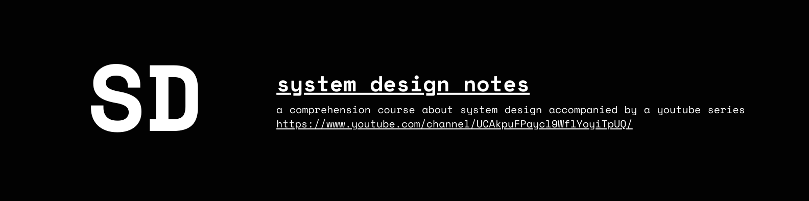
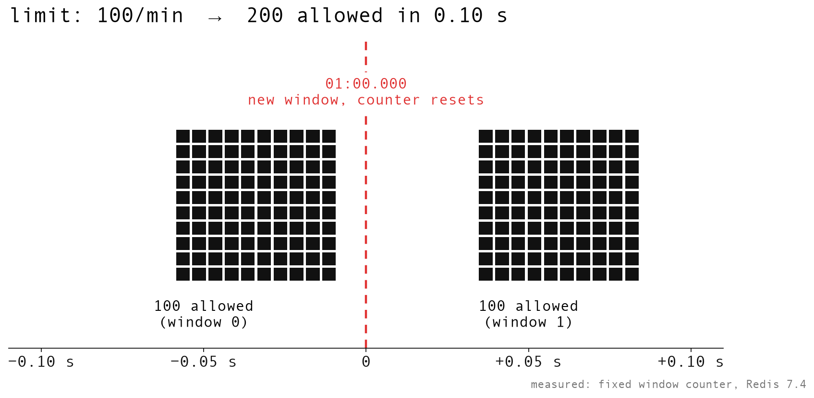

<div align="center">

# System Design, Measured

**A free system design course with a YouTube video, deep-dive notes, and slides for every topic, plus runnable labs that test the claims on real infrastructure.**

[](http://youtube.com/@ThatNotesGuy)
[](#-the-course)
[](https://github.com/harshpreet931/SystemDesignNotes/stargazers)
[](https://opensource.org/licenses/MIT)



</div>

> **"What separates your weekend project from Netflix or Uber? It's not just more servers or code, it's the blueprint. It's system design. : )"**

## Why this one is different

Most system design material repeats the same diagrams and the same numbers nobody has checked. Here, wherever a claim can be tested, it is.

<p align="center">
  <a href="./episodes/29-rate-limiting/"></a>
</p>

<p align="center"><i>A fixed-window limiter set to 100 requests/min, attacked on real Redis 7.4: <b>200 requests got through in 0.102 seconds</b>.<br>See how sliding windows, token bucket and leaky bucket did under the same attack in <a href="./episodes/29-rate-limiting/">Episode 29</a>.</i></p>

- 🎥 **A video for every topic**: short, visual explanations on [YouTube](http://youtube.com/@ThatNotesGuy)
- 📖 **Notes you can study from**: diagrams, comparison tables, trade-offs and real-world case studies in every episode
- 🧪 **Labs you can run**: [rate limiters on Redis](./episodes/29-rate-limiting/practical/), [REST vs gRPC servers](./episodes/19-rest-grpc/practical/), [a mini RAG pipeline](./episodes/10-vector-databases/rag_tuitorial.md)
- 🖼️ **Every slide included**, free to use for your own revision

## 🚀 Start here

| If you... | Follow this path |
|---|---|
| **are new to system design** | [01](./episodes/01-fundamentals/) → [03](./episodes/03-functional-nonfunctional-requirements/) → [04](./episodes/04-horizontal-vertical-scaling/) → [06](./episodes/06-load-balancing/) → [07](./episodes/07-caching/) → [09](./episodes/09-databases/) → [14](./episodes/14-sharding-partitioning/) |
| **have an interview coming up** | [04](./episodes/04-horizontal-vertical-scaling/) → [07](./episodes/07-caching/) → [14](./episodes/14-sharding-partitioning/) → [16](./episodes/16-cap-theorem/) → [23](./episodes/23-redundancy-high-availability/) → [26](./episodes/26-message-queues/) → [29](./episodes/29-rate-limiting/) |
| **learn best by building** | [Rate limiters](./episodes/29-rate-limiting/practical/) → [REST vs gRPC](./episodes/19-rest-grpc/practical/) → [Mini RAG](./episodes/10-vector-databases/rag_tuitorial.md) |

## 📚 The Course

### 🧱 Foundations

| # | Topic | Notes | Slides | Lab |
|:-:|---|:-:|:-:|---|
| 01 | **System Design Fundamentals** | [📖](./episodes/01-fundamentals/) | [🖼️](./episodes/01-fundamentals/presentation/) |  |
| 02 | **Monolith vs Microservices** | [📖](./episodes/02-monolith-microservices/) | [🖼️](./episodes/02-monolith-microservices/presentation/) |  |
| 03 | **Functional vs Non-Functional Requirements** | [📖](./episodes/03-functional-nonfunctional-requirements/) | [🖼️](./episodes/03-functional-nonfunctional-requirements/presentation/) |  |
| 04 | **Horizontal vs Vertical Scaling** | [📖](./episodes/04-horizontal-vertical-scaling/) | [🖼️](./episodes/04-horizontal-vertical-scaling/presentation/) |  |
| 05 | **Stateless vs Stateful Systems** | [📖](./episodes/05-stateless-stateful-systems/) | [🖼️](./episodes/05-stateless-stateful-systems/presentation/) |  |

### ⚖️ Scaling & Traffic

| # | Topic | Notes | Slides | Lab |
|:-:|---|:-:|:-:|---|
| 06 | **Load Balancing** | [📖](./episodes/06-load-balancing/) | [🖼️](./episodes/06-load-balancing/presentation/) |  |
| 07 | **Caching** | [📖](./episodes/07-caching/) | [🖼️](./episodes/07-caching/presentation/) |  |
| 08 | **CDNs Explained** | [📖](./episodes/08-cdns/) | [🖼️](./episodes/08-cdns/presentation/) |  |

### 🗄️ Data & Storage

| # | Topic | Notes | Slides | Lab |
|:-:|---|:-:|:-:|---|
| 09 | **Databases Guide** | [📖](./episodes/09-databases/) | [🖼️](./episodes/09-databases/presentation/) |  |
| 10 | **Vector Databases** | [📖](./episodes/10-vector-databases/) | [🖼️](./episodes/10-vector-databases/presentation/) | [Mini RAG in Python](./episodes/10-vector-databases/rag_tuitorial.md) |
| 11 | **Keys in DBMS** | [📖](./episodes/11-keys-in-dbms/) | [🖼️](./episodes/11-keys-in-dbms/presentation/) |  |
| 12 | **Normalization vs Denormalization** | [📖](./episodes/12-normalization-denormalization/) | [🖼️](./episodes/12-normalization-denormalization/presentation/) |  |
| 13 | **Database Indexing Mastery** | [📖](./episodes/13-indexing/) | [🖼️](./episodes/13-indexing/presentation/) |  |
| 14 | **Sharding & Partitioning** | [📖](./episodes/14-sharding-partitioning/) | [🖼️](./episodes/14-sharding-partitioning/presentation/) |  |
| 15 | **Database Replication & Leader Election** | [📖](./episodes/15-replication-leader-election/) | [🖼️](./episodes/15-replication-leader-election/presentation/) |  |
| 16 | **CAP Theorem is Not Enough** | [📖](./episodes/16-cap-theorem/) | [🖼️](./episodes/16-cap-theorem/presentation/) |  |

### 🌐 Networking & Protocols

| # | Topic | Notes | Slides | Lab |
|:-:|---|:-:|:-:|---|
| 17 | **OSI Model Deep Dive** | [📖](./episodes/17-osi-model/) | [🖼️](./episodes/17-osi-model/presentation/) |  |
| 18 | **TCP vs UDP - The Complete Engineering Deep Dive** | [📖](./episodes/18-tcp-udp/) | [🖼️](./episodes/18-tcp-udp/presentation/) |  |
| 19 | **REST vs gRPC - The Complete Architecture Masterclass** | [📖](./episodes/19-rest-grpc/) | [🖼️](./episodes/19-rest-grpc/presentation/) | [REST & gRPC servers in Node](./episodes/19-rest-grpc/practical/) |
| 20 | **HTTP, HTTPS & WebSockets** | [📖](./episodes/20-http-https-websockets/) | [🖼️](./episodes/20-http-https-websockets/presentation/) |  |
| 21 | **DNS (Domain Name System)** | [📖](./episodes/21-dns/) | [🖼️](./episodes/21-dns/presentation/) |  |
| 22 | **Network Latency, Bandwidth & Throughput** | [📖](./episodes/22-latency-bandwidth-throughput/) | [🖼️](./episodes/22-latency-bandwidth-throughput/presentation/) |  |

### 🛡️ Reliability & Availability

| # | Topic | Notes | Slides | Lab |
|:-:|---|:-:|:-:|---|
| 23 | **Redundancy & High Availability** | [📖](./episodes/23-redundancy-high-availability/) | [🖼️](./episodes/23-redundancy-high-availability/presentation/) |  |
| 24 | **Replication Strategies - Zero Data Loss vs Insane Speed** | [📖](./episodes/24-replication-strategies/) | [🖼️](./episodes/24-replication-strategies/presentation/) |  |
| 25 | **Failover Mechanisms in System Design** | [📖](./episodes/25-failover-mechanisms/) | [🖼️](./episodes/25-failover-mechanisms/presentation/) |  |

### 📨 Communication & APIs

| # | Topic | Notes | Slides | Lab |
|:-:|---|:-:|:-:|---|
| 26 | **Message Queues - Queues vs Streams** | [📖](./episodes/26-message-queues/) | [🖼️](./episodes/26-message-queues/presentation/) |  |
| 27 | **Designing REST APIs** | [📖](./episodes/27-rest-api-design/) | [🖼️](./episodes/27-rest-api-design/presentation/) |  |
| 28 | **Webhooks & Push Notifications** | [📖](./episodes/28-webhooks-push-notifications/) | [🖼️](./episodes/28-webhooks-push-notifications/presentation/) |  |
| 29 | **Rate Limiting - Token Bucket vs Leaky Bucket vs Sliding Window** | [📖](./episodes/29-rate-limiting/) | [🖼️](./episodes/29-rate-limiting/presentation/) | [5 rate limiters on real Redis](./episodes/29-rate-limiting/practical/) |

New episodes land regularly. **⭐ Star the repo** to follow along.

## 🔍 Episode Summaries

Expand any episode to see what it covers before you dive in.

<details>
<summary><b>Episode 1: System Design Fundamentals</b></summary>

**[Watch the Video](http://youtube.com/@ThatNotesGuy) | [Read the Notes](./episodes/01-fundamentals/) | [View Presentation](./episodes/01-fundamentals/presentation/)**

#### What You'll Learn:
- What is System Design and why it matters
- High-Level Design (HLD) vs Low-Level Design (LLD)
- Real example: Designing a URL Shortener
- Hands-on: Build your first system architecture

#### Key Concepts Covered:
```
System Design = Software Architecture Blueprint
├── High-Level Design (HLD) - The Big Picture
│   ├── Major Components & Services
│   ├── Technology Stack Decisions
│   ├── Data Flow Architecture
│   └── Third-party Integrations
└── Low-Level Design (LLD) - The Details
    ├── Classes, Methods & Data Structures
    ├── Database Schemas & Relationships
    ├── Algorithms & Implementation Logic
    └── Error Handling & Edge Cases
```

</details>
<details>
<summary><b>Episode 2: Monoliths vs Microservices</b></summary>

**[Watch the Video](http://youtube.com/@ThatNotesGuy) | [Read the Notes](./episodes/02-monolith-microservices/)**

#### What You'll Learn:
- What monolithic architecture is and when to use it
- What microservices architecture is and its benefits
- Real-world examples: Netflix's evolution and Uber's architecture
- Practical decision framework for choosing between approaches

#### Key Concepts Covered:
```
Architecture Patterns Comparison
├── Monolithic Architecture
│   ├── Single Codebase & Deployable Unit
│   ├── Shared Resources & Database
│   ├── Advantages: Simple, Fast, Easy to Debug
│   └── Challenges: Scalability, Technology Lock-in
└── Microservices Architecture
    ├── Independent Services & Databases
    ├── Distributed System Architecture
    ├── Advantages: Scalability, Flexibility, Fault Isolation
    └── Challenges: Complexity, Operational Overhead
```

</details>
<details>
<summary><b>Episode 3: Functional vs Non-Functional Requirements</b></summary>

**[Watch the Video](http://youtube.com/@ThatNotesGuy) | [Read the Notes](./episodes/03-functional-nonfunctional-requirements/)**

#### What You'll Learn:
- What requirements are and why they're critical to system design
- The difference between functional and non-functional requirements
- How to identify and document both requirement types
- Real-world example: Online bookstore requirements breakdown
- The requirements elicitation process

#### Key Concepts Covered:
```
Requirements = Foundation of System Design
├── Functional Requirements (WHAT the system does)
│   ├── User Actions & Features
│   ├── System Operations & Business Logic
│   ├── Data Processing & Integrations
│   └── Example: User can create account, add to cart, checkout
└── Non-Functional Requirements (HOW WELL it performs)
    ├── Performance: Response time, load time
    ├── Scalability: Concurrent users, data growth
    ├── Availability: Uptime (99.9%, 99.99%)
    ├── Security: Encryption, authentication, compliance
    ├── Usability: User experience, accessibility
    ├── Maintainability: Code quality, integration time
    └── Portability: Cross-platform, deployment flexibility
```

</details>
<details>
<summary><b>Episode 4: Horizontal vs Vertical Scaling</b></summary>

**[Watch the Video](http://youtube.com/@ThatNotesGuy) | [Read the Notes](./episodes/04-horizontal-vertical-scaling/)**

#### What You'll Learn:
- What scalability means across three dimensions (load, data, compute)
- Vertical scaling: Making one machine more powerful
- Horizontal scaling: Distributed systems engineering
- Real-world examples: Netflix's evolution and AWS instances
- Decision matrix and practical frameworks for choosing the right approach
- Monitoring, metrics, and autoscaling strategies

#### Key Concepts Covered:
```
Scaling Strategies Comparison
├── Vertical Scaling (Scale Up)
│   ├── Upgrade CPU, RAM, Storage on single machine
│   ├── AWS Example: r6i.large → r6i.24xlarge (48x power)
│   ├── Advantages: Simple, no code changes, ACID consistency
│   └── Challenges: Physical limits, single point of failure, cost
├── Horizontal Scaling (Scale Out)
│   ├── Add more servers, distribute load
│   ├── Requires: Stateless architecture, load balancers
│   ├── Advantages: Unlimited scale, fault tolerance, flexibility
│   └── Challenges: CAP theorem, network latency, complexity
└── Hybrid Approach (Best of Both)
    ├── Vertical for databases, horizontal for app servers
    ├── Netflix: 1000+ microservices, 300M+ users
    └── Autoscaling: Reactive, predictive, serverless
```

</details>
<details>
<summary><b>Episode 5: Stateless vs Stateful Systems</b></summary>

**[Watch the Video](http://youtube.com/@ThatNotesGuy) | [Read the Notes](./episodes/05-stateless-stateful-systems/)**

#### What You'll Learn:
- What "state" means in software systems (memory and session data)
- Stateless systems: Vending machine analogy and REST APIs
- Stateful systems: Bank teller analogy and session management
- Hybrid architecture: Stateless app tier + external state stores
- Real-world examples: Netflix, Amazon, and WhatsApp architectures
- Decision framework for choosing the right approach

#### Key Concepts Covered:
```
State Management Strategies
├── Stateless Systems (Amnesia Design)
│   ├── No server memory between requests
│   ├── Every request includes full context (tokens, auth)
│   ├── Advantages: Perfect clones, easy scaling, fault tolerance
│   └── Challenges: Chattier requests, external state needed
├── Stateful Systems (Memory Design)
│   ├── Server remembers session context
│   ├── Requires: Sticky sessions, session storage
│   ├── Advantages: Efficient, fast (in-memory), simple client
│   └── Challenges: Sticky sessions, fragile, scaling hard
└── Hybrid Architecture (Modern Approach)
    ├── Stateless application servers
    ├── Centralized state in Redis/DynamoDB/Cassandra
    ├── Netflix: Stateless microservices + Cassandra
    ├── Amazon: Stateless servers + DynamoDB carts
    └── WhatsApp: Stateful connections for real-time (2B users)
```

</details>
<details>
<summary><b>Episode 6: Load Balancing</b></summary>

**[Watch the Video](http://youtube.com/@ThatNotesGuy) | [Read the Notes](./episodes/06-load-balancing/)**

#### What You'll Learn:
- What load balancing is and its critical role in distributed systems
- Primary objectives: Scalability and High Availability
- 9 load balancing algorithms and when to use each
- Health monitoring: L4 (TCP) vs L7 (HTTP) checks
- Session persistence strategies (IP Hash vs Cookie-Based)
- Real-world example: Netflix's multi-layer architecture
- Load balancer types: Hardware, Software, and Cloud
- L4 vs L7 load balancing and their trade-offs

#### Key Concepts Covered:
```
Load Balancing Strategies
├── Primary Objectives
│   ├── Scalability: Horizontal scaling with commodity servers
│   └── High Availability: 99.99% uptime, health checks, failover
├── Load Balancing Algorithms (9 total)
│   ├── Round Robin: Simple, zero overhead, default
│   ├── Weighted Round Robin: Heterogeneous hardware capacity
│   ├── Least Connections: Dynamic, state-aware
│   ├── Weighted Least Connections: Best of both worlds
│   ├── Least Response Time: Latency + connections
│   ├── Resource-Based: CPU/memory monitoring with agents
│   ├── Geographic (GSLB): DNS-based, multi-region
│   ├── IP Hash: Sticky sessions (L4)
│   └── Cookie-Based: Sticky sessions (L7)
├── Session Persistence
│   ├── IP Hash: Simple but NAT/proxy issues
│   └── Cookie-Based: Robust L7 solution
├── Real-World Architecture
│   ├── Netflix: GSLB → AWS ELB → Zuul → Microservices
│   ├── 300M subscribers, 1000+ microservices
│   └── Path-based routing (/play, /browse)
├── Load Balancer Types
│   ├── Hardware: F5 BIG-IP, specialized silicon
│   ├── Software: HAProxy, NGINX (flexible, cheap)
│   └── Cloud: AWS ALB/NLB (managed, auto-scaling)
└── L4 vs L7 Load Balancing
    ├── L4: IP/port level, fast (<1ms), simple
    └── L7: Content-based routing, SSL termination, microservices
```

</details>
<details>
<summary><b>Episode 7: Caching</b></summary>

**[Watch the Video](http://youtube.com/@ThatNotesGuy) | [Read the Notes](./episodes/07-caching/) | [View Presentation](./episodes/07-caching/presentation/)**

#### What You'll Learn:
- What caching is and why it's fundamental to high-performance systems
- The benefits: reduced latency, increased throughput, lower costs
- Client-side vs. server-side caching strategies
- CDN caching for global content delivery
- Application-level caching with Redis and Memcached
- Database caching mechanisms
- Cache eviction policies: LRU, LFU, FIFO
- Cache invalidation strategies: TTL, Write-Through, Write-Behind
- The Thundering Herd problem and mitigation strategies
- Real-world case studies: Facebook, Netflix, and Amazon

#### Key Concepts Covered:
```
Caching = Smart Memory for Faster Systems
├── Core Benefits
│   ├── 10-100x faster response times
│   ├── 50-90% reduction in database queries
│   └── Lower infrastructure costs
├── Caching Locations
│   ├── Client-Side: Browser cache, DNS cache, mobile storage
│   ├── CDN Caching: Edge locations globally
│   ├── Application Cache: Redis, Memcached, local memory
│   └── Database Cache: Buffer pool, query result cache
├── Eviction Policies (decide what to remove)
│   ├── LRU: Least Recently Used (most common)
│   ├── LFU: Least Frequently Used
│   └── FIFO: First In, First Out
├── Invalidation Strategies (keep data fresh)
│   ├── Write-Through: Write both cache and DB
│   ├── Write-Behind: Async writes to DB
│   ├── TTL: Time-based automatic expiration
│   └── Active: Explicit invalidation on updates
├── Design Patterns
│   ├── Cache-Aside: Application manages cache
│   ├── Read-Through: Cache loads itself on miss
│   └── Refresh-Ahead: Proactive refresh
└── Real-World Case Studies
    ├── Facebook: Multi-level caching with Memcached + Tao
    ├── Netflix: Cache everything, cache everywhere (EVCache)
    └── Amazon: DAX for microsecond DynamoDB reads
```

</details>
<details>
<summary><b>Episode 8: CDNs Explained</b></summary>

**[Watch the Video](http://youtube.com/@ThatNotesGuy) | [Read the Notes](./episodes/08-cdns/) | [View Presentation](./episodes/08-cdns/presentation/)**

#### What You'll Learn:
- What a Content Delivery Network (CDN) is and its core purpose
- How CDNs solve the latency problem caused by geographic distance
- The CDN workflow: Cache hits, cache misses, and origin fetching
- The key benefits: Performance, availability, security, and cost savings
- What content is ideal for CDN caching (static vs dynamic)
- Cache control mechanisms: Headers, purging, and versioning
- How to choose a CDN provider based on features and pricing
- Real-world case studies: Netflix Open Connect, Facebook's infrastructure
- Edge computing concepts and modern CDN capabilities

#### Key Concepts Covered:
```
CDN = Global Network for Fast Content Delivery
├── Core Concept
│   ├── Edge Servers / PoPs (Points of Presence)
│   ├── Geographic Distribution (global network)
│   └── Content Caching at the Edge
├── The Distance Problem
│   ├── Latency increases with distance
│   ├── Tokyo user from NYC: ~180ms without CDN
│   └── Tokyo user with CDN: ~5ms (36x faster!)
├── How CDNs Work
│   ├── DNS-based routing to nearest edge
│   ├── Cache HIT: Serve from edge (1-5ms)
│   ├── Cache MISS: Fetch from origin, cache, serve
│   └── TTL-based expiration with revalidation
├── Key Benefits
│   ├── Performance: 50-90% latency reduction
│   ├── Availability: Redundancy, fail-over
│   ├── Security: DDoS protection, WAF
│   └── Cost: 80% bandwidth savings
├── What to Cache
│   ├── Static Assets (Images, CSS, JS, Fonts)
│   ├── Videos (MP4, HLS, DASH streaming)
│   └── Dynamic Content (with care!)
├── Cache Control
│   ├── Cache-Control headers (max-age, public/private)
│   ├── ETags for conditional requests (304 Not Modified)
│   ├── Manual Purging (API or dashboard)
│   └── Filename Versioning (best practice)
└── Popular Providers
    ├── Cloudflare: Free tier, security included
    ├── AWS CloudFront: Deep AWS integration
    ├── Akamai: Enterprise scale (365K+ servers)
    ├── Fastly: Real-time purging, developer focus
    └── Google Cloud CDN: GCP ecosystem
```

</details>
<details>
<summary><b>Episode 9: The Ultimate Guide to Databases</b></summary>

**[Watch the Video](http://youtube.com/@ThatNotesGuy) | [Read the Notes](./episodes/09-databases/) | [View Presentation](./episodes/09-databases/presentation/)**

#### What You'll Learn:
- What a database and DBMS are
- Database design fundamentals: entities, attributes, relationships
- SQL (Relational) databases and ACID compliance
- Four core types of NoSQL databases
- Two emerging types: Time-Series and Vector databases
- How to choose the right database for your use case
- NewSQL: Bridging SQL and NoSQL
- Polyglot persistence in modern applications

#### Key Concepts Covered:
```
Database Types Overview
├── SQL (Relational Databases)
│   ├── Data Model: Tables with strict schema
│   ├── Key Feature: ACID Compliance (Atomicity, Consistency, Isolation, Durability)
│   ├── Examples: PostgreSQL, MySQL, SQL Server
│   └── Best For: Transactions, financial data, structured data
├── NoSQL (Non-Relational) - Core Types
│   ├── Key-Value Stores: Simplest model (Redis, DynamoDB)
│   │   └── Best For: Caching, sessions, simple lookups
│   ├── Document Databases: Flexible JSON documents (MongoDB)
│   │   └── Best For: User profiles, product catalogs
│   ├── Column-Family Stores: Columnar storage (Cassandra)
│   │   └── Best For: Big data analytics, time-series, logging
│   └── Graph Databases: Nodes and relationships (Neo4j)
│       └── Best For: Social networks, recommendations, fraud detection
├── NoSQL - Emerging Types
│   ├── Time-Series Databases: Optimized for timestamps (InfluxDB)
│   │   └── Best For: IoT sensors, DevOps metrics, stock data
│   └── Vector Databases: Store embeddings for AI (Pinecone, Weaviate)
│       └── Best For: AI recommendations, semantic search, chatbots
├── NewSQL: Bridging SQL and NoSQL
│   ├── Concept: ACID guarantees + horizontal scaling
│   ├── Examples: CockroachDB, YugabyteDB, TiDB
│   └── Best For: Cloud-native apps needing SQL at scale
└── Polyglot Persistence
    ├── Use multiple databases for different needs
    ├── Example: PostgreSQL (orders) + MongoDB (catalog) + Redis (cache)
    └── Modern approach: Choose right tool for each job
```

</details>
<details>
<summary><b>Episode 10: Vector Databases</b></summary>

**[Watch the Video](http://youtube.com/@ThatNotesGuy) | [Read the Notes](./episodes/10-vector-databases/) | [View Presentation](./episodes/10-vector-databases/presentation/)**

#### What You'll Learn:
- What vector embeddings are and why they matter
- How vector databases differ from traditional databases
- Approximate Nearest Neighbor (ANN) search algorithms
- Core use cases: semantic search, recommendations, RAG
- Popular vector databases: Pinecone, Weaviate, Milvus, Qdrant
- Embedding generation and model selection
- Hybrid search: combining vectors with metadata
- Performance considerations: HNSW, quantization, filtering

#### Key Concepts Covered:
```
Vector Databases Fundamentals
├── Vector Embeddings
│   ├── Numerical representations of meaning
│   ├── 768-4096 dimensions (model-dependent)
│   └── Similar meanings → similar vectors
├── ANN Search Algorithms
│   ├── HNSW: Fastest for online queries
│   ├── IVF: Fast build, moderate memory
│   └── PQ: Compressed storage (80% smaller)
├── Use Cases
│   ├── Semantic Search: Meaning-based, not keyword
│   ├── RAG: Context for LLMs (most common!)
│   └── Recommendations: Similar items/users
├── Popular Vector DBs
│   ├── Pinecone: Managed, easy scaling
│   ├── Weaviate: Open source, multimodal
│   ├── Milvus: High scale, flexible
│   ├── Qdrant: Rust-based, fast, simple
│   └── Chroma: Lightweight, Python-native
└── Performance Optimization
    ├── Index tuning (HNSW m, efConstruction)
    ├── Quantization (Binary, Scalar, Product)
    └── Hybrid search (Vector + Metadata filtering)
```

</details>
<details>
<summary><b>Episode 11: Keys in DBMS</b></summary>

**[Watch the Video](http://youtube.com/@ThatNotesGuy) | [Read the Notes](./episodes/11-keys-in-dbms/) | [View Presentation](./episodes/11-keys-in-dbms/presentation/)**

#### What You'll Learn:
- The purpose of database keys in ensuring data integrity
- The difference between Super Keys, Candidate Keys, and Primary Keys
- How Primary Keys differ from Unique Keys (null handling)
- The role of Alternate Keys and Composite Keys
- Foreign Keys and referential integrity
- Surrogate vs Natural Keys and when to use each
- Performance implications: indexing Foreign Keys
- Modern distributed keys: ULIDs and Snowflake IDs
- Temporal keys for auditing and compliance

#### Key Concepts Covered:
```
Database Keys Fundamentals
├── Key Hierarchy
│   ├── Super Key: Any unique set (may be redundant)
│   ├── Candidate Key: Minimal unique set (potential PKs)
│   ├── Primary Key: The chosen one (unique + NOT NULL)
│   ├── Alternate Key: Backup candidate keys
│   └── Foreign Key: Links tables, enforces referential integrity
├── Key Comparison
│   ├── Primary Key: 1 per table, NO nulls, auto-indexed
│   ├── Unique Key: Multiple allowed, 1 null typically OK
│   ├── Foreign Key: Can repeat, nullable, MUST index
│   └── Composite Key: 2+ columns form unique identifier
├── Key Types
│   ├── Natural Key: From business data (SSN, Email)
│   ├── Surrogate Key: System-generated (Auto-increment, UUID)
│   └── Temporal Key: Tracks when data was valid (auditing)
├── Modern Distributed Keys
│   ├── Snowflake ID: 64-bit, time-sortable, distributed
│   ├── ULID: Lexicographically sortable, 128-bit
│   └── Problem: UUIDv4 causes index fragmentation
└── Best Practices
    ├── Index all Foreign Keys (prevents slow JOINs)
    ├── Use Surrogate Keys for volatile data
    ├── Keep Natural Keys as Unique/Alternate Keys
    └── Every table needs a Primary Key
```

</details>
<details>
<summary><b>Episode 12: Normalization vs Denormalization</b></summary>

**[Watch the Video](http://youtube.com/@ThatNotesGuy) | [Read the Notes](./episodes/12-normalization-denormalization/) | [View Presentation](./episodes/12-normalization-denormalization/presentation/)**

#### What You'll Learn:
- What normalization is and why it ensures data integrity
- The three data anomalies: Insertion, Update, and Deletion
- Normal Forms progression: 1NF through 5NF
- Functional, partial, and transitive dependencies
- Boyce-Codd Normal Form (BCNF) and when to use it
- What denormalization is and why it improves read performance
- Denormalization techniques: redundant columns, table splitting, materialized views
- When to choose normalization (OLTP) vs denormalization (OLAP)
- The hybrid approach in modern system architecture

#### Key Concepts Covered:
```
Database Design: Structure vs Performance
├── Data Anomalies (Why Normalize?)
│   ├── Insertion Anomaly: Cannot add data without other data
│   ├── Update Anomaly: Inconsistency from multiple copies
│   └── Deletion Anomaly: Losing data when deleting unrelated record
├── Normal Forms (Normalization)
│   ├── 1NF: Atomic values, no repeating groups
│   ├── 2NF: No partial dependency (full key required)
│   ├── 3NF: No transitive dependency
│   ├── BCNF: Every determinant is a superkey
│   ├── 4NF: No multi-valued dependency
│   └── 5NF: No join dependency (rare)
├── Denormalization Techniques
│   ├── Redundant Columns: Duplicate data to avoid JOINs
│   ├── Derived Columns: Pre-computed values
│   ├── Table Splitting: Horizontal/Vertical partitioning
│   └── Materialized Views: Pre-computed query results
└── Design Decisions
    ├── Normalize for: OLTP, data integrity, write-heavy
    ├── Denormalize for: OLAP, read-heavy, analytics
    └── Hybrid: Normalized source + denormalized views
```

</details>
<details>
<summary><b>Episode 13: Database Indexing Mastery</b></summary>

**[Watch the Video](http://youtube.com/@ThatNotesGuy) | [Read the Notes](./episodes/13-indexing/) | [View Presentation](./episodes/13-indexing/presentation/)**

#### What You'll Learn:
- What database indexes are and why they are critical for performance
- B-Tree and B+Tree data structures that power most database indexes
- The difference between clustered and non-clustered indexes
- How composite indexes work and the leftmost prefix rule
- What covering indexes are and when to use them
- Different index types: Hash, Bitmap, Full-Text, and PostgreSQL-specific indexes
- How to read and interpret execution plans with EXPLAIN
- Index maintenance: fragmentation, VACUUM, and fill factors
- Best practices for index design and avoiding common anti-patterns

#### Key Concepts Covered:
```
Database Indexing Fundamentals
├── Index Basics
│   ├── B-Tree/B+Tree: Self-balancing tree data structure
│   ├── Trade-offs: Speed up reads, slow down writes
│   └── Cost: 20-30% storage overhead per index
├── Index Types
│   ├── Clustered: Data physically sorted, one per table
│   ├── Non-Clustered: Separate structure with row pointers
│   ├── Composite: Multiple columns, leftmost prefix rule
│   └── Covering: Query satisfied entirely from index
├── Advanced Index Types
│   ├── Hash: O(1) equality lookups, no range support
│   ├── Bitmap: Low-cardinality, data warehousing
│   ├── Full-Text: Inverted index for text search
│   └── PostgreSQL: GiST, GIN, BRIN specialized indexes
├── Index Design
│   ├── Selectivity: Higher is better (> 20% ideal)
│   ├── Column Order: Equality first, range last
│   ├── Functional Indexes: Index on expressions
│   └── Partial Indexes: Filtered conditions
├── Execution Plans
│   ├── EXPLAIN: Read query execution strategy
│   ├── Seq Scan: Full table scan (warning sign!)
│   ├── Index Scan: Index used + table lookup
│   └── Index Only Scan: Fastest (covering index)
└── Maintenance
    ├── Fragmentation: Internal and external
    ├── VACUUM: Reclaim space, update statistics
    ├── FILLFACTOR: Balance storage vs updates
    └── Monitoring: pg_stat_user_indexes usage stats
```

</details>
<details>
<summary><b>Episode 14: Sharding & Partitioning</b></summary>

**[Watch the Video](http://youtube.com/@ThatNotesGuy) | [Read the Notes](./episodes/14-sharding-partitioning/) | [View Presentation](./episodes/14-sharding-partitioning/presentation/)**

#### What You'll Learn:
- The critical distinction between partitioning and sharding
- Types of partitions: Range, List, Hash, and Composite
- How to select optimal shard keys (cardinality, uniformity, query alignment)
- Directory-based sharding and lookup strategies
- Cross-shard operations: transactions, joins, and aggregations
- Resharding strategies and zero-downtime migrations
- Real-world sharding patterns from Vitess, CockroachDB, and MongoDB

#### Key Concepts Covered:
```
Scaling Databases: Distribution Strategies
├── Sharding vs Partitioning
│   ├── Partitioning: Splitting within ONE server/cluster
│   ├── Sharding: Splitting ACROSS multiple servers/nodes
│   └── Shared-Nothing Architecture
├── Partition Types
│   ├── Range: Consecutive ranges (dates, numeric)
│   ├── List: Specific values (regions, categories)
│   ├── Hash: Uniform distribution via hash function
│   └── Composite: Range-Hash, Range-List combinations
├── Shard Key Selection
│   ├── Cardinality: High cardinality required
│   ├── Uniformity: Even data and access distribution
│   └── Query Alignment: Target single shard when possible
├── Cross-Shard Operations
│   ├── Transactions: Two-Phase Commit (2PC)
│   ├── Joins: Data colocation vs scatter-gather
│   └── Aggregations: MapReduce-style distributed queries
├── Resharding
│   ├── Triggers: Growth, hotspots, capacity planning
│   ├── Strategies: Split vs Migrate approaches
│   └── Zero-Downtime: Dual-write, blue-green deployment
└── Platforms
    ├── Vitess: MySQL sharding middleware (YouTube)
    ├── CockroachDB: Automatic distributed SQL
    └── MongoDB: Document database sharding
```

</details>
<details>
<summary><b>Episode 15: Database Replication & Leader Election</b></summary>

**[Watch the Video](http://youtube.com/@ThatNotesGuy) | [Read the Notes](./episodes/15-replication-leader-election/) | [View Presentation](./episodes/15-replication-leader-election/presentation/)**

#### What You'll Learn:
- Database replication: Master-Slave patterns, binary logs, and GTIDs
- Synchronous vs asynchronous replication trade-offs
- Practical MySQL/MariaDB replication setup
- Leader election: Bully, Ring, Raft, and Paxos algorithms
- Distributed locking with leases and heartbeats
- Split brain prevention and fencing tokens
- Sharding to scale beyond single-master limitations

#### Key Concepts Covered:
```
Distributed Coordination: Replication and Consensus
├── Replication Fundamentals
│   ├── Master-Slave: Single writer, multiple readers
│   ├── Binary Logs (MySQL) vs WAL (PostgreSQL)
│   ├── GTIDs for position tracking
│   └── Cascading replication
├── Consistency Trade-offs
│   ├── Synchronous: Strong consistency, high latency
│   ├── Asynchronous: High performance, eventual consistency
│   └── Semi-Synchronous: Hybrid approach
├── Leader Election
│   ├── Bully Algorithm: Highest ID wins
│   ├── Ring Algorithm: Ring topology messaging
│   └── Raft: Leader, Follower, Candidate states
├── Consensus Protocols
│   ├── Raft: Terms, heartbeats, log replication
│   ├── Paxos: Prepare and Accept phases
│   └── Real-world: etcd, Consul, Spanner
├── Distributed Coordination
│   ├── ZooKeeper: ZAB protocol, ephemeral znodes
│   ├── etcd: Strong consistency, Kubernetes backbone
│   ├── Consul: Service discovery, KV store
│   └── Cloud primitives: Azure Blob leases, DynamoDB Lock
├── Failure Scenarios
│   ├── Split brain: Dual leader prevention
│   ├── Fencing tokens for safe leader handoff
│   └── Idempotency for duplicate handling
└── Scaling Patterns
    ├── Sharding: Partitioning across masters
    └── Multi-shard operations and rebalancing
```

</details>
<details>
<summary><b>Episode 16: CAP Theorem is Not Enough - The Truth About Distributed Systems</b></summary>

**[Watch the Video](http://youtube.com/@ThatNotesGuy) | [Read the Notes](./episodes/16-cap-theorem/) | [View Presentation](./episodes/16-cap-theorem/presentation/)**

#### What You'll Learn:
- The real meaning of CAP theorem and why "Pick Two" is misleading
- Why CA systems do not actually exist in distributed computing
- The critical difference between CAP Consistency and ACID Consistency
- How to use the PACELC framework for real-world system design
- How to classify databases as PA/EL vs PC/EC
- Practical decision framework for choosing the right consistency model

#### Key Concepts Covered:
```
Distributed Consistency Trade-offs
├── CAP Theorem Fundamentals
│   ├── Consistency: Linearizability (everyone sees same data)
│   ├── Availability: Every request gets response
│   ├── Partition Tolerance: Non-negotiable in distributed systems
│   └── Reality: CA systems don't exist (P is mandatory)
├── The CAP Blind Spot
│   ├── Partitions are rare (1% of time)
│   ├── CAP says nothing about normal operations
│   └── Missing metric: Latency
├── PACELC Framework
│   ├── PAC: If Partition, choose Availability or Consistency
│   ├── ELC: Else (no partition), choose Latency or Consistency
│   └── Daniel Abadi (Yale), 2010
├── Database Classifications
│   ├── PA/EL: DynamoDB, Cassandra (Availability + Low Latency)
│   ├── PC/EC: BigTable, HBase, Spanner (Consistency + Consistency)
│   └── Tunable: Cosmos DB, MongoDB (adjustable per query)
└── Practical Decision Framework
    ├── Money involved? -> PC/EC (accuracy critical)
    ├── Speed is product? -> PA/EL (availability critical)
    └── Global distribution? -> Expect partitions
```

</details>
<details>
<summary><b>Episode 17: The OSI Model</b></summary>

**[Watch the Video](http://youtube.com/@ThatNotesGuy) | [Read the Notes](./episodes/17-osi-model/) | [View Presentation](./episodes/17-osi-model/presentation/)**

#### What You'll Learn:
- The 7 layers of the OSI model and their specific responsibilities
- How data flows through the network stack (encapsulation and decapsulation)
- The role of each layer in real-world protocols (Ethernet, IP, TCP, HTTP)
- How troubleshooting tools like ping, traceroute, and Wireshark map to layers
- Common misconceptions about the OSI model in modern networking
- How the TCP/IP model maps to the OSI model

#### Key Concepts Covered:
```
OSI Model Fundamentals
├── 7 Layers Overview
│   ├── Physical (Layer 1): Bits, cables, signals
│   ├── Data Link (Layer 2): Frames, MAC addresses, switches
│   ├── Network (Layer 3): Packets, IP addresses, routers
│   ├── Transport (Layer 4): Segments, TCP/UDP, end-to-end
│   ├── Session (Layer 5): Connections, auth, sync
│   ├── Presentation (Layer 6): Format, encryption, compression
│   └── Application (Layer 7): HTTP, DNS, user protocols
├── Encapsulation Process
│   ├── Data: Application message
│   ├── Segment: Transport header (TCP/UDP)
│   ├── Packet: Network header (IP)
│   ├── Frame: Data Link header + trailer (Ethernet)
│   └── Bits: Physical transmission
├── Protocol Mapping
│   ├── Layer 7: HTTP, DNS, SMTP, FTP
│   ├── Layer 6: SSL/TLS, JPEG, ASCII
│   ├── Layer 5: RPC, SQL sessions
│   ├── Layer 4: TCP, UDP
│   ├── Layer 3: IP, ICMP, ARP
│   ├── Layer 2: Ethernet, MAC, Switch
│   └── Layer 1: Cables, Hubs, Signals
└── Modern Relevance
    ├── OSI as troubleshooting framework
    ├── TCP/IP as practical implementation
    ├── Why layers still matter
    └── Network virtualization and SDN
```

</details>
<details>
<summary><b>Episode 18: TCP vs UDP</b></summary>

**[Watch the Video](http://youtube.com/@ThatNotesGuy) | [Read the Notes](./episodes/18-tcp-udp/) | [View Presentation](./episodes/18-tcp-udp/presentation/)**

#### What You'll Learn:
- How TCP and UDP operate at the Transport Layer (Layer 4)
- The fundamental differences between connection-oriented and connectionless protocols
- TCP's reliability mechanisms: handshakes, sequencing, acknowledgments, and retransmissions
- UDP's minimalist design and why it excels in real-time scenarios
- The Head-of-Line Blocking problem and its impact on performance
- How QUIC and HTTP/3 leverage UDP for modern web performance
- Practical decision frameworks for choosing the right protocol

#### Key Concepts Covered:
```
Transport Layer Protocols: TCP vs UDP
├── TCP Fundamentals
│   ├── Connection-oriented: 3-way handshake
│   ├── Reliable: ACKs, retransmissions
│   ├── Ordered: Guaranteed packet sequencing
│   ├── Flow control: Sliding window
│   └── Congestion control: Adapts to network
├── UDP Fundamentals
│   ├── Connectionless: No handshake
│   ├── Fast: Minimal 8-byte header
│   ├── Stateless: No connection tracking
│   └── Best-effort: No guarantees
├── Key Differences
│   ├── Overhead: TCP 20-60 bytes vs UDP 8 bytes
│   ├── Latency: TCP handshake cost vs UDP immediate
│   ├── Ordering: TCP blocks vs UDP independent
│   └── Use cases: TCP web/email vs UDP gaming/streaming
├── Head-of-Line Blocking
│   ├── TCP: Lost packet 1 blocks 2, 3, 4
│   ├── Impact: Jitter in real-time apps
│   └── Solution: QUIC per-stream reliability
├── Modern Evolution
│   ├── QUIC: Reliability on UDP (HTTP/3)
│   ├── Benefits: 0-RTT, no HoL blocking
│   ├── Migration: Survives WiFi to 5G
│   └── Adoption: 30%+ of web traffic
└── Decision Framework
    ├── TCP: Web, email, files (reliability first)
    ├── UDP: Gaming, VoIP, streaming (speed first)
    └── QUIC: Best of both worlds
```

</details>
<details>
<summary><b>Episode 19: REST vs gRPC</b></summary>

**[Watch the Video](http://youtube.com/@ThatNotesGuy) | [Read the Notes](./episodes/19-rest-grpc/) | [View Presentation](./episodes/19-rest-grpc/presentation/)**

#### What You'll Learn:
- What RPC (Remote Procedure Call) is and how it enables distributed communication
- The definition and constraints of REST as an architectural style
- The Richardson Maturity Model and HATEOAS principles
- What gRPC is and why Google open-sourced it in 2015
- Protocol Buffers (Protobuf) as a binary serialization format
- HTTP/2 vs HTTP/1.1 and the performance implications
- The four types of gRPC: Unary, Server Streaming, Client Streaming, Bidirectional
- When to choose REST vs gRPC based on your use case
- Load balancing complexities with both approaches
- Real-world code examples for both paradigms

#### Key Concepts Covered:
```
Communication Patterns: REST vs gRPC
├── RPC Foundation
│   ├── Remote Procedure Call: Execute code on remote machine
│   ├── Client Stub: Proxy that hides network complexity
│   ├── Marshalling: Serializing parameters
│   └── Network Transparency: Looks like local function call
├── REST Architecture
│   ├── Roy Fielding (2000), architectural style, NOT protocol
│   ├── Constraints: Stateless, Cacheable, Uniform Interface
│   ├── Everything is a Resource (identified by URI)
│   ├── HTTP Methods: GET, POST, PUT, PATCH, DELETE
│   └── Richardson Maturity Model: Levels 0-3 (HATEOAS)
├── gRPC Framework
│   ├── Google (2015), part of CNCF
│   ├── HTTP/2 for transport (multiplexing, binary)
│   ├── Protocol Buffers for serialization (binary, efficient)
│   ├── Contract-First: Define .proto before coding
│   └── Four RPC Types: Unary, Server, Client, Bidirectional
├── Performance Comparison
│   ├── Payload: Protobuf 50-70% smaller than JSON
│   ├── Speed: Protobuf 3-10x faster parsing
│   ├── Latency: HTTP/2 multiplexing reduces overhead
│   └── Winner: gRPC 7-10x faster for internal services
├── Protocol Buffers
│   ├── Binary serialization, not human-readable
│   ├── Field tags (1, 2, 3...) identify fields
│   ├── Single source of truth in .proto files
│   └── Schema evolution support
├── HTTP/2 Advantages
│   ├── Multiplexing: Multiple streams over single TCP
│   ├── Header Compression (HPACK)
│   ├── Binary framing (not text)
│   └── Bidirectional communication
├── gRPC RPC Types
│   ├── Unary: Simple request/response (like REST)
│   ├── Server Streaming: Request, stream responses
│   ├── Client Streaming: Stream requests, single response
│   └── Bidirectional: Both sides stream independently
├── Decision Framework
│   ├── REST: Browser clients, public APIs, simple CRUD
│   ├── gRPC: Internal services, polyglot, streaming, low latency
│   ├── Flowchart: Browser? -> REST | Latency critical? -> gRPC
└── Challenges
    ├── REST: Universally supported, easy debugging
    ├── gRPC: Browser support requires proxy (gRPC-Web)
    ├── Load Balancing: gRPC needs L7, HTTP/2 persistent connections
    └── Debugging: gRPC requires deserialization tools
```

</details>
<details>
<summary><b>Episode 20: HTTP, HTTPS & WebSockets</b></summary>

**[Watch the Video](http://youtube.com/@ThatNotesGuy) | [Read the Notes](./episodes/20-http-https-websockets/) | [View Presentation](./episodes/20-http-https-websockets/presentation/)**

#### What You'll Learn:
- How HTTP works as a stateless request-response protocol, and its evolution from 0.9 to 1.1 (Keep-Alive)
- How HTTPS wraps HTTP in a TLS tunnel with handshakes and certificates
- Why HTTP struggles with real-time apps, and the short/long polling hacks
- The WebSocket upgrade handshake, frames, opcodes, ping/pong heartbeats, and masking
- Scaling WebSockets with Redis Pub/Sub, load balancer tuning, and WSS

#### Key Concepts Covered:
```
HTTP, HTTPS & WebSockets
├── HTTP Fundamentals
│   ├── Client-server request/response, stateless (cookies/tokens on top)
│   ├── Evolution: 0.9 (1991, GET only) → 1.0 (1996, headers) → 1.1 (1997, Keep-Alive)
│   ├── Request: start line, headers, optional body (ASCII in HTTP/1.x)
│   └── Status codes: 2xx success, 3xx redirect, 4xx client, 5xx server
├── HTTPS
│   ├── HTTP inside a TLS tunnel (PKI)
│   └── Client Hello → Server Hello + Cert → Key Exchange → Encrypted
├── Real-Time Problem
│   ├── Unidirectional, header overhead (500B-2KB), half-duplex
│   └── Hacks: Short polling (wasteful), Long polling (memory-heavy)
├── WebSockets (RFC 6455, 2011)
│   ├── Upgrade: Connection/Upgrade headers → 101 Switching Protocols
│   ├── Sec-WebSocket-Key + magic GUID → SHA-1 → base64 = Accept
│   ├── Frames: FIN, opcode, mask bit, payload length (2-byte min)
│   ├── Opcodes: 0x1 text, 0x2 binary, 0x8 close, 0x9 ping, 0xA pong
│   ├── Heartbeats: ping/pong vs LB/firewall idle timeouts
│   └── Masking: client→server XOR key, prevents proxy cache poisoning
├── Scaling
│   ├── Stateful connections = isolated servers
│   ├── Redis Pub/Sub backplane (Cluster/Sentinel for HA)
│   ├── LB: sticky sessions (Socket.IO), long timeouts, L4 vs L7 TLS
│   └── Always WSS (443): security, firewall pass-through, mixed content
└── Future
    ├── HTTP/2: RFC 8441 WebSocket over a single stream
    ├── HTTP/3 (QUIC/UDP): no head-of-line blocking
    └── WebTransport: reliable streams + unreliable datagrams
```

</details>
<details>
<summary><b>Episode 21: DNS (Domain Name System)</b></summary>

**[Watch the Video](http://youtube.com/@ThatNotesGuy) | [Read the Notes](./episodes/21-dns/) | [View Presentation](./episodes/21-dns/presentation/)**

#### What You'll Learn:
- Why DNS replaced HOSTS.TXT, and how the hierarchical namespace (root, TLD, second-level, subdomain) delegates authority
- The four DNS server types and the step-by-step lookup flow, recursive vs iterative queries
- Why DNS runs on UDP/53, when it falls back to TCP, and the 12-byte header
- Record types (A, AAAA, CNAME, ALIAS, PTR), TTL, caching layers, propagation, and zone transfers
- DNS attacks (cache poisoning, hijacking, amplification, tunneling) and defenses: DNSSEC, DoH, DoT

#### Key Concepts Covered:
```
DNS (Domain Name System)
├── History
│   ├── ARPANET HOSTS.TXT managed by SRI (didn't scale)
│   └── Paul Mockapetris, 1983 (RFC 1034/1035): distributed database
├── Hierarchy (read right to left)
│   ├── Root (.) → TLD (.com) → Second-level (google) → Subdomain (www)
│   └── FQDN: trailing dot = root
├── Server Types
│   ├── Recursive Resolver: the librarian (ISP, 1.1.1.1, 8.8.8.8)
│   ├── Root: the index → TLD: aisle manager
│   └── Authoritative: source of truth
├── Resolution
│   ├── Browser cache → OS cache → hosts file → resolver
│   ├── Resolver → Root → TLD → Authoritative → cache → client
│   └── Recursive (client→resolver, RD bit) vs Iterative (referrals)
├── Protocol
│   ├── UDP port 53 (speed), 512-byte historical limit
│   ├── TC bit → retry over TCP 53; zone transfers always TCP
│   └── Header: ID, QR, Opcode, AA, TC, RD, RA, RCODE (3 = NXDOMAIN)
├── Records
│   ├── A (IPv4), AAAA (IPv6), round-robin load balancing
│   ├── CNAME (not at apex, extra lookup) vs ALIAS/ANAME
│   └── PTR reverse lookup (in-addr.arpa, email checks)
├── Caching & TTL
│   ├── Layers: Browser (~1 min) → OS stub → ISP resolver (full TTL)
│   └── Propagation = waiting for caches to expire
├── Zones: primary/secondary, AXFR (full) vs IXFR (incremental)
└── Security
    ├── Attacks: cache poisoning (Kaminsky), hijacking, amplification, tunneling
    ├── DNSSEC: RRSIG, DNSKEY, DS → chain of trust
    └── DoH (443) / DoT (853): encrypted lookups (privacy)
```

</details>
<details>
<summary><b>Episode 22: Network Latency, Bandwidth & Throughput</b></summary>

**[Watch the Video](http://youtube.com/@ThatNotesGuy) | [Read the Notes](./episodes/22-latency-bandwidth-throughput/) | [View Presentation](./episodes/22-latency-bandwidth-throughput/presentation/)**

#### What You'll Learn:
- The difference between latency (time), bandwidth (capacity), and throughput (reality)
- The four components of latency: propagation, serialization, processing, and queuing
- The speed-of-light floor, TCP/TLS handshake costs, and the Bandwidth-Delay Product (BDP)
- Latency vs throughput trade-offs (batching, compression, parallelism, Little's Law), packet loss, jitter, and P99 tail latency
- Optimizations: Protobuf, CDNs, keep-alive, optimistic UI, and observability with RUM and distributed tracing

#### Key Concepts Covered:
```
Network Performance Metrics
├── The Holy Trinity
│   ├── Latency: Time delay (ms)
│   ├── Bandwidth: Max theoretical capacity (Gbps)
│   └── Throughput: Actual achieved rate (≤ bandwidth)
├── Components of Latency
│   ├── Propagation: Speed of light (~200,000 km/s in fiber)
│   ├── Serialization: Packet size / bandwidth
│   ├── Processing: Router/server CPU
│   └── Queuing: Buffer waits → jitter
├── Hard Limits & Protocol Costs
│   ├── NY ↔ London: ~56ms RTT theoretical minimum
│   ├── TCP handshake: 1.5 RTT + TLS 1-2 RTTs
│   ├── BDP = Bandwidth × RTT (1Gbps × 100ms = 12.5 MB)
│   └── Packet loss & jitter: TCP backs off, VoIP suffers
├── Trade-offs & Tail Latency
│   ├── Batching / Compression / Parallelism
│   ├── Little's Law: L = λW
│   └── P99 over averages (1% of 1M = 10,000 users)
└── Optimizations
    ├── Real-time? UDP/WebSockets
    ├── Global? CDN (edge servers)
    ├── High throughput? Batching + Parallelism
    ├── Chatty? Keep-Alive / persistent connections
    └── Huge payload? Compression / Protobuf
```

</details>
<details>
<summary><b>Episode 23: Redundancy & High Availability</b></summary>

**[Watch the Video](http://youtube.com/@ThatNotesGuy) | [Read the Notes](./episodes/23-redundancy-high-availability/) | [View Presentation](./episodes/23-redundancy-high-availability/presentation/)**

#### What You'll Learn:
- What High Availability means, the "nines" (99.9% ≈ 8h 46m vs 99.999% ≈ 5m 16s downtime/year), and redundancy to eliminate SPOFs
- Active-Passive ("spare tire"): heartbeats, failover with a 30-60s downtime window, and failback
- Active-Active ("multi-lane highway"): load balancing, health checks, near-instant failover
- Trade-offs in utilization, scalability, complexity, and cost, plus the multi-master write-conflict problem
- Database choices (PostgreSQL/MySQL vs Cassandra/Aerospike) and HA vs Disaster Recovery (geo-redundancy)

#### Key Concepts Covered:
```
High Availability = Continuity via Redundancy
├── Active-Passive ("Spare Tire")
│   ├── Primary handles 100% traffic, standby idle
│   ├── Heartbeats → failover (30-60s downtime)
│   ├── Failback: often manual
│   └── ~50% utilization, single-node bottleneck
├── Active-Active ("Multi-Lane Highway")
│   ├── All nodes serve traffic via load balancer
│   ├── Round Robin / Weighted / Random
│   ├── Health checks → near-instant failover
│   └── ~100% utilization, scales horizontally
├── Trade-offs
│   ├── Complexity: distributed state management
│   ├── Cost: idle hardware vs licensing + ops skills
│   └── Data consistency: write conflicts, bi-directional sync
│       └── Conflict resolution: Last Write Wins, Vector Clocks
├── Database Architectures
│   ├── Active-Passive: PostgreSQL, MySQL (ACID, no conflicts)
│   └── Active-Active: Cassandra, Aerospike (XDR, geo-distribution)
└── HA vs DR
    ├── HA: local redundancy, survives server crashes
    └── DR: geographic separation, survives site outages
        └── Geo-redundancy: Active-Active across regions
```

</details>
<details>
<summary><b>Episode 24: Replication Strategies - Zero Data Loss vs Insane Speed</b></summary>

**[Watch the Video](http://youtube.com/@ThatNotesGuy) | [Read the Notes](./episodes/24-replication-strategies/) | [View Presentation](./episodes/24-replication-strategies/presentation/)**

#### What You'll Learn:
- Why we replicate: high availability, read scaling, disaster recovery, and lower latency
- Synchronous replication: zero RPO, latency cost, the ~300 km distance limit, and blocked writes
- Asynchronous replication: fire and forget, replication lag, and the PostgreSQL WAL problem
- Semi-synchronous replication and the risk of silently falling back to async
- Quorum/consensus (Raft, Paxos, CockroachDB) and picking a strategy per use case

#### Key Concepts Covered:
```
Replication Strategies: When Does the Primary Say "Success"?
├── Why Replicate
│   ├── High Availability: Survive hardware failures
│   ├── Scalability: Offload reads to replicas
│   ├── Disaster Recovery: Geographically distant copies
│   └── Latency Reduction: Data closer to users
├── Synchronous Replication
│   ├── Atomic commit: Primary AND replica acknowledge
│   ├── RPO = 0, strong consistency
│   ├── Cost: RTT + replica I/O, ~300 km limit
│   └── Risk: Replica down = writes blocked
├── Asynchronous Replication
│   ├── Fire and forget: Ack immediately, ship later
│   ├── High throughput, eventual consistency
│   └── Danger zone: Replication lag, RPO > 0, WAL recycling
├── Semi-Synchronous
│   ├── Ack from at least one replica (memory ack)
│   └── Adaptive fallback to async = data-loss window
├── Quorum & Consensus
│   ├── Wait for a majority (e.g., 3 of 5) - Raft/Paxos
│   └── Zero data loss + tolerates minority failures (CockroachDB)
└── Use Cases
    ├── Sync: Banking, healthcare, compliance
    └── Async: Cross-continent DR, analytics, feeds, AdTech
```

</details>
<details>
<summary><b>Episode 25: Failover Mechanisms in System Design</b></summary>

**[Watch the Video](http://youtube.com/@ThatNotesGuy) | [Read the Notes](./episodes/25-failover-mechanisms/) | [View Presentation](./episodes/25-failover-mechanisms/presentation/)**

#### What You'll Learn:
- What failover is, five nines (99.999%), and planned vs unplanned failures
- RTO and RPO, and eliminating single points of failure at every layer
- Cold, warm, and hot standby; active-passive vs active-active and split-brain
- Failover triggers: heartbeats, load balancer health checks, SNMP traps, DNS switching
- Microservice resiliency (circuit breakers, bulkheads, retries with backoff), database failover, AWS ELB, and Netflix Chaos Monkey

#### Key Concepts Covered:
```
Failover: The System's Ultimate Safety Net
├── Fundamentals
│   ├── Automatic switch from failed to standby component
│   ├── Five nines: 99.999% = < 5 min downtime/year
│   └── Planned (upgrades, migrations) vs Unplanned (power, hardware, network)
├── Recovery Objectives
│   ├── RTO: How long can you be down?
│   └── RPO: How much data can you lose?
├── High Availability Principles
│   └── No SPOF: Network, Compute (AZs), Storage (RAID), Database (replicas)
├── Failover Spectrum
│   ├── Cold: Powered off, high RTO, lowest cost
│   ├── Warm: Running, partially synced
│   └── Hot: Real-time mirror, near-zero RTO, highest cost
├── Routing Models
│   ├── Active-Passive: Simple, idle standby
│   └── Active-Active: Efficient, complex sync, split-brain risk
├── Triggers
│   ├── Heartbeat monitoring
│   ├── Load balancer health checks
│   └── SNMP traps -> switch DNS / reroute traffic
├── Microservice Resiliency
│   ├── Fault isolation & circuit breakers
│   ├── Retries with exponential backoff
│   └── Bulkhead isolation (dedicated connection pools)
└── Real World
    ├── Database failover: Sync (RPO 0) vs Async (faster, some loss)
    ├── AWS ELB: Routes away from unhealthy AZs
    └── Netflix Chaos Monkey: Kills prod servers to prove resilience
```

</details>
<details>
<summary><b>Episode 26: Message Queues</b></summary>

**[Watch the Video](http://youtube.com/@ThatNotesGuy) | [Read the Notes](./episodes/26-message-queues/) | [View Presentation](./episodes/26-message-queues/presentation/)**

#### What You'll Learn:
- The difference between queues (commands, destructive reads) and streams (events, immutable logs)
- How RabbitMQ routes messages with exchanges, bindings, and routing keys (smart broker, dumb consumer)
- How Kafka scales with partitions, sequential I/O, consumer groups, offsets, and replayability
- How Amazon SQS works with long polling, visibility timeouts, and its per-request cost model
- Delivery guarantees (at-most-once, at-least-once, exactly-once) and why consumers must be idempotent

#### Key Concepts Covered:
```
Message Queues: Queues vs Streams
├── Core Distinction
│   ├── Queues (RabbitMQ, SQS): Commands, destructive reads, stateful broker
│   ├── Streams (Kafka): Events, immutable log, consumer-tracked offsets
│   └── Analogy: Kitchen ticket wheel vs security camera ledger
├── RabbitMQ
│   ├── Smart Broker / Dumb Consumer, AMQP, push-based
│   ├── Producers -> Exchanges -> Bindings -> Queues
│   ├── Exchange types: Direct, Fanout, Topic, Headers
│   └── ACKs + requeue on crash; huge backlogs page to disk
├── Apache Kafka
│   ├── Dumb Broker / Smart Consumer, pull-based
│   ├── Partitions: unit of parallelism and ordering
│   ├── Sequential I/O + Zero-Copy -> 1M+ msg/sec
│   └── Consumer groups + offsets -> replayability
├── Amazon SQS
│   ├── Fully managed, HTTP long polling
│   ├── Visibility timeout for crash recovery
│   ├── Standard (best-effort) vs FIFO (ordered, 3,000 msg/sec batched)
│   └── Cost trap: billed per request
├── Delivery Semantics
│   ├── At-most-once: may drop, no duplicates
│   ├── At-least-once: no drops, duplicates guaranteed (industry standard)
│   ├── Exactly-once: Kafka-to-Kafka only (producer IDs, sequence numbers)
│   └── Idempotent consumers: unique event ID + dedup check
└── Architecture Decisions
    ├── Ephemeral task -> Queue | Permanent fact -> Stream
    ├── Understand the cost model, not just the price
    └── Hybrid: Kafka backbone + SQS/RabbitMQ worker queues
```

</details>
<details>
<summary><b>Episode 27: Designing REST APIs</b></summary>

**[Watch the Video](http://youtube.com/@ThatNotesGuy) | [Read the Notes](./episodes/27-rest-api-design/) | [View Presentation](./episodes/27-rest-api-design/presentation/)**

#### What You'll Learn:
- Why REST is an architectural style (not HTTP), and Fielding's six constraints
- Resource naming with plural nouns, HTTP methods as actions, and idempotency (PUT vs PATCH)
- Using status codes correctly and standardizing errors with RFC 7807 Problem Details
- Pagination (offset vs cursor), filtering, sorting, and API versioning strategies
- Security (HTTPS, JWT, OAuth 2.0/RBAC, rate limiting), performance (ETags, Cache-Control, compression), and OpenAPI docs

#### Key Concepts Covered:
```
REST API Design
├── REST Fundamentals
│   ├── Roy Fielding (2000): architectural style, NOT a protocol
│   ├── REST ≠ HTTP: you can build non-RESTful HTTP APIs
│   ├── Resource (named entity) + Representation (JSON snapshot)
│   └── Analogy: Menu = API, Guest = Client, Kitchen = Server
├── Six Constraints
│   ├── Client-Server, Statelessness (key to scale), Cacheability
│   ├── Layered System, Uniform Interface, Code on Demand (optional)
│   └── Breaking statelessness -> distributed monolith
├── Resource Naming
│   ├── Nouns not verbs: GET /users, not /getUsers
│   ├── Plural collections: /users/123
│   └── URL = target, HTTP method = action
├── HTTP Methods & Idempotency
│   ├── GET, PUT, DELETE idempotent; POST not; PATCH not inherently
│   └── PUT = replace the whole car, PATCH = change the tires
├── Status Codes & Errors
│   ├── Never 200 for errors; 400 / 401 / 422 / 429; 201 + Location
│   ├── RFC 7807 Problem Details: code, message, field, docs URL
│   └── Never leak stack traces or DB internals
├── Pagination, Filtering, Sorting
│   ├── ?status=active, ?sort=-price
│   ├── Offset: simple, slow on huge datasets, duplicates/gaps
│   └── Cursor: fast, stable for feeds; always cap limits
├── Versioning
│   ├── URI (/api/v1) - pragmatic default
│   ├── Header (Accept: vnd.myapi.v1+json), Query (?version=1)
│   └── Bump only for breaking changes; deprecate generously
├── Security
│   ├── HTTPS always
│   ├── Authentication: JWT / API keys (who)
│   ├── Authorization: OAuth 2.0 / RBAC (what)
│   └── Rate limiting: 429 + X-RateLimit-* + Retry-After
├── Performance
│   ├── Cache-Control for CDNs/browsers
│   ├── ETags + If-None-Match -> 304 Not Modified
│   └── Gzip/Brotli compression, field selection (?fields=id,name)
└── Documentation & DX
    ├── OpenAPI Specification (YAML/JSON)
    ├── Swagger UI: interactive "Try it out" docs
    └── Contract-first: parallel frontend/backend, generated SDKs
```

</details>
<details>
<summary><b>Episode 28: Webhooks & Push Notifications</b></summary>

**[Watch the Video](http://youtube.com/@ThatNotesGuy) | [Read the Notes](./episodes/28-webhooks-push-notifications/) | [View Presentation](./episodes/28-webhooks-push-notifications/presentation/)**

#### What You'll Learn:
- Why polling wastes resources and adds delay, and how webhooks ("reverse APIs") push events instead
- When to use REST APIs vs webhooks vs WebSockets
- Securing webhooks with HTTPS, HMAC signatures, timestamp checks, and idempotency, plus a Node.js receiver
- How push notifications reach devices through APNs and FCM using device tokens and one persistent OS connection
- Offline delivery: APNs coalescing, FCM queuing, collapse keys, the 4 KB payload limit, and token pruning

#### Key Concepts Covered:
```
Event-Driven Communication
├── The Problem: Polling
│   ├── Pull model: constant "anything new?" requests
│   ├── 5 s polling = 17,000+ requests/day, mostly empty
│   └── Built-in delay until the next check
├── Webhooks (Server-to-Server)
│   ├── "Reverse API": provider POSTs JSON to your URL
│   ├── vs REST (pull, CRUD) vs WebSockets (bidirectional)
│   ├── Security: HTTPS, HMAC, timestamps, idempotency
│   └── Receiver: timingSafeEqual, return 2xx fast, process async
└── Push Notifications (Server-to-Device)
    ├── APNs (HTTP/2, .p8 tokens) & FCM (cross-platform, proxies to APNs)
    ├── Device token = mailing address (permission → token → your DB)
    ├── One persistent TCP connection + heartbeats per phone
    └── Offline: APNs keeps latest, FCM queues 100, collapse_key, prune on 410
```

</details>
<details>
<summary><b>Episode 29: Rate Limiting - Token Bucket vs Leaky Bucket vs Sliding Window</b></summary>

**[Watch the Video](http://youtube.com/@ThatNotesGuy) | [Read the Notes](./episodes/29-rate-limiting/) | [View Presentation](./episodes/29-rate-limiting/presentation/) | [Run the Practical](./episodes/29-rate-limiting/practical/)**

#### What You'll Learn:
- What a rate limiter decides per request (allow, 429, or queue) and the accuracy / burst / memory trade-off
- How fixed window, sliding log, sliding window counter, token bucket, and leaky bucket (meter vs queue) work
- What each one actually let through under the same attack on real Redis (fixed window: 200 in 0.102 s against a 100/min limit)
- Why distributed limiters break under race conditions (20 gateways let 1,000 of 1,000 through) and how one Lua script fixes it
- How LLM APIs limit tokens per minute, plus GCRA and concurrency limits

#### Key Concepts Covered:
```
Rate Limiting (running example: 100 requests/min)
├── The Decision: key (API key/user/IP/route) → allow | 429 | queue
├── Algorithms (measured: most let through in any 60 s)
│   ├── Fixed Window: 1 counter, 2x at boundary (200)
│   ├── Sliding Log: exact (100), 8 GB vs 16 MB memory
│   ├── Sliding Window Counter: 2 counters, 0.003% error at Cloudflare (199)
│   ├── Token Bucket: C + r × W burst bound (199)
│   └── Leaky Bucket: meter = token bucket mirror (199) | queue = smooth, 60 s wait
├── Distributed Limiting
│   ├── Read → compute → write race: 2 GW = 196, 20 GW = 1,000
│   └── Fix: one atomic Lua script + Redis TIME (exactly 100)
└── Beyond Requests
    ├── LLM APIs: RPM / ITPM / OTPM, cache → 50 of 50 vs 9
    ├── GCRA: one timestamp per key
    └── Concurrency limits: Little's law L = λ × W
```

</details>

## Contributing

We love contributions! Here's how you can help make this course even better:

- [Report bugs or issues](./CONTRIBUTING.md)
- [Suggest new topics or improvements](./CONTRIBUTING.md)
- [Improve documentation](./CONTRIBUTING.md)
- [Create better diagrams](./CONTRIBUTING.md)
- [Add more examples](./CONTRIBUTING.md)

## Follow the Journey

If these notes helped you, **⭐ star the repo**. It is the best way to get new episodes in your feed and helps other engineers find it.


- **YouTube**: [Subscribe for new episodes](http://youtube.com/@ThatNotesGuy)
- **LinkedIn**: [Connect with Harsh](https://www.linkedin.com/in/harshpreet931/)

## License

This project is licensed under the MIT License - see the [LICENSE](LICENSE) file for details.

---

<div align="center">Made with ❤️ by Harshpreet Singh</div>
