# Episode 20: HTTP, HTTPS & WebSockets

[](http://youtube.com/@ThatNotesGuy)

## What You'll Learn

- How HTTP works as a stateless, request-response protocol, and how it evolved from 0.9 to 1.1
- The anatomy of HTTP requests and responses, and the five status code families
- How HTTPS secures HTTP with a TLS handshake and certificates
- Why HTTP falls short for real-time apps, and the polling hacks used before WebSockets
- How the WebSocket upgrade handshake, frames, opcodes, heartbeats, and masking work
- How to scale WebSockets with Redis Pub/Sub, load balancers, and WSS
- Where things are heading: WebSockets over HTTP/2, HTTP/3 (QUIC), and WebTransport

---

## HTTP: The Foundation

### A Request-Response Protocol

**HTTP (HyperText Transfer Protocol)** is an application-layer (Layer 7) protocol for distributed hypermedia systems. Think of it as the language your browser speaks to servers: the rulebook that defines how they communicate.

The model is strictly **client-server**:

1. The client (your browser) opens a connection to the server
2. It sends a request, for example "give me your home page"
3. It waits for the server to respond
4. The connection closes

One request, one response. That's it.

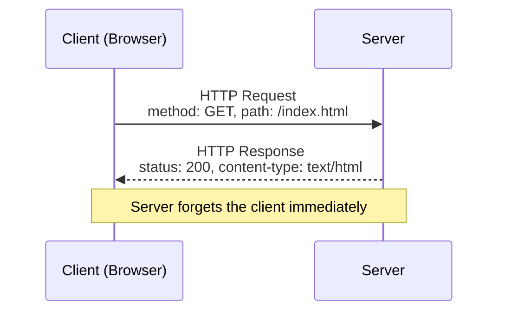

### HTTP Is Stateless

This is the critical concept to understand: **the server has no memory**. Once it sends a response, it forgets you exist. If you visit the same website five seconds later, the server treats you as a complete stranger.

```yaml
HTTP_Statelessness:
  Definition: "Server retains no memory of previous requests"
  Consequence: "Every request is independent and self-contained"

  Question: "Then how do websites remember my login?"
  Answer: |
    Cookies and tokens - layers we add ON TOP of HTTP.
    The client re-sends its identity (session cookie, JWT, etc.)
    with every request. The protocol itself has total amnesia.

  Why_It_Matters:
    Scalability: "No per-user state means no memory overhead per user"
    Load_Balancing: "Any server can handle any request"
    Resilience: "A server crash loses no conversation state"
```

> Statelessness is what made HTTP so scalable. This becomes important later, because WebSockets are the opposite: **stateful**.

---

## The Evolution of HTTP (0.9 to 1.1)

HTTP wasn't always as capable as it is today.

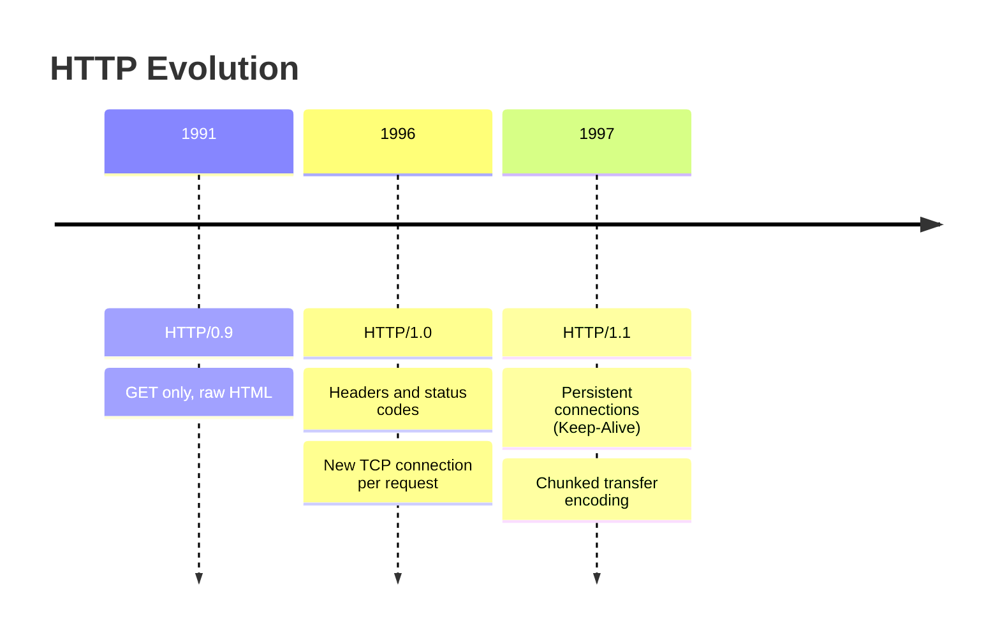

| Version | Year | Key Features | Limitation |
|---------|------|--------------|------------|
| **HTTP/0.9** | 1991 | Invented by Tim Berners-Lee at CERN to transfer HTML. Only `GET`. | No headers, no status codes, just raw HTML back |
| **HTTP/1.0** | 1996 | Headers and status codes introduced | A **new TCP connection for every request** |
| **HTTP/1.1** | 1997 | Keep-Alive (persistent connections), chunked transfer encoding | The standard for ~20 years |

### The Connection Overhead Problem

In HTTP/1.0, every image, every CSS file, every script opened a brand-new TCP connection, paying the TCP handshake cost (see [Episode 18](../18-tcp-udp)) every time.

> **Analogy:** Imagine you're on the phone with someone, and after every single sentence you hang up and dial them again. That is HTTP/1.0.

HTTP/1.1 introduced **persistent connections (Keep-Alive)**: open one TCP connection and reuse it for multiple requests. One phone call, an entire conversation.

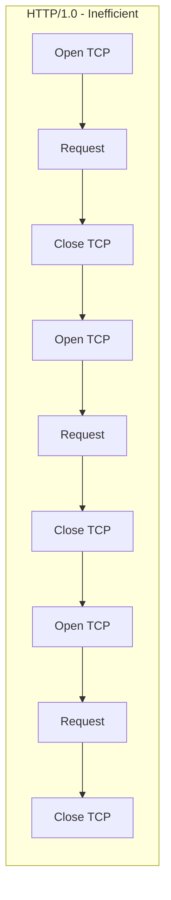

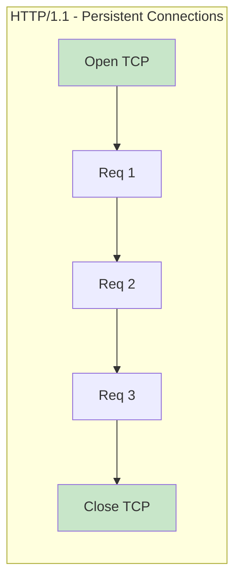

This single change drastically reduced latency and made the modern web possible.

---

## Anatomy of an HTTP Request

What actually travels across the wire when you make a request? Three parts:

```yaml
HTTP_Request_Structure:
  1_Start_Line:
    Method: "GET, POST, PUT, DELETE, ..."
    URI: "The path being requested, e.g. /api/users"
    Version: "HTTP/1.1"

  2_Headers:
    Format: "Key-value pairs carrying metadata"
    Analogy: "The envelope of a letter - who it's from, what's inside"
    Common:
      - Host
      - User-Agent
      - Content-Type
      - Authorization

  3_Body:
    Optional: true
    Used_By: "POST / PUT requests"
    Contains: "The actual payload, e.g. JSON from a submitted form"
```

### Breaking Down a Request

```
GET https://www.server.com/api/orders.json?created_at=2022-01-18T19:08:48+00:00&limit=10 HTTP/1.1
Host: www.server.com
authorization: Basic <base64(username:password)>
```

| Part | Example | Meaning |
|------|---------|---------|
| Method | `GET` | What action to perform |
| Scheme | `https` | Protocol |
| Server | `www.server.com` | Which host |
| Path | `/api/orders.json` | Which resource |
| Query String | `?created_at=...&limit=10` | Filters / parameters |
| Headers | `Host`, `authorization` | Metadata |

A `POST` request adds a body:

```http
POST https://www.server.com/admin/api/order HTTP/1.1
Host: www.server.com
authorization: Basic <base64(username:password)>
Content-Type: application/json

{
  "reference": "PO16262999",
  "customer": "1200",
  "lineItems": [
    { "lineId": 23894, "sku": "A1-103/0", "qty": 2, "description": "A desk lamp" },
    { "lineId": 4759,  "sku": "A1-401/0", "qty": 1, "description": "Some Bulbs" }
  ]
}
```

### Human-Readable on the Wire

In HTTP/1.x everything is **plain ASCII text**. Open Wireshark (or any network debugger) and you can literally read `GET /index.html HTTP/1.1`. This makes debugging a dream compared to binary protocols like gRPC (see [Episode 19](../19-rest-grpc/)).

---

## Anatomy of an HTTP Response

The response starts with a **status line**: protocol version, a three-digit **status code**, and status text. Then headers, then the body.

```http
HTTP/1.1 200 OK
Content-Type: application/json
Date: Thu, 20 Jan 2022 14:13:05 GMT
Server: Apache
X-Correlation-Id: 0a491944-9e95-4ed9-85d9-d3f430ce5d59

{
  "yourOrderReference": "PO16262999",
  "ourOrderNumber": "ORD000000031671",
  "lineItems": [
    { "sku": "A1-103/0", "description": "A desk lamp", "qty": 2 },
    { "sku": "A1-401/0", "description": "Some Bulbs", "qty": 1 }
  ]
}
```

### The Five Status Code Families

Status codes are grouped into families. Learn them and you can debug almost any web issue.

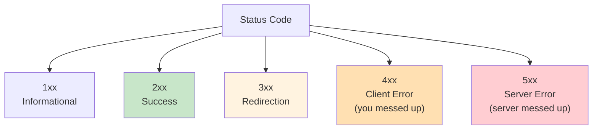

| Family | Meaning | Common Codes |
|--------|---------|--------------|
| **1xx** | Informational | `101 Switching Protocols` (used by WebSockets, below) |
| **2xx** | Success | `200 OK` - everything worked, your best friend |
| **3xx** | Redirection | `301 Moved Permanently` - follow the new URL |
| **4xx** | Client error | `400 Bad Request` (malformed JSON), `401 Unauthorized` (forgot auth), `404 Not Found` |
| **5xx** | Server error | `500 Internal Server Error` - something crashed |

---

## HTTPS: Securing the Transport

### HTTP over TLS

Plain HTTP sends everything as plain text, vulnerable to sniffing by anyone on the path. **HTTPS is not a new protocol**: it's HTTP wrapped in a **TLS (Transport Layer Security)** tunnel. It relies on **Public Key Infrastructure (PKI)**.

Before any HTTP data is sent, a **TLS handshake** establishes encrypted communication.

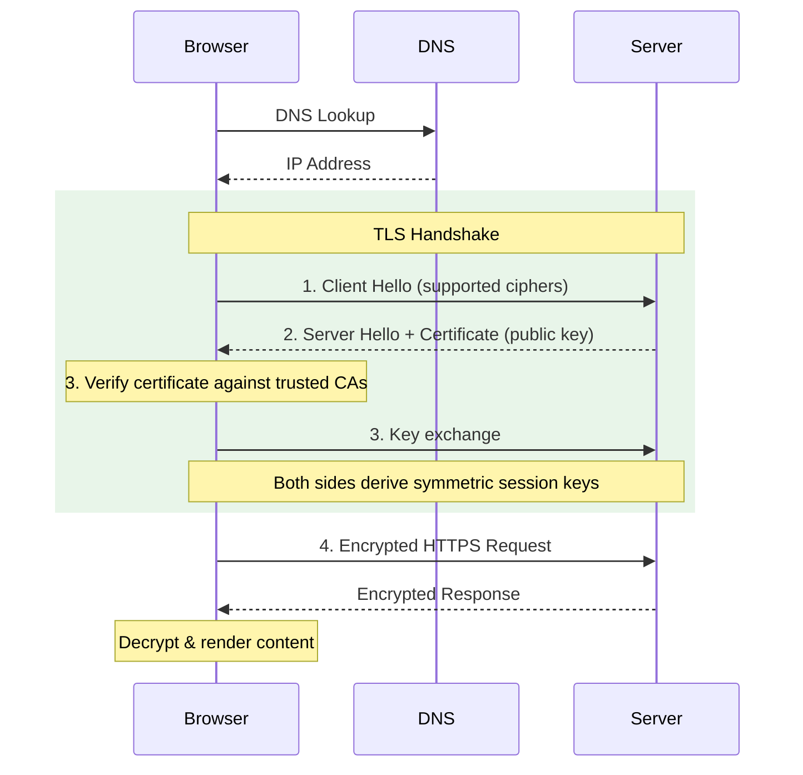

```yaml
TLS_Handshake_Steps:
  1_Client_Hello:
    Says: "Here are the encryption methods (cipher suites) I support"
  2_Server_Hello_And_Certificate:
    Says: "Let's use this cipher. Here's my certificate proving I am who I claim to be"
    Certificate_Contains: "Server's public key, signed by a Certificate Authority"
  3_Key_Exchange:
    Browser: "Verifies the certificate against trusted Certificate Authorities"
    Both: "Generate symmetric session keys"
  4_Encrypted_Communication:
    Result: "Everything is encrypted - intercepted traffic is unreadable garbage"
```

### Why Asymmetric, Then Symmetric?

```yaml
Hybrid_Encryption:
  Asymmetric (public/private key):
    Used_For: "Authenticating the server and agreeing on a secret"
    Cost: "Computationally expensive"
  Symmetric (session key):
    Used_For: "Encrypting all the actual HTTP data"
    Cost: "Fast"
  Takeaway: "Pay the expensive cost once in the handshake, then go fast"
```

### HTTPS Is Non-Negotiable

- Never enter sensitive data on a site without the padlock icon
- Google penalizes plain HTTP sites in search rankings
- Browsers mark HTTP pages as "Not Secure"
- Your WebSocket connections should follow suit (WSS, covered later)

---

## The Problem with HTTP for Real-Time

HTTP works beautifully for documents and APIs. It struggles with live data.

```yaml
HTTP_Real_Time_Problems:
  1_Unidirectional:
    Problem: "The server cannot speak unless spoken to"
    Example: |
      In a chat room, a new message arrives on the server for you,
      but the server can't tell you. It must wait for your browser
      to ask "any new messages?"

  2_High_Overhead:
    Problem: "Every request carries headers - cookies, auth tokens, content types"
    Size: "Headers can be 500 bytes to 2 KB"
    Example: |
      For tiny frequent updates like a gamer's player position,
      headers can be 10x larger than the actual data

  3_Half_Duplex:
    Problem: "You wait for a request to complete before sending the next"
    Analogy: "A walkie-talkie - one talks, waits, then the other responds"
    Need: "Full duplex - like a phone call where both talk at once"
```

### The Waiter vs. The Phone

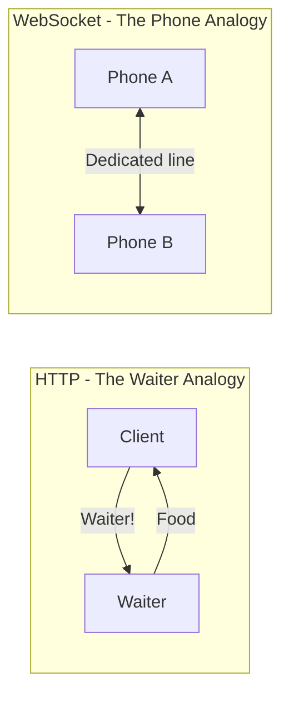

> **HTTP** is like a waiter who only comes to your table when you yell "Waiter!" If the kitchen catches fire, they can't warn you unless you happen to call them over.
>
> **WebSocket** is a dedicated phone line: either side can speak at any time.

---

## Pre-WebSocket Hacks: Faking Real-Time

Before WebSockets (pre-2011), engineers invented hacks to simulate real-time on top of HTTP.

### Short Polling

The client asks "any new data?" every few seconds. The server answers yes or no. Repeat forever.

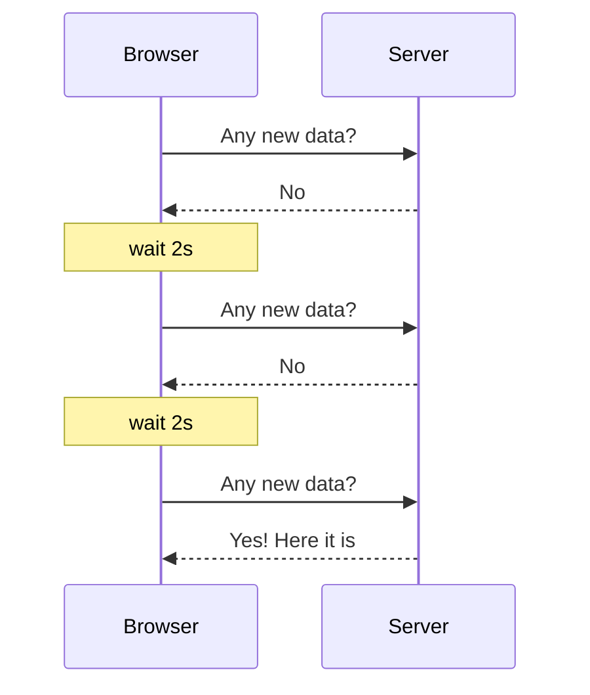

```yaml
Short_Polling_Waste:
  Poll_Interval: "Every 2 seconds = 30 requests/minute"
  Actual_Updates: "3 per minute"
  Result: "90% of requests return nothing"
  Cost: "Hammering the server and wasting bandwidth"
```

### Long Polling

Smarter. The client asks for data, and instead of answering "no" immediately, the server **holds the connection open** until new data arrives or a timeout occurs. Then the client immediately re-requests.

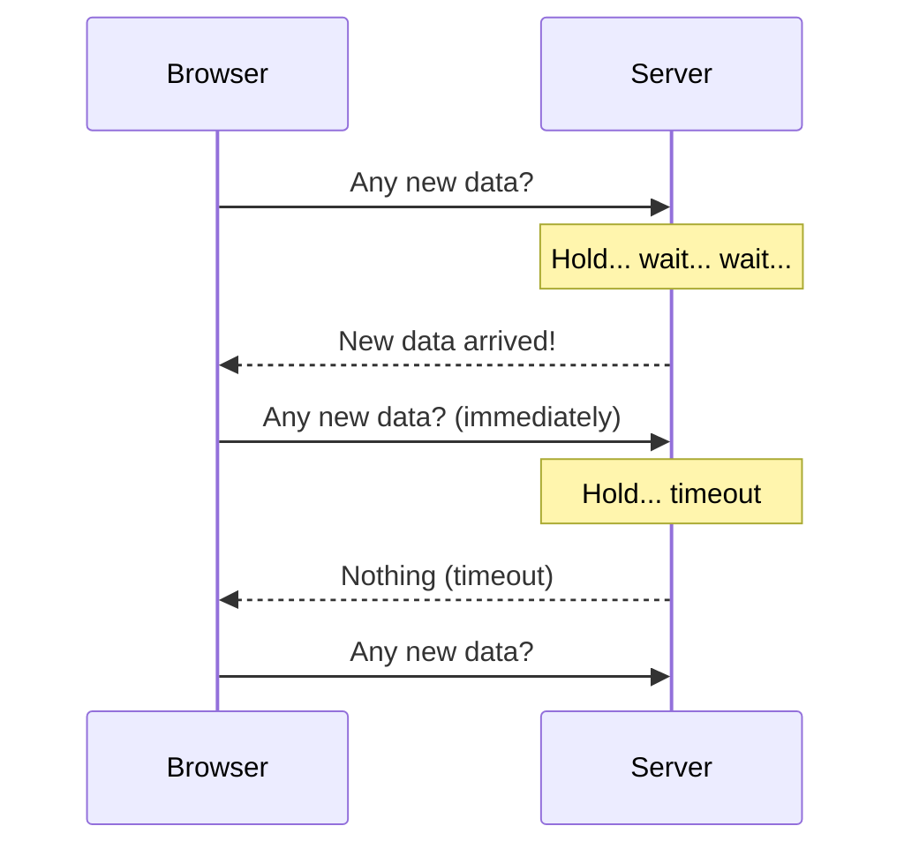

```yaml
Long_Polling:
  Pro: "Lower latency - response goes out the moment data arrives"
  Cons:
    Memory: "Every held connection uses server memory"
    Scale_Example: "100,000 connected clients = 100,000 open connections eating RAM"
    Overhead: "Still full HTTP headers on every request"
    Model: "Still fundamentally request/response"
```

### Comparing the Approaches

| Approach | Direction | Latency | Overhead | Notes |
|----------|-----------|---------|----------|-------|
| **Short Polling** | Client pulls | Up to poll interval | Very high (mostly empty responses) | Simplest |
| **Long Polling** | Client pulls, server holds | Low | High (headers + held connections) | Pre-2011 workhorse |
| **SSE (Server-Sent Events)** | Server → client only | Low | Low | Uni-directional streaming over HTTP |
| **WebSocket** | Full-duplex | Lowest | Minimal after handshake | True bidirectional |

We were hitting the limits of what HTTP could do. The web needed a new paradigm.

---

## Enter WebSockets

### True Bidirectional, Full-Duplex Communication

In **2011**, WebSockets were standardized in **RFC 6455**. Suddenly we had true bidirectional, full-duplex communication over a **single TCP connection**.

```yaml
WebSocket_Essentials:
  Definition: "A persistent connection allowing data to flow both ways at any time"
  Protocol: "Starts as HTTP, then upgrades to a WebSocket over the same TCP socket"
  In_Plain_English: |
    Once you connect, the pipe stays open.
    The server can push data whenever it wants.
    The client can send data whenever it wants.
    Both at the same time, in parallel.
  Efficiency:
    After_Handshake: "No more HTTP headers - just tiny binary frames"
    Example: "A message that's ~1 KB with HTTP might be ~10 bytes over WebSockets"
  Schemes:
    ws: "Unencrypted, port 80"
    wss: "Encrypted over TLS, port 443"
```

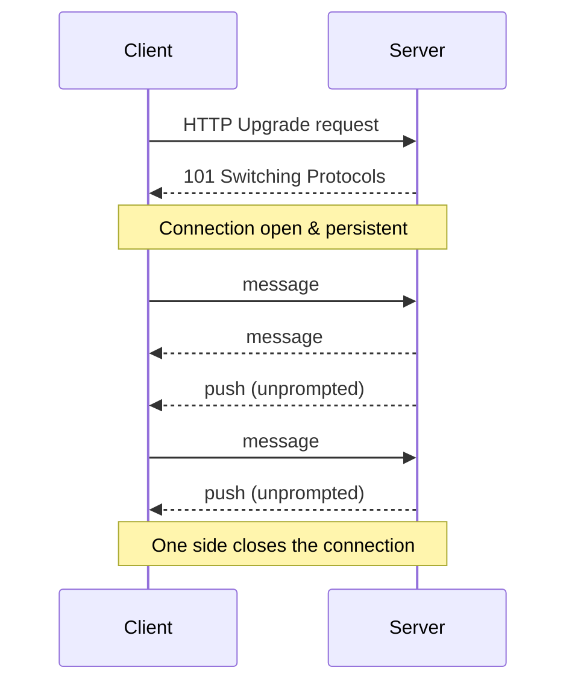

### Real-World Uses

If data updates frequently and latency matters, WebSockets are the answer:

- **Chat & messaging:** Discord, Slack
- **Collaborative editing:** Figma, Google Docs
- **Multiplayer games**
- **Live dashboards** and monitoring
- **Real-time trading platforms**

---

## The WebSocket Handshake (The Upgrade)

A WebSocket connection starts life as a **regular HTTP request**, then upgrades.

### Step 1: Client Sends an Upgrade Request

```http
GET /chat HTTP/1.1
Host: example.com
Upgrade: websocket
Connection: Upgrade
Sec-WebSocket-Key: dGhlIHNhbXBsZSBub25jZQ==
Sec-WebSocket-Version: 13
```

| Header | Purpose |
|--------|---------|
| `Upgrade: websocket` | "Can we switch from HTTP to WebSocket?" |
| `Connection: Upgrade` | Confirms the intent to upgrade |
| `Sec-WebSocket-Key` | A random, base64-encoded nonce (used for validation, below) |

### Step 2: Server Responds with 101

```http
HTTP/1.1 101 Switching Protocols
Upgrade: websocket
Connection: Upgrade
Sec-WebSocket-Accept: s3pPLMBiTxaQ9kYGzzhZRbK+xOo=
```

`101 Switching Protocols` literally means "I'm changing the protocol right now." After this response, the connection is **no longer HTTP**. The same TCP socket now speaks the WebSocket protocol. No new connection is needed; we transformed the one we already had.

---

## Sec-WebSocket-Key & Accept: Preventing Protocol Confusion

You might look at `Sec-WebSocket-Key` and assume it's for encryption. **It isn't.** It's for **handshake validation**.

### The Problem It Solves

Imagine a misconfigured HTTP proxy between you and the server that doesn't understand WebSockets. If the client sends an upgrade request and something just echoes back a response, things could break badly. The key proves the server is **actually a WebSocket server** that understands the protocol, not a confused HTTP server.

### The Algorithm

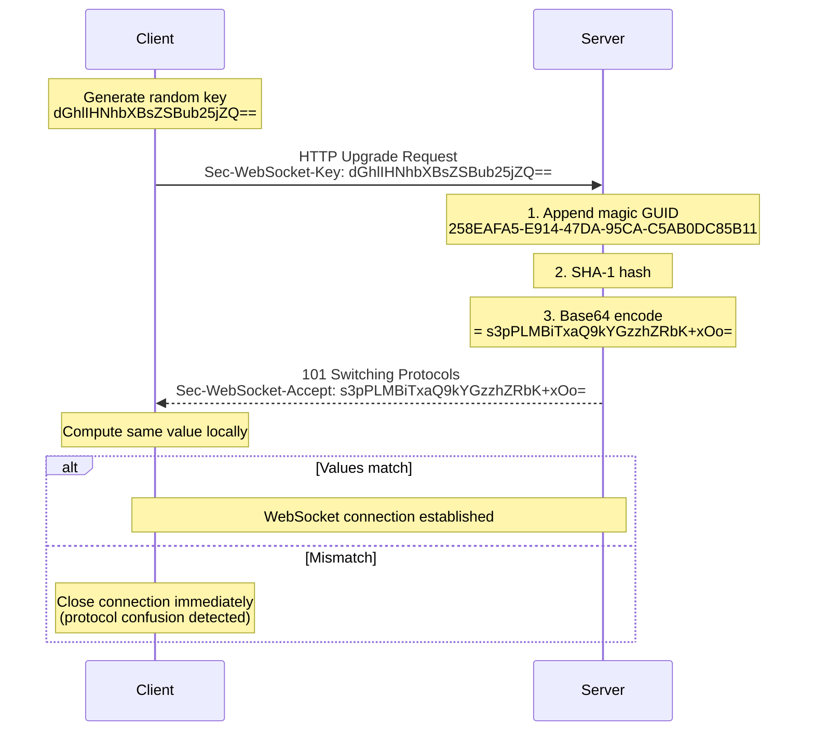

```yaml
Accept_Algorithm:
  a: "Client generates a random key (Sec-WebSocket-Key)"
  b: "Server appends the static GUID 258EAFA5-E914-47DA-95CA-C5AB0DC85B11"
  c: "Server SHA-1 hashes the combined string and base64-encodes it"
  d: "Server returns the result in Sec-WebSocket-Accept"
  e: "Browser does the same math locally; mismatch = connection killed"

Key_Point: "Not encryption - protocol verification"
```

You can verify it yourself:

```javascript
const crypto = require('crypto');

const key = 'dGhlIHNhbXBsZSBub25jZQ==';
const GUID = '258EAFA5-E914-47DA-95CA-C5AB0DC85B11';

const accept = crypto
  .createHash('sha1')
  .update(key + GUID)
  .digest('base64');

console.log(accept); // s3pPLMBiTxaQ9kYGzzhZRbK+xOo=
```

---

## WebSocket Data Frames

Once the handshake completes, we're no longer sending ASCII text. WebSockets communicate in **binary frames**, each with a structure defined in RFC 6455.

```
 0                   1                   2                   3
 0 1 2 3 4 5 6 7 8 9 0 1 2 3 4 5 6 7 8 9 0 1 2 3 4 5 6 7 8 9 0 1
+-+-+-+-+-------+-+-------------+-------------------------------+
|F|R|R|R| opcode|M| Payload len |    Extended payload length    |
|I|S|S|S|  (4)  |A|     (7)     |            (16/64)            |
|N|V|V|V|       |S|             |   (if payload len==126/127)   |
| |1|2|3|       |K|             |                               |
+-+-+-+-+-------+-+-------------+ - - - - - - - - - - - - - - - +
|     Extended payload length continued, if payload len == 127  |
+ - - - - - - - - - - - - - - - +-------------------------------+
|                               | Masking-key, if MASK set to 1 |
+-------------------------------+-------------------------------+
| Masking-key (continued)       |          Payload Data         |
+-------------------------------- - - - - - - - - - - - - - - - +
:                     Payload Data continued ...                :
+---------------------------------------------------------------+
```

```yaml
Frame_Anatomy:
  FIN_Bit (1 bit):
    Meaning: "Is this the final frame of the message?"
    Why: "Large messages can be split into multiple frames; FIN says 'last piece, reassemble now'"
  RSV1-3 (3 bits):
    Meaning: "Reserved for extensions (e.g. compression)"
  Opcode (4 bits):
    Meaning: "What kind of data is this? Text, binary, or a control signal"
  Mask_Bit (1 bit):
    Meaning: "Is the payload masked? Required for all client-to-server frames"
  Payload_Length (7 bits, + optional 16 or 64 bits):
    Meaning: "How many bytes of data follow"
  Masking_Key (32 bits, only if Mask=1):
    Meaning: "The 4-byte key used to mask the payload"
  Payload:
    Meaning: "The actual data"

Efficiency: "Minimum overhead is just 2 bytes for small frames vs hundreds of bytes of HTTP headers"
```

---

## Opcodes and Control Frames

The opcode tells the receiver how to interpret the payload.

| Opcode | Meaning | Description |
|--------|---------|-------------|
| `0x0` | Continuation | Continuation of a fragmented message |
| `0x1` | **Text** | UTF-8 text data - perfect for JSON |
| `0x2` | **Binary** | Raw bytes - images, video, any binary data |
| `0x3-0x7` | Reserved | Future data frames |
| `0x8` | **Close** | Graceful goodbye, includes a status code |
| `0x9` | **Ping** | Heartbeat check |
| `0xA` | **Pong** | Heartbeat response (10 in decimal) |
| `0xB-0xF` | Reserved | Future control frames |

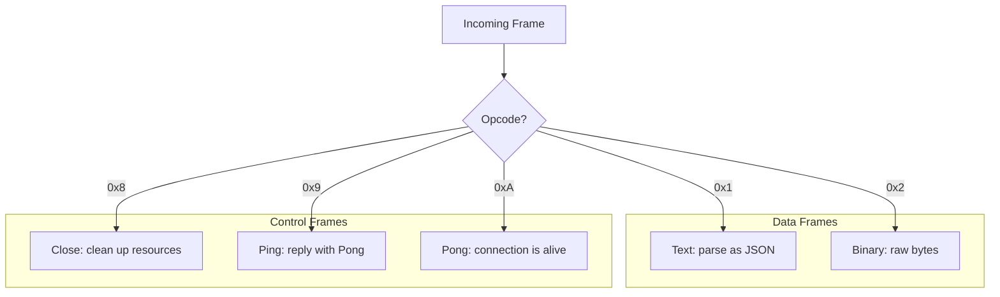

Control frames maintain connection health **without mixing into your application data**. See opcode 1, you know it's text and can parse it as JSON. See opcode 8, you know the connection is closing and should clean up.

---

## Heartbeats (Ping/Pong): Keeping the Connection Alive

### The Problem

Your WebSocket sits idle for a minute and suddenly dies. Why?

Load balancers, firewalls, and NAT routers all have **idle timeout policies**. If they see a TCP connection doing nothing for **30 to 60 seconds**, they consider it stale and kill it to free resources.

### The Solution: Built-in Ping/Pong

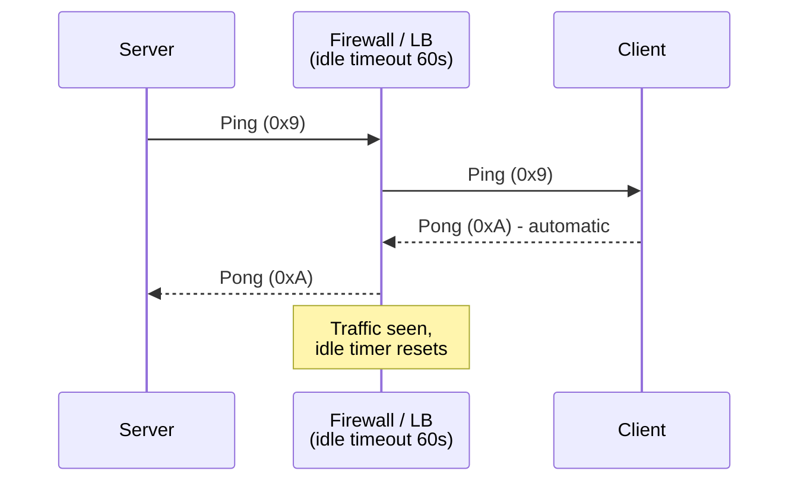

```yaml
Protocol_Heartbeat:
  Server: "Periodically sends a Ping frame (opcode 0x9) with optional payload"
  Client: "Must reply with a Pong frame (opcode 0xA) echoing the payload"
  Browser: "Handles Pong responses automatically - no code needed"
  Effect: "A tiny bit of traffic keeps the connection alive in the eyes of intermediaries"
```

### Application-Level Heartbeats

For production systems, many developers also implement **application-level heartbeats**, for example sending `{"type": "ping"}` every 30 seconds.

Why? The browser's WebSocket API **doesn't expose raw ping/pong frames**. So you can't easily tell from JavaScript whether the server is actually processing messages or just whether the TCP connection is open. Application heartbeats give you that visibility.

```javascript
// Client-side application heartbeat
const HEARTBEAT_INTERVAL = 30_000;
let lastPong = Date.now();

setInterval(() => {
  if (Date.now() - lastPong > HEARTBEAT_INTERVAL * 2) {
    socket.close(); // server unresponsive - trigger reconnect logic
    return;
  }
  socket.send(JSON.stringify({ type: 'ping' }));
}, HEARTBEAT_INTERVAL);

socket.onmessage = (event) => {
  const msg = JSON.parse(event.data);
  if (msg.type === 'pong') lastPong = Date.now();
};
```

---

## Masking: Why Client Data Is "Masked"

Capture WebSocket traffic in Wireshark and you'll notice something odd: **client-to-server frames look like garbage, but server-to-client frames are readable.** That's masking at work.

```yaml
Masking_Rules:
  Client_to_Server: "MUST be masked"
  Server_to_Client: "NOT masked"
  How: "A random 4-byte masking key is XORed with the payload data"
  Not_For: "Encryption - the key is sent in the frame, so it's trivially unmasked"
  Purpose: "Prevent cache poisoning attacks on transparent proxies"
```

### The Cache Poisoning Vulnerability

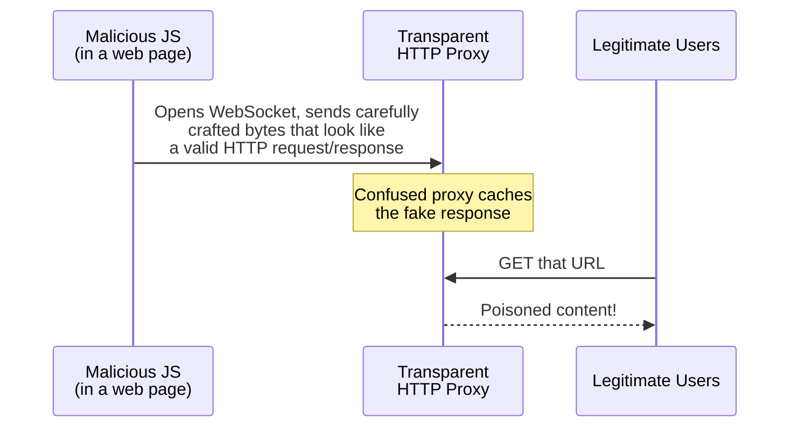

Without masking, malicious JavaScript could control the **exact bytes** on the wire and craft frames that a transparent proxy (one that doesn't understand WebSockets) misinterprets as HTTP, poisoning its cache for every legitimate user.

With masking, the browser picks a **fresh random key for every frame**. The script can't predict what bytes will actually hit the wire, so it can't craft anything a proxy would mistake for HTTP.

```
payload[i] XOR mask_key[i % 4]  →  masked byte
masked[i]  XOR mask_key[i % 4]  →  original byte   (XOR is its own inverse)
```

---

## WebSocket API (Client Side)

Browsers ship a native WebSocket API.

```yaml
Client_API:
  Constructor: "const ws = new WebSocket('ws://url')"
  Events:
    onopen: "Connection established"
    onmessage: "Data received"
    onclose: "Connection closed"
    onerror: "Connection error"
  Sending: "ws.send(data) - text or binary"
```

```javascript
const socket = new WebSocket('ws://localhost:8080');

socket.onopen = () => {
  console.log('Connected!');
  socket.send(JSON.stringify({ type: 'greeting', content: 'Hello' }));
};

socket.onmessage = (event) => {
  console.log('Received:', event.data);
};

socket.onclose = (event) => {
  console.log('Closed:', event.code, event.reason);
};

socket.onerror = (err) => {
  console.error('Error:', err);
};
```

This **event-driven model** is the key shift. Instead of asking "do you have new data?" in a loop, your function is called whenever data arrives. It's reactive, efficient, and the pattern used by every real-time application.

---

## Server-Side Implementation (Node.js)

### Libraries

| Library | Character |
|---------|-----------|
| **ws** | Lightweight, close to the raw protocol |
| **Socket.IO** | Feature-rich: automatic reconnection, rooms, fallbacks (starts with HTTP long polling) |

### The Logic

```yaml
Server_Steps:
  a: "Create an HTTP server"
  b: "Upgrade incoming requests to WebSocket"
  c: "Store each connection in a Set/Map to track active clients"
  d: "Listen for message events (and remove clients on close)"
```

```javascript
const http = require('http');
const { WebSocketServer, WebSocket } = require('ws');

const server = http.createServer();
const wss = new WebSocketServer({ server });

const clients = new Set(); // every client is a living object in memory

wss.on('connection', (ws) => {
  clients.add(ws);

  ws.on('message', (data) => {
    // Broadcast to everyone else
    for (const client of clients) {
      if (client !== ws && client.readyState === WebSocket.OPEN) {
        client.send(data.toString());
      }
    }
  });

  ws.on('close', () => clients.delete(ws));
});

server.listen(8080);
```

### The Crucial Difference from HTTP

```yaml
HTTP_Server:
  Model: "Handle a request, send a response, done"
  State: "None between requests"

WebSocket_Server:
  Model: "Store the connection and keep it alive"
  State: "Maintain a Set/Map of active connections"
  Lifecycle: "Add on connect, remove on close, broadcast to others"
  Insight: "You are managing state now - every client is a living object in memory"
```

This is the foundation of any chat room or real-time collaboration tool, and it's exactly what makes scaling hard.

---

## Scaling WebSockets: The Hard Part

Scaling WebSockets is **much harder** than scaling HTTP.

### Stateless HTTP: Easy

Put a load balancer in front of 10 servers. Request 1 goes to Server A, Request 2 goes to Server B. Who cares? They're stateless; each request is independent.

### Stateful WebSockets: The Problem

The socket connection lives in **one specific server's memory**.

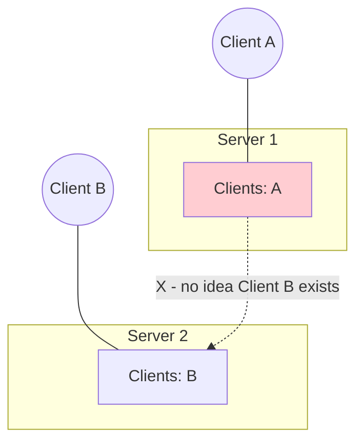

1. Client A is connected to Server 1; Client B is connected to Server 2
2. Client A sends a message meant for Client B
3. Server 1 loops through **its** clients. Client B isn't there
4. Server 1 has no idea Client B even exists

> **The fundamental issue:** horizontal scaling breaks communication between clients on different servers. Connections become isolated islands, and we need to build bridges. Many teams underestimate this complexity until it's already in production.

---

## The Pub/Sub Solution (Redis)

The standard fix is the **publish-subscribe** pattern, commonly implemented with **Redis** as a message broker or "backplane".

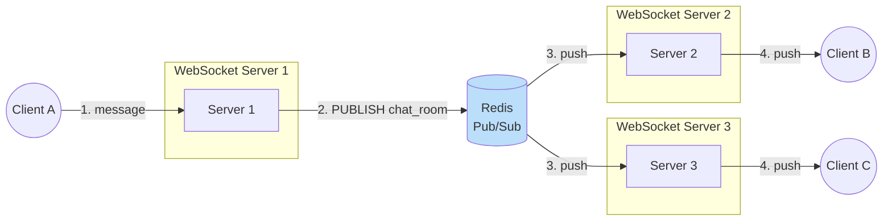

```yaml
PubSub_Flow:
  1: "Client A (on Server 1) sends a chat message"
  2: "Server 1 PUBLISHES it to a Redis channel, e.g. chat_room:123"
  3: "Servers 2, 3, 4... are all SUBSCRIBED to that channel"
  4: "Redis instantly broadcasts the message to every subscriber"
  5: "Each server pushes it to its own local WebSocket clients"

Key_Insight: |
  Redis acts as the central nervous system.
  No server needs to know about other servers or their clients.
  They just listen to Redis.
```

```javascript
// Each WebSocket server runs this
const { createClient } = require('redis');

const pub = createClient();
const sub = pub.duplicate();
await Promise.all([pub.connect(), sub.connect()]);

// Fan-in: local client message -> Redis
ws.on('message', (data) => pub.publish('chat_room:123', data.toString()));

// Fan-out: Redis -> local clients
await sub.subscribe('chat_room:123', (message) => {
  for (const client of localClients) client.send(message);
});
```

### Why Redis?

| Reason | Detail |
|--------|--------|
| In-memory | Incredibly fast |
| Pub/Sub is first-class | Built-in `PUBLISH` / `SUBSCRIBE` |
| Proven | Battle-tested at massive scale |

The pattern extends well beyond chat: real-time dashboards, collaborative editing, live notifications. Any time you need to broadcast state changes across a distributed system, Pub/Sub is your friend.

### The Trade-off

```yaml
Redis_Tradeoff:
  Risk: "Redis becomes a single point of failure"
  Mitigation:
    - "Redis Cluster for sharding and availability"
    - "Redis Sentinel for automatic failover"
```

---

## Load Balancing WebSockets

Putting a load balancer in front of WebSocket servers has a few gotchas.

```yaml
LB_Gotchas:
  1_Sticky_Sessions:
    When: "Using Socket.IO, which starts with HTTP long polling before upgrading"
    Need: "Sticky sessions (session affinity) - all requests from one client hit the same server"
    Why: "The upgrade handshake must complete on the server that started the polling session"

  2_Raw_WebSockets:
    Behaviour: "Once connected, the TCP connection simply stays open with that server"

  3_Connection_Timeouts:
    Problem: "Nginx / HAProxy HTTP timeouts are often ~60 seconds"
    Reality: "WebSocket connections need to stay open for hours"
    Fix: "Configure much longer timeouts, or the LB cuts 'stalled' connections"

  4_Layer_7_vs_Layer_4:
    Layer_7: "Terminate TLS at the load balancer, forward plain WebSocket to backends"
    Layer_4: "Pass encrypted traffic straight through to backends"
    Tradeoff: "Certificate management vs. inspection/routing capabilities"
```

### Example: Nginx Configuration

```nginx
upstream ws_backend {
    ip_hash;                       # sticky sessions by client IP
    server ws1.internal:8080;
    server ws2.internal:8080;
}

server {
    listen 443 ssl;
    server_name chat.example.com;

    location /ws/ {
        proxy_pass http://ws_backend;
        proxy_http_version 1.1;
        proxy_set_header Upgrade $http_upgrade;     # forward the upgrade
        proxy_set_header Connection "upgrade";
        proxy_read_timeout 3600s;                   # don't kill long-lived sockets
        proxy_send_timeout 3600s;
    }
}
```

> Test your load balancer thoroughly before production.

---

## WS vs. WSS: Encryption Is Non-Negotiable

**WSS (WebSocket Secure)** is WebSocket over TLS on **port 443**. Always use WSS in production. No exceptions.

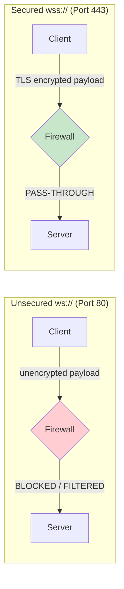

```yaml
Why_WSS:
  1_Security:
    Problem: "Without encryption, anyone on the network can read your messages"
    Exposed: "Chat, game moves, financial data"

  2_Firewall_Pass_Through:
    Problem: "Many corporate firewalls / proxies block non-standard traffic on port 80"
    Why: "WebSocket frames on port 80 don't look like HTTP"
    WSS: "On 443 the traffic is encrypted - it looks like normal HTTPS and is let through"
    Result: "Much higher connection success rate on restrictive networks"

  3_Mixed_Content_Blocking:
    Rule: "Browsers block ws:// connections from https:// pages"
    Symptom: "Mixed-content error in the console; connection fails"

  Certificates: |
    WSS uses the same certificate as HTTPS. If your domain already
    has HTTPS (e.g. via Let's Encrypt), WSS works on that same domain.
```

---

## Future Protocols

### The Evolution

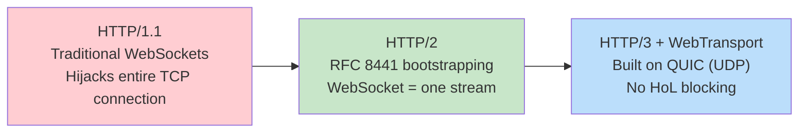

| Generation | Transport | How WebSockets Fit | Characteristics |
|-----------|-----------|--------------------|----------------|
| **HTTP/1.1** | TCP | Upgrade takes over the **entire** TCP connection | No multiplexing, hogs the connection |
| **HTTP/2** | TCP | **RFC 8441** bootstraps a WebSocket inside a **single HTTP/2 stream** | Shares the connection with other requests (images, CSS, JS) |
| **HTTP/3** | QUIC over UDP | Independent streams | Eliminates TCP head-of-line blocking |
| **WebTransport** | HTTP/3 | Successor to WebSockets | Reliable streams **and** unreliable datagrams |

### HTTP/2 and WebSockets

HTTP/2 introduced multiplexing: many streams over one connection. RFC 8441 lets a WebSocket live in one of those streams instead of hijacking the whole connection, so other HTTP/2 requests share the same connection. More efficient use of resources.

### HTTP/3 and QUIC

HTTP/3 runs over **QUIC**, which uses **UDP** instead of TCP. This matters because TCP has **head-of-line blocking**: if one packet is lost, everything behind it waits (see [Episode 18](../18-tcp-udp)). On unreliable networks that causes stuttering. QUIC handles streams independently, which is ideal for real-time communication.

### WebTransport

```yaml
WebTransport:
  Built_On: "HTTP/3"
  Provides:
    Reliable_Streams: "Ordered, guaranteed delivery (like WebSockets)"
    Unreliable_Datagrams: "Fire-and-forget (like UDP)"
  Best_For: "Gaming and video, where some data loss is acceptable for lower latency"
  Mental_Model: "WebSockets and UDP datagrams in one API"
```

WebSockets were revolutionary in 2011, and these new protocols extend that revolution. If you're building the next generation of real-time apps, keep an eye on them.

---

## Choosing the Right Tool

```yaml
Decision_Guide:
  Plain_HTTP/REST:
    When: "Request-response, CRUD, cacheable content"
    Examples: "Web pages, REST APIs, file downloads"

  Short_Polling:
    When: "Updates are rare and latency doesn't matter"
    Examples: "Checking a report-generation job every 30s"

  Long_Polling:
    When: "Fallback when WebSockets are blocked"
    Examples: "Socket.IO's initial transport"

  Server_Sent_Events:
    When: "Server-to-client only streaming"
    Examples: "Live feeds, notifications, streaming text output"

  WebSockets:
    When: "Frequent, bidirectional, low-latency messaging"
    Examples: "Chat, multiplayer games, collaborative editing, trading"

  WebTransport:
    When: "Real-time where some loss is acceptable and HoL blocking hurts"
    Examples: "Cloud gaming, live media"
```

| Feature | HTTP | Long Polling | WebSocket |
|---------|------|-------------|-----------|
| Direction | Client → Server | Client pulls, server holds | Bidirectional |
| Duplex | Half | Half | Full |
| Connection | Short-lived / keep-alive | Held per request | Persistent |
| Per-message overhead | Full headers (500 B - 2 KB) | Full headers | 2-14 byte frame header |
| Server state | Stateless | Held connections | Stateful |
| Scaling | Easy (any server) | Moderate | Hard (needs Pub/Sub, sticky LB) |
| Caching | Yes | No | No |

---

## Key Takeaways

### Remember This

- **HTTP is stateless:** the server forgets you after every response; cookies and tokens are layered on top. That's why HTTP scales so easily
- **HTTP/1.1 Keep-Alive** reused TCP connections instead of opening one per request (HTTP/1.0), drastically reducing latency
- **Status code families:** 2xx success, 3xx redirect, 4xx you messed up, 5xx the server messed up
- **HTTPS = HTTP inside a TLS tunnel:** Client Hello → Server Hello + Certificate → Key Exchange → Encrypted traffic
- **HTTP struggles with real-time:** unidirectional, heavy headers, half-duplex. Polling and long polling were hacks around this
- **WebSockets (RFC 6455, 2011):** start as HTTP, upgrade via `101 Switching Protocols`, then exchange tiny binary frames full-duplex on the same TCP socket
- **Sec-WebSocket-Key/Accept** is protocol verification (key + magic GUID → SHA-1 → base64), not encryption
- **Masking** (client-to-server only, 4-byte XOR key) prevents cache poisoning of transparent proxies, not eavesdropping
- **Ping/Pong** (0x9/0xA) keeps idle connections alive past LB/firewall timeouts; add app-level heartbeats for visibility
- **WebSockets are stateful,** so horizontal scaling needs a Pub/Sub backplane (Redis), long LB timeouts, and sometimes sticky sessions
- **Always use WSS** in production: security, firewall pass-through, and no mixed-content blocking

### Common Mistakes to Avoid

```yaml
Common_Mistakes:
  1_WebSockets_For_Everything:
    Mistake: "Using WebSockets for plain CRUD APIs"
    Reality: "You lose HTTP caching, simple LB, and statelessness"
    Correct: "Use REST for request-response; WebSockets for real-time"

  2_Forgetting_The_Backplane:
    Mistake: "Scaling WebSocket servers horizontally with no Pub/Sub"
    Reality: "Clients on different servers can't reach each other"
    Correct: "Add Redis Pub/Sub (or similar broker) from the start"

  3_Default_LB_Timeouts:
    Mistake: "Leaving Nginx/HAProxy at ~60s timeouts"
    Reality: "Connections get cut as 'stalled'"
    Correct: "Raise proxy timeouts and send heartbeats"

  4_Using_ws_In_Production:
    Mistake: "Unencrypted ws:// on an https:// site"
    Reality: "Mixed-content blocking + firewalls drop it + data exposed"
    Correct: "Always wss://"

  5_Thinking_Masking_Is_Encryption:
    Mistake: "Relying on masking or Sec-WebSocket-Key for security"
    Reality: "Both are trivially reversible / public"
    Correct: "TLS (WSS) is what encrypts your data"

  6_No_Reconnect_Logic:
    Mistake: "Assuming the socket stays up forever"
    Reality: "Networks drop, servers deploy, LBs rebalance"
    Correct: "Reconnect with exponential backoff and resync state"

  7_Single_Redis_Instance:
    Mistake: "One Redis node as the backplane"
    Reality: "Single point of failure for all real-time traffic"
    Correct: "Redis Cluster or Sentinel"
```

### Best Practices

```yaml
Best_Practices:
  1: "Default to HTTPS everywhere; WSS for every WebSocket"
  2: "Use HTTP/REST for request-response, WebSockets for live bidirectional data"
  3: "Track connections in a Set/Map and clean up on close"
  4: "Use a Pub/Sub backplane (Redis Cluster/Sentinel) to scale horizontally"
  5: "Configure LB timeouts for long-lived connections; forward Upgrade headers"
  6: "Use sticky sessions when the library starts with polling (Socket.IO)"
  7: "Combine protocol Ping/Pong with application-level heartbeats"
  8: "Implement client reconnection with backoff"
  9: "Watch HTTP/2 (RFC 8441), HTTP/3, and WebTransport for future designs"
```

---

## Presentation

The slides used in this episode are available in the [presentation folder](./presentation/).

---

<div align="center">

[Previous Episode: REST vs gRPC](../19-rest-grpc/) | [Course Home](../../) | [Next Episode: DNS](../21-dns/)

</div>
