# Episode 21: DNS (Domain Name System)

[](http://youtube.com/@ThatNotesGuy)

## What You'll Learn

- Why DNS was invented, and how it replaced a single HOSTS.TXT file with a distributed database
- How the DNS namespace hierarchy works: root, TLD, second-level domain, subdomain, and FQDN
- The four server types in every lookup and the step-by-step resolution flow
- Recursive vs. iterative queries, and why DNS runs on UDP port 53 (with TCP fallback)
- What's inside the 12-byte DNS header: ID, QR, Opcode, AA, TC, RD, RA, RCODE
- Core record types (A, AAAA, CNAME, ALIAS, PTR), TTL, caching layers, and propagation
- Zones and zone transfers (AXFR/IXFR)
- DNS attacks (cache poisoning, hijacking, amplification, tunneling), DNSSEC, and DoH/DoT

---

## The Problem & The History

### The Pre-DNS Era: HOSTS.TXT

Before 1983, if you wanted to talk to another computer on **ARPANET**, you looked up its address in a single text file called **HOSTS.TXT**. It was literally a list of names and addresses.

```yaml
HOSTS_TXT_Era:
  Network: "ARPANET (before 1983)"
  Mechanism: "One text file mapping hostnames to addresses"
  Managed_By: "SRI (Stanford Research Institute), centrally"
  Process: |
    Every time a new computer came online, SRI updated the file
    by hand, and every other computer had to download it again.
  Problem: "As the network grew exponentially, a central file became impossible to manage"
```

You can still see the remnant of this today: your `/etc/hosts` (or `C:\Windows\System32\drivers\etc\hosts`) file.

```
# /etc/hosts
127.0.0.1       localhost
192.168.1.20    devbox.local
```

### The Solution: A Distributed Database

In **1983, Paul Mockapetris** at UC Irvine invented DNS, defined in **RFC 1034 & 1035** (the 1987 revisions of his original RFC 882/883).

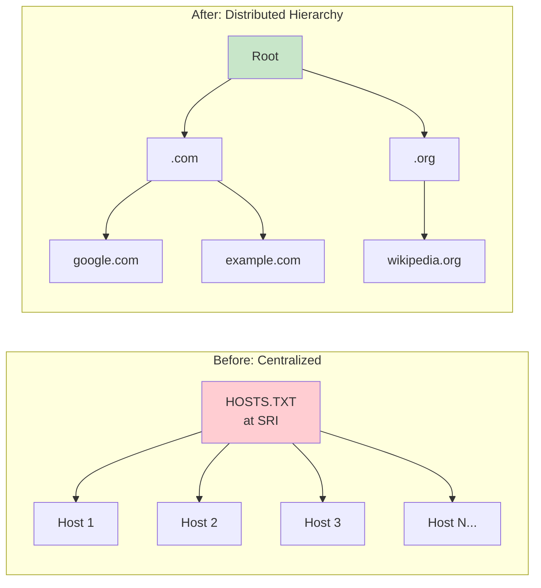

```yaml
DNS_Core_Concept:
  What: "A hierarchical, distributed database"
  Key_Property: "Local control over segments of the database"
  In_Practice: "You manage your slice of the internet, I manage mine"
  Mechanism: "Authority is delegated downwards through the hierarchy"
```

---

## The Hierarchy (The Tree)

DNS is strict about hierarchy. The namespace is an **inverted tree read from right to left**.

When you see `www.google.com`, the system actually reads: `.` (root) → `com` → `google` → `www`.

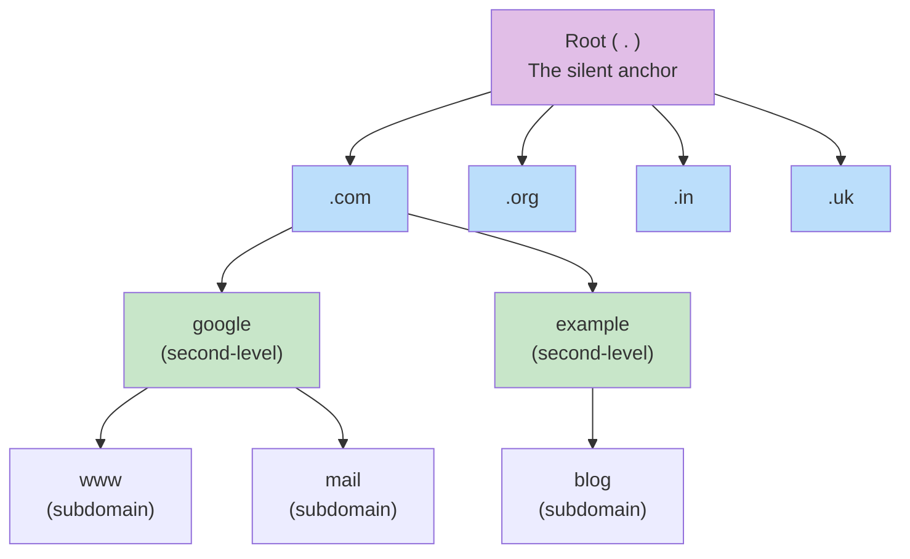

| Level | Examples | Managed By |
|-------|----------|-----------|
| **Root (`.`)** | The trailing dot | Root server operators (coordinated by IANA) |
| **Top-Level Domain (TLD)** | `.com`, `.org`, `.in`, `.uk` | Registries |
| **Second-Level Domain** | `google` in `google.com` | The specific organization |
| **Subdomain** | `www`, `mail`, `blog` | The domain owner |

### FQDN: Fully Qualified Domain Name

```
 www . example . com .
  │       │       │   └── Root (the silent anchor)
  │       │       └────── TLD
  │       └────────────── Second-level domain
  └────────────────────── Subdomain
```

The **trailing dot** is the root, the silent anchor at the end of every FQDN. `www.example.com.` is the fully qualified form; browsers just hide the dot.

> This hierarchy is critical. It dictates **exactly which server knows what**, and it delegates authority downwards.

---

## The Four Server Types

There are four servers you need to memorize.

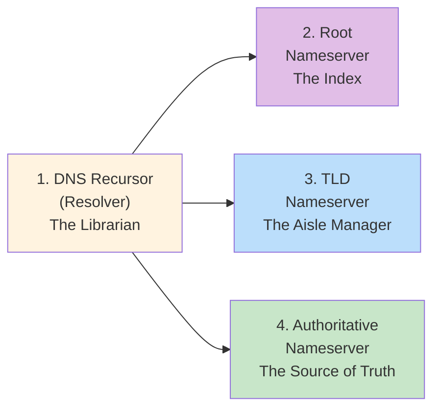

| Server | Nickname | Role |
|--------|----------|------|
| **DNS Recursor (Resolver)** | The Librarian | Receives queries from the client (browser/OS) and does the legwork. Provided by your ISP or a public service like Cloudflare `1.1.1.1` or Google `8.8.8.8` |
| **Root Nameserver** | The Index | Doesn't know the IP, but knows where all the TLD servers are |
| **TLD Nameserver** | The Aisle Manager | Manages a specific extension (like `.com`) and points to the authoritative server |
| **Authoritative Nameserver** | The Source of Truth | Holds the actual records (IP addresses) for the domain. The final destination |

### The Personal Assistant Analogy

```yaml
Analogy:
  You: "Ask your personal assistant (resolver) to find someone's phone number"
  Assistant_Asks_Root: "The phone book distributor - 'try the regional office'"
  Assistant_Asks_TLD: "The regional office - 'try the local switchboard'"
  Assistant_Asks_Authoritative: "The local switchboard - 'here's the number'"
  Assistant: "Writes it down (caches it) and hands it to you"
```

---

## The Lookup Flow (Step-by-Step)

What happens when you type `example.com` and hit Enter?

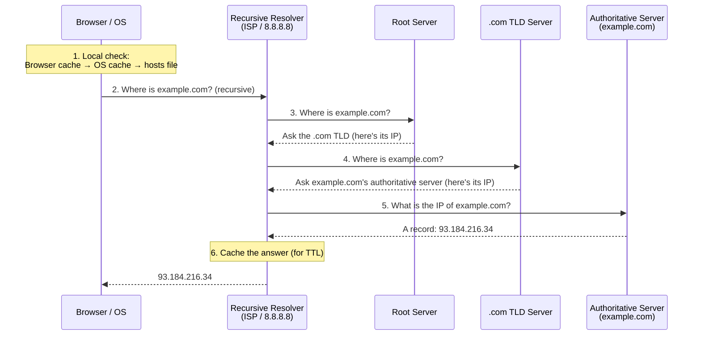

```yaml
Lookup_Steps:
  1_Local_Check: "Browser cache -> OS cache -> hosts file"
  2_Query_Resolver: "If all empty, ask the recursive resolver (ISP or public DNS like 8.8.8.8)"
  3_Root_Query: "Resolver asks root '.' -> root returns the .com TLD server IP"
  4_TLD_Query: "Resolver asks .com TLD -> TLD returns the authoritative server IP"
  5_Auth_Query: "Resolver asks authoritative server -> gets the A record (IP)"
  6_Response: "Resolver caches the IP and sends it back to the browser"

Speed: "This entire chain happens in milliseconds - and caching usually skips most of it"
```

### Try It Yourself

```bash
# Trace the full resolution path from the root
dig +trace example.com

# Ask a specific resolver
dig @1.1.1.1 example.com A

# Short answer only
dig +short example.com
```

---

## Recursive vs. Iterative Queries

### Doing the Work vs. Passing the Buck

```yaml
Recursive_Query:
  Analogy: "Telling your assistant 'get me a pizza' - you expect the pizza"
  Meaning: "The client demands the FINAL answer: 'Find this for me, I don't care who you ask'"
  Direction: "Client (stub resolver) -> Recursive resolver"
  Flag: "RD (Recursion Desired) bit set to 1 in the header"

Iterative_Query:
  Analogy: "Asking a stranger 'where's the pizza place?' - they point down the street"
  Meaning: "Asks for the BEST answer the server has: 'Tell me the IP, or who to ask next'"
  Direction: "Recursive resolver -> Root / TLD / Authoritative"
  Note: "Root and TLD servers typically only accept iterative queries to reduce load"
```

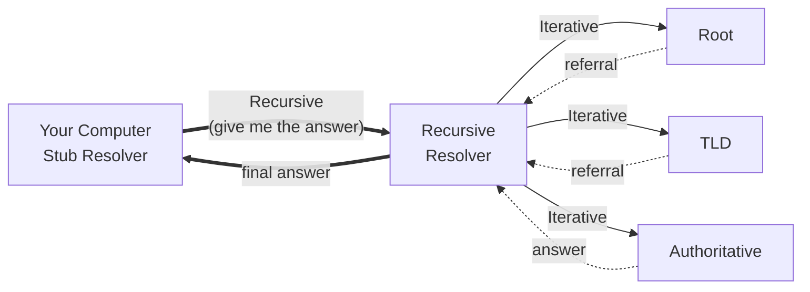

| Feature | Recursive | Iterative |
|---------|-----------|-----------|
| **Who asks?** | Client (stub resolver) | DNS resolver |
| **Response** | The final IP or an error | A referral to another server |
| **Workload** | High on the server | Low on the server |

---

## The Protocol: UDP, TCP, and the Magic Number 512

### Why UDP on Port 53?

DNS lives on **port 53** and usually runs over **UDP**. Speed is critical for DNS, and UDP is fire-and-forget with low overhead: no handshake, a single request packet and a single response packet (see [Episode 18](../18-tcp-udp)).

### The 512-Byte Limit and TCP Fallback

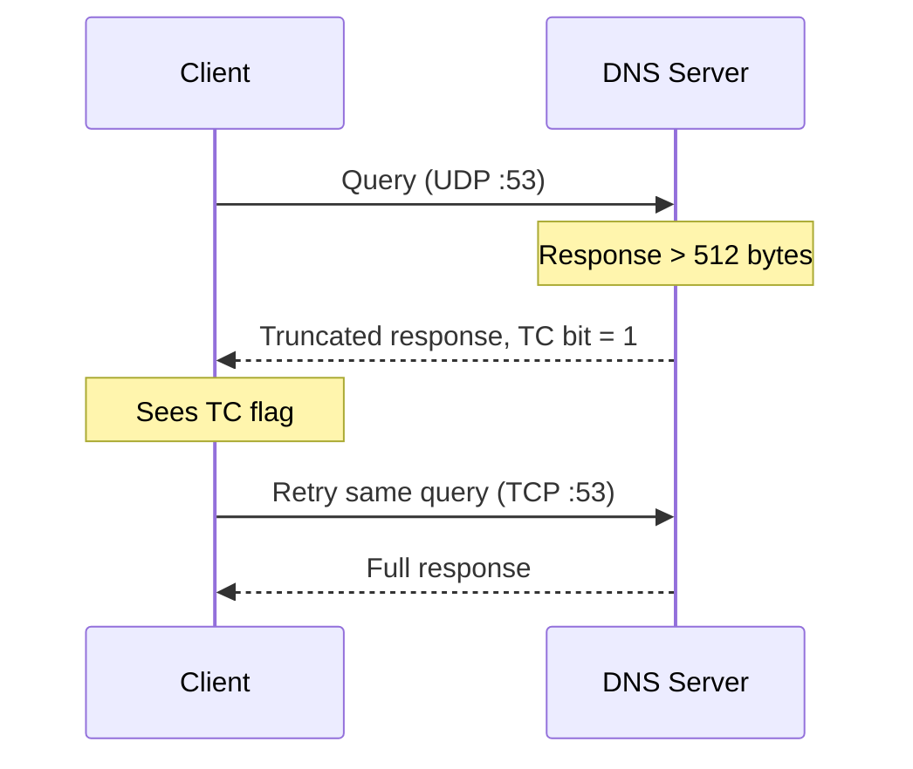

```yaml
Transport_Rules:
  Primary: "UDP on port 53"
  Packet_Limit: "Historically 512 bytes for UDP"
  Truncation:
    Trigger: "Response larger than 512 bytes (e.g. many IPv6 addresses, DNSSEC keys)"
    Action: "Server sets the TC (truncation) bit in the header"
  TCP_Fallback:
    Action: "Client retries the query over TCP port 53"
    Why: "TCP handles the larger payload"
  Zone_Transfers: "ALWAYS TCP - zone files can be huge"
  EDNS0: "Extension mechanism allowing larger UDP packets today; 512 is the historical basis"
```

---

## The DNS Packet Header

Capture a DNS packet in Wireshark and you'll see a fixed **12-byte header**.

```
                                1  1  1  1  1  1
  0  1  2  3  4  5  6  7  8  9  0  1  2  3  4  5
+--+--+--+--+--+--+--+--+--+--+--+--+--+--+--+--+
|                      ID                       |
+--+--+--+--+--+--+--+--+--+--+--+--+--+--+--+--+
|QR|   Opcode  |AA|TC|RD|RA|   Z    |   RCODE   |
+--+--+--+--+--+--+--+--+--+--+--+--+--+--+--+--+
|                    QDCOUNT                    |
+--+--+--+--+--+--+--+--+--+--+--+--+--+--+--+--+
|                    ANCOUNT                    |
+--+--+--+--+--+--+--+--+--+--+--+--+--+--+--+--+
|                    NSCOUNT                    |
+--+--+--+--+--+--+--+--+--+--+--+--+--+--+--+--+
|                    ARCOUNT                    |
+--+--+--+--+--+--+--+--+--+--+--+--+--+--+--+--+
```

| Field | Size | Meaning |
|-------|------|---------|
| **ID** | 16 bits | Matches requests to responses, so your computer knows which answer belongs to which question |
| **QR** | 1 bit | Query (0) or Response (1) |
| **Opcode** | 4 bits | Message type: 0 = Standard Query, 4 = Notify, 5 = Update |
| **AA** | 1 bit | Authoritative Answer. **1** = straight from the authoritative server; **0** = came from a cache somewhere |
| **TC** | 1 bit | Truncation: response too long for UDP |
| **RD** | 1 bit | Recursion Desired: client asks the server to do the work |
| **RA** | 1 bit | Recursion Available: server says "I can do that" |
| **Z** | 3 bits | Reserved |
| **RCODE** | 4 bits | Response code: 0 = No Error, 3 = **NXDOMAIN** (name doesn't exist) |
| **QD/AN/NS/AR COUNT** | 16 bits each | Number of entries in the question, answer, authority, and additional sections |

### Common RCODEs

```yaml
RCODE_Values:
  0_NOERROR: "Success"
  2_SERVFAIL: "Server failed to complete the request"
  3_NXDOMAIN: "The domain doesn't exist"
  5_REFUSED: "Server refuses to answer (e.g. policy)"
```

### Reading It in `dig`

```
;; ->>HEADER<<- opcode: QUERY, status: NOERROR, id: 41237
;; flags: qr rd ra; QUERY: 1, ANSWER: 1, AUTHORITY: 0, ADDITIONAL: 1
```

`qr` = this is a response, `rd` = we asked for recursion, `ra` = the resolver offers it. There's no `aa`, so the answer came from a cache, not the authoritative server.

---

## DNS Record Types

### A & AAAA Records: The Meat of DNS Resolution

```yaml
A_Record:
  Purpose: "Maps a hostname to a 32-bit IPv4 address"
  Example: "example.com.  3600  IN  A  93.184.216.34"

AAAA_Record:
  Purpose: "Maps a hostname to a 128-bit IPv6 address"
  Why_Quad_A: "IPv6 addresses are 128 bits - 4x larger than 32-bit IPv4. Hence four As."
  Why_Needed: "We ran out of IPv4 addresses"
  Example: "example.com.  3600  IN  AAAA  2606:2800:220:1:248:1893:25c8:1946"
```

Reading a record line:

```
example.com.    3600    IN    A    93.184.216.34
     │            │      │    │          │
   name          TTL   class type      value
              (seconds)
```

### Round-Robin DNS

You can have **multiple A records for one name**. The client cycles through the list of IPs, giving you **basic load balancing**.

```
api.example.com.   300   IN   A   10.0.0.1
api.example.com.   300   IN   A   10.0.0.2
api.example.com.   300   IN   A   10.0.0.3
```

```yaml
Round_Robin:
  Pro: "Free, simple traffic distribution"
  Cons:
    - "No health checks - dead servers still get traffic"
    - "Caching skews distribution"
    - "No awareness of server load"
  Better: "A real load balancer (Episode 6) behind a single record"
```

### CNAME vs. ALIAS: Mapping Names to Names

A **CNAME (Canonical Name)** is like a "see also" in a library card catalog: look up one name, and it says "see this other name". CNAMEs point a name to **another name, not an IP**.

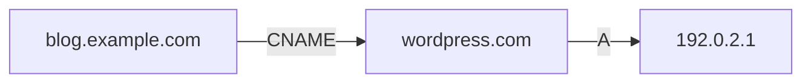

```yaml
CNAME:
  Purpose: "Alias one hostname to another hostname"
  Example: "blog.example.com -> CNAME -> wordpress.com -> A -> 192.0.2.1"

  Constraint:
    Rule: "You CANNOT put a CNAME at the root (apex) of a domain"
    Allowed: "www.example.com CNAME ..."
    Not_Allowed: "example.com CNAME ..."
    Why: |
      The apex must also hold other records (SOA, NS, MX),
      and a CNAME can't coexist with any other record at the same name.

  Performance: "Slower - requires a second lookup"

ALIAS_ANAME:
  What: "A virtual, provider-specific record type"
  Behaviour: "Mimics CNAME at the apex, but returns an A record to the client"
  Examples: "Route 53 ALIAS, Cloudflare CNAME flattening"
```

### Record Type Cheat Sheet

| Type | Maps | Example Use |
|------|------|-------------|
| **A** | Name → IPv4 | `example.com → 93.184.216.34` |
| **AAAA** | Name → IPv6 | `example.com → 2606:2800:...` |
| **CNAME** | Name → Name | `www → example.com` |
| **ALIAS/ANAME** | Apex name → Name (returns A) | `example.com → my-lb.cloud.com` |
| **PTR** | IP → Name | Reverse lookups, email checks |
| **MX** | Domain → Mail server | Where to deliver email |
| **NS** | Zone → Nameservers | Delegation |
| **SOA** | Zone metadata | Primary server, serial, timers |
| **TXT** | Arbitrary text | SPF, DKIM, domain verification |

---

## Caching & TTL: Why the Internet Doesn't Melt Down

### TTL (Time-To-Live)

TTL is a value **in seconds** dictating how long a record stays valid. Setting `TTL = 3600` tells every resolver in the world: "remember this answer for one hour."

### The Layers of Cache

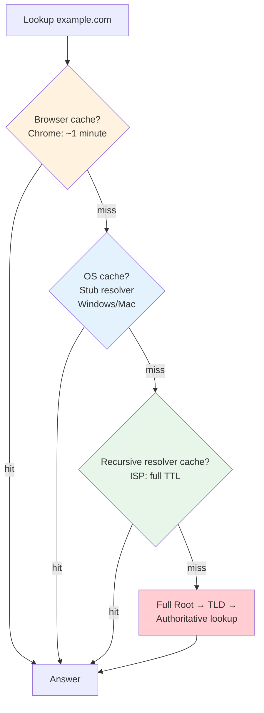

| Layer | What Caches | Duration |
|-------|-------------|----------|
| **Browser** | Chrome's internal DNS cache | About a minute |
| **OS (Stub Resolver)** | Windows / macOS DNS cache | Per OS policy, up to TTL |
| **Recursive Resolver** | ISP / public resolver | The full TTL |

> **The concept:** store data closer to the user to avoid network traffic. Caching is what makes the web fast.

### Propagation

If you change an IP five minutes after publishing a record with a 1-hour TTL, **nobody using those caches will know until their cached copy expires**. This delay is called **propagation**.

```yaml
Propagation:
  What: "The delay caused by caches clearing out old data"
  Why_DNS_Isnt_Instant: "You're waiting for caches around the world to expire"

  Migration_Playbook:
    1: "Days before the change, lower the TTL (e.g. 3600 -> 60)"
    2: "Wait at least one OLD TTL so caches pick up the short TTL"
    3: "Make the change - it now propagates within ~60s"
    4: "Once stable, raise the TTL again to reduce query load"
```

### Choosing a TTL

| TTL | Pros | Cons | Use For |
|-----|------|------|---------|
| Short (60-300s) | Fast changes, quick failover | More queries, more latency | Failover endpoints, upcoming migrations |
| Long (3600s-86400s) | Fewer queries, faster lookups | Slow to change | Stable records (MX, NS) |

---

## Zones & Zone Transfers

### What Is a Zone?

A **zone** is an **administrative boundary**. For example, `example.com` and `blog.example.com` could be in different zones, managed by different teams or providers.

### Primary and Secondary Servers

Large companies don't rely on one server. They run a **primary (master)** and multiple **secondary (slave)** servers. To keep them in sync, they perform **zone transfers**: moving DNS data from primary to secondary.

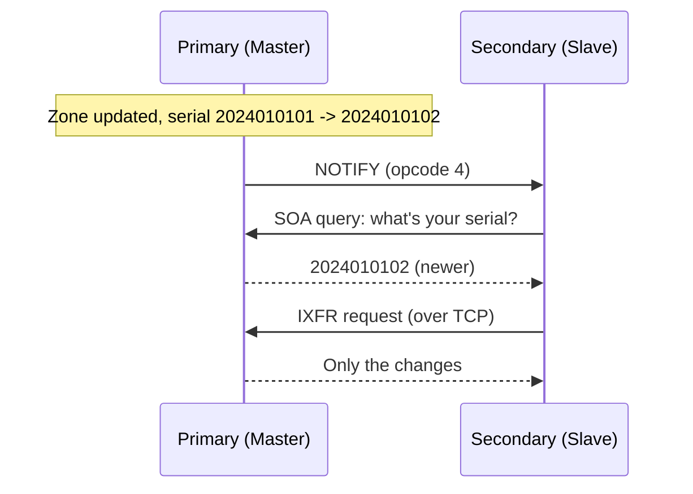

| Type | Name | What It Copies |
|------|------|----------------|
| **AXFR** | Full zone transfer | Everything |
| **IXFR** | Incremental zone transfer | Only changes since the last sync |

```yaml
Zone_Transfer_Notes:
  Protocol: "Always TCP - zone files are large"
  Security_Risk: |
    Unrestricted zone transfers let attackers download your
    entire zone and map your whole network (every hostname/IP).
  Mitigation: "Allow AXFR/IXFR only from known secondary IPs (and use TSIG)"
```

```bash
# Test whether a server leaks its zone (should be refused!)
dig AXFR example.com @ns1.example.com
```

---

## Reverse DNS (PTR): "Who Owns This IP?"

Usually we go from **name to IP**. Sometimes we need the opposite.

```yaml
Reverse_DNS:
  Function: "Map an IP address BACK to a hostname"
  Record: "PTR (Pointer) - the opposite of an A record"
  Special_Domain: "in-addr.arpa (IPv4 reverse lookups)"
  Format: "IP octets reversed + .in-addr.arpa"
  Use_Cases:
    - "Network diagnostics (traceroute, logs)"
    - "Email security - anti-spam filters check if the IP matches the hostname"
```

```
# Forward:   mail.example.com      A     203.0.113.25
# Reverse:   25.113.0.203.in-addr.arpa.   PTR   mail.example.com.
```

```bash
dig -x 203.0.113.25
```

> **Email gotcha:** if you run a mail server without a PTR record, Gmail and Outlook will almost certainly reject your emails.

---

## DNS Security: The Attacks

DNS was built for **trust, not security**, and attackers exploit that.

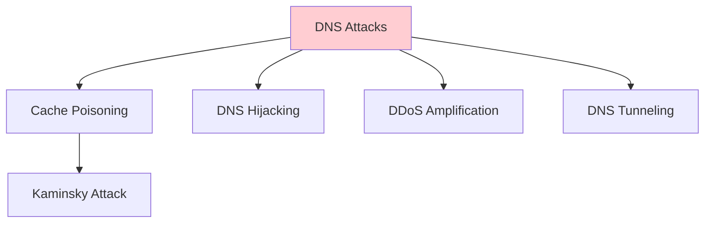

### 1. Cache Poisoning

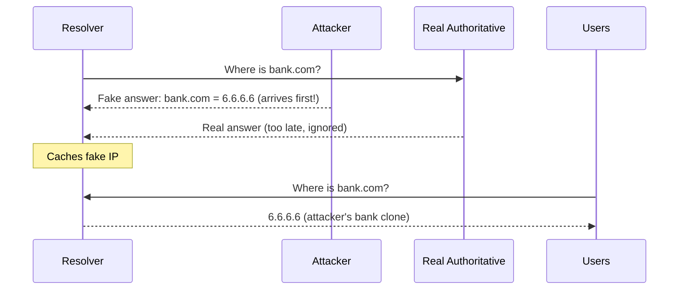

```yaml
Cache_Poisoning:
  How: "Attacker races the real server; if the fake answer reaches the resolver first, it gets cached"
  Impact: "Everyone using that resolver goes to the attacker's site - e.g. a bank clone stealing credentials"
  Kaminsky_Attack:
    What: "A famous variation exploiting predictable transaction IDs"
    Why_It_Worked: "A 16-bit ID is only 65,536 possibilities - guessable at scale"
    Mitigations: "Randomized source ports + IDs, and ultimately DNSSEC"
```

### 2. DNS Hijacking

Malware or a rogue ISP **changes your DNS settings entirely**, redirecting all your traffic through a resolver they control.

### 3. DDoS Amplification

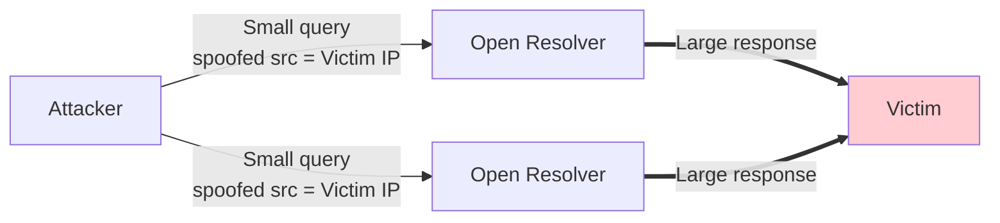

Attackers **spoof the victim's IP** and send queries asking for **large records** (e.g. `ANY` queries) to open resolvers. The big responses all flood the victim. Because UDP has no handshake, the source address is never verified.

### 4. DNS Tunneling

Encoding data **inside DNS queries** to bypass firewalls, used for **data exfiltration** or **command-and-control** channels. Since almost every network allows DNS out, it's a sneaky side channel.

```
# Data smuggled in subdomain labels
dGhlIHNlY3JldA.exfil.attacker.com
```

| Attack | What It Abuses | Defense |
|--------|---------------|---------|
| Cache poisoning | Unauthenticated responses | DNSSEC, randomized IDs/ports |
| Hijacking | Compromised settings / resolvers | Endpoint security, DoH/DoT to trusted resolvers |
| Amplification | Open resolvers + spoofable UDP | Close open resolvers, rate limit, BCP38 filtering |
| Tunneling | DNS allowed through firewalls | Monitor query patterns and entropy |

---

## DNSSEC: Adding a Digital Signature to the Phonebook

DNSSEC fixes the **trust** issue by adding digital signatures to DNS. Think of it as signing the phonebook to prove it's authentic.

```yaml
DNSSEC:
  Purpose: "Verify the authenticity of DNS data (anti-spoofing)"
  How: "Cryptographic signatures with public/private key pairs"

  New_Records:
    RRSIG: "The digital signature of a record set"
    DNSKEY: "The public key used to verify that signature"
    DS: "Delegation Signer - the link in the chain of trust, stored in the PARENT zone"

  Verification: |
    The resolver checks the RRSIG using the zone's DNSKEY.
    If they don't match, the data was tampered with - drop it.

  Does_Not_Provide: "Privacy - DNSSEC data is signed, not encrypted"
```

### The Chain of Trust

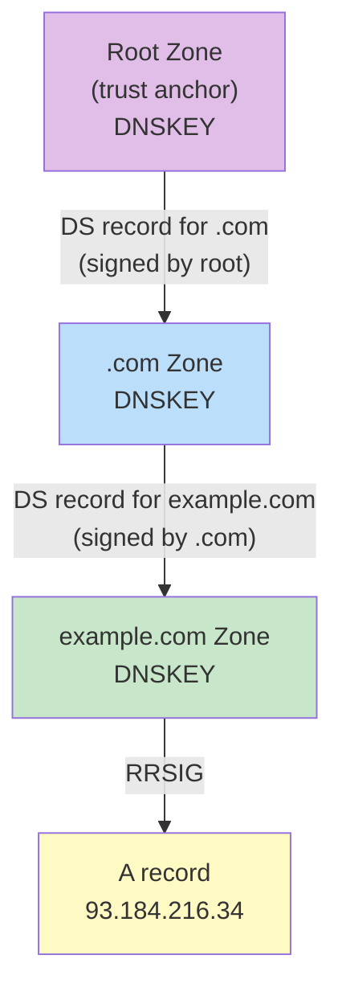

The root signs the TLD, the TLD signs your domain. This creates an **unbroken cryptographic chain** you can verify all the way up to the root.

```bash
# Ask for DNSSEC records alongside the answer
dig +dnssec example.com
```

---

## Privacy: DoH & DoT

### The Issue

For about 30 years, your ISP knew every site you visited. Standard DNS is **plaintext UDP**, so anyone eavesdropping on your network (ISPs, coffee-shop attackers, governments) can see every domain you query.

### The Solutions

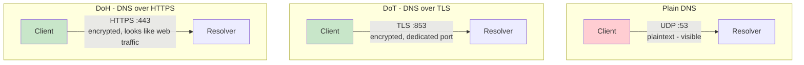

| | Plain DNS | DoT (DNS over TLS) | DoH (DNS over HTTPS) |
|--|-----------|--------------------|----------------------|
| **Port** | 53 | 853 | 443 |
| **Encrypted** | No | Yes | Yes |
| **Looks like** | DNS | A dedicated secure DNS channel | Regular web traffic |
| **Easy to block/filter** | Yes | Yes (by port) | Very hard |

### The Trade-off

```yaml
Encrypted_DNS_Tradeoff:
  Benefit: "Nobody on the path can see which sites you're looking up"
  Cost: "A headache for network admins"
  Why: |
    Corporate firewalls and parental controls rely on seeing DNS
    to filter malicious or inappropriate sites. When DNS is encrypted
    and looks like any other HTTPS traffic, filtering becomes much harder.
```

> **DNSSEC vs. DoH/DoT:** DNSSEC gives you **trust** (the answer is authentic). DoH/DoT gives you **privacy** (nobody saw the question). They solve different problems and can be used together.

---

## DNS in System Design

```yaml
DNS_In_Practice:
  Load_Distribution:
    Round_Robin: "Multiple A records for basic spreading"
    GeoDNS: "Return different IPs based on the resolver's location"
    Weighted: "Send X% to one endpoint (canary releases)"

  Failover:
    How: "Health-checked records swap to a standby IP"
    Requires: "Short TTLs, otherwise caches keep sending users to the dead IP"

  CDNs:
    How: "CNAME your hostname to the CDN, which answers with the nearest edge"
    Example: "assets.example.com CNAME example.cdn-provider.net"

  Apex_Domains:
    Problem: "Need to point example.com at a load balancer hostname"
    Solution: "ALIAS/ANAME or CNAME flattening"

  Reliability:
    Rule: "DNS is a dependency of EVERYTHING - if it's down, you're down"
    Practice: "Multiple nameservers, ideally across providers"
```

---

## Key Takeaways

### Remember This

- **Hierarchy is king:** Root → TLD → Authoritative. DNS is a distributed database where authority is delegated downwards
- **History:** HOSTS.TXT at SRI didn't scale; Paul Mockapetris invented DNS in 1983 (RFC 1034/1035)
- **Read right to left:** `www.example.com.` = root `.` → `com` → `example` → `www`; the trailing dot is the root
- **Four servers:** Resolver (librarian), Root (index), TLD (aisle manager), Authoritative (source of truth)
- **Recursion vs. iteration:** the client asks the resolver recursively; the resolver walks root/TLD/authoritative iteratively
- **UDP/53** is the standard transport, with TCP/53 for truncated (TC bit, >512 bytes) responses and zone transfers; EDNS0 allows larger UDP
- **Header flags:** AA = from the source, TC = truncated, RD/RA = recursion desired/available, RCODE 3 = NXDOMAIN
- **Records:** A (IPv4), AAAA (IPv6), CNAME (name → name, never at the apex), ALIAS (apex workaround), PTR (reverse)
- **Caching is critical:** TTL controls how long data persists across browser, OS, and resolver caches; propagation is just caches expiring
- **Security layers:** DNSSEC for trust, DoH/DoT for privacy

### Common Mistakes to Avoid

```yaml
Common_Mistakes:
  1_Long_TTL_Before_Migration:
    Mistake: "Changing an IP while the TTL is 24 hours"
    Reality: "Users hit the old IP for up to a day"
    Correct: "Lower the TTL days in advance, then migrate"

  2_CNAME_At_Apex:
    Mistake: "example.com CNAME my-lb.cloud.com"
    Reality: "Breaks the protocol - apex needs SOA/NS/MX"
    Correct: "Use ALIAS/ANAME or CNAME flattening"

  3_Open_Zone_Transfers:
    Mistake: "Allowing AXFR from anyone"
    Reality: "Attackers can map your entire network"
    Correct: "Restrict transfers to known secondaries (TSIG)"

  4_Running_An_Open_Resolver:
    Mistake: "Recursive resolver reachable by the whole internet"
    Reality: "It becomes a DDoS amplification weapon"
    Correct: "Restrict recursion to your own clients"

  5_No_PTR_For_Mail:
    Mistake: "Mail server without reverse DNS"
    Reality: "Gmail/Outlook reject or spam-folder your mail"
    Correct: "Set a PTR record matching your mail hostname"

  6_Relying_On_Round_Robin_For_HA:
    Mistake: "Multiple A records as your only failover"
    Reality: "No health checks; dead IPs keep getting traffic"
    Correct: "Health-checked DNS or a real load balancer"

  7_Single_DNS_Provider:
    Mistake: "All nameservers at one provider"
    Reality: "Provider outage = your entire site disappears"
    Correct: "Multiple nameservers, ideally multi-provider"
```

### Best Practices

```yaml
Best_Practices:
  1: "Keep stable records on long TTLs; failover/migration records on short TTLs"
  2: "Run at least two authoritative nameservers in different networks"
  3: "Restrict zone transfers and recursion"
  4: "Enable DNSSEC to protect against spoofing"
  5: "Use DoH/DoT on clients for privacy where policy allows"
  6: "Configure PTR, SPF, DKIM, and DMARC for any domain that sends email"
  7: "Use dig +trace to debug resolution end to end"
  8: "Monitor DNS - it's a dependency of every other service"
```

---

## Presentation

The slides used in this episode are available in the [presentation folder](./presentation/).

---

<div align="center">

[Previous Episode: HTTP, HTTPS & WebSockets](../20-http-https-websockets/) | [Course Home](../../) | [Next Episode: Latency, Bandwidth & Throughput](../22-latency-bandwidth-throughput/)

</div>
