# Episode 22: Network Latency, Bandwidth & Throughput

[](http://youtube.com/@ThatNotesGuy)

## What You'll Learn

- The precise difference between latency, bandwidth, and throughput (and why they are not interchangeable)
- The four components of latency: propagation, serialization, processing, and queuing delay
- Why the speed of light sets a hard floor on latency (New York to London = ~56ms round trip, minimum)
- The latency vs. throughput trade-off: batching, compression, parallelism, and Little's Law
- How the TCP/TLS handshake and the Bandwidth-Delay Product (BDP) cap real-world throughput
- Why packet loss and jitter are performance killers, and why you must design for P99 tail latency
- Practical optimizations: Protobuf over JSON, CDNs, keep-alive connections, optimistic UI
- How to measure and observe latency with ping/traceroute, RUM, and distributed tracing

---

## Introduction: The Holy Trinity of Network Metrics

### Three Words People Mix Up

Latency, bandwidth, and throughput are often used interchangeably, but they describe three very different things. Mixing them up leads to wrong fixes: buying a bigger pipe will not help if your problem is distance, and moving servers closer will not help if your pipe is full.

```yaml
The_Holy_Trinity:
  Latency:
    Definition: "The time delay between an action and a response"
    Think_Of_It_As: "Speed, measured in time"
    Unit: "Milliseconds (ms), sometimes microseconds (µs)"
    Question_It_Answers: "How long does one request take?"

  Bandwidth:
    Definition: "The maximum theoretical capacity of the channel"
    Think_Of_It_As: "The width of the pipe"
    Unit: "Bits per second (Mbps, Gbps)"
    Question_It_Answers: "How much data COULD flow per second?"
    Example: "A 1 Gbps connection has 1 Gbps of bandwidth"

  Throughput:
    Definition: "The actual successful data transfer rate achieved"
    Think_Of_It_As: "Reality"
    Unit: "Bits per second, or requests/transactions per second"
    Question_It_Answers: "How much data DID flow per second?"
    Example: "1 Gbps bandwidth, but with packet loss you may only get 500-750 Mbps"
```

### The Highway Analogy

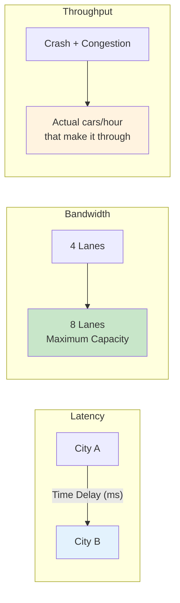

```yaml
Highway_Analogy:
  Latency: "How long it takes ONE car to drive from City A to City B"
  Bandwidth: "How many lanes the highway has (4 lanes vs 8 lanes)"
  Throughput: "How many cars ACTUALLY arrive per hour, after crashes, congestion, and roadwork"

  Key_Insight: |
    Adding lanes (bandwidth) does not make a single car drive faster (latency).
    It only lets more cars travel at the same time.
```

### The Golden Rule

```yaml
Golden_Rule:
  Statement: "Throughput can never exceed bandwidth"
  Reality: "Throughput is almost always LOWER than bandwidth"
  Why:
    - Protocol overhead (headers for Ethernet, IP, TCP, TLS, HTTP)
    - Packet loss and retransmissions
    - Congestion control backing off
    - TCP window limits (see Bandwidth-Delay Product)
    - Slow endpoints (CPU, disk, application logic)

  Relationship: "Throughput <= Bandwidth"
```

| Metric | Measures | Unit | Analogy | Improved By |
|--------|----------|------|---------|-------------|
| **Latency** | Time for one round trip / response | ms | Travel time between cities | Shorter distance, fewer hops, less queuing |
| **Bandwidth** | Maximum capacity | Mbps / Gbps | Number of lanes | Bigger link / plan upgrade |
| **Throughput** | Actual delivered rate | Mbps / req/s | Cars actually arriving per hour | Less loss, tuned windows, batching, parallelism |

---

## Latency: Where Does the Time Go?

Latency is not one number. It is the **sum of four specific delays**, and each one has a different cause and a different fix.

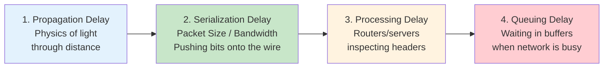

```yaml
Total_Latency:
  Formula: "Latency = Propagation + Serialization + Processing + Queuing"
  Note: "This is per hop; end-to-end latency adds these up across every router on the path"
```

### 1. Propagation Delay

The time it takes the signal to physically travel from sender to receiver. This is bounded by the **speed of light**.

```yaml
Propagation_Delay:
  Cause: "Physical distance"
  Formula: "Distance / Signal Speed"
  Speed_In_Vacuum: "~300,000 km/s"
  Speed_In_Fiber: "~200,000 km/s (about 2/3 the speed of light in a vacuum)"
  Why_Slower_In_Fiber: "Light is slowed by the glass (refractive index ~1.5)"

  Rule_Of_Thumb: "~5 µs per km in fiber, or ~1 ms per 200 km one way"
  Fix: "Reduce distance - move data closer to the user (CDN, edge, multi-region)"
```

### 2. Serialization (Transmission) Delay

The time it takes to push all the bits of a packet onto the wire.

```yaml
Serialization_Delay:
  Cause: "Link speed (bandwidth) and packet size"
  Formula: "Packet Size / Bandwidth"

  Example_1500_Byte_Packet:
    Packet_Size_Bits: "1500 bytes x 8 = 12,000 bits"
    On_1_Gbps: "12,000 / 1,000,000,000 = 12 µs"
    On_100_Mbps: "12,000 / 100,000,000 = 120 µs"
    On_10_Mbps: "12,000 / 10,000,000 = 1.2 ms"

  Key_Insight: |
    This is the ONE component of latency that higher bandwidth reduces.
    It is also why smaller payloads (e.g., Protobuf instead of JSON) help.
```

### 3. Processing Delay

```yaml
Processing_Delay:
  Cause: "CPU work done by routers, firewalls, load balancers and servers"
  Examples:
    - Inspecting packet headers and making routing decisions
    - Checksum verification
    - Firewall / NAT rules
    - TLS encryption and decryption
  Typical: "Microseconds per router hop on modern hardware"
  Fix: "Faster hardware, fewer middleboxes, hardware offload"
```

### 4. Queuing Delay

```yaml
Queuing_Delay:
  Cause: "Congestion - packets waiting in a router or switch buffer"
  Behavior: "If the outgoing link is busy, your packet just sits in a buffer"
  Variability: "Highly variable - depends on how busy the network is at that moment"
  Side_Effect: "This variability is the main source of JITTER (variable latency)"
  Fix: "Avoid congested paths, QoS prioritization, reduce burstiness"
```

### Summary of the Four Delays

| Component | Caused By | Depends On | Can You Fix It? |
|-----------|-----------|------------|-----------------|
| **Propagation** | Physics (speed of light) | Distance | Only by moving closer (CDN/edge) |
| **Serialization** | Pushing bits onto the wire | Packet size / bandwidth | Bigger links, smaller payloads |
| **Processing** | Router/server CPU logic | Hardware, number of hops | Faster hardware, fewer hops |
| **Queuing** | Congestion in buffers | Network load | Capacity, QoS, traffic shaping |

---

## The Physics of Distance: You Can't Beat the Speed of Light

If you are building a real-time trading app, propagation delay is your ceiling. No amount of code optimization will fix it.

### New York to London

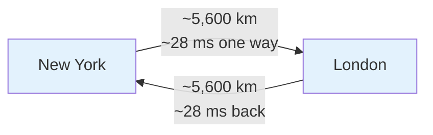

```yaml
NY_to_London:
  One_Way_Distance: "~5,600 km"
  Round_Trip_Distance: "~11,200 km"
  Speed_In_Fiber: "~200,000 km/s"

  Theoretical_Minimum:
    One_Way: "5,600 / 200,000 = 0.028 s = ~28 ms"
    Round_Trip: "11,200 / 200,000 = 0.056 s = ~56 ms"
    Assumes: "A perfectly straight fiber cable with zero routers"

  Reality:
    Why_Slower:
      - Cables do not follow straight lines (zigzag routes, landing stations)
      - Multiple router hops (processing + queuing at each)
      - Signal repeaters along undersea cables
    Rule: "Routing overhead usually doubles or triples the theoretical minimum"
    Realistic_Ping: "Often 80-120 ms"
```

### Practical Implications

```yaml
Distance_Implications:
  Fact: "No code optimization can make light travel faster"
  Only_Solution: "Move the data (or compute) closer to the user"
  Techniques:
    - CDNs and edge caches for static content
    - Multi-region deployments for dynamic content
    - Edge compute (run logic near the user)
    - Co-location (e.g., trading firms placing servers next to the exchange)

  Design_Question: |
    "Where are my users, and where is my data?"
    If the answer is "different continents", you have a latency floor
    you cannot optimize away in code.
```

---

## Latency vs. Throughput Trade-offs

Optimizing one often hurts the other.

### Batching: Fast or Volume?

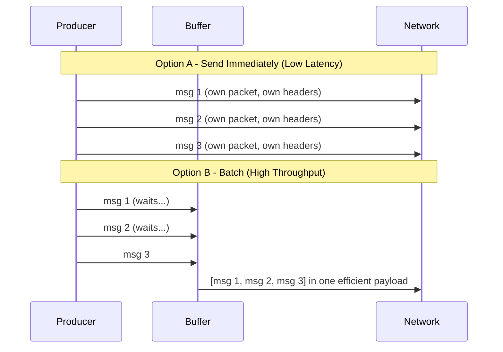

```yaml
Batching_Trade_Off:
  Send_Immediately:
    Latency: "Low - each message leaves right away"
    Throughput: "Lower - high overhead per packet (headers, syscalls, ACKs)"

  Batch:
    Latency: "Higher - the FIRST item in the batch had to wait for the buffer to fill"
    Throughput: "Higher - fewer, larger, more efficient payloads"

  Real_World: "Kafka producers expose exactly this choice"
  Kafka_Example:
    linger.ms: "How long to wait for more records before sending a batch"
    batch.size: "Max bytes per batch"
    Effect: "Higher linger.ms = bigger batches = more throughput, more latency"

  The_Question: "Do I want it fast, or do I want the volume?"
```

```properties
# Kafka producer - tuned for throughput
linger.ms=20
batch.size=65536
compression.type=lz4

# Kafka producer - tuned for latency
linger.ms=0
batch.size=16384
```

### Strategy Comparison

| Strategy | Effect on Latency | Effect on Throughput |
|----------|-------------------|----------------------|
| **Batching** | Increases (bad) | Increases (good) |
| **Compression** | Increases (CPU time to compress/decompress) | Increases (less data on the wire) |
| **Parallelism** | Decreases | Increases |

### Little's Law

The slide ties latency and throughput together with **Little's Law**:

```yaml
Littles_Law:
  Formula: "L = λ × W"
  Meaning:
    L: "Average number of items in the system (concurrency / in-flight requests)"
    λ: "Arrival rate = throughput (items per second)"
    W: "Average time each item spends in the system = latency"
  In_Words: "Avg items in system = throughput × latency"

  Example:
    Throughput: "1,000 requests/second"
    Latency: "200 ms (0.2 s)"
    In_Flight: "1,000 × 0.2 = 200 concurrent requests"

  Why_It_Matters:
    - "If latency doubles at the same throughput, you need double the concurrency (threads, connections)"
    - "If your connection pool caps concurrency at L, max throughput = L / W"
    - "Example: pool of 50 DB connections, 10 ms queries -> max ~5,000 queries/s"
```

---

## The TCP Handshake & RTT: Why Latency Kills TCP Throughput

TCP is connection-oriented. Before a single byte of an HTTP request is sent, client and server have to talk.

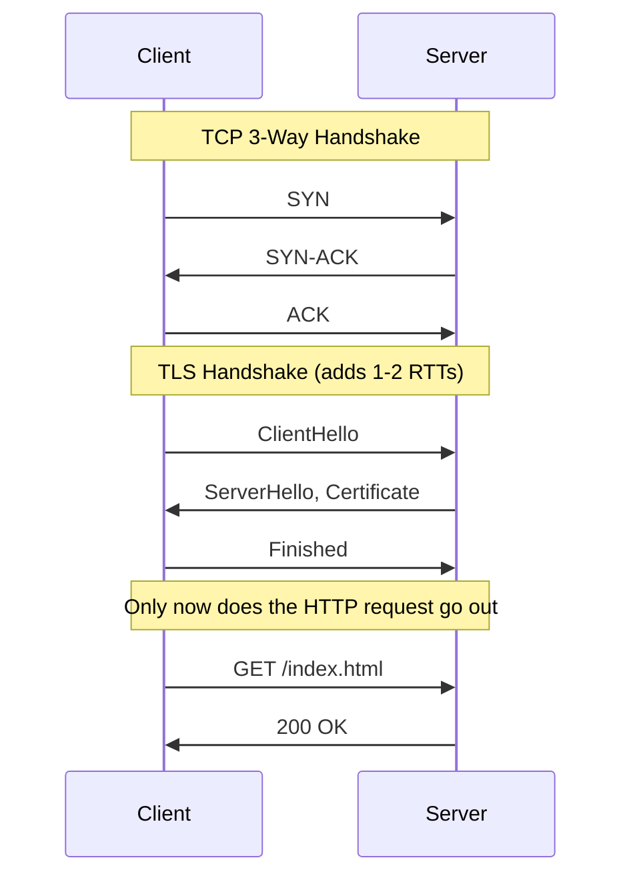

```yaml
Cold_Connection_Cost:
  TCP_Handshake: "SYN -> SYN-ACK -> ACK = 1.5 RTT before data is sent"
  TLS_Handshake: "Adds another 1-2 RTTs (TLS 1.3: 1 RTT, TLS 1.2: 2 RTTs)"

  Example_100ms_RTT:
    TCP_Only: "1.5 × 100 ms = 150 ms wasted before the user sees anything"
    With_TLS_1_2: "~350 ms before the first HTTP byte"
    With_TLS_1_3: "~250 ms before the first HTTP byte"

  Why_This_Hurts:
    - Serverless cold starts open new connections
    - New database connections pay this cost every time
    - Chatty services that reconnect per request multiply it
```

### Fixes for Handshake-Bound Systems

```yaml
Handshake_Fixes:
  Keep_Alive:
    What: "Reuse one TCP/TLS connection for many requests"
    HTTP: "HTTP/1.1 keep-alive is on by default; HTTP/2 multiplexes on one connection"
  Connection_Pooling:
    What: "Pre-open connections (DB pools like HikariCP, pgBouncer)"
    Benefit: "Pay the handshake once, amortize across thousands of queries"
  TLS_Session_Resumption:
    What: "Resume a previous TLS session (session tickets, TLS 1.3 0-RTT)"
  HTTP_3_QUIC:
    What: "Combines transport + TLS handshake (1 RTT, 0-RTT on resume)"
  Edge_Termination:
    What: "Terminate TLS at a CDN edge near the user, short RTT handshake"
```

```javascript
// Node.js - reuse connections instead of a new handshake per request
const https = require('https');

const agent = new https.Agent({
  keepAlive: true,       // reuse TCP + TLS connections
  maxSockets: 50,        // cap concurrent connections per host
});

https.get('https://api.example.com/items', { agent }, (res) => {
  // subsequent requests through `agent` skip the handshake
});
```

---

## The Bandwidth-Delay Product (BDP): The Capacity of the Pipe

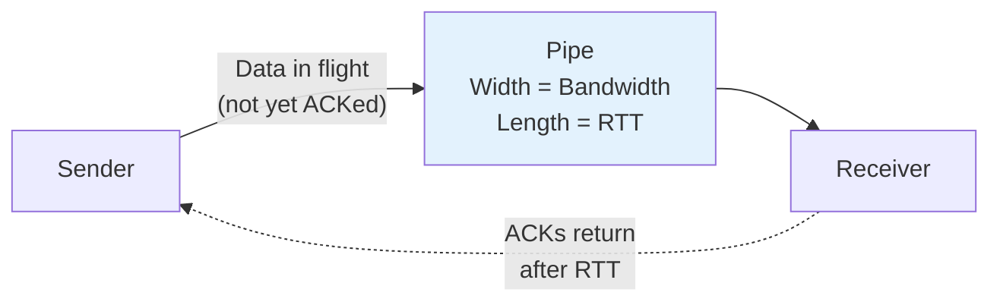

```yaml
Bandwidth_Delay_Product:
  Definition: "BDP = Bandwidth × RTT"
  Concept: "The amount of data 'in flight' on the network at any specific moment"
  Meaning: "How much data can be sent before the sender gets the first ACK back"

  Example:
    Bandwidth: "1 Gbps = 125 MB/s"
    RTT: "100 ms = 0.1 s"
    BDP: "125 MB/s × 0.1 s = 12.5 MB of data filling the pipe"
```

### Why BDP Matters: The TCP Window

```yaml
TCP_Window_vs_BDP:
  Rule: "If the TCP window is smaller than the BDP, you cannot use your full bandwidth"
  What_Happens: |
    The sender fills its window, then STOPS and waits for an ACK.
    While it waits, the link sits idle.

  Max_Throughput_Formula: "Throughput <= Window Size / RTT"

  Example_Untuned:
    Window: "64 KB (classic max without window scaling)"
    RTT: "100 ms"
    Max_Throughput: "64 KB / 0.1 s = 640 KB/s ≈ 5 Mbps"
    On_A_1_Gbps_Link: "You are using ~0.5% of your bandwidth"

  Example_Tuned:
    Window: "12.5 MB (matches BDP)"
    Max_Throughput: "12.5 MB / 0.1 s = 125 MB/s = 1 Gbps"

  Conclusion: |
    On long-distance links you are throughput-bound by LATENCY, not bandwidth,
    unless buffers are tuned to the BDP.
```

### Tuning for Long Fat Networks

If you are designing a file transfer system across continents, tune TCP buffers to match the BDP.

```bash
# Linux - raise max socket buffers so TCP auto-tuning can reach the BDP
# (values in bytes: min, default, max)
sysctl -w net.core.rmem_max=16777216
sysctl -w net.core.wmem_max=16777216
sysctl -w net.ipv4.tcp_rmem="4096 87380 16777216"
sysctl -w net.ipv4.tcp_wmem="4096 65536 16777216"

# Window scaling must be on (default on modern kernels)
sysctl net.ipv4.tcp_window_scaling
```

```yaml
Other_Options_For_Long_Fat_Pipes:
  - "Parallel streams (multiple TCP connections, e.g., multipart S3 uploads)"
  - "Modern congestion control like BBR"
  - "Purpose-built transfer protocols (UDP-based accelerated transfer)"
```

---

## Packet Loss & Jitter: Killers of Performance

```yaml
Definitions:
  Packet_Loss: "Percentage of packets that fail to reach their destination"
  Jitter: "The variance in latency over time"
```

### Packet Loss

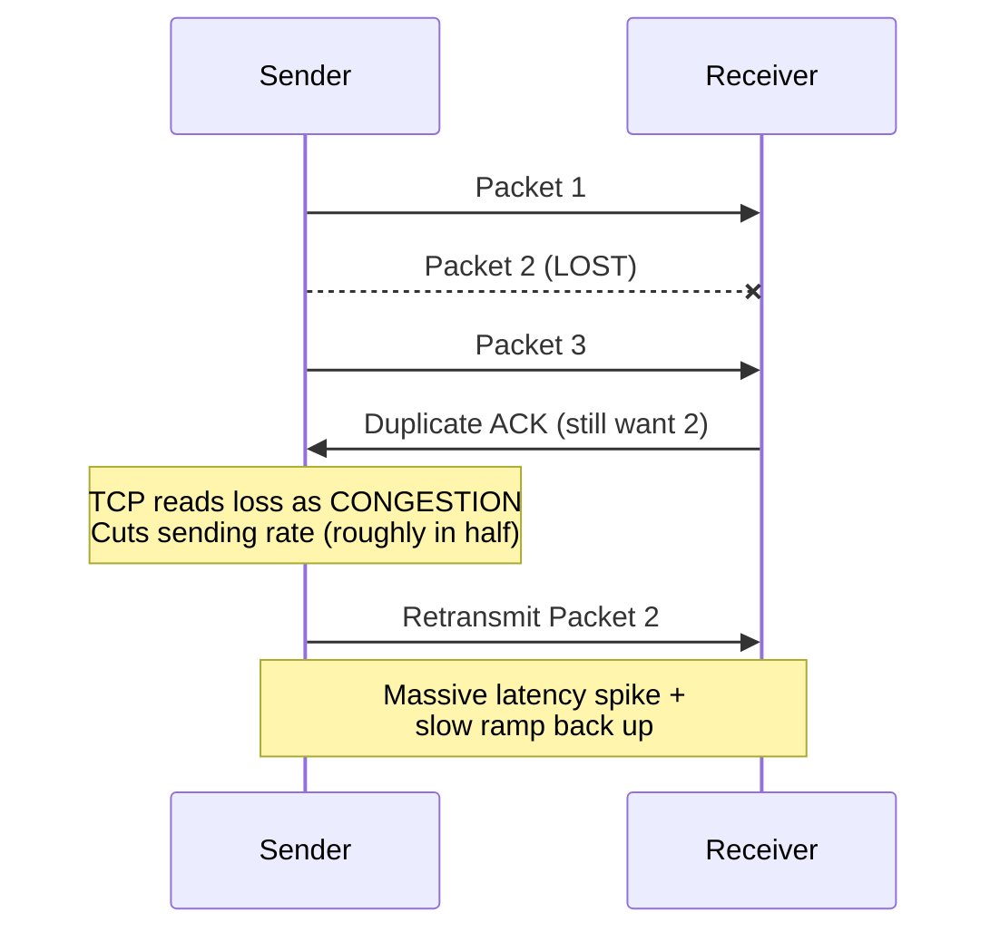

```yaml
Packet_Loss_Impact:
  TCP_Interpretation: "Loss = congestion"
  TCP_Reaction:
    - "Cut the congestion window (transmission rate) roughly in half"
    - "Retransmit the lost packet (at least one extra RTT)"
    - "Slowly ramp back up"
  Result: "Massive latency spike and reduced throughput"

  From_The_Video: "A 2% packet loss can kill your throughput by ~90% on high-latency links"

  Why_Latency_Makes_It_Worse: |
    Recovery speed depends on RTT. On a 10 ms link TCP recovers quickly;
    on a 150 ms intercontinental link every halving takes far longer to undo.

  Rule_Of_Thumb_Mathis_Formula:
    Formula: "Throughput ≈ (MSS / RTT) × (1.22 / sqrt(loss))"
    Takeaway: "Throughput falls with RTT AND with the square root of loss rate"

  Conclusion: "High throughput requires low packet loss"
```

### Jitter

```yaml
Jitter:
  Definition: "Variance in latency between packets"
  Example:
    Low_Jitter: "20 ms, 21 ms, 20 ms, 22 ms"
    High_Jitter: "20 ms, 100 ms, 20 ms, 85 ms"
  Main_Cause: "Queuing delay changing as congestion comes and goes"

  Impact:
    VoIP: "Jitter buffer runs dry -> choppy, robotic audio"
    Video_Calls: "Frozen frames, artifacts"
    Gaming: "Rubber-banding, inconsistent hit registration"

  Mitigations:
    - "Jitter buffers (trade a little latency for smoothness)"
    - "QoS / traffic prioritization for real-time packets"
    - "UDP-based protocols that skip stale packets instead of waiting"
```

| | Packet Loss | Jitter |
|---|-------------|--------|
| **What it is** | Packets that never arrive | Variation in arrival time |
| **Main cause** | Congestion, bad links, Wi-Fi interference | Variable queuing |
| **Hurts most** | TCP bulk transfers (throughput) | Real-time voice/video/gaming |
| **TCP effect** | Retransmit + rate halved | Unpredictable response times |

---

## Tail Latency (P99): Stop Using Averages!

Averages hide problems. If your average latency is 100 ms but your P99 is 2 seconds, your system is slow.

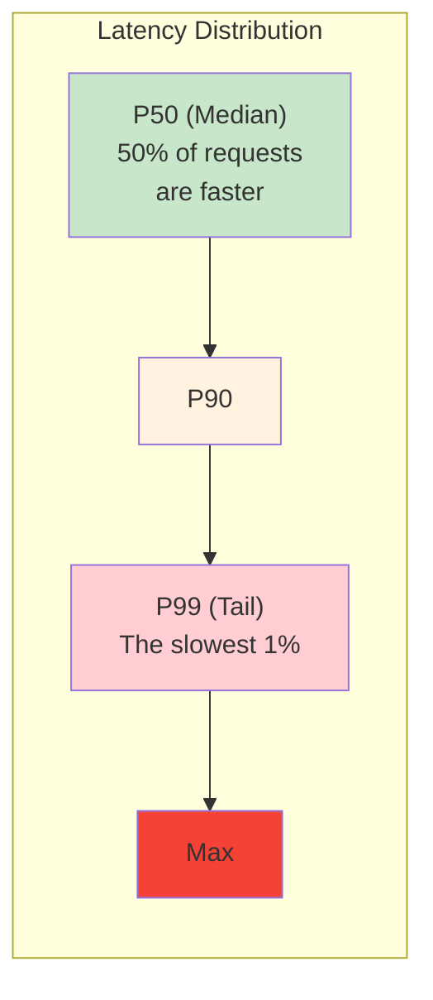

```yaml
Percentiles:
  P50_Median: "50% of requests are faster than this"
  P90: "90% of requests are faster than this"
  P99_Tail: "The slowest 1% of requests are slower than this"
  P999: "The slowest 0.1%"

  Why_Average_Lies:
    Example: "99 requests at 50 ms + 1 request at 5,000 ms"
    Average: "~99.5 ms - looks fine"
    P99: "~5,000 ms - one in a hundred users waits 5 seconds"

  SLA_Impact: "At scale, 1% of 1 million requests is 10,000 angry users"
```

### Causes of Tail Latency

```yaml
Tail_Latency_Causes:
  - "Garbage collection pauses"
  - "Resource contention (CPU, locks, noisy neighbors)"
  - "A single slow microservice in the call chain"
  - "Packet loss + TCP retransmission timeouts"
  - "Cold caches or cold connections"
  - "Queue build-up during traffic spikes"
```

### Fan-Out Makes the Tail Matter More

```yaml
Fan_Out_Amplification:
  Scenario: "One page request fans out to 100 backend calls in parallel"
  Rule: "The page is only as fast as its SLOWEST call"
  Math: "Probability at least one call hits its P99 = 1 - 0.99^100 ≈ 63%"
  Lesson: "For fan-out systems, the backend P99 becomes the user's typical experience"

  Mitigations:
    - "Hedged requests (send a backup request after a short delay)"
    - "Timeouts and graceful degradation"
    - "Reduce fan-out width"
```

```yaml
Design_Rule: "At scale, P99 defines your users' perception of your product. Always design for tail latency."
```

---

## Data Serialization & Formats: Making the Payload Smaller

Remember: serialization delay = packet size / bandwidth. Shrink the packet and you shrink the delay, and fit more requests through the same pipe.

```yaml
Format_Comparison:
  JSON:
    Type: "Text-based"
    Pros: "Human-readable, universal compatibility, great for public APIs"
    Cons: "Heavy - repeats field names in every object, numbers as text"

  Protobuf_gRPC:
    Type: "Binary"
    Pros: "Schema-enforced, compact byte stream, fast to encode/decode"
    Cons: "Not human-readable, needs .proto schema on both sides"
    From_The_Slide: "Up to 10x throughput improvement"
```

### Same Data, Two Formats

```json
{
  "user_id": 12345,
  "username": "harsh",
  "is_active": true,
  "followers": 1024
}
```

```protobuf
syntax = "proto3";

message User {
  int32  user_id   = 1;   // field names replaced by tag numbers on the wire
  string username  = 2;
  bool   is_active = 3;
  int32  followers = 4;
}
```

```yaml
Why_Protobuf_Is_Smaller:
  JSON: "Sends the string 'user_id', 'username', ... in EVERY message"
  Protobuf: "Sends a 1-byte tag (field number + type) instead of the field name"
  Numbers: "Varint encoding - small integers take 1-2 bytes, not their digit count"
  Result: "Several times fewer bytes on the wire for typical messages"

When_To_Use:
  Internal_Microservices: "Protobuf/gRPC - you control both sides"
  Public_APIs_Browsers: "JSON - compatibility and debuggability win"
  Large_Payloads_Either_Way: "Add compression (gzip, brotli, zstd)"
```

---

## Caching & CDNs: Moving Data Closer to You

Since we can't speed up light, we move the server.

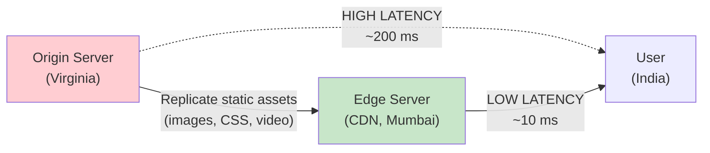

```yaml
CDN_Strategy:
  What: "Content Delivery Network - servers in thousands of cities (e.g., Cloudflare, Akamai)"
  Mechanism: "Replicate static assets (images, CSS, JS, video) to edge servers"

  Example_From_The_Video:
    Without_CDN: "User in India hits your Virginia bucket - ~200 ms"
    With_CDN: "User in India hits an edge server in Mumbai - ~10 ms"

  Results:
    Latency: "Reduces physical distance (propagation delay)"
    Throughput: "Offloads the backend - origin serves far fewer requests"
    Protection: "Acts as a massive shield, absorbing traffic spikes so your core database doesn't melt down"

  Bonus_Benefits:
    - "TLS terminated at the edge (short-RTT handshakes)"
    - "Persistent, optimized connections from edge to origin"
    - "DDoS absorption"
```

```http
# Tell CDNs and browsers what they may cache
Cache-Control: public, max-age=31536000, immutable   # fingerprinted static asset
Cache-Control: public, max-age=60, s-maxage=300      # short browser, longer CDN cache
Cache-Control: private, no-store                     # per-user / sensitive data
```

---

## Optimizing Browser/Client Performance: The Last Mile

```yaml
Client_Side_Optimizations:
  Browser_Limit:
    What: "Browsers limit parallel connections per domain (usually 6, for HTTP/1.1)"
    Effect: "The 7th asset waits in line behind the first 6"

  Domain_Sharding:
    What: "(Legacy) Spreading assets across subdomains (img1.example.com, img2...) to bypass the limit"
    Today: "Counter-productive with HTTP/2 and HTTP/3, which multiplex many requests over one connection"

  Pre_Fetching:
    What: "Predicting the user's next action and loading data early"
    Examples:
      - "<link rel='prefetch'> for the next page"
      - "<link rel='preconnect'> to warm up DNS + TCP + TLS"
      - "Loading data on hover before the click"

  Optimistic_UI:
    What: "Update the UI immediately while the network request processes in the background"
```

### Optimistic UI: Latency Is Also Psychological

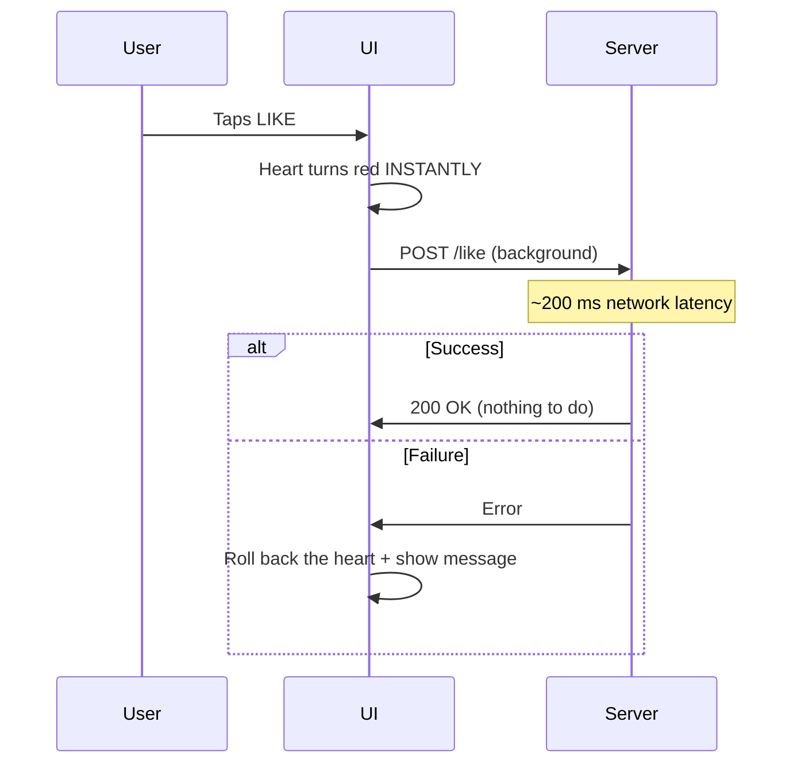

```javascript
// Optimistic UI - perceived latency becomes zero
async function onLikeClick(post) {
  const previous = post.liked;
  setLiked(post.id, true);            // 1. update UI immediately

  try {
    await fetch(`/api/posts/${post.id}/like`, { method: 'POST' });
  } catch (err) {
    setLiked(post.id, previous);      // 2. roll back if the request fails
    showToast('Could not like post. Try again.');
  }
}
```

```yaml
Optimistic_UI:
  Actual_Latency: "~200 ms"
  Perceived_Latency: "0 ms"
  Good_For: "Likes, toggles, sending chat messages, reordering lists"
  Avoid_For: "Payments, irreversible actions - anything where a rollback would confuse or harm the user"
```

```html
<!-- Warm up connections and fetch likely-next resources early -->
<link rel="preconnect" href="https://cdn.example.com">
<link rel="dns-prefetch" href="https://api.example.com">
<link rel="prefetch" href="/next-page.html">
```

---

## Monitoring & Observability: If You Can't Measure It, You Can't Fix It

```yaml
Observability_Tools:
  Ping_Traceroute:
    What: "Basic connectivity"
    Ping: "Round-trip time and packet loss to a host"
    Traceroute: "Which hops the packets take, and latency at each hop"

  Real_User_Monitoring_RUM:
    What: "Measuring latency from the user's actual browser"
    Why: "Lab tests miss real networks, real devices, real geographies"

  Distributed_Tracing:
    What: "Seeing the latency breakdown across microservices"
    Tools: "Jaeger, Zipkin, Datadog APM, OpenTelemetry"
```

### Distributed Tracing: Where Did the Time Go?

```mermaid
gantt
    title One Request, Traced Across Services
    dateFormat X
    axisFormat %L ms

    section Edge
    Load Balancer (20 ms)     :0, 20
    section App
    Application (115 ms)      :20, 135
    section Data
    Database (500 ms)         :135, 635
```

```yaml
Why_Tracing_Matters:
  Without_It: "You're just guessing whether the problem is the network or your code"
  With_It: |
    You see the exact breakdown, e.g.:
    load balancer 20 ms -> application 115 ms -> database 500 ms
    The database is the bottleneck, not the network.
    Now you know where to optimize.
```

```bash
# Quick network diagnostics
ping -c 10 api.example.com              # RTT + packet loss
traceroute api.example.com              # per-hop latency
mtr api.example.com                     # continuous ping + traceroute

# Break down a single HTTP request's latency with curl
curl -o /dev/null -s -w \
  "dns: %{time_namelookup}s\nconnect: %{time_connect}s\ntls: %{time_appconnect}s\nfirst_byte: %{time_starttransfer}s\ntotal: %{time_total}s\n" \
  https://example.com
```

---

## Real-World Scenarios

```yaml
Scenario_1_Global_E_Commerce:
  Problem: "Users in Asia report slow page loads; servers in us-east-1"
  Diagnosis: "Propagation delay (~200 ms RTT) + multiple cold handshakes"
  Fix:
    - "CDN for static assets"
    - "TLS termination at the edge"
    - "Keep-alive / HTTP/2 to the origin"

Scenario_2_Cross_Continent_Backup:
  Problem: "1 Gbps link between regions, but backups crawl at ~5 Mbps"
  Diagnosis: "TCP window (64 KB) far smaller than BDP (12.5 MB at 100 ms)"
  Fix:
    - "Tune TCP buffers to the BDP"
    - "Use parallel streams / multipart uploads"

Scenario_3_Microservice_Chatter:
  Problem: "Internal service-to-service calls dominate request time"
  Diagnosis: "Large JSON payloads + new connection per call"
  Fix:
    - "Switch to gRPC/Protobuf"
    - "Connection pooling"

Scenario_4_Event_Pipeline:
  Problem: "Kafka producers can't keep up at peak"
  Diagnosis: "Sending each record immediately - per-message overhead"
  Fix: "Increase linger.ms and batch.size, enable compression (accept a few ms extra latency)"

Scenario_5_Voice_App:
  Problem: "Choppy audio even though average ping is fine"
  Diagnosis: "High jitter; average hides the variance"
  Fix: "UDP-based transport, jitter buffer, measure jitter and P99, not average"
```

---

## Decision Framework: Summary

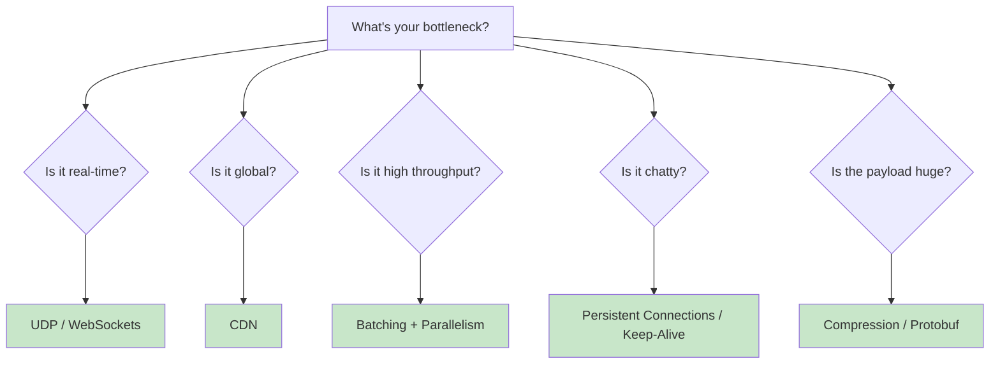

| Question | If Yes, Use | Because |
|----------|-------------|---------|
| **Is it real-time?** | UDP / WebSockets | Avoid per-request handshakes and retransmission stalls |
| **Is it global?** | A CDN | You can't beat the speed of light, so move closer |
| **Is it high throughput?** | Batching and parallelism | Amortize per-message overhead, use the full pipe |
| **Is it chatty?** | Persistent connections / keep-alive | Pay the TCP + TLS handshake once |
| **Is the payload huge?** | Compression / Protobuf | Smaller packets = lower serialization delay |
| **Always** | Measure P99, not averages | Tail latency defines user experience |

---

## Key Takeaways

### Remember This

- **Latency = time, Bandwidth = capacity, Throughput = reality**: throughput can never exceed bandwidth and is almost always lower
- **Latency has four parts**: propagation (distance), serialization (size / bandwidth), processing (CPU), queuing (congestion)
- **Physics sets the floor**: light in fiber travels ~200,000 km/s, so NY to London is ~56 ms round trip at minimum, and 80-120 ms in practice
- **Latency vs. throughput is a trade-off**: batching and compression raise throughput at the cost of latency; Little's Law (L = λW) links them
- **Handshakes are expensive**: TCP costs 1.5 RTT and TLS another 1-2 RTTs, so reuse connections
- **BDP = Bandwidth × RTT**: if your TCP window is smaller than the BDP, latency (not bandwidth) caps your throughput
- **Packet loss and jitter kill performance**: TCP treats loss as congestion and cuts its rate; jitter ruins VoIP and gaming
- **Design for P99**: averages hide the slowest 1%, and at 1M requests that's 10,000 unhappy users
- **Shrink, move, reuse**: Protobuf shrinks payloads, CDNs move data closer, keep-alive reuses connections

### Common Mistakes to Avoid

```yaml
Common_Mistakes:
  1_Confusing_Bandwidth_With_Speed:
    Mistake: "Upgrading to a bigger pipe to fix slow API calls"
    Reality: "Bandwidth doesn't reduce propagation delay"
    Correct: "Identify which latency component dominates first"

  2_Reporting_Averages:
    Mistake: "Dashboards showing only average latency"
    Reality: "Averages hide GC pauses, slow dependencies, retransmits"
    Correct: "Track P50, P95, P99 (and P99.9 at scale)"

  3_New_Connection_Per_Request:
    Mistake: "Opening a fresh TCP/TLS (or DB) connection every call"
    Reality: "Pays 1.5-3.5 RTTs of handshake each time"
    Correct: "Keep-alive, connection pooling, HTTP/2"

  4_Ignoring_BDP:
    Mistake: "Expecting full bandwidth across continents with default buffers"
    Reality: "Small TCP window leaves the link idle while waiting for ACKs"
    Correct: "Tune buffers to the BDP or use parallel streams"

  5_Over_Batching_Latency_Sensitive_Paths:
    Mistake: "Large batch windows on user-facing requests"
    Reality: "First item in the batch waits for the whole batch"
    Correct: "Batch background/bulk work; send interactive requests immediately"

  6_Optimizing_Code_For_A_Physics_Problem:
    Mistake: "Micro-optimizing handlers when users are 10,000 km away"
    Reality: "No code optimization beats the speed of light"
    Correct: "CDN, edge, or multi-region deployment"

  7_JSON_Everywhere_Internally:
    Mistake: "Large, verbose JSON between internal services"
    Reality: "Extra bytes = extra serialization delay and lower throughput"
    Correct: "Protobuf/gRPC where you control both sides"
```

### Best Practices

```yaml
Network_Performance_Best_Practices:
  1: "Measure first - ping/traceroute, RUM, and distributed tracing"
  2: "Always monitor tail latency (P99), not averages"
  3: "Put a CDN in front of anything global and static"
  4: "Reuse connections - keep-alive, pooling, HTTP/2 or HTTP/3"
  5: "Batch bulk/background work; keep interactive paths unbatched"
  6: "Use compact formats (Protobuf) and compression for large payloads"
  7: "Tune TCP buffers to the BDP on long, fast links"
  8: "Watch packet loss and jitter, especially for real-time features"
  9: "Use optimistic UI to hide unavoidable latency from users"
```

---

## Presentation Slides

The slides used in this episode are available in [`./presentation/`](./presentation/):

1. [Title: Network Latency, Bandwidth & Throughput](./presentation/1.png)
2. [The Holy Trinity of Metrics](./presentation/2.png)
3. [Latency: Where Does the Time Go?](./presentation/3.png)
4. [The Physics of Distance (Propagation)](./presentation/4.png)
5. [Latency vs. Throughput Trade-offs](./presentation/5.png)
6. [The TCP Handshake & RTT](./presentation/6.png)
7. [The Bandwidth-Delay Product (BDP)](./presentation/7.png)
8. [Packet Loss & Jitter](./presentation/8.png)
9. [Tail Latency (P99)](./presentation/9.png)
10. [Data Serialization & Formats](./presentation/10.png)
11. [Caching & CDNs](./presentation/11.png)
12. [Optimizing Browser/Client Performance](./presentation/12.png)
13. [Monitoring & Observability](./presentation/13.png)
14. [Summary](./presentation/14.png)

---

<div align="center">

[Previous Episode: DNS](../21-dns/) | [Course Home](../../) | [Next Episode: Redundancy & High Availability](../23-redundancy-high-availability/)

</div>
