# Episode 23: Redundancy & High Availability

[](http://youtube.com/@ThatNotesGuy)

## What You'll Learn

- What High Availability (HA) means, how it is measured in "nines", and why redundancy is the mechanism behind it
- How Active-Passive ("spare tire") architecture works: heartbeats, failover, the 30-60 second downtime window, and failback
- How Active-Active ("multi-lane highway") architecture works: load balancing, health checks, and near-instant failover
- How the two models compare on resource utilization, scalability, complexity, and cost
- Why Active-Active is easy for stateless web servers but hard for databases (write conflicts, bi-directional sync, conflict resolution)
- Which databases favor each model (PostgreSQL/MySQL vs. Cassandra/Aerospike)
- The difference between High Availability (HA) and Disaster Recovery (DR), and geo-redundancy

---

## Introduction: What is High Availability?

### Keeping the Lights On When Hardware Fails

High availability isn't just about having a backup. It's about **continuity**. Whether you are running a financial trading platform or a database, you use redundancy to eliminate **single points of failure (SPOFs)**.

```yaml
High_Availability:
  Definition: "Systems designed to operate continuously without failure for a long period"
  The_Goal: "Minimize downtime and maintain Service Level Agreements (SLAs)"
  The_Mechanism: "Redundancy - you cannot have HA without redundant components"
  The_Cost_Of_Failure: "Downtime is synonymous with revenue loss and user dissatisfaction"

  Redundancy_Means: "If Component A fails, Component B is available to take over"
  HA_Cluster_Types:
    - Active-Passive
    - Active-Active
```

### Single Point of Failure

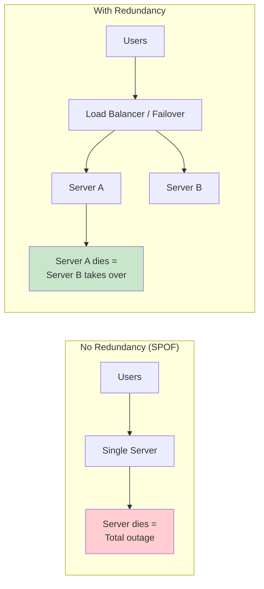

```yaml
Common_SPOFs:
  - "A single application server"
  - "A single database primary with no replica"
  - "A single load balancer"
  - "One availability zone / one data center"
  - "One network link, one power feed"
  - "One DNS provider"

  Rule: "Redundancy must exist at EVERY layer - a redundant app tier behind a single load balancer still has a SPOF"
```

### Measuring Availability: The Nines

```yaml
Availability_Formula:
  Availability: "Uptime / (Uptime + Downtime)"
  Alternative: "MTBF / (MTBF + MTTR)"
  MTBF: "Mean Time Between Failures - how often things break"
  MTTR: "Mean Time To Recovery - how fast you recover"
  Insight: "Faster failover (lower MTTR) is just as valuable as fewer failures"
```

| Availability | Common Name | Allowable Downtime per Year |
|--------------|-------------|-----------------------------|
| 99% | Two nines | ~3.65 days |
| **99.9%** | Three nines | **~8 hours, 46 minutes** |
| 99.99% | Four nines | ~52 minutes, 36 seconds |
| **99.999%** | Five nines | **~5 minutes, 16 seconds** |

```yaml
Why_It_Matters:
  Observation: |
    Going from 99.9% to 99.999% cuts allowed downtime from ~8.8 hours
    to ~5 minutes per year. A single 60-second failover, a handful of
    times a year, can consume most of a five-nines budget.
```

### Why Redundancy Raises Availability

```yaml
Redundancy_Math:
  Single_Node: "Availability = A"
  N_Redundant_Nodes_In_Parallel: "Availability = 1 - (1 - A)^N"

  Example_Two_Nodes_At_99_Percent:
    One_Node: "99%"
    Two_Nodes: "1 - (0.01 × 0.01) = 99.99%"

  Caveats:
    - "Assumes failures are independent (same rack/power/AZ = not independent)"
    - "Assumes failover itself works and is fast"
    - "Components in SERIES multiply: LB (99.99%) × App (99.99%) × DB (99.9%) ≈ 99.88%"
```

---

## The Two Buckets: Active-Passive vs. Active-Active

In system design, we generalize redundant setups into two buckets.

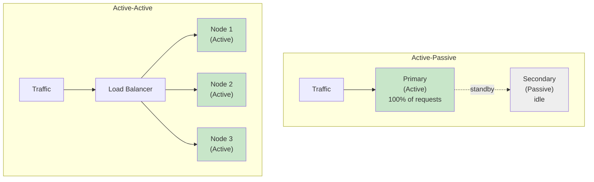

```yaml
Two_Buckets:
  Active_Passive: "One node works, the other waits - the insurance policy"
  Active_Active: "Every node works - there is no standby"
```

---

## Active-Passive: The "Spare Tire" Architecture

Redundancy prioritizing simplicity and reliability.

```yaml
Active_Passive:
  Configuration: "One primary node handles ALL traffic. One (or more) secondary nodes sit idle."
  Behavior: "The passive node is a 'hot standby' or 'failover' node. It does not process requests during normal operation."
  Utilization: "Lower overall resource utilization - the backup hardware is paying for electricity but doing no work"
  Essence: "It's essentially an insurance policy"

  Analogy:
    Spare_Tire: |
      Think of a spare tire in your car. It is fully functional,
      but it sits in the trunk doing nothing until the primary tire blows out.
```

### Standby Temperatures

The slide calls the passive node a "hot standby". In practice, standbys come in different temperatures:

| Standby Type | State of the Backup | Failover Speed | Cost |
|--------------|---------------------|----------------|------|
| **Hot** | Running, data continuously replicated | Seconds | Highest |
| **Warm** | Running, data replicated periodically or partially warmed | Minutes | Medium |
| **Cold** | Off or not provisioned; restore from backups | Hours | Lowest |

---

## Active-Passive Mechanics: The Heartbeat & Failover

How does the passive node know when to shine? **Heartbeats.**

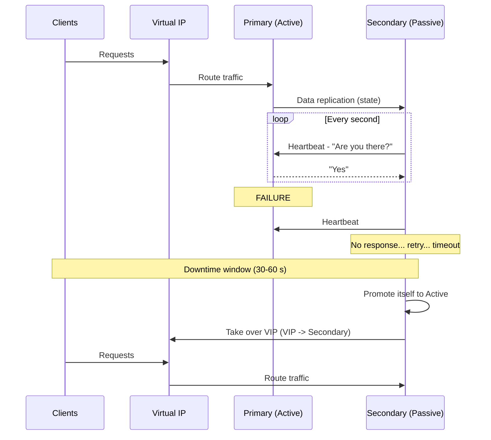

```yaml
Heartbeat_And_Failover:
  Heartbeats: "The passive server monitors the primary using regular heartbeat signals to check health"
  Failover_Trigger: "If the heartbeat stops, the passive node promotes itself to active"
  Traffic_Switch: "A Virtual IP (VIP) moves from the primary to the secondary, so clients don't change addresses"
  Downtime_Window: "Failover is NOT instant. It can take 30 to 60 seconds depending on configuration"
  Failback: "The process of reverting to the original primary once it is fixed (often manual)"
```

### Where the 30-60 Seconds Goes

```yaml
Failover_Timeline:
  1_Detection: "Wait for N missed heartbeats before declaring the primary dead (avoid false alarms)"
  2_Decision: "Confirm failure, ensure the old primary is really out (fencing)"
  3_Promotion: "Secondary becomes primary (DB: replay remaining logs, open for writes)"
  4_Redirection: "Move VIP / update DNS / reconfigure clients"
  5_Warm_Up: "Caches and connection pools refill on the new primary"

  Trade_Off: |
    Shorter heartbeat timeouts = faster failover, but more false positives
    (a brief network blip triggers an unnecessary failover).
```

### Split-Brain: The Danger in Active-Passive

```yaml
Split_Brain:
  Scenario: "The heartbeat link fails, but the primary is actually still alive"
  Problem: "Secondary promotes itself -> now TWO nodes think they're primary and both accept writes"
  Result: "Diverging data, corruption"

  Prevention:
    Fencing_STONITH: "'Shoot The Other Node In The Head' - forcibly power off/isolate the old primary"
    Quorum: "Use a third node or witness; only the side with a majority may be primary"
    Redundant_Heartbeat_Links: "Don't let a single cable decide who is alive"
```

```conf
# Example: keepalived VRRP config for an Active-Passive VIP
vrrp_instance VI_1 {
    state MASTER              # BACKUP on the standby node
    interface eth0
    virtual_router_id 51
    priority 150              # standby gets a lower priority, e.g. 100
    advert_int 1              # heartbeat (advertisement) every 1 second

    virtual_ipaddress {
        10.0.0.100            # clients always connect to this VIP
    }
}
```

---

## Active-Active: The "Multi-Lane Highway" Architecture

Parallel processing: there is no standby. Every node is hot.

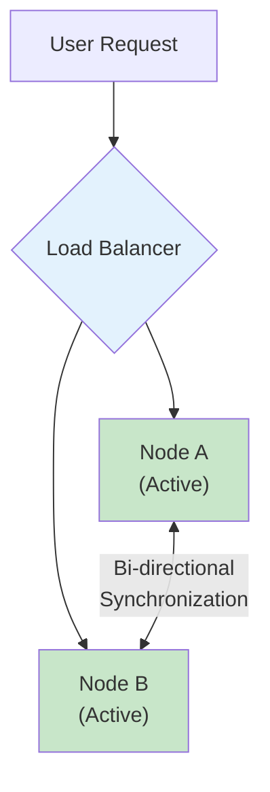

```yaml
Active_Active:
  Configuration: "Multiple identical nodes are simultaneously active and serving requests"
  Workload: "Traffic is distributed across ALL nodes"
  Utilization: "100% of hardware is utilized. No idle resources."
  Benefit: "Maximizes your hardware investment - you aren't paying for a server to sit idle"

  Analogy:
    Multi_Lane_Highway: |
      All the lanes are open, allowing more cars to flow at once.
      If one lane closes for an accident, traffic simply shifts to the others.
```

---

## Active-Active Mechanics: Load Balancing

The load balancer is the **traffic cop** of distributed systems.

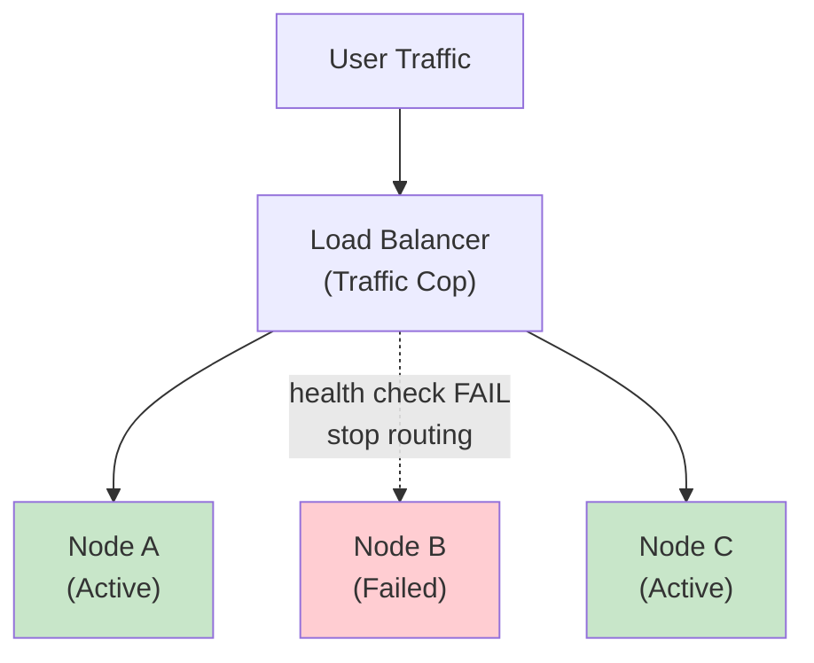

```yaml
Load_Balancer_Role:
  Role: "Route traffic to available nodes and remove unhealthy ones"

  Algorithms:
    Round_Robin: "Distributes requests sequentially: A, B, C, A, B, C..."
    Weighted_Round_Robin: "Biased based on server capacity (a 2x server gets 2x requests)"
    Random: "Arbitrary assignment"

  Health_Checks: "The load balancer detects failure and stops sending traffic to that node immediately"

  Instant_Failover: |
    Unlike Active-Passive, failover in Active-Active is often seamless to the user.
    If Node B dies, the load balancer just routes the next request to a surviving node.
    The user doesn't experience the 30-60 second outage seen in Active-Passive.
```

### Health Checks in Practice

```nginx
# NGINX - Active-Active upstream with weights and passive health checks
upstream app_servers {
    server 10.0.0.11 weight=2 max_fails=3 fail_timeout=10s;   # bigger box
    server 10.0.0.12 weight=1 max_fails=3 fail_timeout=10s;
    server 10.0.0.13 weight=1 max_fails=3 fail_timeout=10s;
}

server {
    listen 80;
    location / {
        proxy_pass http://app_servers;
        proxy_next_upstream error timeout http_502 http_503;   # retry on another node
    }
}
```

```yaml
Health_Check_Types:
  Passive: "Mark a node unhealthy after N failed real requests"
  Active: "LB probes an endpoint (e.g., GET /health) every few seconds"
  Good_Health_Endpoint:
    - "Fast and cheap"
    - "Checks the node's critical dependencies, but avoids cascading failures"
    - "Returns 200 only when the node can actually serve traffic"

  Capacity_Warning: |
    When one node fails, survivors absorb its load. Two nodes each at 70%
    means one node at 140% after a failure - an overload. Keep enough
    headroom (N+1) so the cluster survives losing a node.
```

---

## Resource Utilization: Are You Getting What You Pay For?

Let's talk money and physics.

| Feature | Active-Active | Active-Passive |
|---------|---------------|----------------|
| **Hardware State** | All nodes operational | Primary active, secondary idle |
| **Efficiency** | High (100% utilization) | Low (50% or less utilized) |
| **Throughput** | Aggregated capacity of all nodes | Limited to capacity of a single node |

```yaml
Utilization:
  Active_Passive:
    Reality: "You are effectively wasting ~50% of your resources"
    Detail: "The backup server is burning power but serving zero requests"

  Active_Active:
    Reality: "You aggregate the capacity of all nodes"
    Detail: "With two servers, you can handle roughly double the traffic of a single node"
```

---

## Scalability: Handling Growth and Traffic Spikes

What happens when your user base doubles?

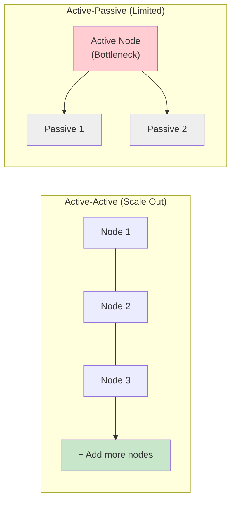

```yaml
Scalability:
  Active_Active:
    Model: "Scales horizontally ('scale out')"
    How: "Drop a new node into the cluster, update the load balancer"
    Effect: "Throughput increases roughly linearly"
    Example: "Going from 2 to 3 nodes - the new node carries a third of the total load"

  Active_Passive:
    Model: "Limited scalability"
    Problem: "You can't add a third server to help - only one server is allowed to serve"
    Effect: "Adding more passive nodes does NOT improve performance; it only increases redundancy"
    Bottleneck: "The single active node is a hard bottleneck for performance"
    Only_Option: "Scale UP (vertical scaling) the active node - and the standby to match"
```

---

## Complexity & Cost: The Hidden Costs of Active-Active

Active-Active sounds better in every way. It isn't. The trade-off is **complexity**.

```yaml
Complexity:
  Active_Passive: "Simpler - one writer, one source of truth"
  Active_Active: "Significantly more complex to configure and manage - requires managing distributed state"

Cost:
  Active_Passive:
    Upfront: "Often cheaper upfront (can use lower-spec standby hardware)"
    Hidden: "Paying for idle capacity"
  Active_Active:
    Upfront: "Hardware is used efficiently"
    Hidden:
      - "Higher software licensing costs (e.g., per-core licenses on multiple active nodes)"
      - "Administration costs due to synchronization logic"
      - "Engineering time for conflict handling and testing"

Operational_Overhead:
  Active_Active: "Requires distributed system management skills"
```

| Dimension | Active-Passive | Active-Active |
|-----------|----------------|---------------|
| **Setup complexity** | Low | High |
| **Upfront hardware cost** | Can be lower (smaller standby) | Full-spec nodes |
| **Licensing** | Often only active node | Every active node |
| **Ops skills needed** | Standard | Distributed systems expertise |
| **Hidden cost** | Idle hardware | Synchronization, conflict resolution |

---

## The Biggest Challenge: Data Consistency (Part 1) - The Multi-Master Problem

If you're running a web server that just serves HTML, Active-Active is easy. If you're running a database, it's hard. Why? **Write conflicts.**

```yaml
Stateless_vs_Stateful:
  Stateless_Web_Servers:
    Active_Active: "Easy"
    Why: "Any node can handle any request - no shared data to keep in sync"
    Tip: "Keep sessions out of the server (JWT, Redis) to stay stateless"

  Stateful_Databases:
    Active_Active: "Very hard"
    Why: "Requires multi-master replication - every node accepts writes"
```

### Write Conflicts

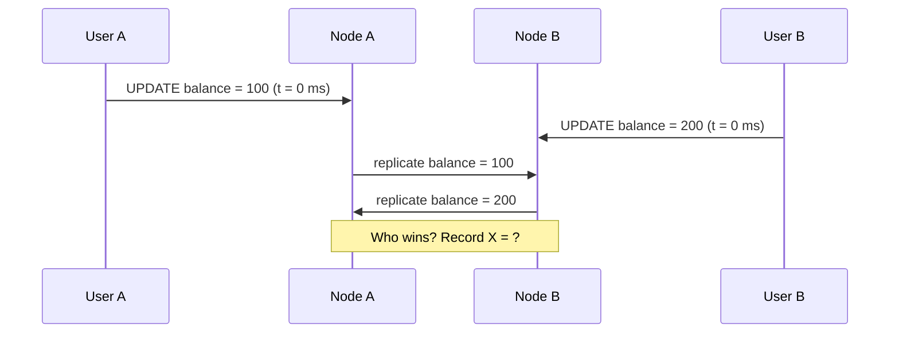

```yaml
Write_Conflict:
  Scenario: "User A writes to Node A and User B writes to Node B at the same exact millisecond, for the same record"
  Question: "Who wins?"
  Without_Handling: "Data corruption or silent data loss"

  Active_Passive_Avoids_This: |
    All writes are funneled to a 'Single Source of Truth' (the primary).
    There is only one writer, so there is nothing to conflict.
    This is why many teams stick to Active-Passive for databases:
    it guarantees strong consistency.
```

---

## The Biggest Challenge: Data Consistency (Part 2) - Solving Synchronization

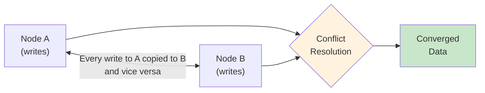

```yaml
Solving_Synchronization:
  Bi_Directional_Synchronization: "Data must be replicated between all active nodes - every write to A copied to B and vice versa"

  Conflict_Resolution: "Systems must use algorithms to merge divergent data"
  Algorithms:
    Last_Write_Wins_LWW:
      How: "Highest timestamp wins"
      Pro: "Simple"
      Con: "Clock skew can pick the 'wrong' write; the losing write is silently dropped"
    Vector_Clocks:
      How: "Track causal history per node to detect truly concurrent writes"
      Pro: "Detects conflicts instead of hiding them"
      Con: "Application may have to merge siblings itself"
    CRDTs:
      How: "Data types designed to merge automatically (counters, sets)"
      Pro: "Always converge without coordination"
      Con: "Only fit certain data shapes"
    Distributed_Consensus:
      How: "Paxos/Raft - nodes agree on order before committing"
      Pro: "Strong consistency"
      Con: "Extra round trips on every write"

  Latency: |
    Synchronizing data across distances (e.g., US-East to US-West)
    introduces latency, slowing down write speeds.
    Synchronous sync = slow writes; asynchronous sync = possible conflicts.
```

### Avoiding Conflicts by Design

```yaml
Conflict_Avoidance_Patterns:
  Home_Region_Partitioning: "Each user/record has a 'home' node that owns its writes"
  Commutative_Operations: "Prefer 'increment by 1' over 'set to 42'"
  Append_Only_Data: "Events/logs never overwrite each other"
  Route_Writes_Active_Passive_Reads_Active_Active: "Hybrid - one writer, many readers"
```

---

## Database Architectures: Where Consistency Matters

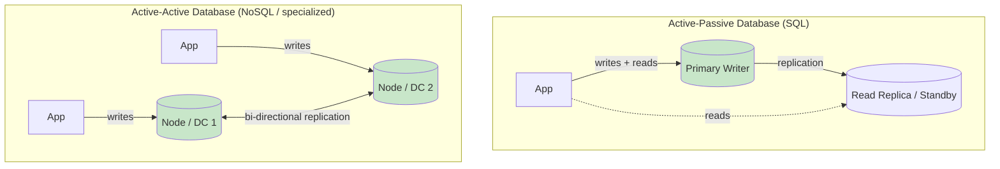

```yaml
Active_Passive_Database:
  Typical: "Standard for SQL (e.g., PostgreSQL, MySQL)"
  Layout: "One primary writer, one (or more) read replicas / standbys"
  Benefit: "No data conflicts, simple ACID compliance"
  Failover: "Promote a replica when the primary dies"
  Examples_Of_Tooling: "PostgreSQL streaming replication + Patroni, MySQL replication + Orchestrator, managed Multi-AZ databases"

Active_Active_Database:
  Typical: "Used for NoSQL or specialized SQL (e.g., Cassandra, Aerospike)"
  Benefit: "High throughput, geo-distribution - write to any node, even in different data centers"
  How: "The database handles the replication complexity for you"
  Example: "Aerospike uses Cross Datacenter Replication (XDR) to support Active-Active"
  Cassandra: "Masterless - any node accepts writes; tunable consistency (ONE, QUORUM, ALL); LWW per cell"
```

```sql
-- Cassandra: choose your consistency per query
-- QUORUM = a majority of replicas must acknowledge
CONSISTENCY QUORUM;
INSERT INTO users (user_id, name) VALUES (42, 'Harsh');

-- Multi-datacenter replication for active-active
CREATE KEYSPACE app
  WITH replication = {
    'class': 'NetworkTopologyStrategy',
    'us_east': 3,
    'eu_west': 3
  };
```

---

## Disaster Recovery (DR) vs. High Availability (HA)

Local vs. geographic redundancy.

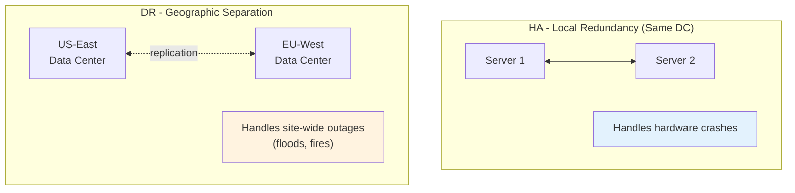

```yaml
HA_vs_DR:
  HA:
    Scope: "Local redundancy (same data center / region)"
    Handles: "A server crash, a disk failure, a process dying"
  DR:
    Scope: "Geographic separation"
    Handles: "A data center burning down - site-wide outages (floods, fires, power loss)"

  Active_Passive_For_DR:
    Standard: "Yes - keep a backup site somewhere else, ready to take over"
  Active_Active_For_DR:
    Name: "Geo-redundancy"
    How: "Deploy active nodes in different regions (e.g., US-East and EU-West / New York and London)"
    Benefit: "Both sites serve local users simultaneously; if one region dies, the other already has live traffic"
```

### DR Metrics: RTO and RPO

```yaml
DR_Metrics:
  RTO_Recovery_Time_Objective: "How long can we be down? (time to restore service)"
  RPO_Recovery_Point_Objective: "How much data can we lose? (time since last good copy)"
```

| DR Strategy | RTO | RPO | Cost |
|-------------|-----|-----|------|
| **Backup & restore (cold)** | Hours to days | Hours | $ |
| **Pilot light / warm standby** | Minutes to hours | Minutes | $$ |
| **Hot standby (Active-Passive across regions)** | Minutes | Seconds to minutes | $$$ |
| **Multi-site Active-Active (geo-redundancy)** | Near zero | Near zero | $$$$ |

---

## Real-World Examples

```yaml
Stateless_Web_Tier:
  Pattern: "Active-Active behind a load balancer across availability zones"
  Why: "No shared state - easy, cheap, scales out"

Relational_Database:
  Pattern: "Active-Passive - primary + synchronous standby in another AZ"
  Why: "Strong consistency and ACID; accept a short failover window"

Load_Balancers_Themselves:
  Pattern: "Active-Passive pair sharing a VIP (e.g., keepalived/VRRP), or managed LB that is internally redundant"
  Why: "Removes the LB as a single point of failure"

Global_NoSQL_Store:
  Pattern: "Active-Active across regions (Cassandra multi-DC, Aerospike XDR)"
  Why: "Local low-latency writes for users worldwide; survives a region loss"

Financial_Trading_Platform:
  Pattern: "Often Active-Passive for the order book (single source of truth), Active-Active for market-data fan-out"
  Why: "Correctness for writes, throughput for reads"
```

---

## Decision Framework

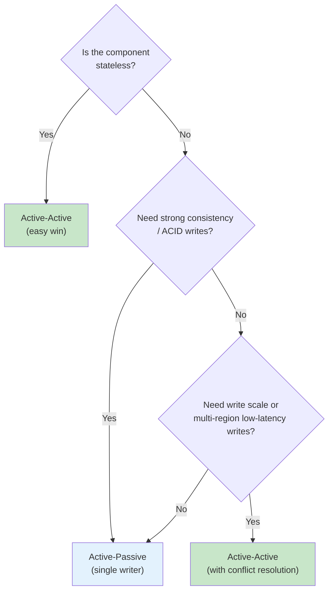

| Aspect | Active-Passive | Active-Active |
|--------|----------------|---------------|
| **Traffic** | Primary handles 100% | Spread across all nodes |
| **Utilization** | ~50% or less | ~100% |
| **Throughput** | Single node's capacity | Sum of all nodes |
| **Failover** | Heartbeat-driven, 30-60 s | Load balancer reroutes, near-instant |
| **Scalability** | Vertical only; passive nodes add redundancy only | Horizontal; add nodes for more capacity |
| **Consistency** | Strong (single source of truth) | Needs bi-directional sync + conflict resolution |
| **Complexity** | Low | High |
| **Cost profile** | Paying for idle hardware | Licensing, sync logic, ops expertise |
| **Best for** | SQL databases, stateful systems, DR backups | Stateless services, NoSQL, geo-distributed apps |
| **Analogy** | Spare tire | Multi-lane highway |

---

## Key Takeaways

### Remember This

- **HA = continuity**: the goal is minimal downtime and meeting SLAs; redundancy is the mechanism that eliminates single points of failure
- **Nines matter**: 99.9% allows ~8h 46m of downtime per year, while 99.999% allows only ~5m 16s
- **Active-Passive = spare tire**: one node serves 100% of traffic, the standby watches via heartbeats and takes over on failure, with a 30-60 second downtime window
- **Active-Active = multi-lane highway**: all nodes serve traffic behind a load balancer, which removes failed nodes via health checks for near-seamless failover
- **Utilization and scale**: Active-Active uses ~100% of hardware and scales out; Active-Passive wastes ~50% and the single active node is a hard bottleneck
- **Complexity is the price**: Active-Active means distributed state, bi-directional sync, conflict resolution, higher licensing and ops costs
- **Stateless is easy, stateful is hard**: web servers go Active-Active easily; databases risk write conflicts, so SQL usually stays Active-Passive while Cassandra/Aerospike are built for Active-Active
- **HA is not DR**: HA survives a server crash, DR survives a data center burning down; Active-Active across regions gives you geo-redundancy

### Common Mistakes to Avoid

```yaml
Common_Mistakes:
  1_Redundant_App_Single_Everything_Else:
    Mistake: "Two app servers behind one load balancer and one database"
    Reality: "The LB and DB are still single points of failure"
    Correct: "Remove SPOFs at every layer"

  2_Never_Testing_Failover:
    Mistake: "Assuming the standby works because it's running"
    Reality: "Untested failover often fails when you need it most"
    Correct: "Run regular failover drills / chaos experiments"

  3_Ignoring_Split_Brain:
    Mistake: "Heartbeat over a single link, no fencing"
    Reality: "Network blip -> two primaries -> diverged data"
    Correct: "Quorum, fencing (STONITH), redundant heartbeat links"

  4_Active_Active_Without_Headroom:
    Mistake: "Running two active nodes at 70% each"
    Reality: "One failure pushes the survivor to 140% and it falls over too"
    Correct: "Plan N+1 capacity"

  5_Multi_Master_Without_Conflict_Strategy:
    Mistake: "Turning on bi-directional replication and hoping"
    Reality: "Concurrent writes silently overwrite each other or corrupt data"
    Correct: "Choose LWW, vector clocks, CRDTs, or consensus deliberately - or partition writes"

  6_Confusing_HA_With_DR:
    Mistake: "Both replicas in the same rack / AZ / region"
    Reality: "One site-wide event takes out both"
    Correct: "Spread replicas across AZs for HA and across regions for DR"

  7_Forgetting_Failback:
    Mistake: "No plan for returning to the original primary"
    Reality: "Failback is often manual and risky"
    Correct: "Document and rehearse failback as carefully as failover"
```

### Best Practices

```yaml
High_Availability_Best_Practices:
  1: "Define your availability target (SLA/SLO) and RTO/RPO first"
  2: "Identify and remove single points of failure at every layer"
  3: "Make services stateless so they can run Active-Active"
  4: "Keep databases Active-Passive unless you truly need multi-master"
  5: "Use health checks and automatic failover; tune heartbeat timeouts"
  6: "Protect against split-brain with quorum and fencing"
  7: "Provision N+1 capacity so the cluster survives losing a node"
  8: "Spread across availability zones for HA and regions for DR"
  9: "Test failover and failback regularly"
```

---

## Presentation Slides

The slides used in this episode are available in [`./presentation/`](./presentation/):

1. [Title: Active-Active vs. Active-Passive Architecture](./presentation/1.png)
2. [What is High Availability (HA)?](./presentation/2.png)
3. [Active-Passive: The "Spare Tire" Architecture](./presentation/3.png)
4. [Active-Passive Mechanics: The Heartbeat & Failover](./presentation/4.png)
5. [Active-Active: The "Multi-Lane Highway" Architecture](./presentation/5.png)
6. [Active-Active Mechanics: Load Balancing](./presentation/6.png)
7. [Resource Utilization](./presentation/7.png)
8. [Scalability](./presentation/8.png)
9. [Complexity & Cost](./presentation/9.png)
10. [The Biggest Challenge: Data Consistency (Part 1)](./presentation/10.png)
11. [The Biggest Challenge: Data Consistency (Part 2)](./presentation/11.png)
12. [Database Architectures](./presentation/12.png)
13. [Disaster Recovery (DR) vs. High Availability (HA)](./presentation/13.png)

---

<div align="center">

[Previous Episode: Network Latency, Bandwidth & Throughput](../22-latency-bandwidth-throughput/) | [Course Home](../../) | [Next Episode: Replication Strategies](../24-replication-strategies/)

</div>
