# Episode 24: Replication Strategies - Zero Data Loss vs Insane Speed

[](http://youtube.com/@ThatNotesGuy)

## What You'll Learn

- Why we replicate data: high availability, read scalability, disaster recovery, and latency reduction
- How synchronous replication works step by step, and why it gives an RPO of zero
- The real cost of synchronous replication: write latency, the ~300 km distance limit, and blocked writes
- How asynchronous replication ("fire and forget") trades a non-zero RPO for throughput
- The asynchronous danger zone: replication lag, lost buffers, and PostgreSQL WAL recycling
- Semi-synchronous replication and adaptive fallback to async (MySQL, PostgreSQL)
- Quorum-based replication with consensus (Raft/Paxos) as used by CockroachDB
- A practical decision framework: which strategy for banking, healthcare, cross-continent DR, analytics, and AdTech

> **Prerequisite:** [Episode 15: Database Replication & Leader Election](../15-replication-leader-election/) covers the replication basics (leader/follower, binary logs, WAL, GTIDs, leader election). This episode zooms in on one question: **when does the primary tell the client "success"?** That single decision defines your durability, latency, and availability.

---

## Introduction: The Core Trade-off

Every replication strategy sits somewhere on a spectrum between two goals that pull in opposite directions:

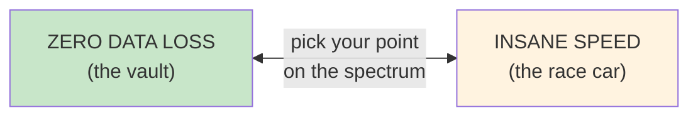

```yaml
The_Central_Question:
  Question: "When a client writes data, when does the primary say 'success'?"
  Option_1: "After the replica also has it  -> safe, but slow (synchronous)"
  Option_2: "Immediately, replicate later   -> fast, but risky (asynchronous)"
  Option_3: "Somewhere in between           -> semi-sync, quorum"

  What_It_Decides:
    - How much data you can lose in a crash (RPO)
    - How long every write takes (latency)
    - Whether writes keep working when a replica dies (availability)
```

The mechanism you choose, sync or async, dictates how well you achieve your replication goals and **what price you pay for them**.

---

## Why We Replicate: Beyond the Single Node

Before arguing about *how* to copy data, remember *why* we do it. In a distributed system, **we replicate to survive**. If a node crashes (and it will), replication keeps the service up. But we also replicate for performance.

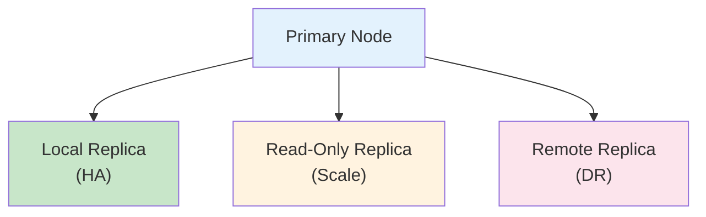

```yaml
Why_We_Replicate:
  High_Availability_HA:
    Goal: "Survive hardware failures"
    Mantra: "If your data doesn't exist in three places, it doesn't exist."
    Typical_Setup: "Local replica in the same region, ready to be promoted"

  Scalability:
    Goal: "Offload read queries to replicas to improve performance"
    Typical_Setup: "Read-only replicas behind the app; writes go to the primary"
    Benefit: "Separates read traffic from write traffic"

  Disaster_Recovery_DR:
    Goal: "Survive catastrophic site failures (fire, flood, region outage)"
    Typical_Setup: "Geographically distant copy in another region"

  Latency_Reduction:
    Goal: "Move data closer to the user (edge computing)"
    Typical_Setup: "Replicas in multiple regions so reads stay local"
```

### Each Goal Pulls Toward a Different Strategy

| Goal | Where the replica lives | Strategy it usually needs |
|------|------------------------|---------------------------|
| **High Availability** | Same datacenter / same metro | Synchronous or semi-sync (no data loss on failover) |
| **Read Scalability** | Same region | Usually asynchronous (reads tolerate small lag) |
| **Disaster Recovery** | Another region / continent | Asynchronous (distance makes sync impractical) |
| **Latency Reduction** | Close to users, worldwide | Asynchronous (or quorum with local-majority placement) |

This table is the whole episode in miniature: **distance and data-loss tolerance decide the strategy.**

---

## Synchronous Replication: The Atomic Commit

### All or Nothing

Imagine you are transferring a million dollars. You want to be absolutely sure the money is recorded safely. In synchronous replication, **the primary does not tell the client "success" until the replica confirms it has also written the data.**

```yaml
Synchronous_Replication:
  Definition: "A transaction is not committed until the primary AND the standby acknowledge the write"
  Consistency: "Strong consistency (ACID guarantees hold across the pair)"
  RPO: "Zero - no committed data is lost if the primary fails"
  Analogy: "A bank teller who won't hand you the receipt until the vault copy is stamped too"
```

### The Write Flow

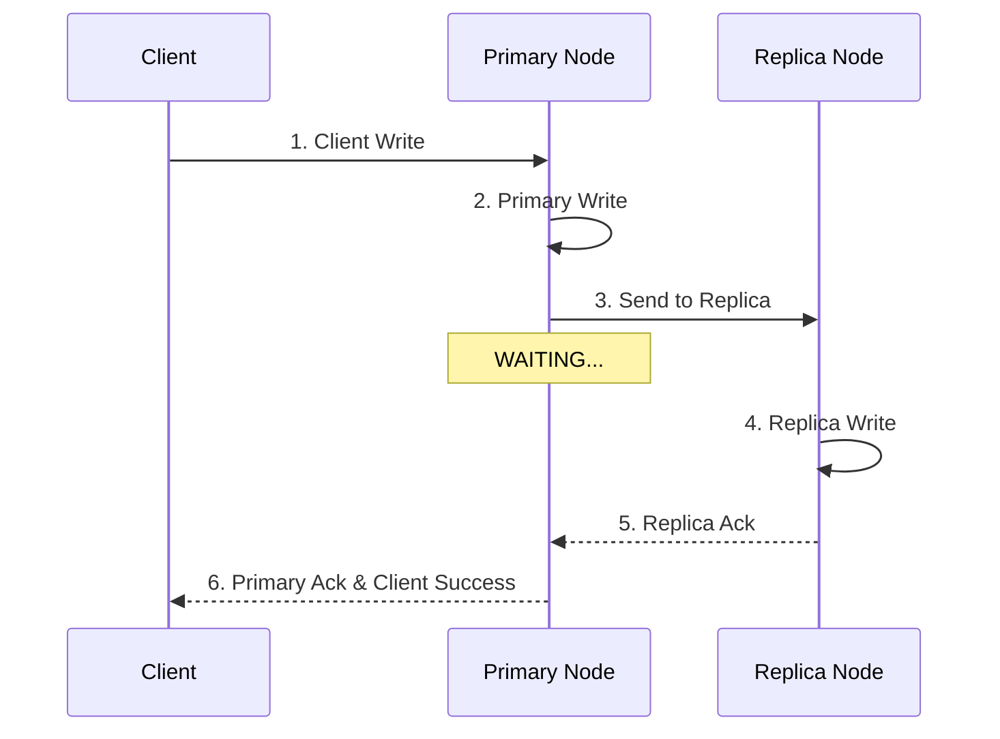

```yaml
Flow:
  1: "Client Write     - client sends the transaction"
  2: "Primary Write    - primary writes it locally (e.g., to its WAL)"
  3: "Send to Replica  - primary ships the change over the network"
  4: "Replica Write    - replica persists the change"
  5: "Replica Ack      - replica confirms back to the primary"
  6: "Client Success   - only now does the client hear 'committed'"
```

### Why RPO Is Zero

**RPO (Recovery Point Objective)** is the maximum amount of data you can afford to lose, measured in time. With synchronous replication, every write the client was told about exists on at least two machines. If the primary crashes immediately after the write, you lose nothing because the replica has an exact copy.

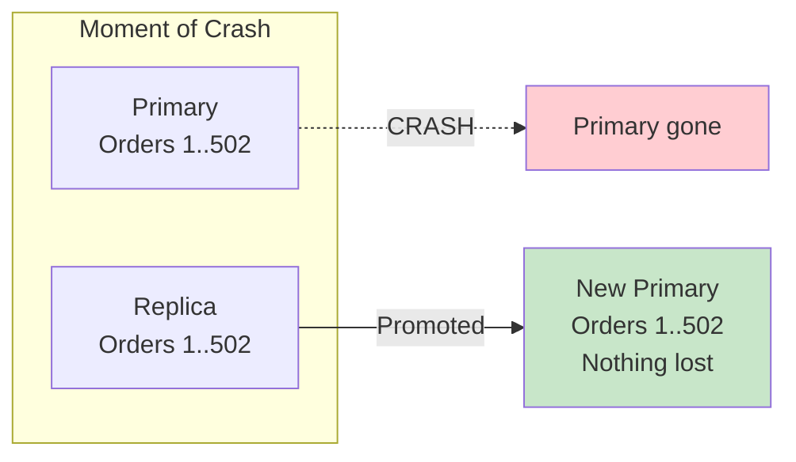

> Any write still "in flight" (not yet acknowledged) when the primary crashed was never confirmed to the client, so the client knows to retry it. That is what "no **committed** data is lost" means.

---

## The Cost of Synchronization: Latency and Availability

### The Penalty of Perfection

Safety isn't free. Synchronous replication charges you in two currencies: **latency** and **availability**.

```yaml
Costs_of_Sync:
  Write_Latency:
    Rule: "The primary MUST wait for the network round-trip (RTT) + replica disk I/O"
    Consequence: "Your write speed is determined by your SLOWEST replica"
    Example: "If your replica is 50 ms away, every single write takes at least 50 ms"

  Distance_Limit:
    Rule: "Effectively limited to ~300 km, or metro areas"
    Reason: "Speed-of-light latency - you cannot make photons go faster"

  Availability_Risk:
    Rule: "If the synchronous replica goes down (or the network fails),
           the primary halts writes to preserve consistency"
    Consequence: "You are trading availability for consistency"

  Performance:
    Rule: "Lower write throughput"
    Reason: "Connections, locks, and threads are tied up waiting for acknowledgments"
```

### Write Latency Comparison

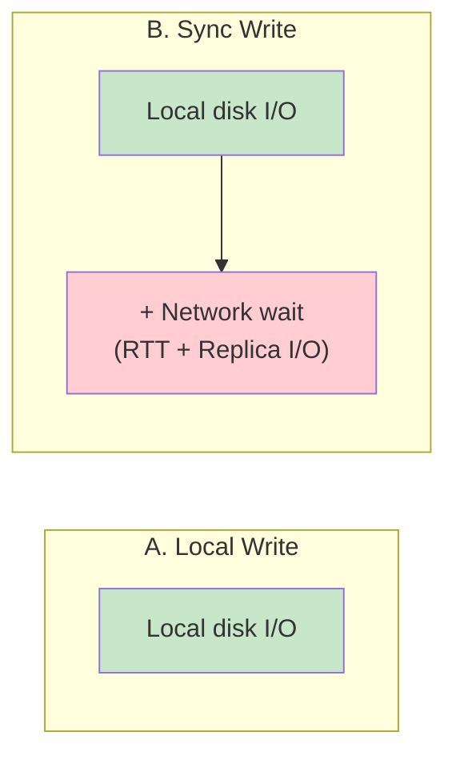

```yaml
Sync_Write_Latency_Formula:
  Local_Write: "T_local = primary disk I/O"
  Sync_Write:  "T_sync  = primary disk I/O + RTT(primary <-> replica) + replica disk I/O"
  Insight: "The network term dominates as soon as replicas leave the building"
```

### Why ~300 km? The Speed of Light

Light in optical fiber travels at roughly two-thirds of its vacuum speed, about **200,000 km/s**, which works out to about **1 ms of round-trip time per 100 km** of fiber, before any routing, switching, or queuing overhead.

| Distance (fiber, straight line) | Theoretical minimum RTT | What it means for sync writes |
|---------------------------------|-------------------------|-------------------------------|
| Same datacenter | well under 1 ms | Sync is cheap |
| Metro area (~50 km) | ~0.5 ms | Sync is very practical |
| ~300 km | ~3 ms (real-world: more) | Upper end of comfortable sync |
| New York - London (~5,600 km) | ~55 ms (real-world: ~70+ ms) | Every write pays this; usually unacceptable |
| New York - Tokyo (~10,800 km) | ~110 ms (real-world: much more) | Sync destroys the user experience |

```yaml
Why_It_Matters:
  Throughput_Ceiling: |
    "If each commit on a single connection must wait ~100 ms,
     that connection can do at most ~10 commits per second.
     Group commit and many parallel connections help, but every
     individual user still feels the full round trip."
  Takeaway: "Physics, not engineering effort, sets the limit for synchronous replication"
```

### The Availability Trap

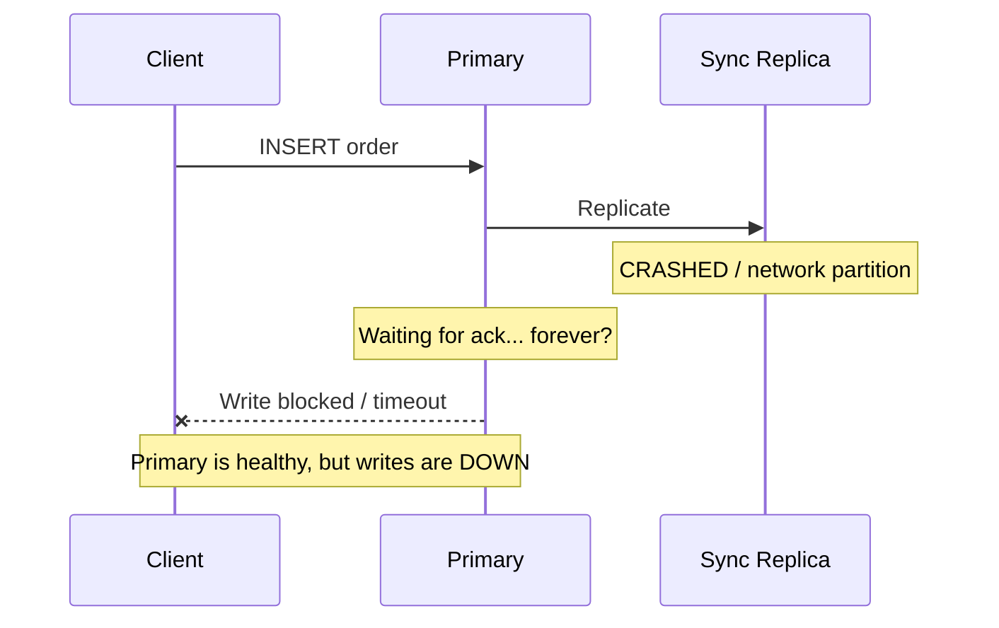

If your synchronous replica crashes or the network fails, your primary might **stop accepting writes entirely** to prevent data divergence. The primary is healthy, yet the system is unavailable for writes. In PostgreSQL, for example, with a single named synchronous standby, commits hang until that standby comes back or an operator changes `synchronous_standby_names`.

```yaml
Mitigations_For_The_Trap:
  Multiple_Sync_Candidates: "Name several standbys; any one can satisfy the wait"
  Semi_Sync_Fallback: "Drop to async after a timeout (see Semi-Sync below)"
  Quorum: "Wait for a majority instead of one specific replica (see Quorum below)"
```

---

## Asynchronous Replication: Fire and Forget

### How It Works

In asynchronous replication, the primary **commits the write and tells the client "success" immediately**. It doesn't wait for the replica. It sends the data later: maybe a millisecond later, maybe a second later.

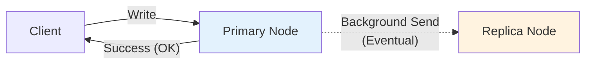

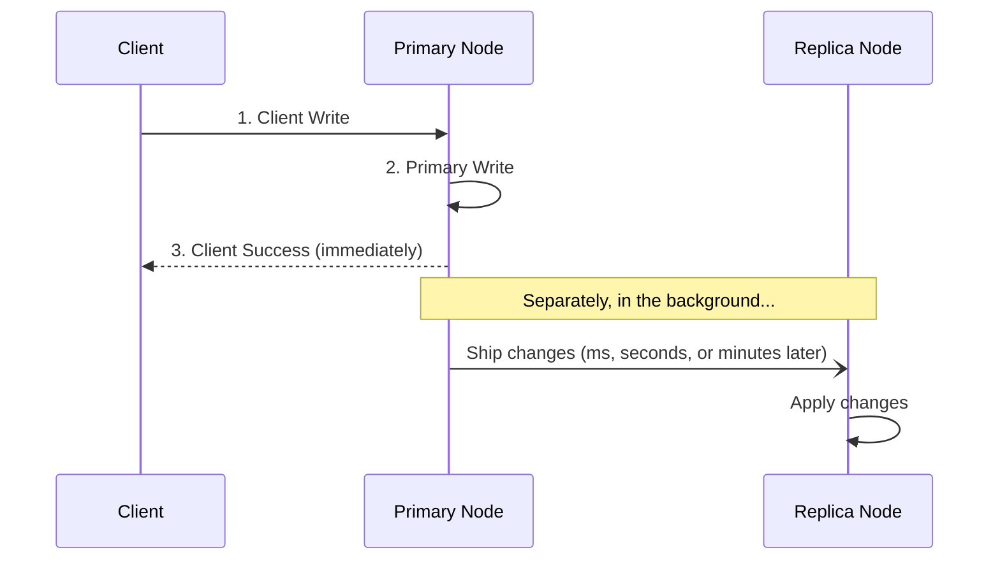

```yaml
Asynchronous_Replication:
  Definition: "Primary commits and acknowledges the client immediately; data is sent to replicas in the background"
  Flow: "Client Write -> Primary Write -> Client Success   (separately: Primary -> Replica)"
  Consistency: "Eventual consistency - replicas may lag by milliseconds, seconds, or minutes"
  Throughput: "High - the client is never blocked by the network"
  RPO: "Greater than zero - whatever hasn't shipped yet can be lost"
```

### The Massive Advantage: Throughput

Your application feels lightning fast because it isn't waiting on a network round trip to a different city.

```yaml
Why_Async_Is_Fast:
  Write_Path: "Only local disk I/O is on the critical path"
  Distance: "Replica can be on another continent with zero effect on write latency"
  Replica_Failure: "Primary keeps accepting writes even if every replica is down"
  Batching: "Changes can be streamed and batched efficiently in the background"
```

---

## The Asynchronous Danger Zone: When RPO > 0

### Replication Lag

**Replication lag** is the time difference between the primary and the replica. It is the window of data that exists in only one place.

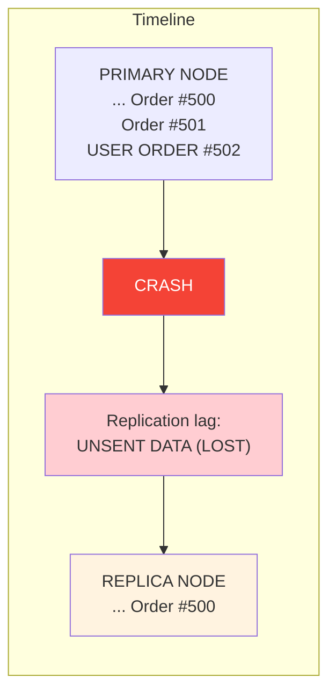

### The Failure Scenario

If your primary server smokes and catches fire **before** it transmits the last batch of updates to the replica, that data is gone forever. In a failover, your replica is promoted to primary, but it is missing the last few milliseconds or seconds of data.

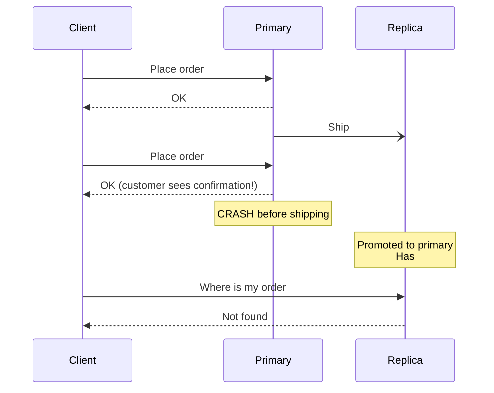

```yaml
What_Goes_Wrong:
  Lost_Writes: "Customer was told 'success' but the record no longer exists"
  Reused_IDs: "New primary may hand out ID #502 again to a different order"
  Downstream_Mismatch: "Emails, payments, or caches may reference data that vanished"
  Old_Primary_Returns: "If the old primary comes back, its extra writes conflict with the new timeline"

The_Question_To_Ask: "Can your business survive losing the last two seconds of data?"
```

### PostgreSQL WAL Recycling: Breaking the Link

In high-traffic scenarios, if the replica falls too far behind, the primary might delete the very transaction log the replica still needs, breaking replication entirely.

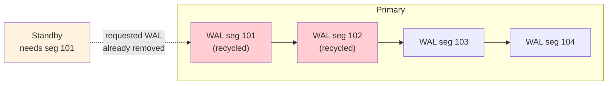

```yaml
PostgreSQL_WAL_Problem:
  Background: "PostgreSQL streams Write-Ahead Log (WAL) records to standbys"
  Problem: "If the standby is stopped or lagging, the primary may recycle old WAL
            segments before the standby receives them"
  Symptom: "Standby errors with 'requested WAL segment ... has already been removed'"
  Result: "Replication is broken; the standby must be rebuilt from a fresh base backup"

  Standard_Mitigations:
    Replication_Slots: "Primary retains WAL until the slot's consumer has received it"
    Slot_Risk: "A dead standby with a slot makes WAL pile up and can fill the primary's disk"
    max_slot_wal_keep_size: "Caps how much WAL a slot may retain (PostgreSQL 13+)"
    wal_keep_size: "Keep a fixed minimum amount of WAL around"
    WAL_Archiving: "Ship WAL to archive storage so a standby can catch up from there"
```

```ini
# postgresql.conf (primary) - illustrative
wal_level = replica
max_wal_senders = 10
max_replication_slots = 10
wal_keep_size = 1GB              # keep some WAL even without slots
max_slot_wal_keep_size = 50GB    # don't let a dead slot fill the disk
```

### Monitoring Lag

You cannot manage what you don't measure. Async replication makes lag a first-class metric.

```sql
-- PostgreSQL (on the primary): how far behind is each standby?
SELECT client_addr,
       state,
       write_lag,
       flush_lag,
       replay_lag
FROM pg_stat_replication;

-- MySQL (on the replica)
SHOW REPLICA STATUS\G      -- look at Seconds_Behind_Source
```

```yaml
The_Trade_Off:
  You_Accept: "A non-zero RPO"
  You_Get: "Performance, throughput, and freedom from distance limits"
  Rule_Of_Thumb: "Alert on lag long before it threatens WAL retention or your RPO budget"
```

---

## Semi-Synchronous Replication: The "Best" of Both Worlds?

### The Middle Ground

Is there a middle ground between "slow and safe" and "fast and risky"? Yes: **semi-synchronous replication**.

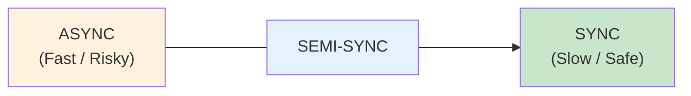

```yaml
Semi_Synchronous_Replication:
  Concept:
    - "Wait for acknowledgement from AT LEAST ONE replica (not all of them)"
    - "Or wait for a memory ack only - the replica has RECEIVED the transaction,
       not necessarily finished writing/applying it on disk"
  Behavior: "If the synchronous replica times out, some systems (like MySQL)
             fall back to asynchronous mode to keep the app running"
  RPO: "Usually zero (unless fallback occurs)"
  Performance: "Better than full sync, safer than async"
```

### Ack on Receipt vs Ack on Write

The key latency saving comes from **what** the replica acknowledges.

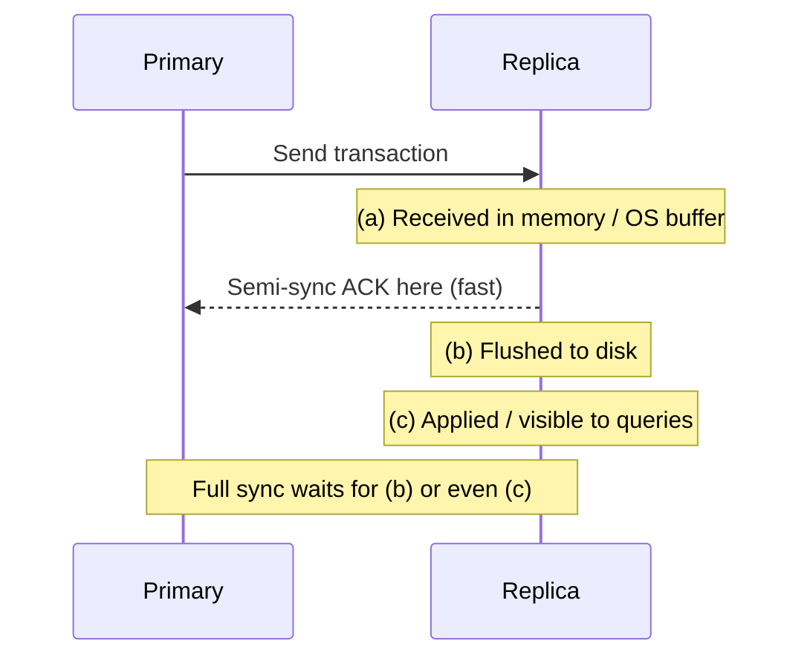

| Acknowledgement point | Survives primary crash? | Survives primary + replica crash at the same moment? | Latency |
|-----------------------|------------------------|------------------------------------------------------|---------|
| Received in replica memory | Yes | No | Lowest |
| Flushed to replica disk | Yes | Yes | Medium |
| Applied on replica (readable) | Yes | Yes, and reads on the replica see it | Highest |

The bet semi-sync makes: it is very unlikely that **both** machines die in the same instant, so an in-memory copy on a second machine is "good enough" durability for most systems.

### How Real Databases Expose It

```yaml
PostgreSQL_synchronous_commit:
  off:          "Don't even wait for the local WAL flush (fastest, riskiest)"
  local:        "Wait for local flush only - async replication"
  remote_write: "Wait until the standby has received the WAL and written it to its OS (not fsynced)"
  on:           "Wait until the standby has flushed the WAL to disk (default when sync standbys are set)"
  remote_apply: "Wait until the standby has applied it - reads on the standby see the write"

PostgreSQL_synchronous_standby_names:
  "FIRST 1 (s1, s2)": "Wait for the highest-priority available standby"
  "ANY 1 (s1, s2, s3)": "Wait for any one standby - 'at least one replica'"
  "ANY 2 (s1, s2, s3)": "Quorum-style: any two of three"

MySQL_Semi_Sync:
  Ack: "Source waits until at least one replica acknowledges receipt of the transaction"
  Count: "rpl_semi_sync_source_wait_for_replica_count (default 1)"
  Timeout: "rpl_semi_sync_source_timeout (milliseconds) - after it expires, the source
            silently reverts to asynchronous replication"
  Recovery: "Switches back to semi-sync automatically once a replica catches up"
```

```ini
# MySQL (source) - illustrative semi-sync settings
plugin_load_add = "semisync_source.so"
rpl_semi_sync_source_enabled = 1
rpl_semi_sync_source_wait_for_replica_count = 1
rpl_semi_sync_source_timeout = 1000      # ms; then fall back to async
```

### Adaptive Systems and the Fallback Window

Some systems are **adaptive**: they try to be synchronous, but if the network lags too much, they temporarily switch to asynchronous so your app doesn't freeze.

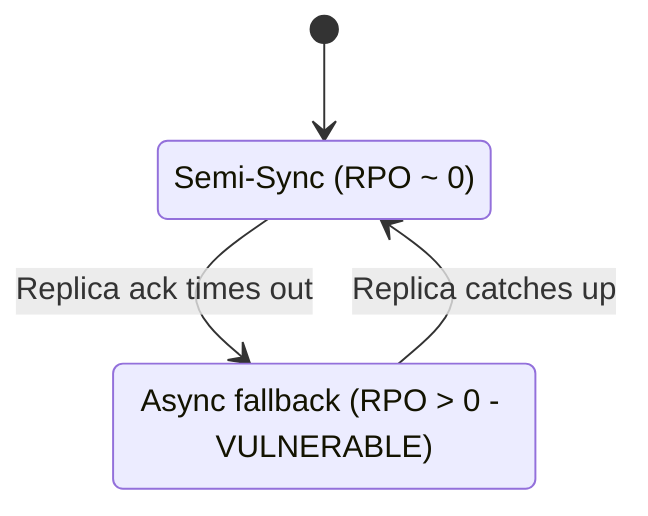

```yaml
Be_Careful:
  Risk: "During the fallback period you are vulnerable to data loss"
  Why_It_Bites: "The switch is often silent - the app keeps working, so nobody notices
                 that the zero-RPO guarantee has quietly disappeared"
  What_To_Do:
    - "Alert when the system drops out of semi-sync mode"
    - "Track how long and how often fallback happens"
    - "Decide explicitly: is availability or zero-RPO more important for THIS data?"
```

---

## Quorum and Consensus: Democracy in Databases

### The Problem with Plain Sync

Synchronous replication relies on **one specific replica**. If it dies, you block. Semi-sync with fallback avoids blocking, but gives up zero-RPO. Can we have both?

### The Solution: Wait for a Majority

Modern distributed databases like **CockroachDB** use consensus algorithms (**Raft** / **Paxos**). Instead of saying "wait for replica 2", they say: **"I have 5 replicas; wait until any 3 of them agree."** This is a **quorum**.

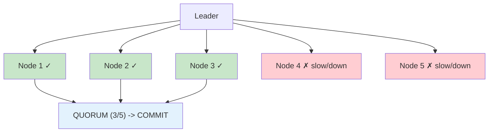

```yaml
Quorum_And_Consensus:
  The_Problem: "Sync relies on ONE specific replica. If it dies, you block."
  The_Solution: "Quorum (e.g., Paxos/Raft). Wait for a MAJORITY of nodes (e.g., 2 out of 3)."
  CockroachDB_Example: "Uses Raft consensus per range of data. Commits when a majority of replicas confirm."
  Benefit: "Tolerates failure of a minority of nodes without blocking writes or losing data"
  Cost: "Still pays a latency cost compared to pure async (wait for the majority's round trip)"
```

### Majority Math

| Replicas (N) | Majority needed | Failures tolerated | Notes |
|--------------|-----------------|--------------------|-------|
| 1 | 1 | 0 | No redundancy |
| 2 | 2 | 0 | Worse than 1 for availability - avoid |
| 3 | 2 | 1 | Most common default (e.g., CockroachDB's default replication factor) |
| 4 | 3 | 1 | Extra node adds cost, no extra tolerance |
| 5 | 3 | 2 | Common for critical data |
| 7 | 4 | 3 | Rare; more replicas = more coordination |

```yaml
Formulas:
  Majority: "floor(N / 2) + 1"
  Tolerated_Failures: "floor((N - 1) / 2)"
  Why_Odd_Numbers: "Adding a node to an odd-sized group raises the majority without raising tolerance"
  Why_Majority_Works: "Any two majorities overlap in at least one node, so a committed write
                       is always seen by whichever majority elects the next leader"
```

### Why Quorum Solves the Availability Problem

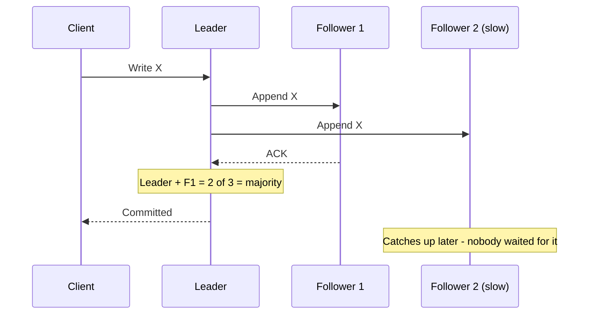

If one node slows down, the system simply ignores it and proceeds as soon as the majority responds. You get:

```yaml
Quorum_Gives_You:
  Zero_Data_Loss: "A committed write lives on a majority; any future leader must have it"
  High_Availability: "Minority failures don't block writes"
  Tail_Latency_Protection: "One slow replica can't drag every write down"

Quorum_Costs_You:
  Latency: "Every write waits for the majority round trip (slower than async)"
  Placement_Matters: "Latency is set by the median replica, so place a majority close together"
  Minority_Side_Of_Partition: "Nodes cut off from the majority cannot accept writes"
  More_Hardware: "At least 3 replicas to tolerate one failure"
```

> For how Raft/Paxos actually elect leaders and agree on log entries, see [Episode 15](../15-replication-leader-election/).

---

## Side-by-Side Comparison

| Aspect | Synchronous | Asynchronous | Semi-Synchronous | Quorum / Consensus |
|--------|-------------|--------------|------------------|--------------------|
| **Client hears "success" when** | Replica has written | Primary has written | At least one replica has received | A majority has written |
| **RPO** | Zero | > 0 (lag window) | Usually zero (unless fallback) | Zero |
| **Write latency** | Highest (slowest replica) | Lowest (local only) | Medium | Medium-high (majority RTT) |
| **Throughput** | Lowest | Highest | Medium | Medium |
| **Replica failure** | Writes can block | No effect on writes | Falls back to async | Tolerates minority failures |
| **Consistency** | Strong | Eventual | Near-strong | Strong |
| **Distance** | ~300 km / metro | Any (cross-continent) | Region | Region, or careful multi-region placement |
| **Examples** | PostgreSQL sync standby, SAN mirroring | MySQL default replication, cross-region read replicas | MySQL semi-sync, PostgreSQL `remote_write` | CockroachDB, etcd, Spanner-style systems |

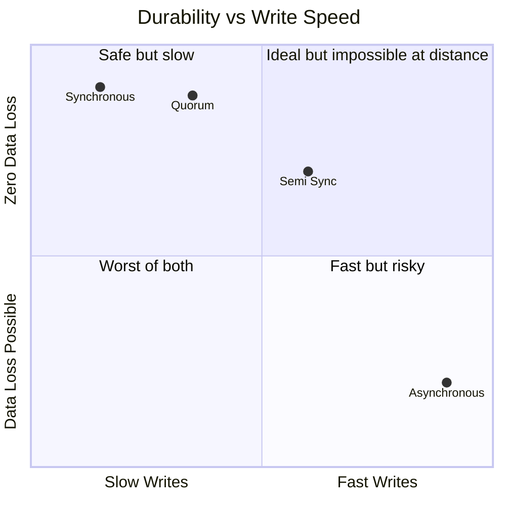

---

## Use Cases: When to Use What?

### Use Synchronous When

```yaml
Use_Synchronous_When:
  Financial_Transactions:
    Why: "Zero RPO required"
    Quote: "You cannot explain to a user why their deposit disappeared."
  Medical_Patient_Data:
    Why: "Losing a prescription or allergy record can harm a person"
  Regulatory_Compliance:
    Why: "Regulations demand strict consistency and provable durability"

  Typical_Shape: "Primary + sync replica in the same metro (<~300 km), accept the latency"
```

### Use Asynchronous When

```yaml
Use_Asynchronous_When:
  Geographically_Distant_DR:
    Examples: "New York -> London, New York -> Tokyo"
    Why: "The speed of light prohibits synchronous replication over that distance
          without destroying the user experience"
  High_Volume_Analytics_Or_Logging:
    Why: "Huge write volume; losing a few seconds of events is tolerable"
  Social_Media_Feeds:
    Why: "Stale data is annoying, not fatal"
  Real_Time_Bidding_AdTech_And_HFT:
    Why: "Every nanosecond counts - async is the only option"
```

### Decision Flow

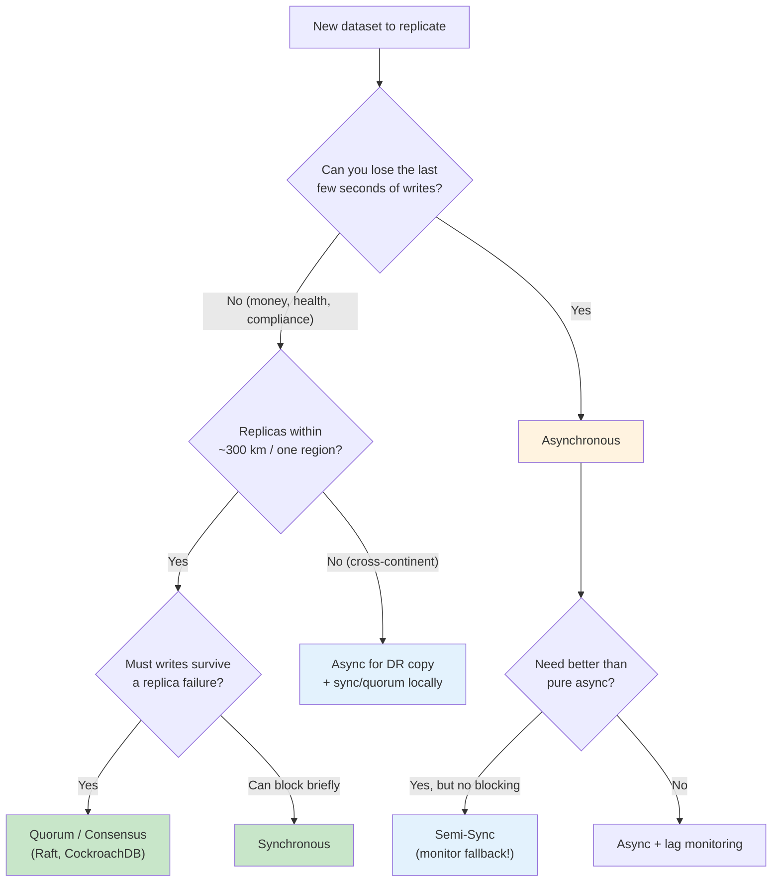

### Real-World Architecture: Mixing Strategies

Most serious systems don't pick one strategy; they **layer** them.

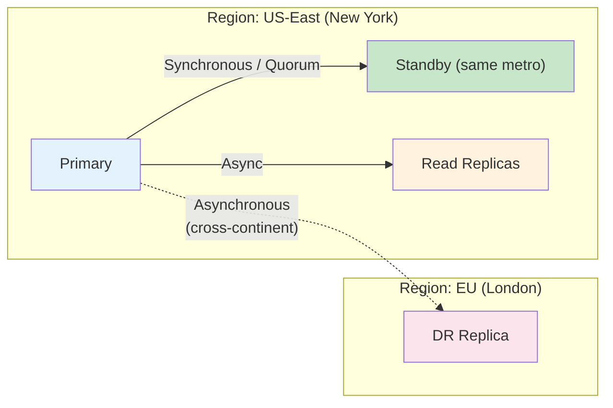

```yaml
Layered_Design:
  Local_Standby: "Sync or quorum -> zero RPO for everyday hardware failures"
  Read_Replicas: "Async -> scale reads, tolerate small staleness"
  Remote_DR: "Async -> survive a region loss, accept a few seconds of RPO"
  Result: "Zero data loss for common failures, bounded loss for rare disasters,
           and no cross-ocean latency on the write path"
```

---

## Key Takeaways

### Remember This

- **We replicate to survive and to perform**: HA, read scalability, disaster recovery, and moving data closer to users
- **The core question** is when the primary tells the client "success"; that decision sets RPO, latency, and availability
- **Synchronous** = atomic commit on primary *and* replica; **RPO = 0**, but every write pays RTT + replica I/O and the slowest replica sets your speed
- **Distance limit**: sync is practical only up to roughly **300 km / metro areas** because of the speed of light
- **Sync availability trap**: if the sync replica or network fails, the primary may stop accepting writes; you trade availability for consistency
- **Asynchronous** = fire and forget; high throughput and no distance limit, but **RPO > 0** and replicas are eventually consistent
- **Async danger zone**: a primary crash before the buffer ships loses data forever; in PostgreSQL a lagging standby can lose the WAL it needs
- **Semi-sync** waits for at least one replica's receipt (often an in-memory ack); adaptive fallback to async keeps apps alive but opens a data-loss window
- **Quorum / consensus** (Raft, Paxos, CockroachDB) waits for a majority: zero data loss *and* tolerance of minority failures, at a latency cost vs async
- **Choose by business impact**: banking and healthcare go sync; NY-to-Tokyo DR, analytics, feeds, and AdTech go async

### Common Mistakes to Avoid

```yaml
Common_Mistakes:
  1_Sync_Across_Continents:
    Mistake: "Synchronous replication between distant regions"
    Reality: "Every write pays 100+ ms; throughput and UX collapse"
    Correct: "Sync/quorum locally, async for the far-away DR copy"

  2_Single_Sync_Replica:
    Mistake: "One named synchronous standby"
    Reality: "When it dies, writes stop on a perfectly healthy primary"
    Correct: "Multiple candidates (ANY 1 of N) or a majority quorum"

  3_Ignoring_Silent_Fallback:
    Mistake: "Assuming semi-sync always means RPO = 0"
    Reality: "After a timeout it quietly becomes async"
    Correct: "Alert on fallback and track time spent in async mode"

  4_Not_Monitoring_Lag:
    Mistake: "Async replicas with no lag alerts"
    Reality: "Lag grows until reads are badly stale or replication breaks"
    Correct: "Monitor pg_stat_replication / Seconds_Behind_Source and alert early"

  5_Unbounded_Replication_Slots:
    Mistake: "Replication slot for a standby that is permanently gone"
    Reality: "WAL piles up until the primary's disk is full"
    Correct: "Set max_slot_wal_keep_size and drop abandoned slots"

  6_Even_Sized_Quorums:
    Mistake: "Running 2 or 4 consensus replicas"
    Reality: "Same failure tolerance as N-1, more cost and coordination"
    Correct: "Use 3 or 5 replicas"

  7_Reading_Your_Own_Write_From_Async_Replica:
    Mistake: "User writes to primary, then reads from a lagging replica"
    Reality: "Their own update appears to be missing"
    Correct: "Route read-after-write to the primary, or use remote_apply / session consistency"
```

### Best Practices

```yaml
Replication_Strategy_Best_Practices:
  1: "Start from the business: write down the RPO each dataset can tolerate"
  2: "Keep synchronous replicas close (same metro / region)"
  3: "Prefer quorum over a single sync replica when writes must not block"
  4: "Use async for cross-region DR and read scaling"
  5: "Monitor replication lag and alert on semi-sync fallback"
  6: "Protect async replicas from WAL/binlog recycling (slots, retention, archiving)"
  7: "Use odd-sized consensus groups (3 or 5)"
  8: "Regularly test failover - an untested replica is a hope, not a plan"
```

---

## Presentation

View the slides for this episode: [Presentation Slides](./presentation/)

---

<div align="center">

[Previous: Episode 23](../23-redundancy-high-availability/) | [Course Home](../../) | [Next: Episode 25](../25-failover-mechanisms/)

</div>
