# Episode 25: Failover Mechanisms in System Design

[](http://youtube.com/@ThatNotesGuy)

## What You'll Learn

- What failover is and why "five nines" (99.999% uptime) means less than ~5 minutes of downtime a year
- Planned vs unplanned failures, and the different strategy each one needs
- RTO and RPO: the two metrics that dictate your disaster recovery budget
- Core principles of high availability: removing single points of failure at the network, compute, storage, and database layers
- The failover spectrum: cold, warm, and hot standby, and how each affects cost and RTO
- Active-passive vs active-active routing, and the split-brain risk
- How failover is triggered: heartbeats, load balancer health checks, SNMP traps, and DNS switching
- Microservice resiliency patterns: fault isolation, circuit breakers, retries with exponential backoff, and bulkheads
- Database failover with synchronous vs asynchronous replication
- Real-world examples: AWS Elastic Load Balancer and Netflix Chaos Monkey

---

## Introduction: The System's Ultimate Safety Net

### What Is a Failover?

At its core, a failover is your system's **ultimate safety net**. It is the process of **automatically shifting operations from a failed component to a standby one**, ideally so seamlessly that users never notice.

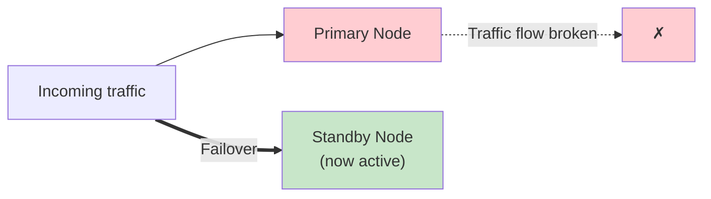

```yaml
Failover:
  Definition: "The automatic process of switching to a redundant or standby computer
               server, system, or network upon the failure of the previously active application"
  Goals:
    - "Minimize downtime"
    - "Ensure continuous service delivery"
    - "Maintain data consistency"
  Target: "Keep downtime as close to zero as humanly possible"
```

### The "Nines"

Highly available systems often target the holy grail of **five nines: 99.999% uptime**, which equates to **less than 5 minutes of downtime per year**.

| Availability | Common name | Downtime per year | Downtime per month (30 days) |
|--------------|-------------|-------------------|------------------------------|
| 99% | Two nines | ~3.65 days | ~7.2 hours |
| 99.9% | Three nines | ~8.76 hours | ~43.2 minutes |
| 99.99% | Four nines | ~52.6 minutes | ~4.3 minutes |
| 99.999% | Five nines | ~5.26 minutes | ~26 seconds |

```yaml
Why_Failover_Must_Be_Automatic:
  Observation: "At five nines, the yearly budget is ~5 minutes"
  Implication: "A human being paged, waking up, logging in, and diagnosing
                already burns that budget. Detection and switchover must be machine-driven."
```

---

## Planned vs Unplanned Failures

Not all failures are accidents. We design for two distinct categories.

| Aspect | Planned Failures | Unplanned Failures |
|--------|------------------|--------------------|
| **Cause** | Infrastructure upgrades, OS patching, database migrations | Hardware faults, kernel panics, network disruptions, power loss |
| **Predictability** | Fully predictable and scheduled | Unpredictable, time-sensitive |
| **Strategy** | Zero-downtime deployment strategies, graceful rollouts | Architectural redundancy, automated failover, self-healing |

```yaml
Planned_Failures:
  Examples: "Scheduled maintenance windows, updating an OS, migrating a database schema"
  Key_Property: "You control the blast radius"
  Techniques:
    Rolling_Updates: "Upgrade one node at a time while others serve traffic"
    Blue_Green: "Stand up the new version beside the old one, then switch traffic"
    Connection_Draining: "Stop sending new requests to a node, let in-flight ones finish"
    Controlled_Switchover: "Promote the standby deliberately, with zero data in flight"

Unplanned_Failures:
  Examples: "Power loss, hardware fault, severed network cable, kernel panic"
  Key_Property: "The ones that wake you up at night"
  Techniques:
    Redundancy: "No single point of failure anywhere in the stack"
    Automated_Failover: "Detect and switch without a human in the loop"
    Self_Healing: "Replace failed instances automatically (e.g., auto scaling groups, Kubernetes)"

Requirement: "The failover mechanism must handle BOTH gracefully without violating your SLAs"
```

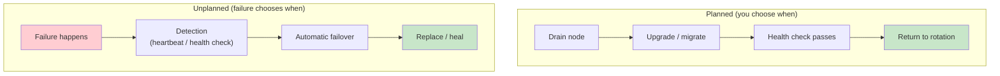

---

## RTO and RPO: The Two Numbers That Set Your Budget

Before we look at *how* to fail over, we need to define *why*, using two crucial metrics that dictate your entire disaster recovery budget.

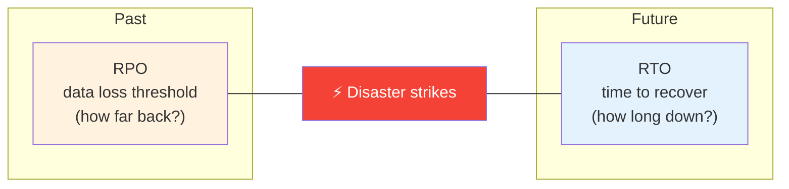

```yaml
RTO_Recovery_Time_Objective:
  Definition: "The target time required to restore operations after a failure"
  Question: "How long can your business afford to be offline?"
  Looks: "Forward in time from the disaster"

RPO_Recovery_Point_Objective:
  Definition: "The maximum acceptable data loss, measured in time"
  Example: "Losing the last 5 minutes of data"
  Question: "How much data can you afford to lose?"
  Looks: "Backward in time from the disaster"
```

### Examples

| System | Typical RPO | Typical RTO | Why |
|--------|-------------|-------------|-----|
| Banking ledger | 0 | Milliseconds to seconds | Lost or delayed transactions are unacceptable |
| E-commerce checkout | Seconds | Seconds to minutes | Lost orders cost money and trust |
| Internal reporting | Hours | Hours | Can re-run or wait |
| Batch processing job | Hours | Hours | Jobs can simply be re-run |

```yaml
How_RTO_RPO_Drive_Architecture:
  RPO_Is_Controlled_By: "How data is copied - backups, async replication, sync replication"
  RTO_Is_Controlled_By: "How fast you detect and switch - standby temperature, automation, DNS/LB"
  Cost_Curve: "Pushing either number toward zero gets exponentially more expensive"
  Example:
    Banking: "RPO 0 + RTO in milliseconds -> synchronous replication + hot standby + automation"
    Batch_Job: "RPO hours + RTO hours -> nightly backups + cold standby"
```

---

## Core Principles of High Availability

To achieve a true failover, **you cannot have a single point of failure (SPOF) anywhere in your stack**. We need redundancy at every layer.

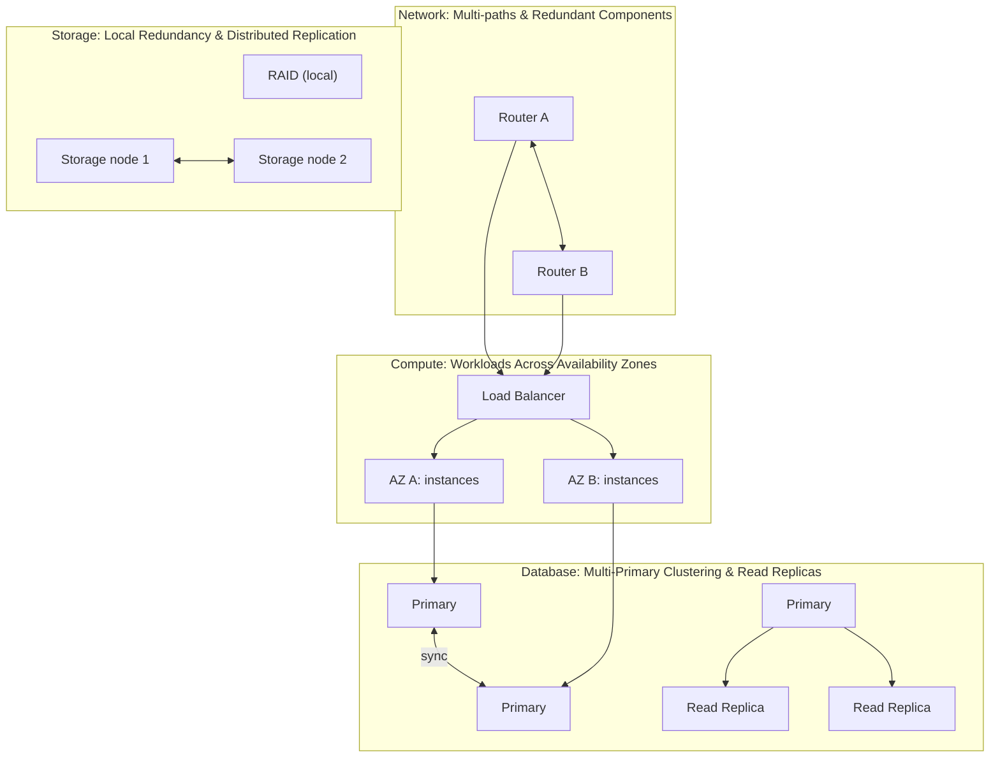

```yaml
High_Availability_By_Layer:
  Network:
    Principle: "Multiple paths, redundant routers/switches"
    Examples: "Dual uplinks, multiple ISPs, redundant top-of-rack switches, BGP/VRRP"

  Compute:
    Principle: "Workloads distributed across multiple instances (VMs/containers) or Availability Zones (AZs)"
    Examples: "Auto scaling groups spanning AZs, Kubernetes replicas spread across zones"

  Storage:
    Principle: "RAID for local redundancy, distributed replication for durability"
    Examples: "RAID 1/10 on a server, replicated block storage, object storage across zones"

  Database:
    Principle: "Read replicas, multi-primary clustering"
    Examples: "Primary + standby replicas, multi-primary clusters, data replicated across geographic zones"

Rule: "If a single piece of hardware dies, the system must keep running"
```

> Redundancy and high availability were covered in depth in [Episode 23: Redundancy & High Availability](../23-redundancy-high-availability/). Failover is the mechanism that actually *uses* that redundancy when something breaks.

---

## The Failover Spectrum: Cold, Warm, and Hot

How quickly your failover kicks in depends on **how hot your backup is**.

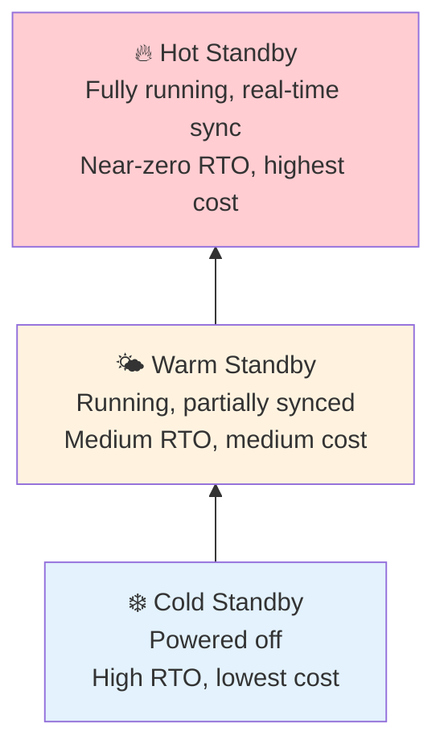

```yaml
Cold_Standby:
  State: "Backup system exists but is powered off"
  Data: "Restored from backups when needed"
  RTO: "High - minutes to hours to provision, boot, restore, and verify"
  Cost: "Lowest"
  Fits: "Non-critical internal tools, batch systems, archival workloads"

Warm_Standby:
  State: "Backup is running and partially (mostly) synchronized, but not taking live traffic"
  Data: "Periodic or async replication; may need a final catch-up"
  RTO: "Medium - minutes; may need scaling up or a final sync"
  Cost: "Medium"
  Fits: "Business systems that can tolerate a short outage"

Hot_Standby:
  State: "Backup is fully functional, a mirror of the primary"
  Data: "Synchronized in real time"
  RTO: "Near-zero - ready to take the load instantly"
  Cost: "Highest - you pay for a full second environment"
  Fits: "Mission-critical apps: payments, trading, healthcare"
```

### Cost vs Recovery Time

| Standby | Running? | Data freshness | RTO | Cost | Analogy |
|---------|----------|----------------|-----|------|---------|
| **Cold** | No (powered off) | Last backup | High (hours) | $ | Spare tyre in the garage |
| **Warm** | Yes, idle | Mostly synced | Medium (minutes) | $$ | Spare tyre in the trunk |
| **Hot** | Yes, fully ready | Real-time | Near-zero (seconds) | $$$ | Run-flat tyres |

> **Increasing cost** runs one way up the thermometer; **increasing recovery time (RTO)** runs the other way. You are buying lower RTO with money.

---

## Active-Passive vs Active-Active

Now, how do we route traffic between the primary and its backup?

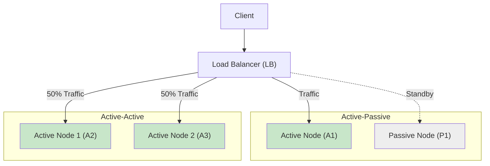

### Active-Passive

One system does all the heavy lifting while the other one waits.

```yaml
Active_Passive:
  How: "One node handles traffic, the other waits"
  On_Failure: "Passive node is promoted; traffic is redirected to it"
  Pros:
    - "Simpler state management - only one writer at a time"
    - "Easy to reason about consistency"
  Cons:
    - "Lower resource utilization - you're paying for servers you aren't actively using"
    - "Failover takes time (detect + promote + redirect)"
    - "Passive node may hide problems until the day you need it"
```

### Active-Active

Both systems process traffic simultaneously. If one dies, the other takes the full load.

```yaml
Active_Active:
  How: "All nodes process traffic simultaneously"
  On_Failure: "Remaining nodes absorb the failed node's share"
  Pros:
    - "Better resource utilization"
    - "Seamless failover - no 'promotion' step for stateless traffic"
  Cons:
    - "Keeping state synchronized globally in real time is a complex engineering challenge"
    - "Risk of split-brain"
  Capacity_Rule: "Each node must have headroom to take the full load if its peer dies
                  (two nodes at 50% each, not 80% each)"
```

### Split-Brain

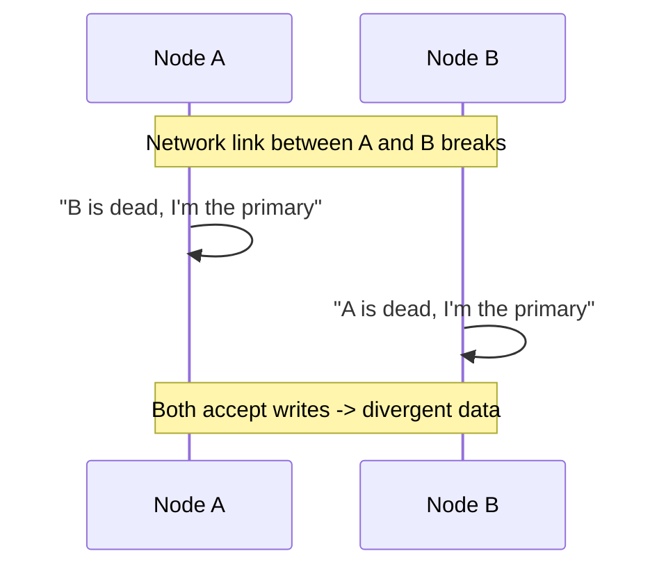

```yaml
Split_Brain:
  What: "Both sides believe they are the only live primary and accept conflicting writes"
  Standard_Defenses:
    Quorum: "Only the side with a majority of votes may act as primary"
    Witness_Or_Tiebreaker: "A third node/site breaks ties in two-node setups"
    Fencing: "Forcibly cut off the old primary (STONITH, fencing tokens, revoking its access)"
```

> Active-passive and active-active are covered in more detail in [Episode 23](../23-redundancy-high-availability/); split-brain and fencing in [Episode 15](../15-replication-leader-election/).

### Comparison

| Aspect | Active-Passive | Active-Active |
|--------|----------------|---------------|
| Traffic handling | One node | All nodes |
| Resource utilization | Lower (idle standby) | Higher |
| Failover experience | Brief switchover | Near-seamless |
| State management | Simple | Complex (sync across nodes) |
| Split-brain risk | Exists during failover | Higher, constant concern |
| Typical use | Primary databases, legacy apps | Stateless web/app tiers, global services |

---

## Triggering the Failover: How Does the System Know?

How does the system actually know when something died? We use **triggers**.

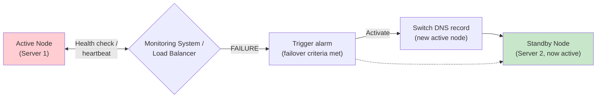

### 1. Heartbeat Monitoring

The most common trigger. The primary constantly signals "I am alive". If the backup misses a few consecutive heartbeats, it declares the primary dead and takes over.

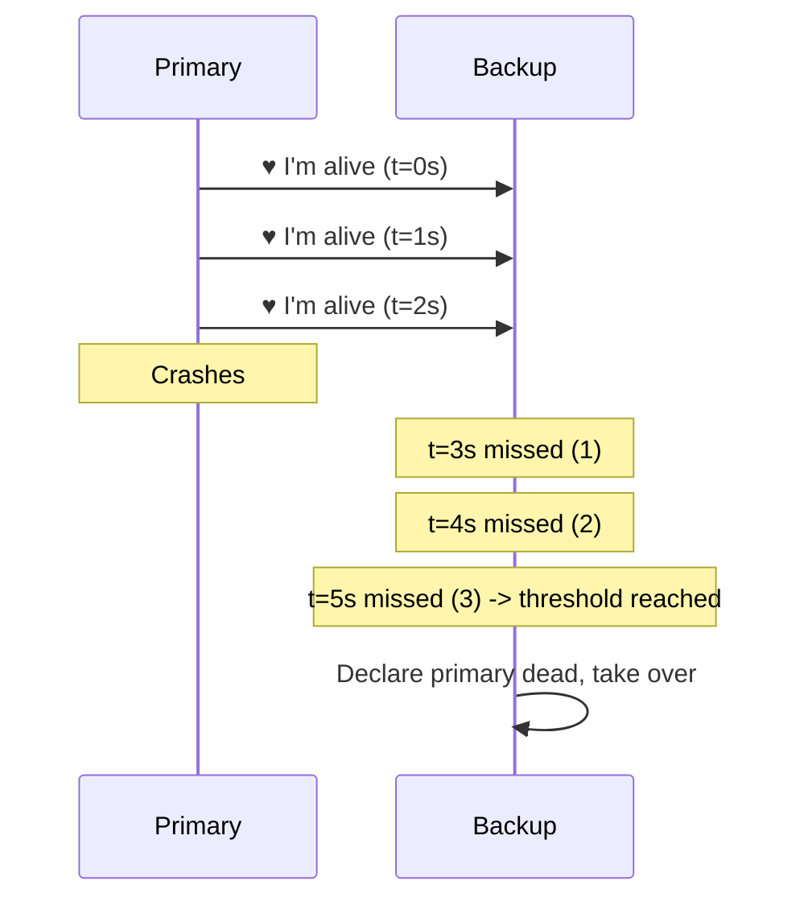

```yaml
Heartbeat_Tuning:
  Interval: "How often 'I'm alive' is sent (e.g., every 1s)"
  Missed_Threshold: "How many misses before declaring death (e.g., 3)"
  Detection_Time: "~ interval x threshold"
  Trade_Off:
    Too_Aggressive: "False positives - a GC pause or network blip triggers an unnecessary failover"
    Too_Lenient: "Slow detection - RTO grows"
```

### 2. Load Balancer Health Checks

Load balancers continuously ping backend servers, **instantly pulling unhealthy instances out of rotation** so your users never see an error.

```yaml
# Illustrative health check configuration
health_check:
  path: /health
  interval: 10s
  timeout: 2s
  unhealthy_threshold: 3   # 3 consecutive failures -> remove from rotation
  healthy_threshold: 2     # 2 consecutive successes -> add back

Health_Check_Types:
  Shallow: "Is the process up? (TCP connect or 200 OK on /health)"
  Deep: "Can it reach its dependencies (DB, cache)? Use carefully - a shared
         dependency outage can mark EVERY instance unhealthy at once"
```

### 3. SNMP Traps

```yaml
SNMP_Traps:
  What: "Event-driven alerts sent by devices when hardware/software thresholds are crossed"
  Examples: "Fan failure, disk errors, interface down, temperature too high"
  Difference: "Push-based (device tells you) vs polling-based (you ask the device)"
  Use: "Common for network gear and physical infrastructure monitoring"
```

### Redirecting Traffic After Detection

```yaml
Switchover_Methods:
  Load_Balancer: "Stop routing to the failed backend - fastest, near-instant"
  DNS_Switch: "Point the record to the new active node - limited by TTL and client caching"
  Floating_Virtual_IP: "Move a shared IP to the standby (e.g., keepalived/VRRP)"
  Service_Discovery: "Registry (Consul, etcd, Kubernetes endpoints) stops advertising the dead node"
```

---

## Microservices and Resiliency Patterns

When we move to distributed systems and microservices, failover gets more sophisticated. A failure is no longer "the server is down"; it's "one of 50 dependencies is slow".

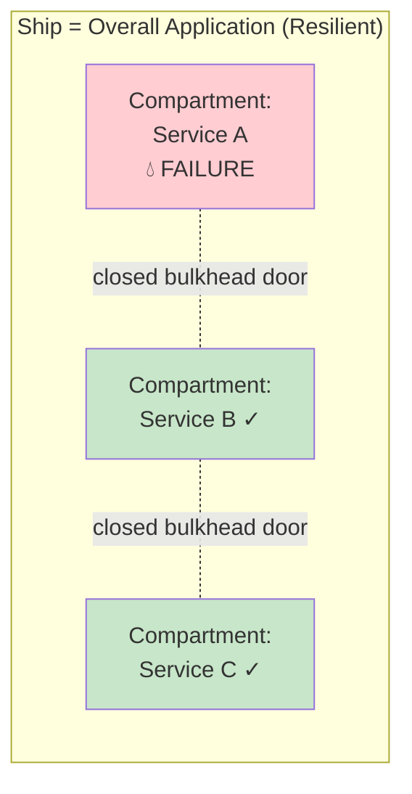

```yaml
Resiliency_Patterns:
  Fault_Isolation: "Microservices prevent single component failures from bringing down the entire application"
  Circuit_Breakers: "Stop sending requests to a failing dependency to give it time to recover"
  Retries_With_Exponential_Backoff: "Automatically retry failed requests, spacing them out to avoid overwhelming the system"
  Bulkhead_Isolation: "Dedicate specific resources (like connection pools) per service to prevent shared resource exhaustion"
```

### Circuit Breaker

If service A realizes service B is down, it **trips the circuit**, immediately returning an error (or a fallback) instead of hanging and wasting resources.

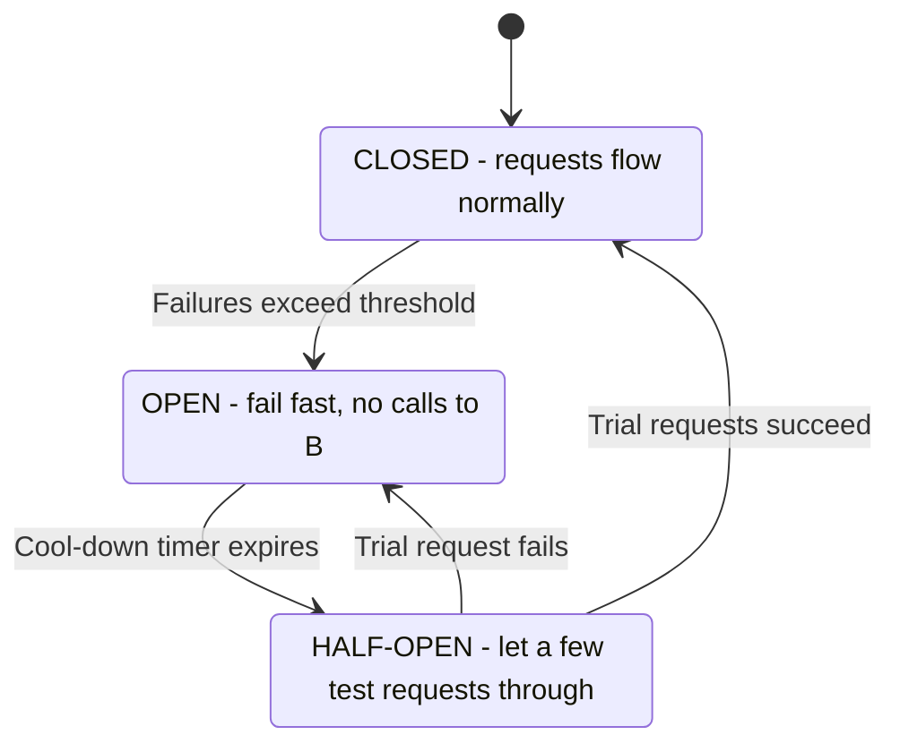

```python
# Simplified circuit breaker
import time

class CircuitBreaker:
    def __init__(self, failure_threshold=5, reset_timeout=30):
        self.failure_threshold = failure_threshold
        self.reset_timeout = reset_timeout
        self.failures = 0
        self.state = "CLOSED"
        self.opened_at = 0

    def call(self, fn, *args, fallback=None):
        if self.state == "OPEN":
            if time.time() - self.opened_at >= self.reset_timeout:
                self.state = "HALF_OPEN"
            else:
                return fallback  # fail fast, don't touch the sick service

        try:
            result = fn(*args)
            self.failures = 0
            self.state = "CLOSED"
            return result
        except Exception:
            self.failures += 1
            if self.state == "HALF_OPEN" or self.failures >= self.failure_threshold:
                self.state = "OPEN"
                self.opened_at = time.time()
            return fallback
```

### Retries with Exponential Backoff

```yaml
Retries_With_Backoff:
  Idea: "Retry transient failures, but wait longer each time"
  Schedule_Example: "100ms -> 200ms -> 400ms -> 800ms -> give up"
  Add_Jitter: "Randomize the delay so thousands of clients don't retry in lockstep"
  Cap: "Limit max attempts and max delay"
  Only_Retry_Idempotent: "Retrying a non-idempotent payment can charge twice - use idempotency keys"
  Combine: "Retries + circuit breaker, so retries stop when the dependency is clearly down"
```

```python
import random, time

def retry_with_backoff(fn, max_attempts=5, base=0.1, cap=5.0):
    for attempt in range(max_attempts):
        try:
            return fn()
        except Exception:
            if attempt == max_attempts - 1:
                raise
            delay = min(cap, base * (2 ** attempt))
            time.sleep(random.uniform(0, delay))  # "full jitter"
```

### Bulkhead Isolation

Just like a submarine or ship has **watertight compartments** so a single leak won't sink the vessel, we allocate **dedicated connection pools** to different services. If one service gets overwhelmed, it doesn't consume all the resources and sink the whole application.

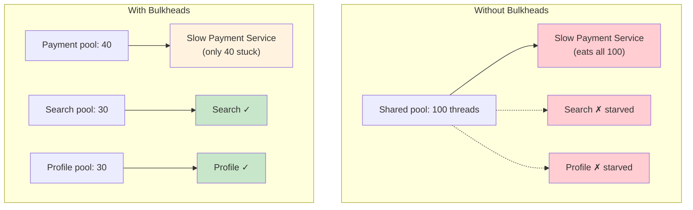

### Pattern Summary

| Pattern | Protects against | Mechanism |
|---------|------------------|-----------|
| Fault isolation | One component taking down everything | Separate services/processes |
| Circuit breaker | Hanging on a dead dependency | Fail fast after repeated errors |
| Retry + exponential backoff | Transient glitches | Retry with growing, jittered delays |
| Bulkhead | Resource exhaustion spreading | Dedicated pools per dependency |

---

## Database Failover and Replication

Stateless app servers are easy to fail over: start another one. **Databases hold state**, so how you replicate determines what survives the failover.

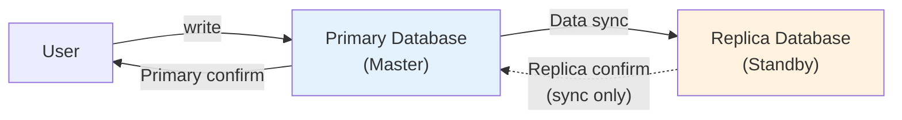

```yaml
Synchronous_Replication:
  How: "Transactions must be written to both primary and backup before confirming to the user"
  Result: "Ensures perfect consistency (RPO = 0) but adds latency"

Asynchronous_Replication:
  How: "Primary confirms to the user immediately, then syncs to the backup in the background"
  Result: "Faster performance, but risks minor data loss if the primary crashes before syncing (RPO > 0)"
```

| | Synchronous | Asynchronous |
|---|-------------|--------------|
| Confirm to user | After primary **and** replica write | After primary write |
| Data loss on failover | None | Last un-synced writes |
| Write latency | Higher | Lower |
| Fits | Banking, healthcare | Analytics, feeds, cross-region DR |

```yaml
Database_Failover_Steps:
  1: "Detect primary failure (heartbeat / health check)"
  2: "Fence the old primary so it cannot accept writes (prevent split-brain)"
  3: "Choose the most up-to-date replica"
  4: "Promote it to primary"
  5: "Repoint applications (DNS, virtual IP, proxy, or service discovery)"
  6: "Rebuild the old primary as a new replica when it returns"

Common_Tools: "Patroni (PostgreSQL), Orchestrator (MySQL), managed failover in Amazon RDS Multi-AZ / Aurora"
```

> The full sync vs async vs semi-sync vs quorum trade-off is the subject of [Episode 24: Replication Strategies](../24-replication-strategies/).

---

## Real-World Examples

### AWS Elastic Load Balancer (ELB)

AWS ELB is a perfect example of failover at the traffic layer: it actively monitors health and dynamically spreads traffic across different Availability Zones.

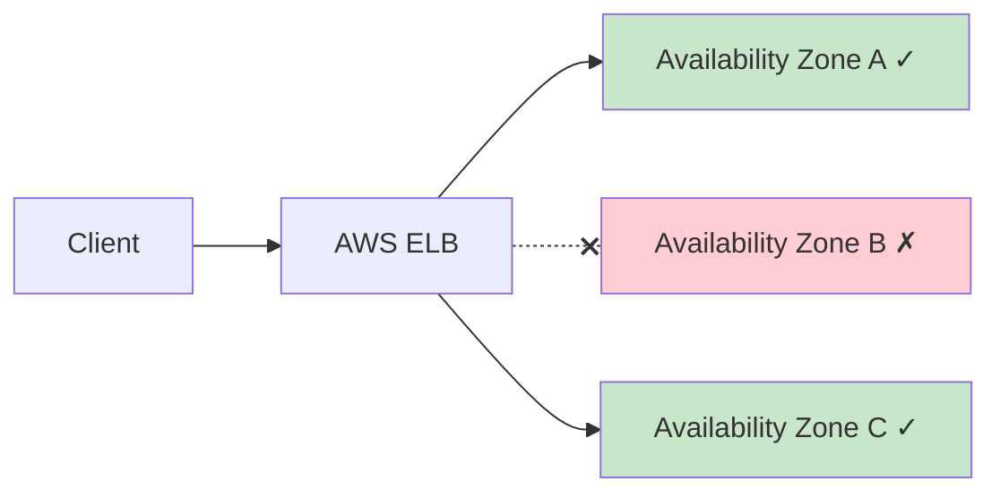

```yaml
AWS_ELB:
  What: "Automatically distributes incoming application traffic across multiple targets and Availability Zones"
  Failover_Behavior: "Routes away from unhealthy instances based on health checks"
  Why_It_Works: "Each AZ is physically separate, so losing one doesn't lose the service"
  Pairs_With: "Auto Scaling groups that replace unhealthy instances (self-healing)"
```

### Netflix Chaos Monkey

Netflix built a tool called **Chaos Monkey** that runs in their **production** environment and **randomly kills servers**.

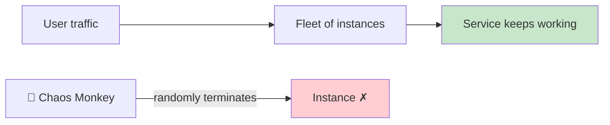

```yaml
Chaos_Monkey:
  What: "Intentionally and randomly terminates virtual machine instances in production"
  Why: "If you constantly force failures, you force your engineering team to build
        failover systems that are completely bulletproof"
  Principle: "Chaos engineering - prove resilience by testing it, not by assuming it"
  Lesson: "A failover path that is never exercised is a failover path that doesn't work"
```

---

## Putting It Together: A Failover-Ready Architecture

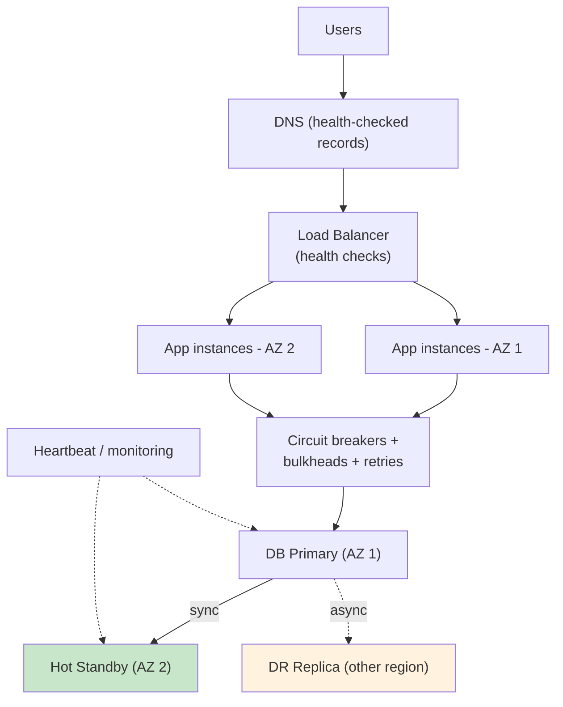

```yaml
Layer_By_Layer:
  DNS: "Health-checked records fail traffic over between regions"
  Load_Balancer: "Removes unhealthy app instances within seconds"
  App_Tier: "Active-active across AZs, sized so one AZ can carry the load"
  Service_Calls: "Circuit breakers, bulkheads, and backoff contain dependency failures"
  Database: "Hot standby with sync replication for RPO 0 locally; async DR replica in another region"
  Verification: "Chaos testing proves the whole chain actually works"
```

---

## Key Takeaways

### Remember This

- **Failover** = automatically shifting operations from a failed component to a standby, as seamlessly as possible
- **Five nines** (99.999%) leaves less than ~5 minutes of downtime per year, so detection and switchover must be automated
- **Planned failures** (upgrades, patches, migrations) are controlled with zero-downtime rollouts; **unplanned failures** (power, hardware, network) need redundancy and automated failover
- **RTO** = how long you can be down; **RPO** = how much data you can lose. Together they set your DR budget
- **No single point of failure**: redundancy at network, compute, storage, and database layers
- **Cold / Warm / Hot standby**: cheaper backups mean higher RTO; hot standby gives near-zero RTO at the highest cost
- **Active-passive** is simple but leaves capacity idle; **active-active** uses everything but makes state sync hard and risks split-brain
- **Triggers**: heartbeats, load balancer health checks, SNMP traps; then reroute via LB, DNS, or virtual IP
- **Microservice resiliency**: fault isolation, circuit breakers, retries with exponential backoff, and bulkheads
- **Database failover** depends on replication: sync gives RPO 0 with latency, async is faster but can lose recent writes
- **Test it**: AWS ELB routes around unhealthy AZs; Netflix Chaos Monkey kills production servers to prove failover works

### Common Mistakes to Avoid

```yaml
Common_Mistakes:
  1_Untested_Failover:
    Mistake: "Failover configured but never exercised"
    Reality: "It fails the one time you need it"
    Correct: "Run game days and chaos experiments regularly"

  2_Hidden_SPOF:
    Mistake: "Redundant servers behind a single load balancer, DNS provider, or database"
    Reality: "The whole stack is only as available as its weakest single component"
    Correct: "Audit every layer for single points of failure"

  3_Hair_Trigger_Health_Checks:
    Mistake: "Fail over after one missed heartbeat"
    Reality: "GC pauses and network blips cause flapping and needless failovers"
    Correct: "Require several consecutive failures; add hysteresis before failing back"

  4_No_Split_Brain_Protection:
    Mistake: "Two-node cluster with no quorum or fencing"
    Reality: "A network partition creates two primaries and divergent data"
    Correct: "Use quorum, a witness, and fencing"

  5_Retry_Storms:
    Mistake: "Immediate, unlimited retries"
    Reality: "Clients hammer a recovering service back into the ground"
    Correct: "Exponential backoff with jitter, capped attempts, plus circuit breakers"

  6_Active_Active_Without_Headroom:
    Mistake: "Two active nodes each running at 80%"
    Reality: "When one dies, the survivor needs 160% and falls over too"
    Correct: "Keep enough headroom to absorb a failed peer's load"

  7_Ignoring_DNS_TTL:
    Mistake: "Relying on DNS failover with a 1-hour TTL"
    Reality: "Clients keep hitting the dead endpoint until caches expire"
    Correct: "Use low TTLs for failover records, or fail over at the load balancer"
```

### Best Practices

```yaml
Failover_Best_Practices:
  1: "Define RTO and RPO per service before choosing an architecture"
  2: "Eliminate single points of failure at every layer"
  3: "Match standby temperature (cold/warm/hot) to the RTO you actually need"
  4: "Automate detection and switchover; humans are too slow for five nines"
  5: "Protect against split-brain with quorum and fencing"
  6: "Wrap remote calls in timeouts, circuit breakers, bulkheads, and backoff"
  7: "Spread workloads across Availability Zones (and regions for DR)"
  8: "Continuously test failover with chaos engineering"
```

---

## Presentation

View the slides for this episode: [Presentation Slides](./presentation/)

---

<div align="center">

[Previous: Episode 24](../24-replication-strategies/) | [Course Home](../../) | [Next: Episode 26](../26-message-queues/)

</div>
