# Episode 26: Message Queues

[](http://youtube.com/@ThatNotesGuy)

## What You'll Learn

- Why "messaging" actually covers two different concepts: **queues** and **streams**
- The difference between **commands** (ephemeral tasks) and **events** (permanent facts)
- How **RabbitMQ** routes messages with exchanges, bindings, and routing keys (smart broker / dumb consumer)
- How **Apache Kafka** scales with partitions, sequential I/O, consumer groups, and offsets (dumb broker / smart consumer)
- How **Amazon SQS** works with long polling and visibility timeouts, and why its pricing model matters
- The three delivery semantics: **at-most-once**, **at-least-once**, and **exactly-once**
- Why **idempotent consumers** are the real answer to duplicate messages
- How to combine tools in a **hybrid architecture** (Kafka as the backbone, SQS/RabbitMQ for worker queues)

---

## Introduction: Why Message Queues Exist

### The Problem with Direct Calls

When Service A calls Service B synchronously (HTTP/gRPC), the two are tightly coupled in time: if B is slow, A is slow; if B is down, A fails. A **message broker** sits in the middle so producers and consumers no longer need to be online, fast, or even aware of each other at the same moment.

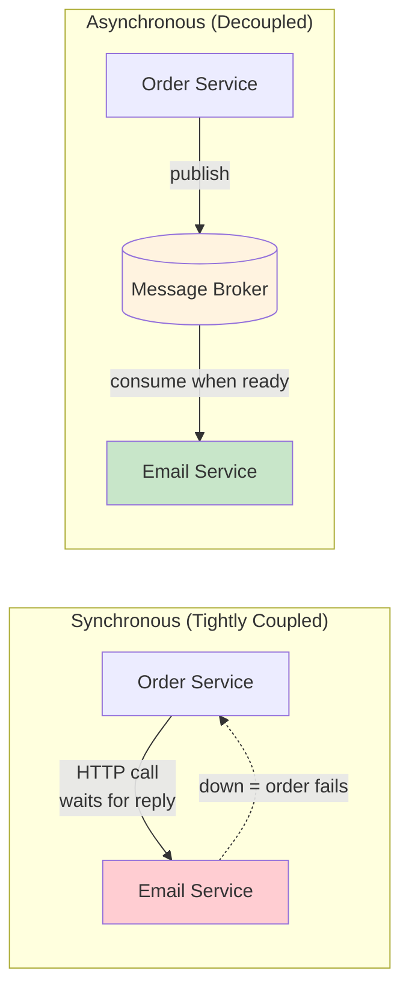

```yaml
Why_Use_A_Broker:
  Decoupling: "Producer doesn't need to know who consumes, or how many consumers exist"
  Buffering: "Absorb traffic spikes - the queue grows, workers drain it at their own pace"
  Resilience: "If a consumer crashes, messages wait in the broker instead of being lost"
  Async_Work: "Return to the user fast, do the slow work (emails, video encoding) later"
  Scaling: "Add more consumers to process the backlog faster"
```

### The Three Tools in This Episode

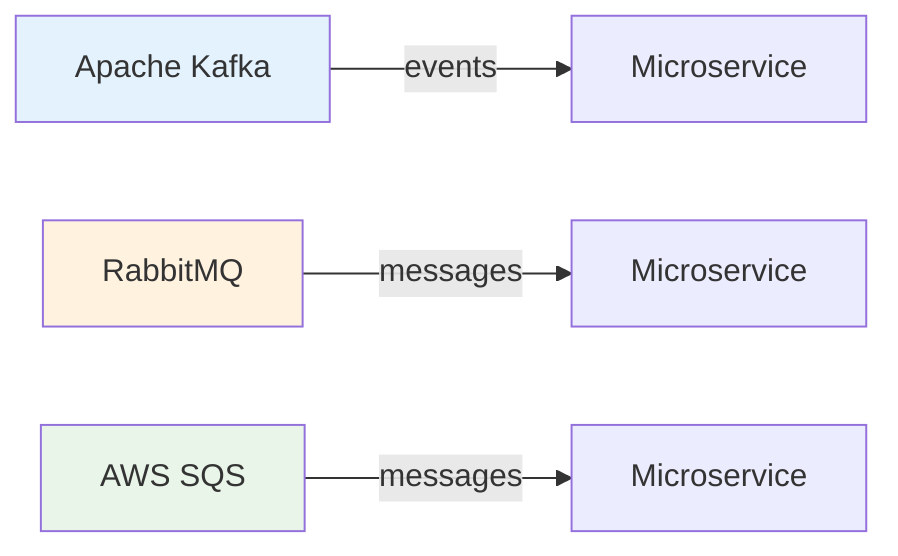

All three move data from producers to microservices, but they are built on very different philosophies. Before comparing them, we need to clear up the biggest source of confusion in system design.

---

## Queues vs. Streams: The Core Distinction

We often use the word **messaging** to cover two completely different concepts.

| | **Message Queue** | **Event Stream** |
|---|---|---|
| **Examples** | RabbitMQ, Amazon SQS | Apache Kafka |
| **Built for** | **Commands** ("do this task") | **Events** ("this fact happened") |
| **Lifetime** | Ephemeral - deleted after ACK | Permanent (retained by policy) - immutable ledger |
| **Read type** | **Destructive** reads | **Non-destructive** reads |
| **Focus** | Task-focused, point-to-point delegation | Fact-focused, many independent readers |
| **Who tracks state** | **Stateful broker** tracks what was read | **Stateless broker / smart consumer** tracks its own offset |
| **Replay** | Not possible once consumed | Rewind the offset and re-read |

### The Restaurant Analogy

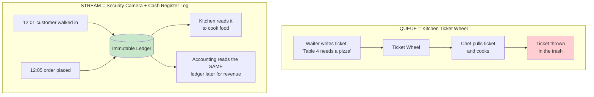

```yaml
Restaurant_Analogy:
  Queue_Ticket_Wheel:
    Message: "Table 4 needs a pizza (a command)"
    Consumer: "One chef pulls the ticket"
    After_Processing: "Ticket goes in the trash - the message's life is over"

  Stream_Security_Camera:
    Message: "Customer walked in at 12:01 (a fact)"
    Consumers: "Kitchen reads it now; accounting reads the exact same ledger later"
    After_Processing: "Nothing is deleted just because someone read it"
```

### What Happens Under the Hood

- **Queues delete messages upon acknowledgment (ACK)**, which alters the state of the queue. The broker must remember which messages are in flight, which are acked, and which need redelivery.
- **Streams append serialized byte arrays to a disk log**, pushing the state-tracking burden (offsets) onto the consumer. The broker just stores bytes in order.

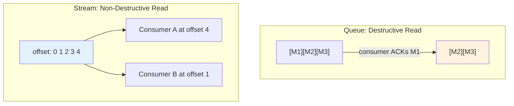

### Commands vs. Events

```yaml
Commands:
  Shape: "Imperative - SendWelcomeEmail, ResizeImage, ChargeCard"
  Audience: "Exactly one worker should do it"
  Value_After_Done: "None - the task is complete"
  Fits: "Queue (RabbitMQ, SQS)"

Events:
  Shape: "Past tense - UserSignedUp, OrderPlaced, PaymentCaptured"
  Audience: "Any number of services, now or in the future"
  Value_After_Done: "High - it's a historical fact you can replay, audit, or analyze"
  Fits: "Stream (Kafka)"
```

> **Rule of thumb:** If it's an ephemeral task, use a queue. If it's a permanent fact, use a stream.

---

## RabbitMQ: The Smart Broker

If Kafka is a dumb pipe with smart consumers, **RabbitMQ is a genius pipe with dumb consumers**.

```yaml
RabbitMQ_Overview:
  Architecture: "Smart Broker / Dumb Consumer"
  Protocol: "Built heavily around AMQP (Advanced Message Queuing Protocol), version 0-9-1"
  Core_Components: [Producers, Exchanges, Bindings, Queues]
  Exchange_Types: [Direct, Fanout, Topic, Headers]
  Delivery_Model: "Broker PUSHES messages to consumers"
  State: "Tracked in memory by the broker (which messages are delivered / acked)"
```

### Producers Don't Talk to Queues

In RabbitMQ, producers never send messages directly to queues. They send them to an **exchange**. Think of an exchange as a highly efficient **post office sorting room**. You configure **bindings**, which are rules telling the exchange which queues should receive which messages.

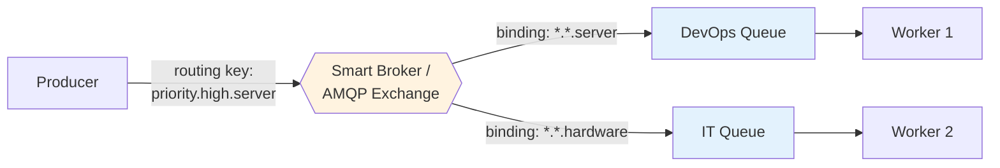

### The Four Exchange Types

| Exchange | Routing Rule | Typical Use |
|---|---|---|
| **Direct** | Routing key must **exactly match** the binding key | Send `pdf.generate` jobs to the PDF worker queue |
| **Fanout** | Ignores the key; copies to **every** bound queue | Broadcast a cache-invalidation message to all nodes |
| **Topic** | Pattern match on dot-separated words (`*`, `#`) | Route alerts by severity and source |
| **Headers** | Matches on message header attributes instead of the key | Route by `format=pdf AND region=eu` |

### Topic Exchange Example (from the episode)

A web portal publishes a JSON payload with a routing key like `priority.high.server`. You can bind a **DevOps queue** to catch anything ending in `server`, and a completely separate **PagerDuty queue** to catch `priority.high.#`. RabbitMQ handles this routing out of the box.

```yaml
Topic_Wildcards:
  "*": "Matches EXACTLY one word"
  "#": "Matches ZERO or more words"

Examples:
  Routing_Key: "priority.high.server"
  "*.server": "NO match (key has 3 words, pattern has 2) - matches 'critical.server'"
  "*.*.server": "MATCH"
  "#.server": "MATCH"
  "priority.high.#": "MATCH (PagerDuty queue)"
  "priority.low.#": "NO match"
```

> Note: the slide shows bindings like `*.server` / `*.hardware`. Those match two-word keys such as `disk.server` or `laptop.hardware`. For three-word keys like `priority.high.server`, use `*.*.server` or `#.server`.

```python
# RabbitMQ topic exchange with pika (Python)
import json, pika

conn = pika.BlockingConnection(pika.ConnectionParameters("localhost"))
ch = conn.channel()

ch.exchange_declare(exchange="alerts", exchange_type="topic", durable=True)

ch.queue_declare(queue="devops", durable=True)
ch.queue_bind(exchange="alerts", queue="devops", routing_key="#.server")

ch.queue_declare(queue="pagerduty", durable=True)
ch.queue_bind(exchange="alerts", queue="pagerduty", routing_key="priority.high.#")

# One publish -> lands in BOTH queues
ch.basic_publish(
    exchange="alerts",
    routing_key="priority.high.server",
    body=json.dumps({"host": "web-07", "msg": "CPU at 98%"}),
    properties=pika.BasicProperties(delivery_mode=2),  # persistent message
)
```

### Acknowledgments: How RabbitMQ Avoids Losing Work

Once a worker grabs a message, the broker waits for an **acknowledgment (ACK)**. If the worker crashes and the TCP connection drops before acking, RabbitMQ simply hands the message to the next available worker, so no data is lost.

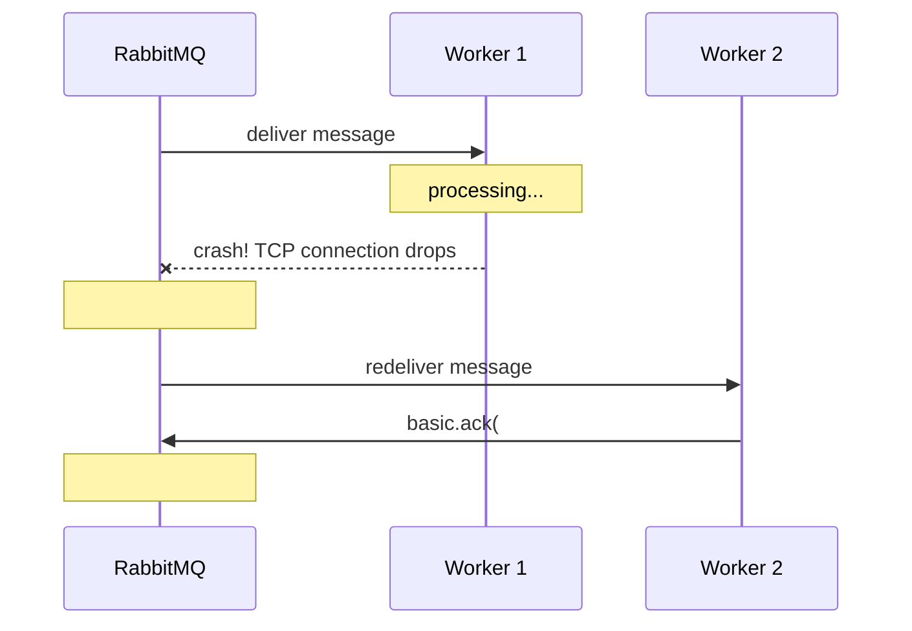

```python
# Consumer with manual acks and prefetch
def handle(ch, method, properties, body):
    process(json.loads(body))
    ch.basic_ack(delivery_tag=method.delivery_tag)   # only after work succeeds

ch.basic_qos(prefetch_count=10)    # at most 10 unacked messages per worker
ch.basic_consume(queue="devops", on_message_callback=handle, auto_ack=False)
ch.start_consuming()
```

### RabbitMQ's Weakness: Deep Backlogs

Because RabbitMQ tracks all of its state in memory, if a queue backs up into **millions** of messages, it has to page to disk and **performance falls off a cliff**. RabbitMQ is happiest when queues are short and consumers keep up.

```yaml
RabbitMQ_Strengths:
  - "Rich, flexible routing out of the box (direct, fanout, topic, headers)"
  - "Per-message acks, redelivery, dead-letter exchanges, priorities, TTLs"
  - "Low latency push delivery to consumers"
  - "Great for task/work queues between microservices"

RabbitMQ_Weaknesses:
  - "State tracked in memory - huge backlogs force paging to disk and slow everything down"
  - "Messages are gone after ACK - no replay"
  - "Throughput ceiling is lower than a partitioned log like Kafka"

Mitigations_In_Newer_Versions: |
  Quorum queues (Raft-replicated) and RabbitMQ Streams exist today,
  but the classic model is still "short queues, fast consumers".
```

---

## Apache Kafka: The Distributed Commit Log

Kafka is not a traditional message queue. It is a **distributed event streaming platform**, born at **LinkedIn** to handle massive, relentless pipelines of data. Internally, Kafka persists messages in an **immutable, append-only log**.

```yaml
Kafka_Overview:
  Architecture: "Dumb Broker / Smart Consumer"
  Data_Structure: "Distributed, partitioned, and replicated commit log"
  Components: [Topics, Partitions, Consumer Groups, Offsets]
  Scale: "Relies on Sequential I/O and the Zero-Copy principle"
  Throughput: "Can process upwards of 1 million+ messages per second"
  Delivery_Model: "Consumers PULL data from brokers (RabbitMQ pushes)"
```

### Architecture Overview

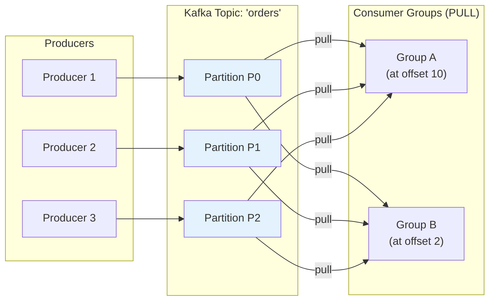

Each partition lives on a **broker** (server) and is replicated to other brokers, so losing one machine doesn't lose data. In the slide's diagram, broker 1 leads P0, broker 2 leads P1 and holds a replica of P0, and so on.

### Partitions: The Unit of Parallelism

To achieve its scale, Kafka splits **topics** into **partitions**. A partition is the fundamental **unit of parallelism and ordering**.

```yaml
Partition_Math_Example:
  Topic_Load: "50,000 events / second"
  Partitions: 20
  Brokers: "20 servers (one partition each)"
  Per_Server_Load: "50,000 / 20 = 2,500 events / second"

Partition_Rules:
  Ordering: "Guaranteed WITHIN a partition, not across partitions"
  Keyed_Messages: "Same key (e.g., user_id) -> same partition -> ordered per key"
  Consumer_Limit: "Within a group, each partition is read by at most ONE consumer"
  Implication: "Max useful consumers in a group = number of partitions"
```

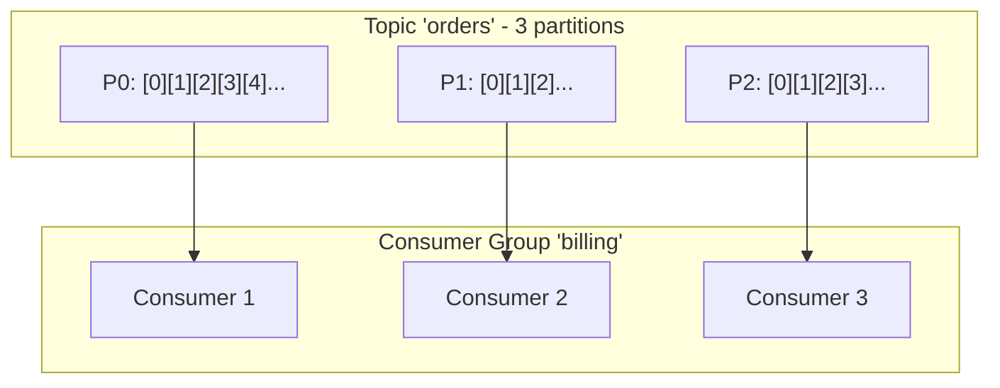

### Why Kafka Is So Fast

```yaml
Sequential_IO:
  What: "Kafka only APPENDS bytes to the end of a log file"
  Why_Fast: "Avoids the slow random reads/writes of traditional databases"
  Result: "SSD-like throughput even on spinning hard drives"

Zero_Copy:
  What: "Data is sent from the OS page cache straight to the network socket (sendfile)"
  Why_Fast: "Skips copying bytes into application memory and back"

Batching_And_Compression:
  What: "Producers batch many records and compress them together"
  Why_Fast: "Fewer, larger network and disk operations"

Dumb_Broker:
  What: "Broker doesn't track per-message ack state for each consumer"
  Why_Fast: "Less bookkeeping - consumers track their own position"
```

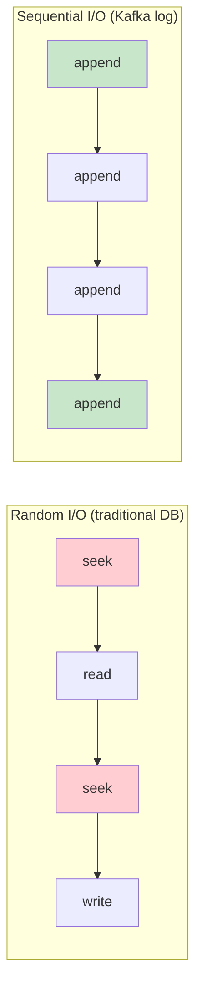

### Consumer Groups and Offsets

Because data is retained on disk rather than deleted upon consumption, Kafka introduces **consumer groups**. A consumer group is a set of application instances coordinating to read a topic, and **each group manages its own offset**: a bookmark indicating exactly which message it read last.

Offsets are logical pointers stored in an internal Kafka topic called **`__consumer_offsets`**.

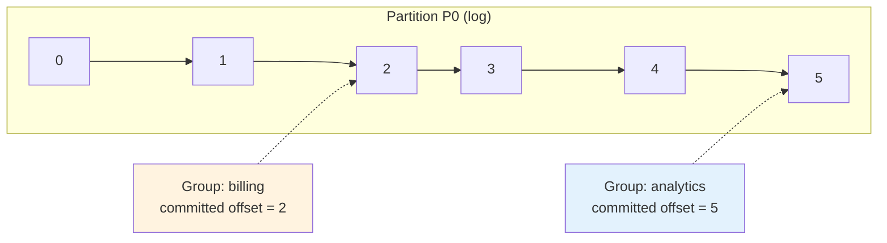

```yaml
Consumer_Group_Behavior:
  Different_Groups: "Each group gets EVERY message (pub/sub) at its own pace"
  Same_Group: "Partitions are split between members (load balancing)"
  Rebalance: "If a consumer joins/leaves/crashes, partitions are reassigned"
  Retention: "Messages kept by time or size policy (or compacted), not by 'was it read?'"
```

### Kafka's Superpower: Replayability

If you deploy a bug that corrupts your database, you can **fix the bug, rewind your offset to last Tuesday, and seamlessly rebuild your state**. A queue can't do this - once a message is acked, it's gone.

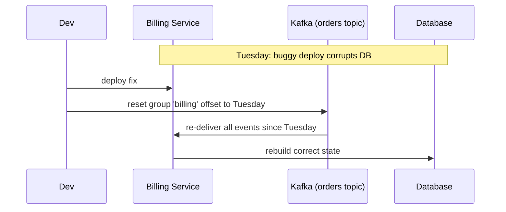

```bash
# Rewind a consumer group to a point in time (group must be stopped)
kafka-consumer-groups.sh --bootstrap-server localhost:9092 \
  --group billing --topic orders \
  --reset-offsets --to-datetime 2026-10-27T00:00:00.000 --execute
```

```python
# Kafka producer/consumer with confluent-kafka (Python)
from confluent_kafka import Producer, Consumer

producer = Producer({"bootstrap.servers": "localhost:9092",
                     "enable.idempotence": True})   # no duplicates from producer retries
producer.produce("orders", key="user-123", value='{"order_id": "o-981", "total": 49.99}')
producer.flush()

consumer = Consumer({"bootstrap.servers": "localhost:9092",
                     "group.id": "billing",
                     "auto.offset.reset": "earliest",
                     "enable.auto.commit": False})
consumer.subscribe(["orders"])

while True:
    msg = consumer.poll(1.0)
    if msg is None or msg.error():
        continue
    handle_order(msg.value())
    consumer.commit(message=msg)    # move the bookmark only after success
```

### Push vs. Pull

| | RabbitMQ (Push) | Kafka (Pull) |
|---|---|---|
| Who controls the pace | Broker (limited by prefetch) | Consumer |
| Slow consumer | Unacked messages pile up on the broker | Consumer just falls behind (lag), broker unaffected |
| Batching | Per message | Natural - pull a batch of records at once |
| Latency | Very low | Low (consumer polls in a loop) |

---

## Amazon SQS: Zero Operational Overhead

If you want absolutely zero operational overhead, you turn to something like **Amazon SQS**. SQS is one of the oldest services in AWS (it was AWS's first publicly launched service). It doesn't have the fancy routing of RabbitMQ or the replayability of Kafka, but it gives you a massively scalable, highly available buffer with a single click.

```yaml
SQS_Overview:
  Architecture: "Fully managed, serverless, API-driven queue"
  Communication: "Long polling via HTTP requests (no persistent TCP connection like Kafka/RabbitMQ)"
  Queue_Types: "Standard vs FIFO"
  Core_Mechanism: "Visibility Timeout"
  Pricing: "Heavily based on API requests (polling, reading, deleting)"
```

### Architecture

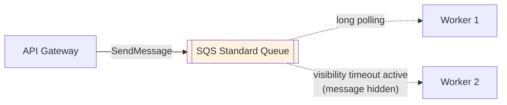

### Standard vs. FIFO Queues

| | **Standard Queue** | **FIFO Queue** |
|---|---|---|
| Ordering | Best-effort | Strictly ordered (per message group) |
| Throughput | Nearly unlimited API calls per second | Limited: 3,000 msg/sec **with batching** (300/sec without) by default |
| Delivery | At-least-once (occasional duplicates) | Exactly-once processing (deduplication window) |
| Use when | Max scale, consumers are idempotent | Order matters (e.g., ledger updates per account) |

> AWS also offers a high-throughput mode for FIFO queues that raises these limits; the 3,000/sec figure is the classic default quoted in the episode.

### Long Polling

Workers make HTTP requests to AWS asking for messages. With **long polling**, the request waits (up to 20 seconds) for a message to arrive instead of returning empty immediately, which cuts down on wasted empty responses.

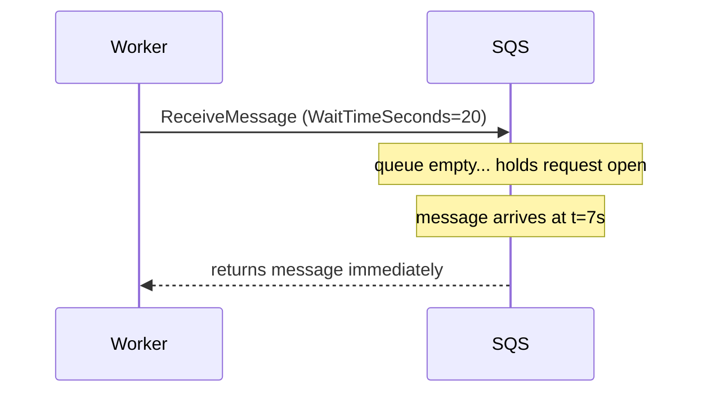

### The Visibility Timeout

When a worker pulls a message, SQS doesn't delete it. Instead it relies on the **visibility timeout**. If the timeout is two minutes, SQS makes the message **invisible to all other consumers** for two minutes while your worker processes it.

- If the worker finishes and **deletes** the message: great, done.
- If the worker **crashes silently**: the timeout expires and the message **magically reappears** in the queue for another worker to try.

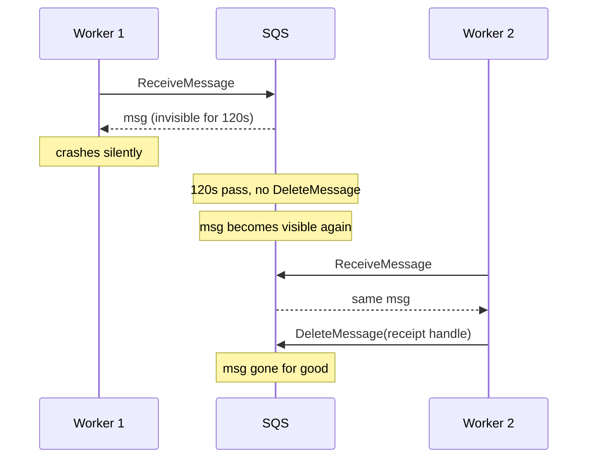

```python
# SQS worker with boto3
import boto3
sqs = boto3.client("sqs")
URL = "https://sqs.us-east-1.amazonaws.com/123456789012/jobs"

while True:
    resp = sqs.receive_message(
        QueueUrl=URL,
        MaxNumberOfMessages=10,     # batch to reduce request count
        WaitTimeSeconds=20,         # long polling
        VisibilityTimeout=120,      # 2 minutes to finish the job
    )
    for m in resp.get("Messages", []):
        process(m["Body"])
        sqs.delete_message(QueueUrl=URL, ReceiptHandle=m["ReceiptHandle"])
```

```yaml
SQS_Extras:
  Dead_Letter_Queue: "After N failed receives (maxReceiveCount), move the poison message aside"
  ChangeMessageVisibility: "Extend the timeout for jobs that run long"
  Retention: "Messages kept for a configurable period (default 4 days, up to 14)"
```

### The SQS Cost Trap

SQS **charges per request**. That includes every poll, every receive, every delete.

```yaml
Cost_Traps:
  Polling_Empty_Queues: "Short polling an empty queue in a tight loop = paying for nothing"
  Grab_And_Release: "Pulling messages you aren't ready to process and putting them back = more requests"
  One_At_A_Time: "Receiving/deleting single messages instead of batches of up to 10"

How_To_Avoid:
  - "Use long polling (WaitTimeSeconds up to 20)"
  - "Batch receives and deletes (up to 10 messages per call)"
  - "Only pull what you can process"
```

> **Don't just ask "how much?" - ask "how does it charge?"** Managed services aren't always cheaper at scale.

---

## Side-by-Side Comparison

| Feature | RabbitMQ | Apache Kafka | Amazon SQS |
|---|---|---|---|
| **Model** | Queue | Stream (commit log) | Queue |
| **Broker style** | Smart broker / dumb consumer | Dumb broker / smart consumer | Managed, API-driven |
| **Protocol** | AMQP over persistent TCP | Kafka binary protocol over persistent TCP | HTTP API (long polling) |
| **Delivery** | Push | Pull | Pull (long polling) |
| **After consumption** | Deleted on ACK | Retained (offset moves) | Deleted on DeleteMessage |
| **Replay** | No | Yes (rewind offsets) | No |
| **Routing** | Very rich (exchanges) | Topic + partition key | None (one queue) |
| **Ordering** | Per queue (with single consumer) | Per partition | FIFO queues only |
| **Scale** | Good; struggles with huge backlogs | Massive (1M+ msg/sec) | Nearly unlimited (Standard) |
| **Crash recovery** | Requeue on connection drop | Re-read from last committed offset | Visibility timeout expires |
| **Ops burden** | You run it | You run it (or use a managed offering) | Zero |
| **Cost model** | Infrastructure | Infrastructure | Per request |

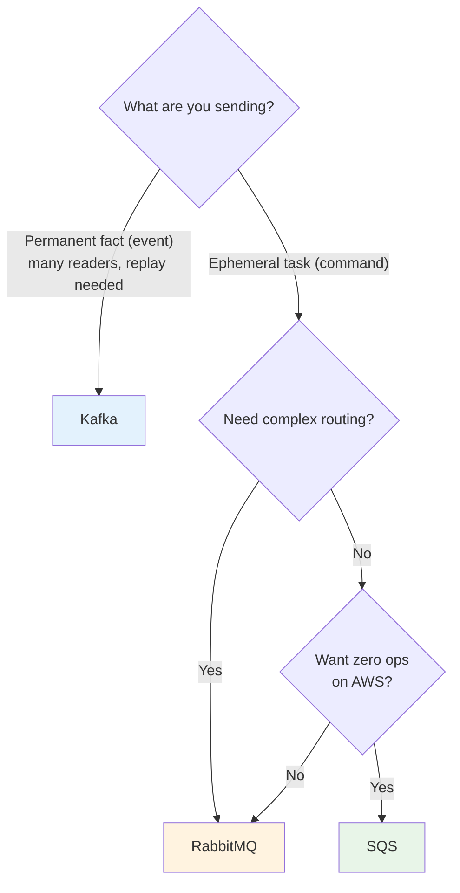

---

## Delivery Semantics

Whenever you work with distributed systems, you have to talk about **delivery semantics**. A system usually promises one of three things:

| Semantic | Behavior | Drops? | Duplicates? | Example |
|---|---|---|---|---|
| **At-most-once** | Fire and forget (UDP style) | Possible | No | Dropping a single frame of live video metrics is fine |
| **At-least-once** | Retries until ACK'd | No | **Guaranteed to happen eventually** | The industry standard |
| **Exactly-once** | The holy grail | No | No | Extremely difficult due to network and node failures |

### At-Most-Once

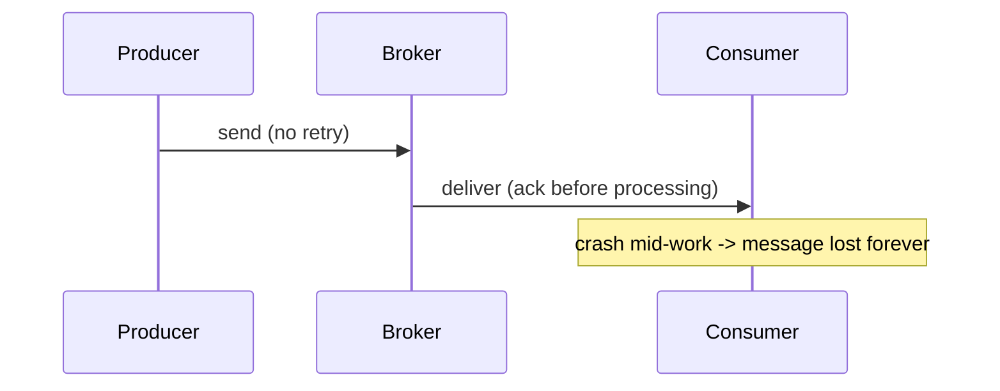

### At-Least-Once: The Duplicate Problem

The broker keeps delivering the message until the consumer acknowledges it. But imagine your worker processes a **payment**, and then the network drops the acknowledgment on its way back to the broker. The broker never hears the ACK, so it sends the payment message **again**.

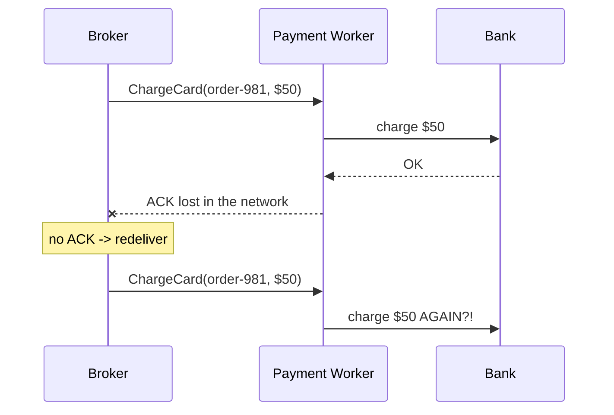

### Exactly-Once: Why It's (Mostly) a Myth

True end-to-end exactly-once **delivery** across external networks is effectively impossible: a sender can never be sure whether a lost ACK means "not processed" or "processed but the reply was lost".

```yaml
Kafka_Exactly_Once:
  Scope: "ONLY within Kafka-to-Kafka workflows (read from topic -> process -> write to topic)"
  Mechanisms:
    Idempotent_Producer: "Producer IDs + sequence numbers let the broker drop retried duplicates"
    Transactions: "Atomically write output records AND commit consumer offsets"
  Limitation: "The moment you call an external API, email server, or bank, the guarantee ends"

SQS_And_RabbitMQ:
  Reality: "Rely heavily on at-least-once"
  Consequence: "The burden of idempotency is pushed to the developer"
```

### The Real Answer: Idempotent Consumers

**Idempotency**: an operation that can be applied multiple times without changing the result beyond the initial application. If a consumer receives the same message five times, the business state changes only **once**.

You achieve this by **attaching a unique ID to every event** and having the consumer **check a database to see if that ID has already been processed** before taking action.

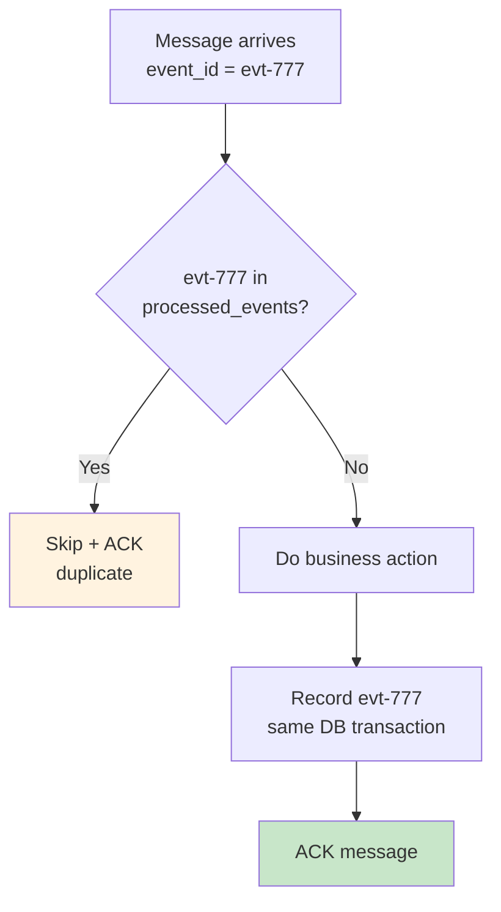

```sql
-- Dedup table: the PRIMARY KEY makes a second insert of the same id fail
CREATE TABLE processed_events (
    event_id     TEXT PRIMARY KEY,
    processed_at TIMESTAMP NOT NULL DEFAULT now()
);
```

```python
def handle_payment(msg):
    event_id = msg["event_id"]
    with db.transaction():
        inserted = db.execute(
            "INSERT INTO processed_events (event_id) VALUES (%s) "
            "ON CONFLICT (event_id) DO NOTHING", [event_id]
        ).rowcount
        if inserted == 0:
            return                      # already processed -> safe no-op
        charge_card(msg["order_id"], msg["amount"],
                    idempotency_key=event_id)   # pass key downstream too
        db.execute("UPDATE orders SET status='PAID' WHERE id=%s", [msg["order_id"]])
    # ack after the transaction commits
```

```yaml
Idempotency_Techniques:
  Dedup_Table: "Store processed message/event IDs with a unique constraint"
  Natural_Idempotence: "SET status='PAID' is safe to repeat; balance = balance + 50 is not"
  Upserts: "INSERT ... ON CONFLICT DO NOTHING / UPDATE"
  Downstream_Keys: "Pass an idempotency key to external APIs (e.g., payment providers)"
  Conditional_Writes: "UPDATE ... WHERE version = 7 (optimistic concurrency)"
```

> Assume the network **will** fail. Design for at-least-once delivery plus idempotent consumers, and stop trying to achieve exactly-once over the network.

---

## Real-World Architecture: Hybrid Is Healthy

Your job as a developer isn't just picking the coolest technology. It's **matching the semantic design of a tool to the economic and technical reality** of what you're building. Often the best answer is a combination: **Kafka as the central nervous system**, with **SQS/RabbitMQ for localized worker queues**.

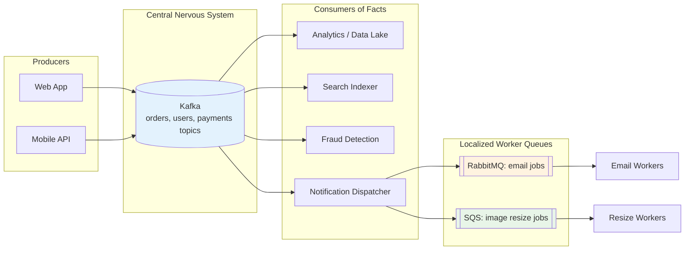

```yaml
Example_E_Commerce_Flow:
  1_Event: "OrderPlaced written to Kafka 'orders' topic (permanent fact)"
  2_Fan_Out: "Analytics, search, fraud, and notifications each read it via their own consumer group"
  3_Commands: "Notification service turns the fact into tasks: SendConfirmationEmail -> RabbitMQ/SQS"
  4_Workers: "Email workers pull tasks, ACK/delete them when sent"
  5_Recovery: "If fraud service had a bug, rewind its offset and reprocess - other groups unaffected"
```

### Common Use Cases

| Use Case | Good Fit | Why |
|---|---|---|
| Background jobs (emails, PDFs, thumbnails) | SQS / RabbitMQ | Ephemeral commands, one worker each |
| Complex routing of alerts/tasks | RabbitMQ | Topic/header exchanges |
| Activity tracking, clickstreams, logs | Kafka | High volume, many readers |
| Event sourcing / audit trail | Kafka | Immutable, replayable ledger |
| Change data capture (DB -> other systems) | Kafka | Ordered per key, replay |
| Simple decoupling on AWS with no ops team | SQS | Fully managed |
| Live metrics where loss is fine | Any, at-most-once | Freshness over completeness |

### Don't Over-Engineer

These tools are powerful but operationally complex. You really need them when scale grows to massive volume. For normal projects, a simple managed queue (or even a database-backed job table) is often enough - reach for a Kafka cluster when the problem actually demands it.

---

## Key Takeaways

### Remember This

- **Queues vs. Streams**: Queues (RabbitMQ, SQS) handle **commands** with destructive reads and a stateful broker; streams (Kafka) store **events** as an immutable log with non-destructive reads and consumer-tracked offsets
- **RabbitMQ = Smart Broker**: Producers publish to **exchanges**; **bindings** route to queues (direct, fanout, topic, headers); unacked messages are redelivered if a worker dies; huge backlogs hurt performance
- **Kafka = Dumb Broker, Smart Consumer**: Topics split into **partitions** (unit of parallelism and ordering); **sequential I/O + zero-copy** give massive throughput; **consumer groups** track their own **offsets**, enabling **replay**
- **SQS = Zero Ops**: HTTP **long polling**, **visibility timeout** for crash recovery, Standard (best-effort, at-least-once) vs FIFO (ordered, 3,000 msg/sec with batching); **you pay per request**
- **Delivery Semantics**: At-most-once (may drop), at-least-once (may duplicate, the industry standard), exactly-once (only Kafka-to-Kafka via producer IDs, sequence numbers, and transactions)
- **Idempotency Is Mandatory**: Give every event a unique ID and check it before acting, so duplicates change state only once
- **Understand the Cost Model**: Ask how a service charges, not just how much
- **Hybrid Is Healthy**: Kafka as the central nervous system, SQS/RabbitMQ for localized worker queues

### Common Mistakes to Avoid

```yaml
Common_Mistakes:
  1_Using_Kafka_As_A_Task_Queue:
    Mistake: "Treating Kafka like RabbitMQ for per-job retries and routing"
    Reality: "No per-message ack/requeue; a slow message blocks its partition"
    Correct: "Use a queue for commands, Kafka for facts"

  2_Using_A_Queue_For_Facts:
    Mistake: "Publishing events to RabbitMQ/SQS, then needing to replay them"
    Reality: "Once acked/deleted, they're gone"
    Correct: "Store permanent facts in a stream"

  3_Assuming_Exactly_Once:
    Mistake: "Trusting the broker to never deliver duplicates"
    Reality: "At-least-once means duplicates WILL happen"
    Correct: "Build idempotent consumers with unique event IDs"

  4_Auto_Ack_Before_Processing:
    Mistake: "auto_ack=True or committing offsets before work is done"
    Reality: "A crash mid-processing silently loses the message"
    Correct: "ACK / commit / delete only after the work succeeds"

  5_Visibility_Timeout_Too_Short:
    Mistake: "30s timeout on a job that takes 3 minutes"
    Reality: "Message reappears and a second worker processes it in parallel"
    Correct: "Set timeout above worst-case processing time, or extend it"

  6_Ignoring_SQS_Request_Costs:
    Mistake: "Short polling empty queues in a tight loop"
    Reality: "Every request is billed"
    Correct: "Long polling + batching"

  7_Too_Few_Partitions:
    Mistake: "1 partition, then adding 10 consumers"
    Reality: "Only one consumer per partition per group does work"
    Correct: "Plan partition count for peak parallelism"

  8_Letting_RabbitMQ_Queues_Grow_Unbounded:
    Mistake: "Consumers can't keep up; millions of messages pile up"
    Reality: "Paging to disk - performance falls off a cliff"
    Correct: "Scale consumers, set TTLs/max-length, use dead-letter exchanges"
```

### Best Practices

```yaml
Message_Queue_Best_Practices:
  1: "Classify every message: command (queue) or event (stream)"
  2: "Default to at-least-once delivery + idempotent consumers"
  3: "Put a unique ID on every message"
  4: "Acknowledge only after successful processing"
  5: "Configure dead-letter queues for poison messages"
  6: "Choose Kafka partition keys that preserve the ordering you need"
  7: "Monitor queue depth and consumer lag"
  8: "Understand the pricing model before committing to a managed service"
  9: "Don't introduce Kafka until scale actually requires it"
```

---

## Related Episodes

- [Episode 5: Stateless vs Stateful Systems](../05-stateless-stateful-systems/) - Why decoupled workers scale horizontally
- [Episode 15: Replication & Leader Election](../15-replication-leader-election/) - How Kafka partitions are replicated across brokers
- [Episode 18: TCP vs UDP](../18-tcp-udp/) - At-most-once "fire and forget" is the UDP mindset
- [Episode 27: REST API Design](../27-rest-api-design/) - Idempotency in HTTP methods
- [Episode 28: Webhooks & Push Notifications](../28-webhooks-push-notifications/) - Another flavor of async delivery

## Presentation

View the slides used in this episode: [Presentation Slides](./presentation/)

---

<div align="center">

[Previous Episode: Failover Mechanisms](../25-failover-mechanisms/) | [Course Home](../../) | [Next Episode: REST API Design](../27-rest-api-design/)

</div>
