# Episode 27: Designing REST APIs

[](http://youtube.com/@ThatNotesGuy)

## What You'll Learn

- Why **REST and HTTP are not the same thing**, and what REST actually is
- The **six architectural constraints** that make an API truly RESTful (and why statelessness matters most for scale)
- How to **name resources** with plural nouns and let HTTP methods express the action
- **HTTP methods and idempotency**, including the classic **PUT vs PATCH** confusion
- Using **status codes** correctly and designing **standardized error payloads** (RFC 7807 Problem Details)
- **Pagination, filtering, and sorting** - and why cursor pagination beats offset pagination at scale
- **API versioning** strategies and when to bump a version
- **Security** (HTTPS, JWT authentication, OAuth 2.0 / RBAC authorization, rate limiting)
- **Performance** (Cache-Control, ETags, compression, field selection)
- **Documentation and DX** with OpenAPI and Swagger UI

> This episode is a practical **design guide**. For the theory of RPC, the Richardson Maturity Model / HATEOAS, and a REST vs gRPC comparison, see [Episode 19: REST vs gRPC](../19-rest-grpc/).

---

## What Actually IS REST?

### REST ≠ HTTP

**REST (Representational State Transfer)** is an **architectural style** introduced by **Roy Fielding** in his **2000 doctoral dissertation**. It's a set of architectural constraints, **not a rigid protocol or standard**.

HTTP is just the protocol most REST APIs happen to use. You can absolutely build a **terrible, non-RESTful API using HTTP**.

```yaml
REST_vs_HTTP:
  HTTP: "An application-layer protocol (methods, headers, status codes)"
  REST: "A set of constraints on how to design a distributed system"
  Relationship: "REST APIs usually use HTTP, but using HTTP doesn't make an API RESTful"

  Non_RESTful_HTTP_Example: |
    POST /api/doEverything
    { "action": "deleteUser", "id": 42 }
    -> 200 OK  { "error": "user not found" }
```

### The Core Philosophy: Decoupling

Imagine you're at a restaurant. You don't walk into the kitchen, grab a pan, and start cooking. You look at a **menu**, tell the waiter what you want, and the **kitchen** prepares it.

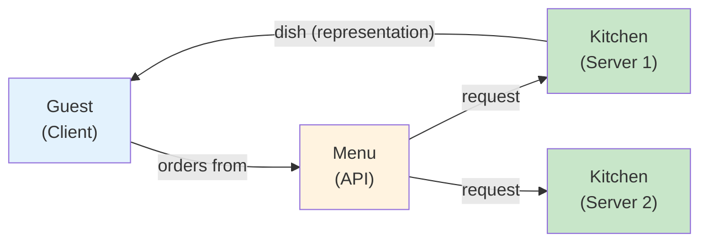

```yaml
Restaurant_Analogy:
  Menu: "The API - the contract of what you can ask for"
  Guest: "The client application"
  Kitchen: "The server"

  Server_Doesnt_Care: "Whether the client is a web app, a mobile app, or a script"
  Client_Doesnt_Care: "Whether the backend uses Postgres or Mongo"

  Result: "Frontend and backend can evolve entirely independently"
```

### Key Definitions

```yaml
Resource:
  Definition: "Any information or entity that can be named and manipulated"
  Examples: ["a user", "a ticket", "an order"]
  Identified_By: "A URI, e.g. /users/123"

Representation:
  Definition: "The data format (like JSON or XML) that represents the state of the resource at a specific time"
  Example: |
    GET /users/123 returns a JSON SNAPSHOT of user 123's state at that exact moment:
    { "id": 123, "name": "Asha", "email": "asha@example.com" }

State_Transfer:
  Meaning: "Client and server exchange representations of resource state"
```

---

## The Six Architectural Constraints

To call your API truly RESTful, it must adhere to six architectural constraints.

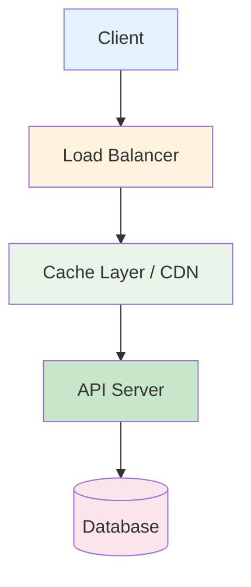

| # | Constraint | What It Means | Why It Matters |
|---|---|---|---|
| 1 | **Client-Server Separation** | UI and data storage evolve independently | Teams ship independently; many clients share one backend |
| 2 | **Statelessness** | Every request carries all info needed to fulfill it | Any server can handle any request - easy load balancing |
| 3 | **Cacheability** | Responses explicitly declare whether they can be cached | Drastically cuts server load and latency |
| 4 | **Layered System** | Client can't tell if it's talking to the origin or an intermediary (proxy, CDN) | Insert LBs, caches, gateways transparently |
| 5 | **Uniform Interface** | Standard way to identify and manipulate resources | Predictable APIs; generic tooling works |
| 6 | **Code on Demand** *(optional)* | Server may send executable code (e.g., scripts) to the client | Rarely used in modern JSON APIs |

### Statelessness: The Most Important for Scale

Every single request from a client must contain **absolutely all the information** the server needs. The server remembers **nothing** about previous requests - no sessions, no server-side state.

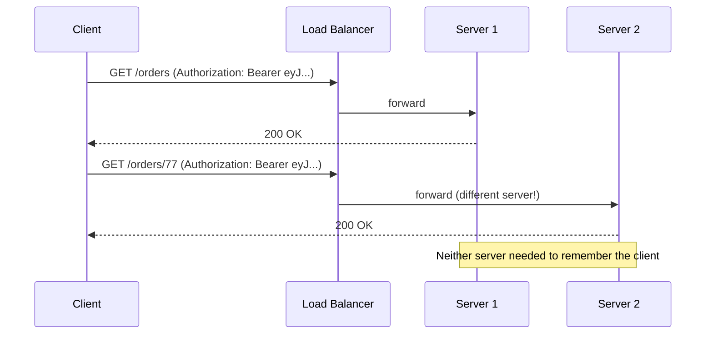

```yaml
Stateful_vs_Stateless:
  Stateful_Server:
    Request: "GET /next-page  (server remembers which page you were on)"
    Problem: "Next request MUST hit the same server (sticky sessions)"
  Stateless_Server:
    Request: "GET /orders?cursor=abc123  + Authorization header"
    Benefit: "Any server in the cluster can answer"
```

> If you break these rules - particularly statelessness - you're building a **distributed monolith**, not a REST API. See [Episode 5: Stateless vs Stateful Systems](../05-stateless-stateful-systems/).

---

## Resource Naming

One of the most common mistakes is naming APIs wrong.

```yaml
Naming_Rules:
  1: "URLs identify resources (nouns), not actions (verbs)"
  2: "Always use plural nouns for collections (e.g., /users)"
  3: "Keep URLs predictable and hierarchical"
```

### Nouns, Not Verbs

Think of an endpoint as a **digital filing cabinet**. You wouldn't label a drawer "get invoices" - you'd just label it **invoices**.

> **The URL defines the target. The HTTP method defines the action.**

| ❌ Messy: Verbs / Actions | ✅ RESTful: Nouns / Resources |
|---|---|
| `/getUsers` | `GET /users` |
| `/createNewOrder` | `POST /orders` |
| `/deleteUser?id=42` | `DELETE /users/42` |
| `/getAllCustomers` | `GET /customers` |
| `/updateCustomerEmail` | `PATCH /customers/7` |

### Plural Nouns for Collections

Use `/users` instead of `/user` - it makes it crystal clear you're dealing with a **collection**. To get one user, ask the collection for item 123: `/users/123`. This provides a predictable, uniform contract and eliminates guesswork for developers consuming your API.

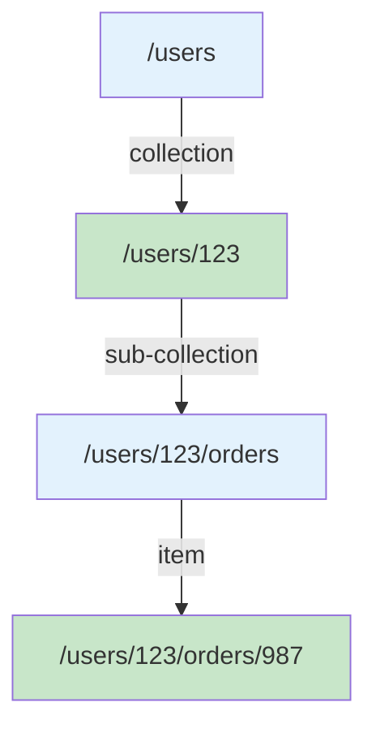

```yaml
Hierarchical_Examples:
  Collection: "GET /users"
  Item: "GET /users/123"
  Sub_Collection: "GET /users/123/orders"
  Sub_Item: "GET /users/123/orders/987"

Conventions:
  Case: "lowercase, hyphens for multi-word: /shipping-addresses"
  Depth: "Avoid nesting deeper than ~2 levels; prefer /orders/987 over /users/1/carts/2/orders/987"
  Filtering: "Not new paths - use query params: /orders?status=shipped"
```

---

## HTTP Methods & Idempotency

Since we've stripped verbs out of URLs, we rely on **HTTP methods** to express intent.

| Method | Purpose | Safe? | Idempotent? | Example |
|---|---|---|---|---|
| **GET** | Retrieve resources | ✅ | ✅ | `GET /users/42` |
| **POST** | Create new resources | ❌ | ❌ | `POST /users` |
| **PUT** | **Complete replacement** of a resource | ❌ | ✅ | `PUT /users/42` |
| **PATCH** | **Partial update** of a resource | ❌ | ❌ *not inherently* | `PATCH /users/42` |
| **DELETE** | Remove resources | ❌ | ✅ | `DELETE /users/42` |

### What Is Idempotency?

> **Idempotency:** Making the same request multiple times produces the same result on the server's state as making it just once.

```yaml
Idempotency_Examples:
  GET: "Fetching a user 100 times doesn't alter the database"
  DELETE: "Delete user 42 -> gone. Send it again -> still gone. Same end state."
  POST: "Send the same POST 10 times -> 10 new users created"

  Note_On_DELETE: |
    The response code may differ (204 the first time, 404 after),
    but the SERVER STATE is the same - that's what idempotency is about.
```

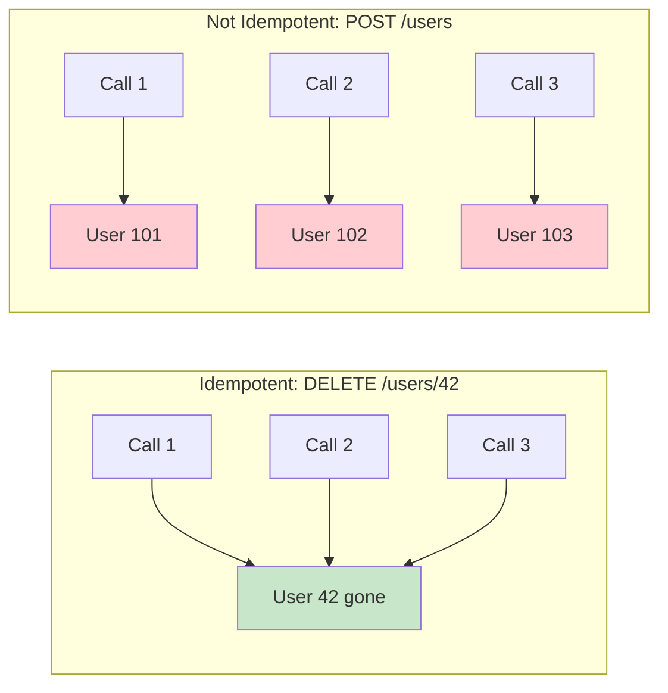

Why it matters: networks fail. A client that times out can **safely retry** an idempotent request. Retrying a POST might charge a card twice (this is the same duplicate problem as in [Episode 26: Message Queues](../26-message-queues/)). Many payment APIs solve this with an `Idempotency-Key` header on POST.

### PUT vs PATCH: The Biggest Point of Confusion

> Think of **PUT** as replacing the **entire car**, and **PATCH** as just getting your **tires changed**.

```http
# Current state of /users/42
{ "id": 42, "name": "Asha", "email": "asha@old.com", "phone": "555-0100" }
```

```http
PUT /users/42
Content-Type: application/json

{ "name": "Asha", "email": "asha@new.com" }
```

```yaml
PUT_Result:
  State: '{ "id": 42, "name": "Asha", "email": "asha@new.com", "phone": null }'
  Rule: "PUT replaces the WHOLE resource - send the entire object"
  Gotcha: "Left out 'phone'? The server should clear it (null / default)"
  Idempotent: "Yes - sending the same full object N times yields the same state"
```

```http
PATCH /users/42
Content-Type: application/merge-patch+json

{ "email": "asha@new.com" }
```

```yaml
PATCH_Result:
  State: '{ "id": 42, "name": "Asha", "email": "asha@new.com", "phone": "555-0100" }'
  Rule: "PATCH changes only the fields you send"
  Why_Not_Inherently_Idempotent: |
    A patch can describe a relative change, e.g. JSON Patch
    { "op": "add", "path": "/tags/-", "value": "vip" } appends again on every call,
    or { "loginCount": "+1" } style increments. Setting a field to a fixed
    value is idempotent in practice, but the method doesn't guarantee it.
```

---

## HTTP Status Codes

Status codes are the **universal language of the web**. They're the **first signal** a client gets - before it even parses the JSON body.

### The Five Classes

| Class | Meaning | Common Codes |
|---|---|---|
| **1xx** | Informational | 100 Continue, 101 Switching Protocols, 103 Early Hints |
| **2xx** | Success | 200 OK, 201 Created, 202 Accepted, 204 No Content |
| **3xx** | Redirection | 301 Moved Permanently, 304 Not Modified, 307 Temporary Redirect, 308 Permanent Redirect |
| **4xx** | Client errors | 400, 401, 403, 404, 405, 409, 410, 415, 422, 429 |
| **5xx** | Server errors | 500 Internal Server Error, 502 Bad Gateway, 503 Service Unavailable, 504 Gateway Timeout |

### The "200 for Everything" Anti-Pattern

One of the most frustrating anti-patterns is returning **200 OK when an error occurred**, simply because the server successfully caught the exception.

```http
# ❌ Breaks HTTP semantics
HTTP/1.1 200 OK
{ "success": false, "error": "User not found" }

# ✅ Correct
HTTP/1.1 404 Not Found
Content-Type: application/problem+json
{ "type": "https://api.example.com/errors/user-not-found", "title": "User not found", "status": 404 }
```

Why it hurts: clients, retries, monitoring dashboards, caches, and API gateways all key off the status code. A "successful" error gets cached, isn't alerted on, and forces every client to parse the body to discover failure.

### Choosing the Right Code

```yaml
Status_Code_Cheat_Sheet:
  200_OK: "Successful GET / PUT / PATCH with a body"
  201_Created: "Successful POST - include a Location header pointing to the new resource"
  204_No_Content: "Successful DELETE (or update) with no body"
  304_Not_Modified: "Conditional GET - client's cached copy is still valid (see ETags)"
  400_Bad_Request: "Malformed syntax - invalid JSON, wrong types"
  401_Unauthorized: "Missing or invalid authentication (who are you?)"
  403_Forbidden: "Authenticated, but not allowed (you can't do that)"
  404_Not_Found: "Resource doesn't exist"
  409_Conflict: "State conflict - duplicate email, version mismatch"
  422_Unprocessable_Entity: "Valid syntax, but business rules reject it"
  429_Too_Many_Requests: "Rate limit exceeded"
  500_Internal_Server_Error: "Unexpected server failure"
  503_Service_Unavailable: "Overloaded or down for maintenance"
```

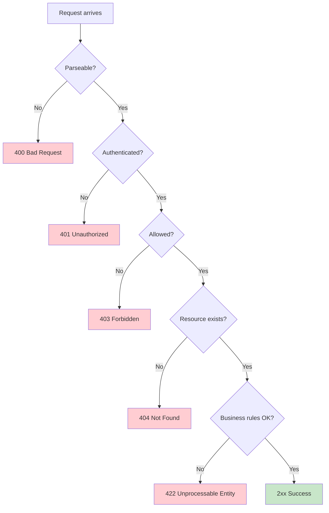

**Example from the episode:** booking a return flight that's **before the departure date** is syntactically valid JSON, but the business logic rejects it - that's **422 Unprocessable Entity**, not 400.

### 201 Created + Location

```http
POST /api/v1/users
Content-Type: application/json

{ "name": "Asha", "email": "asha@example.com" }
```

```http
HTTP/1.1 201 Created
Location: /api/v1/users/123
Content-Type: application/json

{ "id": 123, "name": "Asha", "email": "asha@example.com" }
```

---

## Good Error Responses

> **Status codes tell you *what* happened; payloads tell you *why*.**

A status code gives you the category of failure, but developers need **actionable data** to fix the issue. Design a **standardized error payload** and use it **universally across every endpoint**.

```yaml
Error_Payload_Minimum:
  Code: "Machine-readable error type or code (for programs to branch on)"
  Message: "Human-readable explanation"
  Field: "The specific field that failed validation"
  Documentation_URL: "Link to docs explaining the error"
```

### Example (from the slides)

```json
{
  "error": {
    "code": "InvalidRequestError",
    "message": "The provided end date cannot be before the start date.",
    "field": "endDate",
    "documentation_url": "https://api.example.com/docs/errors/invalid_date"
  }
}
```

### RFC 7807: Problem Details for HTTP APIs

The episode recommends **RFC 7807** (since updated by RFC 9457, which keeps the same format). It defines a standard JSON shape served with `Content-Type: application/problem+json`.

```http
HTTP/1.1 422 Unprocessable Entity
Content-Type: application/problem+json

{
  "type": "https://api.example.com/errors/validation",
  "title": "Your request parameters didn't validate.",
  "status": 422,
  "detail": "The provided end date cannot be before the start date.",
  "instance": "/api/v1/bookings/req-8f2c",
  "errors": [
    { "field": "endDate", "message": "must be on or after startDate" }
  ]
}
```

| Field | Purpose |
|---|---|
| `type` | URI identifying the problem type (doubles as a docs link) |
| `title` | Short, human-readable summary of the problem type |
| `status` | The HTTP status code |
| `detail` | Explanation specific to this occurrence |
| `instance` | URI identifying this specific occurrence |
| *extensions* | Any extra members, e.g. `errors[]` for field validation |

### Be Specific

If a user forgets an email, don't return `"Invalid input"`. Return **exactly which field was missing**.

```json
// ❌ Useless
{ "error": "Invalid input" }

// ✅ Actionable
{ "code": "MISSING_FIELD", "message": "email is required", "field": "email" }
```

### ⚠️ Security Warning: Never Leak Internals

**Never** expose database connection strings, internal service names, or raw stack traces in production API errors. Verbose errors give attackers a **map of your entire backend**.

```json
// ❌ NEVER in production
{
  "error": "SequelizeConnectionError: connect ECONNREFUSED 10.0.3.17:5432",
  "stack": "at UserRepository.find (/app/src/repos/user.js:42:11) ..."
}
```

```javascript
// ✅ Express error handler: generic to the client, detailed in the logs
app.use((err, req, res, next) => {
  const status = err.status || 500;
  logger.error({ err, requestId: req.id }, "request failed");   // full stack stays server-side
  res.status(status).type("application/problem+json").json({
    type: err.type || "about:blank",
    title: status === 500 ? "Internal Server Error" : err.title,
    status,
    detail: status === 500 ? "Something went wrong. Reference: " + req.id : err.detail,
  });
});
```

> Give the client exactly what they need to fix their request. Log the messy stack traces securely on your servers.

---

## Pagination, Filtering & Sorting

Returning massive datasets in a single response is a surefire way to **kill server performance** and **eat client bandwidth**. Use **query parameters** for all of these.

```yaml
Query_Parameter_Patterns:
  Filtering: "GET /products?status=active   |   ?category=electronics"
  Sorting: "GET /products?sort=-price        (minus sign = descending)"
  Multi_Sort: "GET /products?sort=-price,name"
  Offset_Pagination: "GET /products?limit=25&offset=50"
  Cursor_Pagination: "GET /products?limit=25&after_cursor=xyz"
  Combined: "GET /products?category=electronics&sort=-price&limit=25"

Golden_Rule: "Never return massive arrays. Always set a default AND a maximum limit."
```

### Offset Pagination

The standard approach: `limit` and `offset`. Easy to build, but it has flaws on large datasets.

```sql
-- Page 2001 of 25 items
SELECT * FROM products ORDER BY created_at DESC LIMIT 25 OFFSET 50000;
-- The DB still has to walk past 50,000 rows just to throw them away
```

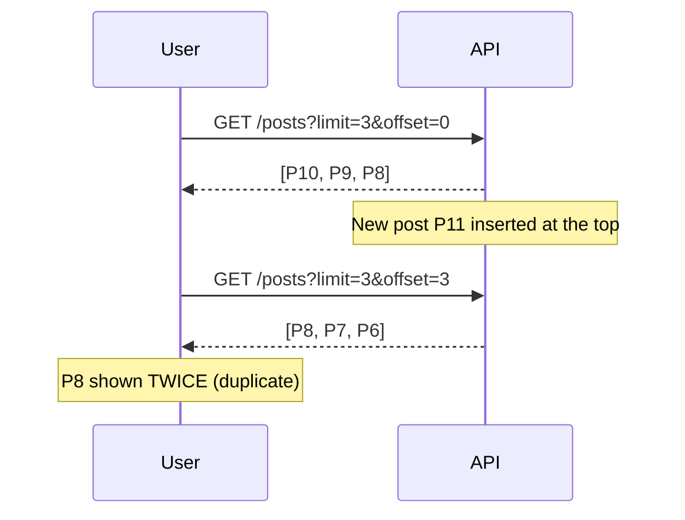

```yaml
Offset_Problems:
  Performance: "Large offsets are slow - the database scans all skipped rows"
  Consistency: "Inserts/deletes while paging cause duplicates or missed items"
  Good_For: "Small datasets, admin tables, 'jump to page 7' UIs"
```

### Cursor Pagination

For large, fast-moving datasets - like a social media feed - use **cursor-based pagination**. Return a unique token (cursor) pointing to the **last item**, and the client sends it back to get the next batch.

```http
GET /api/v1/posts?limit=25

HTTP/1.1 200 OK
{
  "data": [ { "id": 981, "created_at": "2026-11-03T10:15:00Z", ... }, ... ],
  "pagination": {
    "next_cursor": "eyJjcmVhdGVkX2F0IjoiMjAyNi0xMS0wM1QwOTo1OTowMFoiLCJpZCI6OTU3fQ",
    "has_more": true
  }
}

GET /api/v1/posts?limit=25&after_cursor=eyJjcmVhdGVkX2F0Ijoi...
```

```sql
-- Cursor decodes to the last item's (created_at, id); uses an index, no skipped rows
SELECT * FROM posts
WHERE (created_at, id) < ('2026-11-03T09:59:00Z', 957)
ORDER BY created_at DESC, id DESC
LIMIT 25;
```

| | Offset | Cursor |
|---|---|---|
| Syntax | `?limit=25&offset=50` | `?limit=25&after_cursor=xyz` |
| Performance on deep pages | Slow (scans skipped rows) | Fast (index seek) |
| Stable under inserts/deletes | ❌ duplicates / gaps | ✅ stable |
| Jump to arbitrary page | ✅ | ❌ (next/prev only) |
| Best for | Small, static datasets | Feeds, timelines, large tables |

---

## API Versioning

The moment you push an API to production, people build applications that depend on its exact structure. Rename a field or delete an endpoint and **you break their apps**. APIs change, so **versioning is non-negotiable**.

| Strategy | Example | Pros | Cons |
|---|---|---|---|
| **URI** | `GET /api/v1/users` | Most explicit, easy to see and test in a browser, widely adopted | Purists argue the URI should identify only the resource |
| **Header** | `Accept: application/vnd.myapi.v1+json` | Cleaner URLs, "purer" REST | Harder to test (needs custom headers), less visible |
| **Query Parameter** | `GET /users?version=1` | Easy to add | Clutters URLs, easy to forget |

```yaml
Recommendation:
  Choice: "URI versioning (/api/v1/users)"
  Why: "Pragmatic, explicit, and testable without custom headers"
```

### When to Bump the Version

You **don't** need a new version every time you add a feature. Only increment for **breaking changes**.

```yaml
Breaking_Changes (new version):
  - "Removing a field"
  - "Renaming a field"
  - "Changing a field's data type (string -> number)"
  - "Altering a core data structure"
  - "Removing an endpoint"
  - "Making an optional parameter required"

Non_Breaking_Changes (same version):
  - "Adding a new endpoint"
  - "Adding a new optional field to a response"
  - "Adding a new optional query parameter"
```

### Deprecation Schedule

Plan a **generous deprecation schedule** for older versions so consumers have time to migrate.

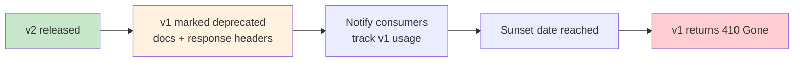

```http
HTTP/1.1 200 OK
Deprecation: true
Sunset: Wed, 01 Jul 2027 00:00:00 GMT
Link: <https://api.example.com/docs/migrate-v2>; rel="deprecation"
```

---

## API Security

Security is **not a feature you add at the end** of a project.

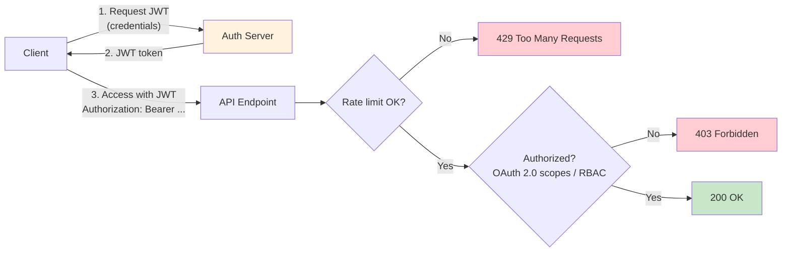

### 1. HTTPS Always

SSL/TLS encryption is **mandatory**. HTTPS everywhere, no exceptions. Without it, access tokens and sensitive payloads are sent in **plain text**. (See [Episode 20: HTTP, HTTPS & WebSockets](../20-http-https-websockets/).)

### 2. Authentication: *Who* Are You?

Authentication proves who the client is - typically with API keys or **stateless JSON Web Tokens (JWT)**, passed in the `Authorization` header.

```http
GET /api/v1/orders HTTP/1.1
Host: api.example.com
Authorization: Bearer <your-jwt-access-token>
```

```yaml
JWT:
  Structure: "header.payload.signature (base64url-encoded)"
  Payload_Claims: "sub (user id), role, exp (expiry), ..."
  Why_Stateless: "Server verifies the signature - no session lookup needed, fits the statelessness constraint"
  Caveats:
    - "Payload is encoded, NOT encrypted - never put secrets in it"
    - "Keep expiry short; revocation is hard without extra infrastructure"
```

### 3. Authorization: *What* Can You Do?

Authorization dictates what an authenticated user is allowed to do. Enforce it with **Role-Based Access Control (RBAC)** or **OAuth 2.0** scopes.

```yaml
RBAC_Example:
  viewer: ["GET /orders"]
  editor: ["GET /orders", "POST /orders", "PATCH /orders/{id}"]
  admin:  ["*"]

OAuth_2_0:
  Use: "Delegated access - let a third-party app act on a user's behalf with limited scopes"
  Example_Scopes: ["orders:read", "orders:write"]
```

### 4. Rate Limiting & Throttling

Protect your infrastructure against abuse and DDoS. If a user hammers your API, return **429 Too Many Requests**, and include headers so the client knows **how many requests are left** and **how long to wait**.

```http
HTTP/1.1 429 Too Many Requests
X-RateLimit-Limit: 100
X-RateLimit-Remaining: 0
Retry-After: 30
Content-Type: application/problem+json

{ "type": "https://api.example.com/errors/rate-limit", "title": "Too Many Requests", "status": 429,
  "detail": "Limit of 100 requests per minute exceeded. Retry in 30 seconds." }
```

| Header | Meaning |
|---|---|
| `X-RateLimit-Limit` | Max requests allowed in the window |
| `X-RateLimit-Remaining` | Requests left in the current window |
| `Retry-After` | Seconds (or a date) to wait before retrying |

> Rate limiting algorithms (token bucket, sliding window, etc.) are covered in [Episode 29: Rate Limiting](../29-rate-limiting/).

---

## Performance & Caching

If your API is heavily utilized, optimize for performance.

### Cache-Control

The easiest win is HTTP caching. The `Cache-Control` header tells the client and intermediaries (CDNs, proxies) how long they may hold a response.

```http
Cache-Control: public, max-age=3600          # anyone (CDN/browser) may cache for 1 hour
Cache-Control: private, max-age=60           # only the user's browser, 60 seconds
Cache-Control: no-store                      # never cache (e.g., account balance)
```

### ETags and Conditional Requests

For dynamic data, use **ETags (Entity Tags)**: a checksum or hash representing the resource's current state. The client sends the hash back in an `If-None-Match` header. If nothing changed, the server responds with a tiny **304 Not Modified** with **zero bytes in the body**.

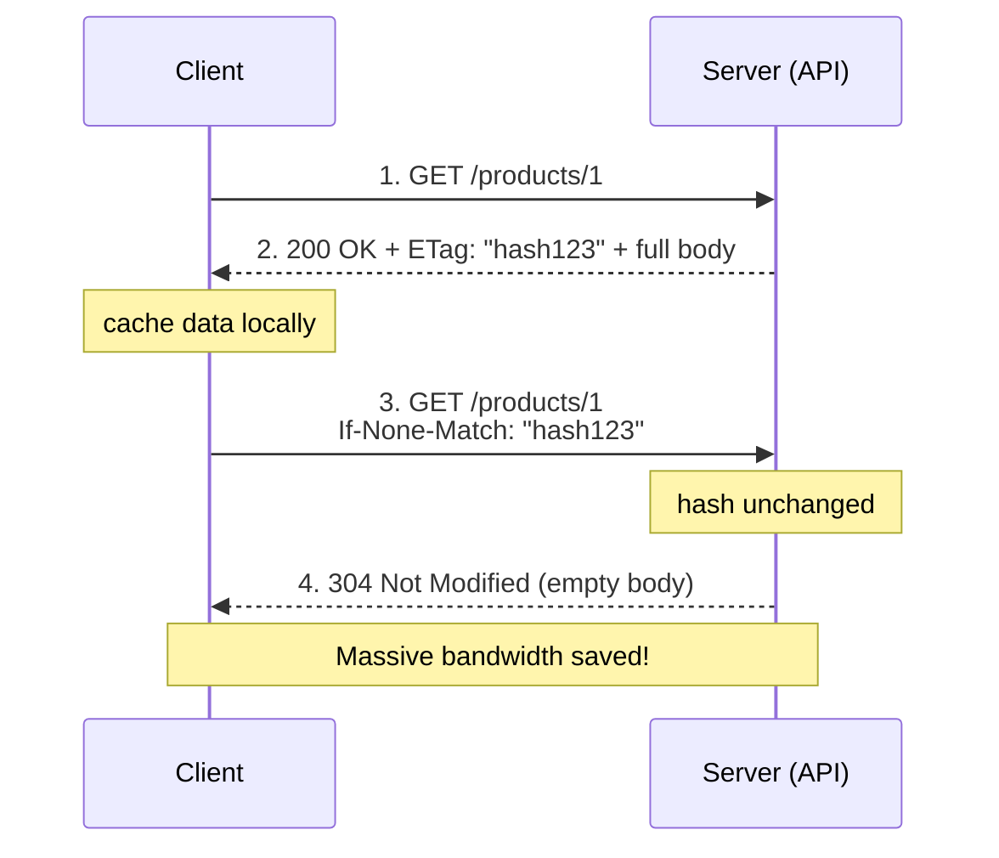

```javascript
// Express: compute an ETag and short-circuit with 304
const crypto = require("crypto");

app.get("/api/v1/products/:id", async (req, res) => {
  const product = await db.products.findById(req.params.id);
  if (!product) return res.status(404).end();

  const body = JSON.stringify(product);
  const etag = `"${crypto.createHash("sha1").update(body).digest("hex")}"`;

  if (req.headers["if-none-match"] === etag) {
    return res.status(304).end();               // no body sent
  }
  res.set({ ETag: etag, "Cache-Control": "private, max-age=0, must-revalidate" });
  res.type("application/json").send(body);
});
```

> Note: Express already generates weak ETags for responses by default; the explicit version above shows the mechanism. Hashing the full body still requires loading it - for the biggest savings, derive the ETag from a cheap value like `updated_at` or a row version.

ETags also enable safe concurrent updates: `PUT` with `If-Match: "hash123"` returns **412 Precondition Failed** if someone else changed the resource first.

### Compression

Always compress responses with **gzip** or **Brotli**. Simply enabling gzip can shrink JSON payloads by **over 60%** (JSON is highly repetitive text, so it compresses very well).

```http
GET /api/v1/products
Accept-Encoding: gzip, br

HTTP/1.1 200 OK
Content-Encoding: br
Vary: Accept-Encoding
```

```javascript
const compression = require("compression");
app.use(compression());   // gzip/deflate based on Accept-Encoding
```

### Field Selection

If a mobile app only needs a user's `id` and `name`, let it ask for just those. Don't force it to download a massive profile object for two strings.

```http
GET /api/v1/users/123?fields=id,name

{ "id": 123, "name": "Asha" }
```

```yaml
Performance_Summary:
  ETags: "Hash of resource state -> 304 Not Modified when unchanged"
  Cache_Control: "Tell CDNs and browsers how long to store data"
  Compression: "Gzip or Brotli to shrink JSON payloads"
  Field_Selection: "?fields=id,name - send only what's needed"
```

---

## API Documentation & Developer Experience (DX)

The best API architecture is **useless if no one knows how to use it**. Your API is a **product**, and documentation is its **UI**.

> **Your API is only as good as its documentation.**

### OpenAPI Specification (OAS)

Never write API docs by hand in a wiki. Use the **OpenAPI Specification** (formerly known as **Swagger**) - the industry standard for defining REST APIs in **YAML or JSON**: endpoints, request parameters, response schemas, and authentication requirements.

```yaml
openapi: 3.0.3
info:
  title: Users API
  version: 1.0.0
servers:
  - url: https://api.example.com/api/v1
paths:
  /users:
    get:
      summary: List users
      parameters:
        - in: query
          name: limit
          schema: { type: integer, default: 25, maximum: 100 }
        - in: query
          name: after_cursor
          schema: { type: string }
      responses:
        "200":
          description: A page of users
          content:
            application/json:
              schema:
                type: object
                properties:
                  data:
                    type: array
                    items: { $ref: "#/components/schemas/User" }
                  pagination:
                    type: object
                    properties:
                      next_cursor: { type: string, nullable: true }
                      has_more: { type: boolean }
    post:
      summary: Create a user
      requestBody:
        required: true
        content:
          application/json:
            schema: { $ref: "#/components/schemas/NewUser" }
      responses:
        "201":
          description: Created
          headers:
            Location: { schema: { type: string } }
        "422":
          description: Validation failed
          content:
            application/problem+json:
              schema: { $ref: "#/components/schemas/Problem" }
components:
  securitySchemes:
    bearerAuth: { type: http, scheme: bearer, bearerFormat: JWT }
  schemas:
    User:
      type: object
      properties:
        id: { type: integer }
        name: { type: string }
        email: { type: string, format: email }
    NewUser:
      type: object
      required: [name, email]
      properties:
        name: { type: string }
        email: { type: string, format: email }
    Problem:
      type: object
      properties:
        type: { type: string }
        title: { type: string }
        status: { type: integer }
        detail: { type: string }
security:
  - bearerAuth: []
```

### Swagger UI: Interactive Docs

Tools like **Swagger UI** take that file and auto-generate **interactive web documentation**. Developers click **"Try it out"**, enter parameters, and see the live JSON response in the browser - without writing a line of code.

### Contract-First Development

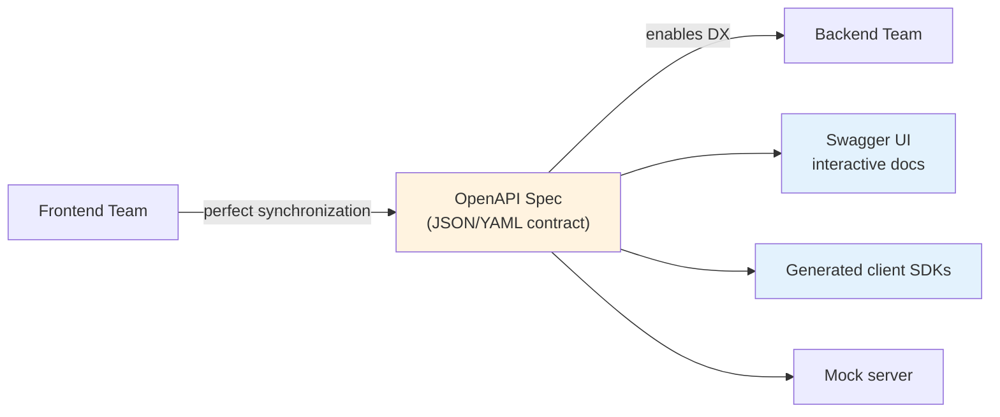

```yaml
Contract_First_Workflow:
  1: "Define the spec first (the contract)"
  2: "Frontend builds against a mock server generated from the spec"
  3: "Backend implements the spec in parallel"
  4: "Client SDKs are generated automatically"
  5: "CI validates that the implementation matches the spec"

Benefits:
  - "Frontend and backend teams stay perfectly synchronized"
  - "Integration time drops drastically"
  - "Far fewer 'what does this endpoint return?' Slack messages"
```

---

## Putting It All Together

A single well-designed request/response, applying everything from this episode:

```http
GET /api/v1/products?category=electronics&sort=-price&limit=2&fields=id,name,price HTTP/1.1
Host: api.example.com
Authorization: Bearer eyJhbGciOi...
Accept: application/json
Accept-Encoding: gzip, br
If-None-Match: "9f2a1c"
```

```http
HTTP/1.1 200 OK
Content-Type: application/json
Content-Encoding: br
ETag: "b71e04"
Cache-Control: private, max-age=30
X-RateLimit-Limit: 1000
X-RateLimit-Remaining: 987

{
  "data": [
    { "id": 77, "name": "4K Monitor", "price": 499.00 },
    { "id": 12, "name": "Mechanical Keyboard", "price": 149.00 }
  ],
  "pagination": { "next_cursor": "eyJpZCI6MTJ9", "has_more": true }
}
```

| Concern | Applied As |
|---|---|
| Versioning | `/api/v1/` |
| Resource naming | Plural noun `products` |
| Method | `GET` - safe and idempotent |
| Filtering / Sorting | `?category=electronics&sort=-price` |
| Pagination | `limit` + cursor |
| Field selection | `?fields=id,name,price` |
| Security | HTTPS + Bearer JWT + rate-limit headers |
| Caching | `ETag`, `If-None-Match`, `Cache-Control` |
| Compression | `Content-Encoding: br` |

---

## Key Takeaways

### Remember This

- **REST ≠ HTTP**: REST is an architectural style (Roy Fielding, 2000), not a protocol - you can build a non-RESTful API over HTTP
- **Decoupling**: The API is the menu; client and server evolve independently
- **Six Constraints**: Client-server, **statelessness** (most important for scale), cacheability, layered system, uniform interface, code on demand (optional)
- **Naming**: Plural nouns for resources (`/users/123`); the URL is the target, the HTTP method is the action
- **Idempotency**: GET, PUT, DELETE are idempotent; POST is not; PATCH is not inherently idempotent. PUT replaces the whole car, PATCH changes the tires
- **Status Codes**: Never return 200 for errors; use 400 / 401 / 422 / 429 correctly and 201 + `Location` on create
- **Errors**: Standardized payloads (RFC 7807) with code, message, field, and docs link - never leak stack traces or internals
- **Pagination**: Always cap limits; offset is simple but slow and unstable at scale; cursor is fast and stable
- **Versioning**: URI versioning (`/api/v1/`) is the pragmatic default; bump only for breaking changes; deprecate generously
- **Security**: HTTPS always, JWT for authentication, OAuth 2.0 / RBAC for authorization, 429 + rate-limit headers
- **Performance**: Cache-Control, ETags with 304 Not Modified, gzip/Brotli compression, field selection
- **DX**: OpenAPI + Swagger UI; contract-first lets teams work in parallel

### Common Mistakes to Avoid

```yaml
Common_Mistakes:
  1_Verbs_In_URLs:
    Mistake: "/getUsers, /createNewOrder, /deleteUser?id=42"
    Correct: "GET /users, POST /orders, DELETE /users/42"

  2_Singular_Collections:
    Mistake: "/user/123 next to /users"
    Correct: "Always plural: /users, /users/123"

  3_Server_Side_Sessions:
    Mistake: "Storing per-client state on one server"
    Reality: "Requires sticky sessions; breaks horizontal scaling"
    Correct: "Stateless requests with tokens"

  4_200_For_Errors:
    Mistake: "200 OK { error: 'user not found' }"
    Correct: "404 Not Found with a problem+json body"

  5_PUT_For_Partial_Updates:
    Mistake: "PUT with only the changed field"
    Reality: "Other fields should be wiped"
    Correct: "Use PATCH for partial updates"

  6_Leaking_Internals:
    Mistake: "Returning stack traces, SQL errors, internal hostnames"
    Correct: "Generic message + request ID to the client; full details in server logs"

  7_Unbounded_Lists:
    Mistake: "GET /orders returns 2 million rows"
    Correct: "Default and maximum limit, cursor pagination"

  8_Versioning_Every_Change:
    Mistake: "v7 because a field was added"
    Correct: "Only bump for breaking changes"

  9_Plain_HTTP:
    Mistake: "Tokens sent over http://"
    Correct: "HTTPS everywhere, no exceptions"

  10_Hand_Written_Wiki_Docs:
    Mistake: "Docs drift from the real API"
    Correct: "OpenAPI spec as the single source of truth"
```

### Best Practices Checklist

```yaml
REST_API_Design_Checklist:
  - "[ ] Plural nouns, hierarchical URLs, no verbs"
  - "[ ] Correct HTTP methods; idempotent where expected"
  - "[ ] Meaningful status codes; 201 + Location on create"
  - "[ ] One standardized error format (RFC 7807) everywhere"
  - "[ ] Pagination with default + max limit; cursor for large datasets"
  - "[ ] Filtering and sorting via query parameters"
  - "[ ] /api/v1 versioning and a deprecation policy"
  - "[ ] HTTPS, JWT authentication, RBAC/OAuth 2.0 authorization"
  - "[ ] Rate limiting with 429 and Retry-After"
  - "[ ] Cache-Control, ETags, compression, field selection"
  - "[ ] OpenAPI spec + Swagger UI docs"
```

---

## Related Episodes

- [Episode 5: Stateless vs Stateful Systems](../05-stateless-stateful-systems/) - The statelessness constraint in depth
- [Episode 7: Caching](../07-caching/) and [Episode 8: CDNs](../08-cdns/) - Cacheability and the layered system
- [Episode 19: REST vs gRPC](../19-rest-grpc/) - RPC, Richardson Maturity Model, HATEOAS, and when to pick gRPC
- [Episode 20: HTTP, HTTPS & WebSockets](../20-http-https-websockets/) - The protocol under REST
- [Episode 26: Message Queues](../26-message-queues/) - Idempotency on the consumer side
- [Episode 29: Rate Limiting](../29-rate-limiting/) - How to implement the 429 logic

## Presentation

View the slides used in this episode: [Presentation Slides](./presentation/)

---

<div align="center">

[Previous Episode: Message Queues](../26-message-queues/) | [Course Home](../../) | [Next Episode: Webhooks & Push Notifications](../28-webhooks-push-notifications/)

</div>
