# Episode 28: Webhooks & Push Notifications

[](http://youtube.com/@ThatNotesGuy)

## What You'll Learn

- Why polling ("are we there yet?") wastes resources and adds built-in delay
- What a webhook is, and why it is often called a "reverse API"
- When to use REST APIs vs webhooks vs WebSockets
- How to secure a webhook endpoint: HTTPS, HMAC signatures, timestamps and idempotency
- How to build a webhook receiver in Node.js (timing-safe comparison, acknowledge fast with a 2xx)
- How push notifications reach a phone through APNs and FCM
- How a device gets its "mailing address" (the device token)
- How phones listen for pushes without draining the battery (one persistent connection)
- What happens when the phone is offline: APNs coalescing, FCM queuing, collapse keys and token pruning

---

## The Problem: Polling

### "Are We There Yet?"

In a traditional REST API setup, if Server A wants to know whether Server B has new data, it has to **ask over and over again**. This is called **polling**, and it works like a child in the back seat of a car asking "are we there yet?" every few minutes.

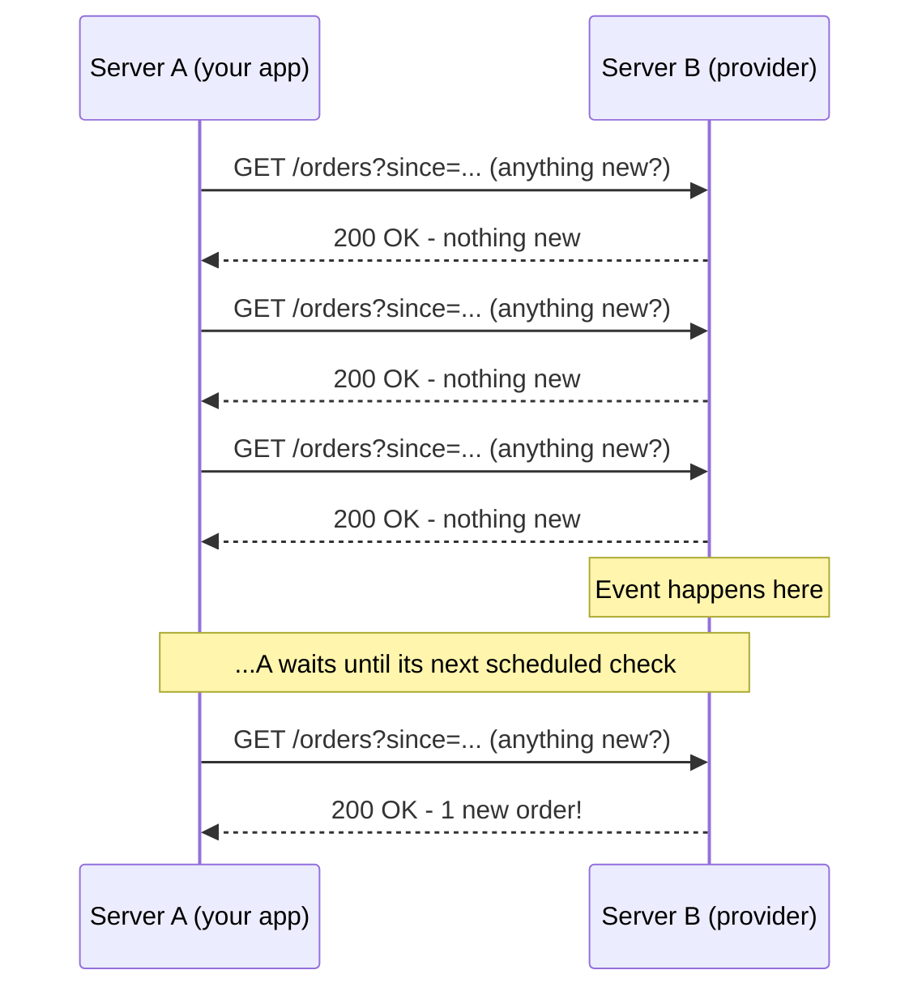

### Why Polling Kills Your Servers

```yaml
The_Pull_Model:
  Definition: "Traditional APIs require constant requests to check for new data"
  Who_Initiates: "The client, every time"

Resource_Waste:
  Problem: "Frequent empty checks consume bandwidth and CPU"
  Example:
    Poll_Interval: "Every 5 seconds"
    Requests_Per_Day: "86,400 s / 5 s = 17,280 requests per day"
    Useful_Responses: "Usually a tiny fraction - most say 'nope, nothing new'"
  Multiplied_By: "Every client, every resource you watch"

Latency:
  Problem: "Delay between the event happening and the next scheduled check"
  Worst_Case: "Almost one full poll interval"
  Average_Case: "About half the poll interval"
```

### The Polling Trade-off You Can't Escape

```yaml
Polling_Dilemma:
  Poll_Faster:
    Pro: "Lower delay"
    Con: "More wasted requests, more load on both sides, may hit rate limits"
  Poll_Slower:
    Pro: "Less waste"
    Con: "Higher delay - you find out about events late"

  Conclusion: |
    "With polling, you trade freshness for waste.
     There has to be a better way."
```

| Poll Interval | Requests / Day (one client) | Worst-case Delay |
|---------------|-----------------------------|------------------|
| 1 second | 86,400 | ~1 s |
| 5 seconds | 17,280 | ~5 s |
| 60 seconds | 1,440 | ~60 s |
| 5 minutes | 288 | ~5 min |

---

## Enter Webhooks: The "Reverse API"

### Flipping the Communication Model

A **webhook** flips the model. Instead of you calling an API to ask for data, you give the platform (Stripe, GitHub, Shopify, ...) **a URL endpoint on your server**. You are effectively saying:

> "Don't wait for me to ask. Just POST to this URL the moment an event happens."

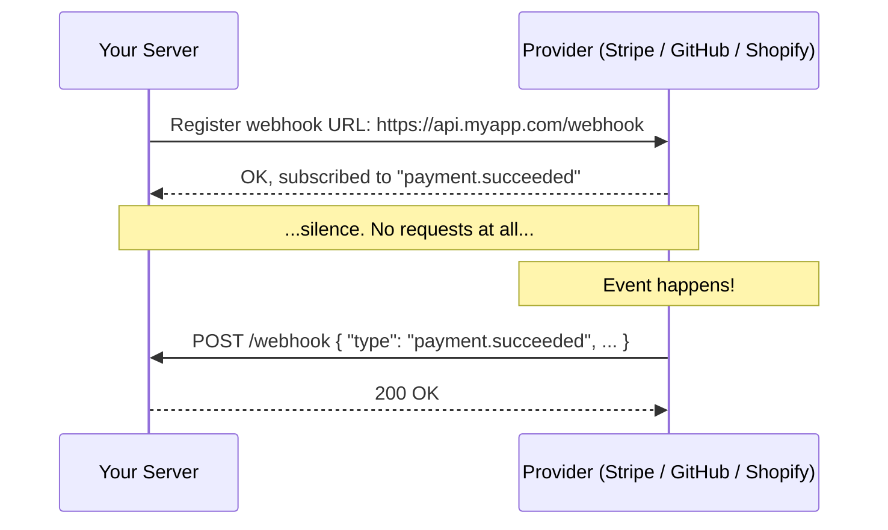

It's highly efficient (no empty checks) and genuinely real-time (the request goes out when the event happens).

### Core Characteristics

```yaml
Webhook_Fundamentals:
  Event_Driven: "A user-defined HTTP callback triggered by a specific event"
  Push_Model: "The server pushes data to the client instantly"
  Payload: "Typically a JSON object delivered via an HTTP POST request"

  Why_Reverse_API:
    Normal_API: "You call them"
    Webhook: "They call you"

  Common_Providers:
    Stripe: "payment_intent.succeeded, invoice.paid, charge.refunded"
    GitHub: "push, pull_request, issues"
    Shopify: "orders/create, products/update"
```

### What a Webhook Delivery Looks Like

```http
POST /webhook HTTP/1.1
Host: api.myapp.com
Content-Type: application/json
X-Webhook-Signature: 5d41402abc4b2a76b9719d911017c592...
X-Webhook-Timestamp: 1730620800
X-Webhook-Id: evt_1Q2w3E4r5T6y

{
  "id": "evt_1Q2w3E4r5T6y",
  "type": "payment.succeeded",
  "created": 1730620800,
  "data": {
    "payment_id": "pay_789",
    "amount": 4999,
    "currency": "usd",
    "customer": "cus_123"
  }
}
```

Header names vary by provider (for example, Stripe sends `Stripe-Signature` and GitHub sends `X-Hub-Signature-256`), but the shape is always the same: **an event ID, an event type, a timestamp, a payload, and a signature**.

### Polling vs Webhooks

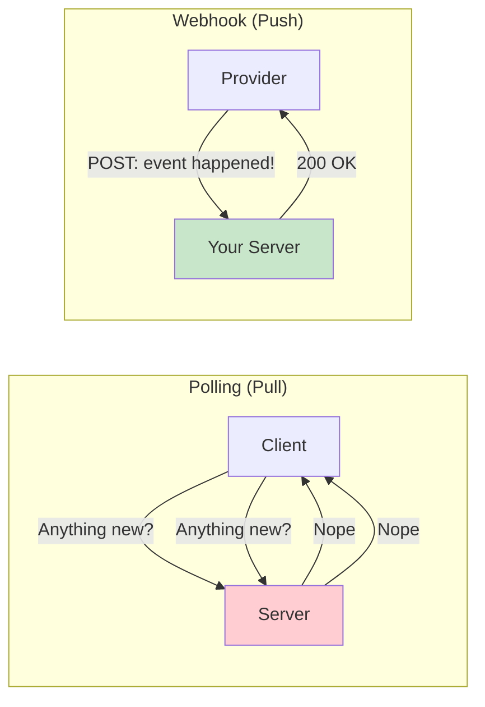

| Aspect | Polling | Webhooks |
|--------|---------|----------|
| **Who initiates** | Consumer | Provider |
| **Wasted requests** | Most of them | None |
| **Delay** | Up to one poll interval | Near-instant |
| **Consumer needs a public URL** | No | Yes |
| **Missed events** | You'll catch up on the next poll | Depends on provider retries |
| **Complexity** | Simple client loop | Endpoint, security, idempotency |

---

## Webhooks vs APIs vs WebSockets

### The Decision Matrix

| Dimension | Webhooks | APIs (REST) | WebSockets |
|-----------|----------|-------------|------------|
| **Model** | Push-based | Pull-based | Bidirectional |
| **Trigger** | Event-driven | Request-driven | Persistent |
| **Best For** | Server-to-server notifications | CRUD operations | Chat, multiplayer games |

```yaml
When_To_Use_What:
  REST_API:
    Use_When: "Your app needs to pull data on demand"
    Examples:
      - "Load a user's profile when they open the page"
      - "Create, read, update, delete resources"

  Webhooks:
    Use_When: "Two backend servers need to talk the moment an event occurs"
    Examples:
      - "Stripe tells you a payment succeeded"
      - "GitHub tells your CI that code was pushed"
      - "Shopify tells your warehouse a new order was placed"

  WebSockets:
    Use_When: "You need real-time, two-way communication between a server and a browser"
    Examples:
      - "Live chat"
      - "Multiplayer games"
      - "Collaborative editing"
```

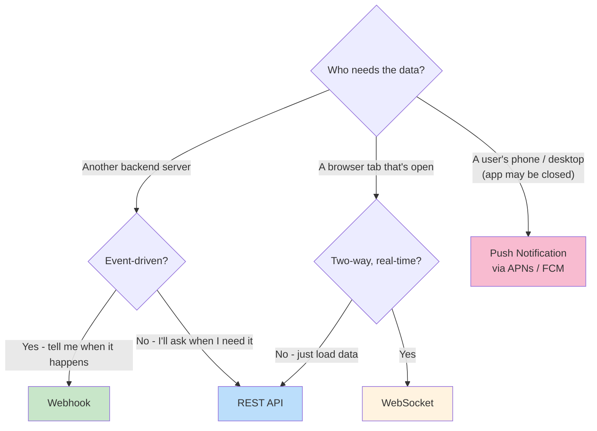

### They Work Together

Modern systems usually use **a combination of all three**. A typical flow:

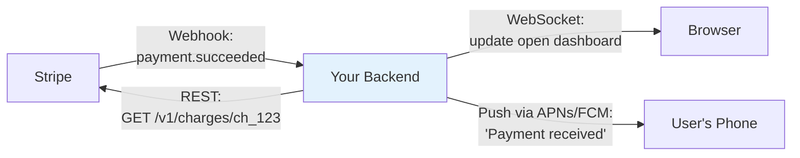

```yaml
Combined_Example:
  1_Webhook: "Stripe POSTs payment.succeeded to your backend"
  2_REST: "Your backend may call Stripe's REST API to fetch full details"
  3_WebSocket: "Your backend updates the user's open browser dashboard live"
  4_Push: "Your backend sends a push notification to the user's phone"
```

---

## Securing Webhooks

### Why Security Is Non-Negotiable

A webhook endpoint is **just a public URL sitting on the internet**. If you don't secure it, anyone can send a fake POST request to your app and trigger unauthorized actions, like marking an order as paid when no payment ever happened.

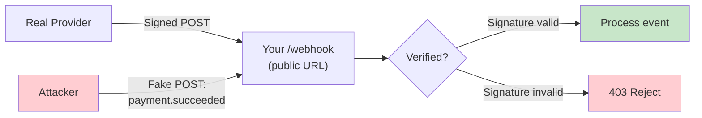

### The Four Layers of Webhook Security

```yaml
Webhook_Security:
  1_HTTPS_Only:
    What: "Always encrypt data in transit"
    Prevents: "Interception and tampering on the wire"

  2_HMAC_Signatures:
    What: "The provider hashes the payload using a shared secret; your server verifies the signature"
    Prevents: "Forged requests - an attacker doesn't know the secret"

  3_Timestamp_Validation:
    What: "Reject payloads older than a few minutes"
    Prevents: "Replay attacks - re-sending a captured, validly-signed request"

  4_Idempotency:
    What: "Processing the same event twice must not duplicate actions"
    Prevents: "Charging a customer twice when a webhook is retried"
```

### HMAC Signature Verification

HMAC (Hash-based Message Authentication Code) is the industry standard for webhook authentication. The sender hashes the payload with a secret key and sends the result in a header. Your server does **the exact same math**. If the hashes match, the payload is authentic.

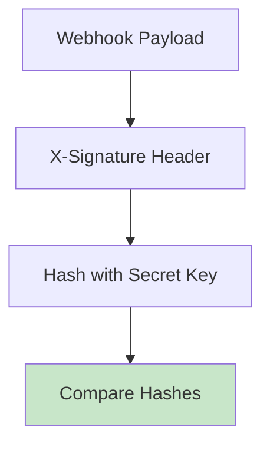

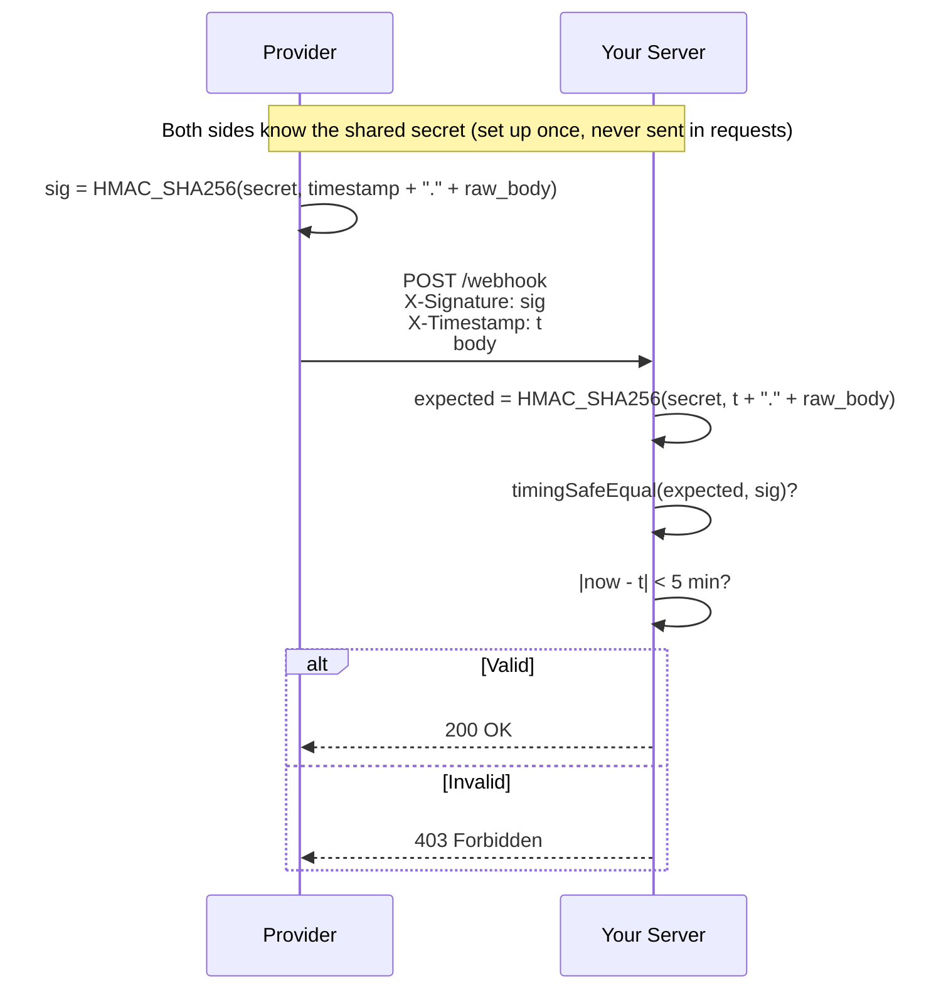

```yaml
Why_HMAC_Works:
  Shared_Secret: "Only you and the provider know it"
  Integrity: "Change one byte of the body and the hash changes completely"
  Authenticity: "Without the secret, an attacker can't compute a valid signature"
  Not_Encryption: "HMAC proves who sent it and that it wasn't changed - it doesn't hide the data (that's HTTPS's job)"
```

### Timestamps: Stopping Replay Attacks

A signature alone isn't enough. If an attacker captures one valid, signed request, they can **replay** it later, and the signature will still match.

```yaml
Replay_Attack:
  Attack: "Capture a valid signed 'payment.succeeded' request, resend it tomorrow"
  Defense:
    - "Provider includes a timestamp, and signs it together with the body"
    - "Your server rejects anything older than a few minutes (Stripe's libraries default to 5 minutes)"
    - "Because the timestamp is inside the signature, the attacker can't just change it"
```

### Idempotency: Surviving Retries

Providers **retry** webhooks when they don't get a timely 2xx response. That means you **will** eventually receive the same event more than once. Each event carries a unique ID, so use it as an **idempotency key**:

```javascript
// Pseudo code: process each event exactly once
async function handleEvent(event) {
  // INSERT fails if this event ID was already recorded (unique constraint)
  const isNew = await db.processedEvents.insertIfAbsent({ id: event.id });
  if (!isNew) return;              // duplicate delivery - already handled

  if (event.type === 'payment.succeeded') {
    await markOrderPaid(event.data.payment_id);
  }
}
```

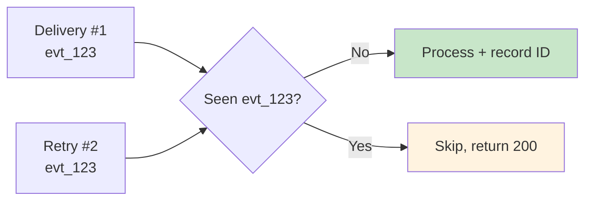

---

## Building a Webhook Receiver (Node.js)

### The Code From the Episode

Here is a small receiver in Node.js using Express. It's **pseudo code to show the idea**, nowhere near what production code looks like.

```javascript
const crypto = require('crypto');
const express = require('express');
const app = express();

function verifySignature(payload, signature, secret) {
  const expectedSig = crypto.createHmac('sha256', secret)
                            .update(JSON.stringify(payload))
                            .digest('hex');
  return crypto.timingSafeEqual(Buffer.from(expectedSig), Buffer.from(signature));
}

app.post('/webhook', express.json(), (req, res) => {
  const signature = req.headers['x-webhook-signature'];

  if (!verifySignature(req.body, signature, process.env.WEBHOOK_SECRET)) {
    return res.status(403).send('Invalid signature');
  }

  // 1. Acknowledge receipt immediately
  res.status(200).send('Webhook received');

  // 2. Process asynchronously (e.g., send to message queue)
  processEventAsync(req.body);
});
```

### The Three Critical Things

```yaml
Critical_Points:
  1_HMAC_Verification:
    Code: "crypto.createHmac('sha256', secret)"
    Why: "Recompute the signature yourself and compare it to the header"

  2_Timing_Safe_Comparison:
    Code: "crypto.timingSafeEqual(...)"
    Why: |
      A normal string comparison (===) returns as soon as it finds the first
      mismatched character. By measuring how long the comparison takes, an
      attacker can guess the correct signature one character at a time.
      timingSafeEqual always takes the same time, whatever the input.

  3_Return_2xx_Immediately:
    Code: "res.status(200) BEFORE processEventAsync(...)"
    Why: |
      If you take too long to respond, the provider assumes delivery failed
      and keeps retrying, flooding your server with duplicates.
      Acknowledge first, then do the heavy lifting asynchronously.
```

### Timing Attacks Visualized

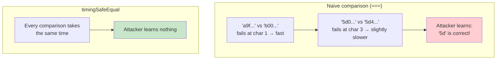

### Raw Body vs Parsed JSON

The slide's first bullet says to use `express.json()` **or raw body parsers, depending on the signature requirements**. This matters:

```yaml
Raw_Body_Gotcha:
  Problem: |
    Providers sign the exact bytes they sent. If you parse the JSON and then
    JSON.stringify() it again, whitespace, key order or number formatting can
    change, and the hash won't match a perfectly valid request.
  Fix: "Verify the signature over the raw request body, then parse it"
  Most_Providers: "Stripe, GitHub and Shopify all require the raw body for verification"
```

### A More Production-Shaped Version

Still simplified, but closer to what you'd ship:

```javascript
const crypto = require('crypto');
const express = require('express');
const app = express();

const SECRET = process.env.WEBHOOK_SECRET;
const TOLERANCE_SEC = 5 * 60;

// Keep the raw bytes: the signature is over exactly what the provider sent
app.post('/webhook', express.raw({ type: 'application/json' }), async (req, res) => {
  const signature = req.get('x-webhook-signature') || '';
  const timestamp = Number(req.get('x-webhook-timestamp'));

  // 1. Reject stale requests (replay protection)
  const age = Math.abs(Date.now() / 1000 - timestamp);
  if (!timestamp || age > TOLERANCE_SEC) {
    return res.status(400).send('Stale or missing timestamp');
  }

  // 2. Verify HMAC over timestamp + raw body
  const expected = crypto.createHmac('sha256', SECRET)
                         .update(`${timestamp}.${req.body}`)
                         .digest('hex');
  const a = Buffer.from(expected);
  const b = Buffer.from(signature);
  // timingSafeEqual throws if lengths differ, so check length first
  if (a.length !== b.length || !crypto.timingSafeEqual(a, b)) {
    return res.status(403).send('Invalid signature');
  }

  const event = JSON.parse(req.body);

  // 3. Hand off to a durable queue, then acknowledge fast
  await queue.publish('webhook-events', event);   // e.g., SQS, RabbitMQ, Kafka
  res.sendStatus(200);
});

// 4. Worker: idempotent processing, off the request path
queue.subscribe('webhook-events', async (event) => {
  if (!(await db.processedEvents.insertIfAbsent({ id: event.id }))) return;
  await handle(event);
});
```

### The Receiver Architecture

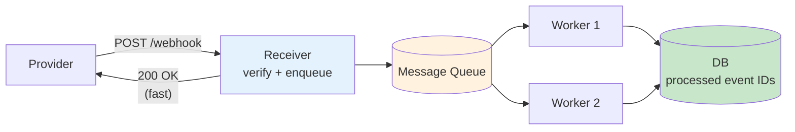

```yaml
Why_Queue_It:
  Fast_Ack: "The receiver only verifies and enqueues - milliseconds"
  Absorbs_Spikes: "A burst of 10,000 events doesn't overwhelm your DB"
  Retries_On_Your_Side: "If processing fails, the worker retries from the queue"
  Ties_To: "Episode 26: Message Queues"
```

### What Providers Do When You Fail

```yaml
Provider_Retry_Behavior:
  Trigger: "Non-2xx response, timeout, or connection error"
  Typical_Strategy: "Retry with exponential backoff over hours or days"
  Example: "Stripe retries failed deliveries for up to three days in live mode"
  Consequences_For_You:
    - "Duplicates are normal - be idempotent"
    - "Order isn't guaranteed - don't assume event N arrives before N+1"
    - "A slow endpoint causes retries, which cause more load, which makes it slower"
```

---

## Push Notifications: Reaching the User's Pocket

### Server-to-Server vs Server-to-Device

Webhooks are amazing for getting two servers to talk. But what if your server needs to talk to **a user's smartphone**? That's where push notifications come in, the modern-day digital postal service.

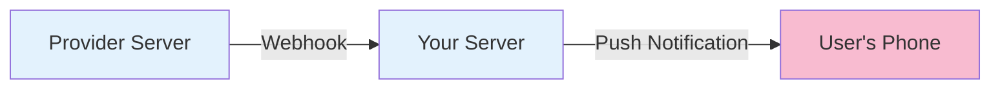

```yaml
The_Split:
  Webhooks: "Server-to-Server communication"
  Push_Notifications: "Server-to-Device communication"

What_Push_Can_Do:
  - "Wake up the user's phone"
  - "Show an alert"
  - "Update an app icon badge"
  - "Trigger a background refresh"
  Key_Point: "All without the user actively running your app"
  Targets: "Smartphones (iOS, Android) and desktops"
```

---

## The Central Post Offices of Mobile: APNs & FCM

### You Can't Talk to an iPhone Directly

You can't send a message directly from your server to an iPhone. You have to go through **the platform's gatekeeper**. Think of these as massive global post offices.

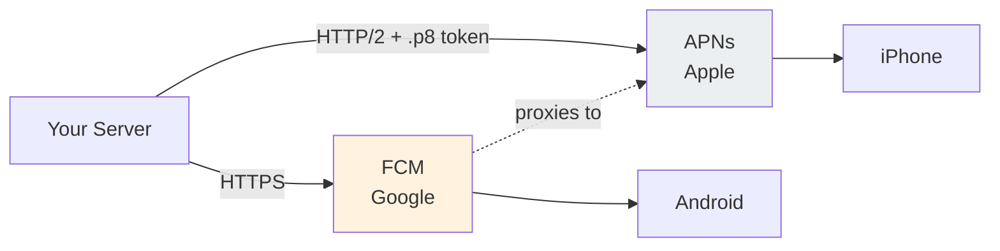

### APNs (Apple Push Notification service)

```yaml
APNs:
  Owner: "Apple - proprietary gateway"
  Required_For: "Every push to an iOS / iPadOS / macOS / watchOS device"
  User_Consent: "Requires explicit user opt-in"
  Protocol: "HTTP/2"
  Authentication:
    Token_Based: "A .p8 signing key from your Apple developer account, used to sign short-lived JWTs"
    Alternative: "Older certificate-based (.p12) authentication still exists"
  Endpoint: "One HTTP/2 POST per notification, addressed to a device token"
```

### FCM (Firebase Cloud Messaging)

```yaml
FCM:
  Owner: "Google - cross-platform service"
  Android: "Delivers via Google Play Services on the device"
  iOS: "Acts as a proxy wrapper - forwards to APNs on your behalf"
  Web: "Also supports browser push"
  Why_Powerful: |
    "Send FCM one payload. It routes it natively to Android,
     or forwards it to APNs for your iOS users."
```

### The 4 KB Limit

```yaml
Payload_Limits:
  Rule: "Both enforce a strict 4 KB (4,096 bytes) size limit for standard notifications"
  Implication: "Keep it light - send IDs and short text, not full objects"

  Good_Payload: |
    { "title": "New message from Priya",
      "body": "Are we still on for 6?",
      "data": { "chat_id": "c_812" } }

  Bad_Payload: "The entire chat history, images as base64, full order JSON"

  Pattern: "Send a small 'something changed' push, and let the app fetch details over your API"
```

### Example Payloads

```json
// APNs payload (sent to APNs with the device token in the URL path)
{
  "aps": {
    "alert": { "title": "Order shipped", "body": "Your order #4821 is on the way" },
    "badge": 3,
    "sound": "default"
  },
  "order_id": "4821"
}
```

```json
// FCM HTTP v1 payload
{
  "message": {
    "token": "fcm-device-token...",
    "notification": { "title": "Order shipped", "body": "Your order #4821 is on the way" },
    "data": { "order_id": "4821" }
  }
}
```

---

## How a Device Gets Its "Mailing Address"

### The Device Token

How does APNs know **which specific iPhone, out of billions**, to send a message to? It uses a **device token**: a unique address for one app on one device.

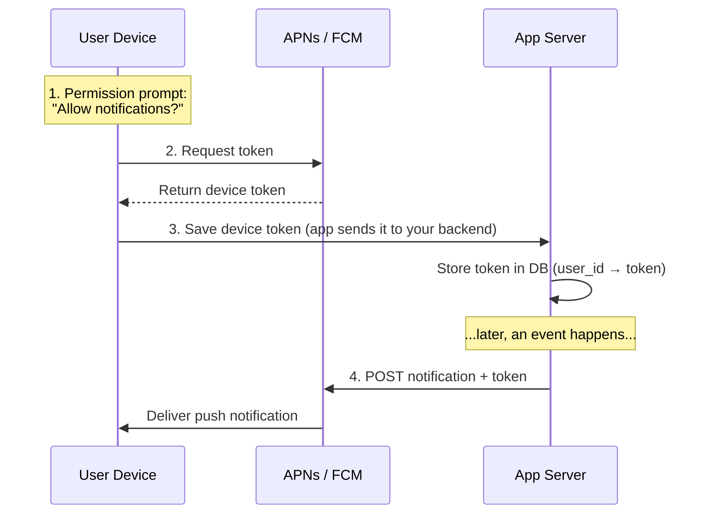

```yaml
Token_Lifecycle:
  1_Permission_Prompt: "The OS asks the user for notification permission"
  2_Token_Generation: "The OS contacts APNs/FCM and gets a unique device token"
  3_Token_Registration: "The mobile app sends this token to your company's backend database"
  4_Message_Dispatch: "Your backend targets the token, sending the JSON payload to APNs/FCM, which routes it to the device"

  Analogy: |
    "The token is the mailing address.
     Your server writes the letter (payload), puts the address on it,
     and hands it to the post office (APNs/FCM) for final delivery."
```

### Storing Tokens

```yaml
Device_Token_Table:
  user_id: "u_123"
  token: "a1b2c3...  (opaque string - don't parse it)"
  platform: "ios | android | web"
  app_version: "5.2.0"
  last_seen_at: "2026-11-03T10:15:00Z"
  created_at: "2026-09-01T08:00:00Z"

Rules:
  One_User_Many_Tokens: "A user may have a phone, a tablet and a laptop"
  Tokens_Change: "Reinstalls, restores and OS updates can issue new tokens - re-send on every app launch"
  Treat_As_Ephemeral: "Never assume a token is valid forever"
```

---

## How Devices Listen Without Dying

### The Myth vs The Reality

If you have 50 apps on your phone, they are **not** all maintaining open connections with 50 different servers. That would drain your battery very quickly.

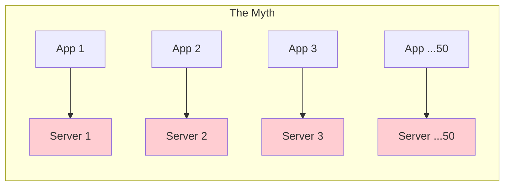

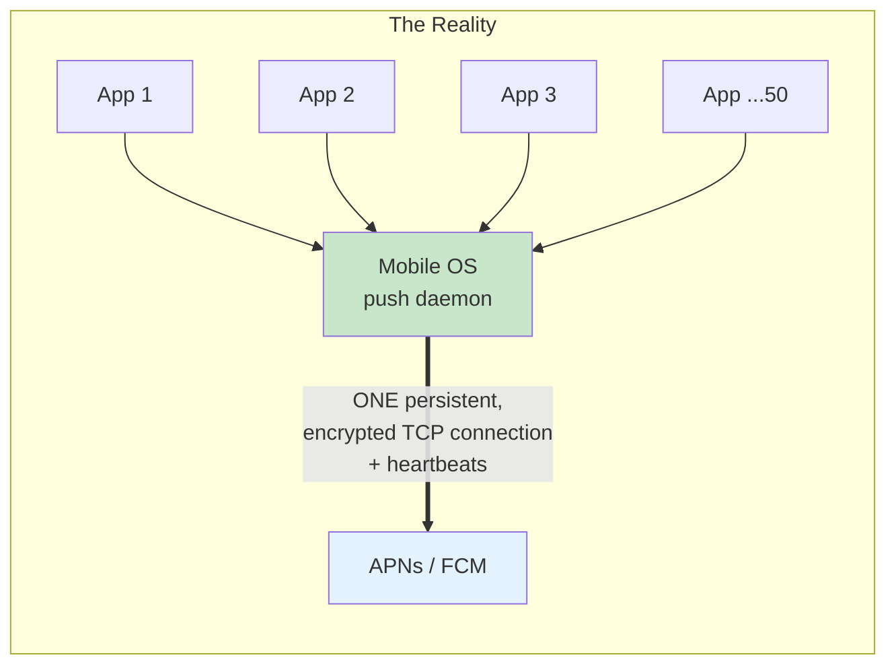

```yaml
How_It_Works:
  The_Myth: "Every app on your phone constantly polls servers (False - that would drain the battery instantly)"
  The_Reality: "The mobile OS maintains a single, power-sipping, encrypted TCP/IP connection to APNs or FCM"
  Heartbeats: "Tiny data packets keep the connection alive through firewalls (and NAT) without waking the main processor"
  Multiplexing: "Incoming pushes for ALL your apps arrive down this single pipe"
  Deep_Sleep: "The phone stays in a low-power state until a push arrives over that socket"
  Routing_On_Device: "The OS reads which app the push is for and hands it over"
```

This is exactly why you **must** go through APNs/FCM: they own the one connection the OS keeps open.

---

## What If the Phone Is in Airplane Mode?

### Store-and-Forward, With Different Rules

When the phone is off or offline, the post offices have to hold the mail, but **Apple and Google follow different rules**.

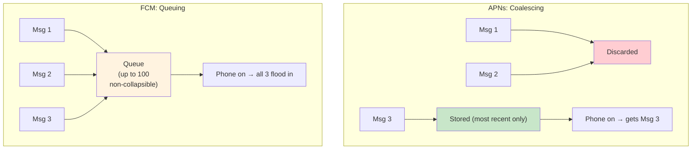

```yaml
Offline_Behavior:
  APNs_Coalescing:
    Rule: "Only the most recent notification per app is stored; older ones are discarded"
    Example: "Send 3 messages while an iPhone is off → only the 3rd is delivered when it turns on"
    Described_As: "'Last-in' wins"

  FCM_Queuing:
    Rule: "Google queues up to 100 non-collapsible messages per device"
    On_Reconnect: "They all flood in"
    Beyond_100: "FCM drops the stored messages and tells the app it missed some, so it can re-sync"

  Collapsible_Messages:
    Field: "collapse_key (FCM) / apns-collapse-id (APNs)"
    Use_Case: "Sports scores, 'you have N unread', live status"
    Example: "'Score: 1-0' is overwritten by 'Score: 2-0' in the queue"
    Benefit: "The user only sees what's still true"
```

### Choosing Collapsible vs Non-Collapsible

| Message Type | Example | Collapsible? |
|--------------|---------|--------------|
| Latest state | Live score, unread count, "driver is 2 min away" | Yes, only the newest matters |
| Discrete events | Chat messages, payment received | No, each one matters |
| Sync trigger | "New data available, please refresh" | Yes, one refresh covers all |

### Token Pruning

```yaml
Token_Pruning:
  Trigger: "APNs/FCM respond with an error saying the token is no longer valid"
  Signals:
    APNs: "HTTP 410 (Unregistered) - e.g. the user uninstalled your app"
    FCM: "An UNREGISTERED error for that token"
  Your_Job: "Delete (prune) that token from your database immediately"
  If_You_Don't: "Apple or Google may throttle / rate limit your server for spamming dead tokens"
```

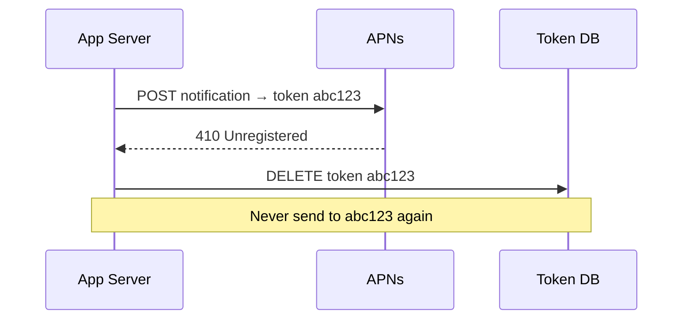

---

## Putting It Together: An Event-Driven Flow

### Example: "Your Payment Was Received"

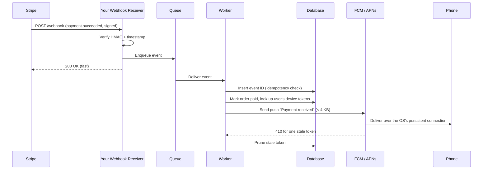

### Real-World Examples

```yaml
Real_World:
  Stripe:
    Webhooks: "payment_intent.succeeded, invoice.payment_failed, customer.subscription.deleted"
    Security: "Signed with a per-endpoint secret; signature header includes a timestamp"

  GitHub:
    Webhooks: "push, pull_request, release"
    Common_Use: "Triggering CI/CD pipelines when code is pushed"
    Security: "X-Hub-Signature-256 header (HMAC-SHA256)"

  Shopify:
    Webhooks: "orders/create, inventory_levels/update"
    Common_Use: "Syncing orders to warehouses and ERPs"

  Messaging_Apps:
    Push: "New message alerts (non-collapsible)"
    Badge: "Unread count (collapsible - only the latest matters)"

  Ride_Hailing:
    Push: "'Your driver has arrived'"
    Collapsible: "Driver ETA updates"
```

---

## Common Mistakes to Avoid

```yaml
Common_Mistakes:
  1_No_Signature_Verification:
    Mistake: "Trusting any POST to /webhook"
    Reality: "Anyone on the internet can call a public URL"
    Correct: "Verify the HMAC signature on every request"

  2_Comparing_Signatures_With_Equals:
    Mistake: "if (expected === signature)"
    Reality: "Leaks timing information"
    Correct: "crypto.timingSafeEqual (check lengths first)"

  3_Verifying_Re_Serialized_JSON:
    Mistake: "HMAC over JSON.stringify(req.body)"
    Reality: "Bytes may differ from what was signed"
    Correct: "HMAC over the raw request body"

  4_Heavy_Work_Before_Responding:
    Mistake: "Processing the event, then returning 200"
    Reality: "Provider times out and retries, flooding your server"
    Correct: "Verify, enqueue, return 2xx, process asynchronously"

  5_Not_Being_Idempotent:
    Mistake: "Assuming each event arrives exactly once"
    Reality: "Retries guarantee duplicates eventually"
    Correct: "Store processed event IDs, skip repeats"

  6_Huge_Push_Payloads:
    Mistake: "Stuffing full objects into notifications"
    Reality: "4 KB hard limit"
    Correct: "Send a small notification + ID; fetch details in-app"

  7_Never_Pruning_Tokens:
    Mistake: "Keeping every token forever"
    Reality: "Uninstalls leave dead tokens; providers may throttle you"
    Correct: "Delete tokens on 410 / UNREGISTERED"

  8_Spamming_Users:
    Mistake: "A push for every tiny event"
    Reality: "Users disable notifications or uninstall"
    Correct: "Respect the user's battery and attention - batch, collapse, optimize triggers"
```

### Best Practices

```yaml
Best_Practices:
  Webhooks:
    - "HTTPS only"
    - "Verify HMAC signatures over the raw body, with a timing-safe compare"
    - "Reject old timestamps (replay protection)"
    - "Acknowledge with 2xx quickly; process asynchronously via a queue"
    - "Use event IDs as idempotency keys"
    - "Don't depend on delivery order"

  Push_Notifications:
    - "Always go through APNs / FCM"
    - "Keep payloads under 4 KB"
    - "Use collapse keys for 'latest state' messages"
    - "Re-register tokens on app launch; store per device, not per user"
    - "Prune tokens on 410 / UNREGISTERED"
    - "Respect the user's battery and attention"
```

---

## Key Takeaways

### Remember This

- **Polling is wasteful**: polling every 5 seconds is over 17,000 requests a day, most of them saying "nothing new", and it still adds delay
- **Webhooks are a "reverse API"**: you give the provider a URL, and it POSTs a JSON payload the moment an event happens
- **Pick the right tool**: REST to pull on demand, webhooks for server-to-server events, WebSockets for two-way real-time with a browser, and push notifications to reach a device
- **Secure every webhook**: HTTPS, HMAC signatures, timestamp validation against replay attacks, and idempotency keys against retries
- **Acknowledge fast**: return a 2xx before heavy processing, or the provider will retry and flood you
- **Use timing-safe comparison**: `crypto.timingSafeEqual` stops attackers guessing your signature from response times
- **Push goes through gatekeepers**: APNs for Apple, FCM for Google (which can also proxy to APNs), with a 4 KB payload limit
- **Device tokens are mailing addresses**: permission → token → your DB → POST to APNs/FCM
- **One connection per phone**: the OS keeps a single persistent, encrypted TCP connection with heartbeats, and all apps' pushes are multiplexed down it
- **Offline rules differ**: APNs keeps only the most recent notification, FCM queues up to 100, and collapse keys overwrite stale updates
- **Prune dead tokens**: on a 410, delete the token, or you risk being rate limited

### The Event-Driven Summary

| | Webhooks | Push Notifications |
|---|----------|--------------------|
| **Direction** | Server → Server | Server → Device |
| **Transport** | HTTP POST to your URL | Via APNs / FCM over the OS's persistent connection |
| **Security / Rules** | HMAC, timestamps, idempotency | User opt-in, device tokens |
| **Size** | Usually small JSON | Strict 4 KB |
| **Must do** | Acknowledge quickly (2xx) | Prune invalid tokens |

---

## Resources

- [Presentation Slides](./presentation/)

---

<div align="center">

[Previous Episode: REST API Design](../27-rest-api-design/) | [Course Home](../../) | [Next Episode: Rate Limiting](../29-rate-limiting/)

</div>
