# Episode 29: Token Bucket vs Leaky Bucket vs Sliding Window | Rate Limiting Explained

[](http://youtube.com/@ThatNotesGuy)

## What You'll Learn

- What a rate limiter actually decides for every request, and the three things every algorithm trades off
- How the five classic algorithms work: fixed window, sliding log, sliding window counter, token bucket and leaky bucket
- Why a "100 requests per minute" limit let **200 requests through in 0.1 seconds**, measured on a real Redis
- The burst bound nobody mentions: a token bucket allows `C + r × W` in any window
- Why "leaky bucket" is really two different algorithms (a meter and a queue)
- How a distributed limiter breaks under a race condition (20 gateways let **all 1,000** requests through a limit of 100), and how one Lua script fixes it
- How LLM APIs rate limit **tokens per minute**, and why prompt caching changes the math
- Two more worth knowing: GCRA and concurrency limits (Little's law)

> Every number in these notes was measured on Redis 7.4 by the code in [`./practical/ratelimit-from-scratch/`](./practical/ratelimit-from-scratch/). You can run it yourself.

---

## The Hook: 200 Requests Through a Limit of 100

A rate limit of **100 requests per minute** was set on a real Redis. Then 200 requests were sent in the tenth of a second around the minute mark.

**All 200 got through.** Nothing was broken. The limiter did exactly what it was designed to do.

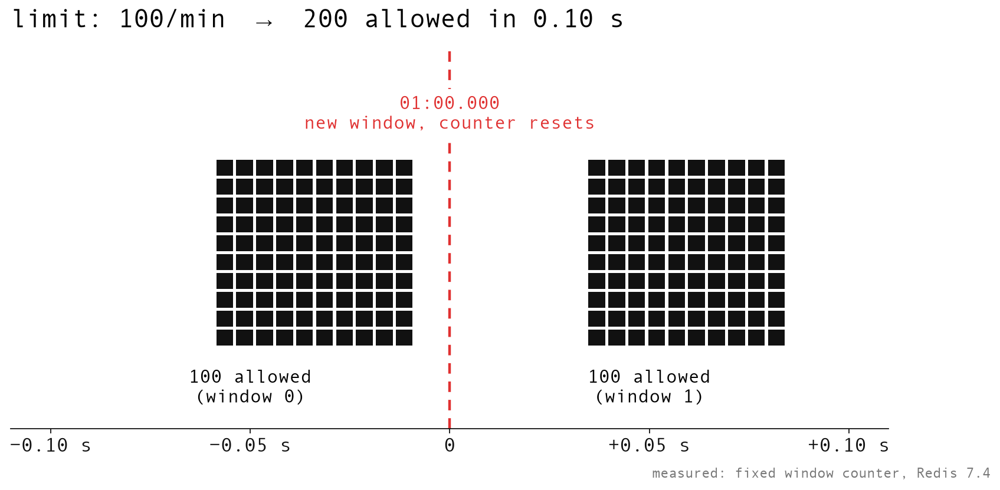

```yaml
The_Experiment:
  Limit: "100 requests per minute"
  Sent: "100 requests at 00:59.95, then 100 more at 01:00.05"
  Result: "All 200 allowed, in 0.102 seconds"
  Second_Run: "200 allowed in 0.105 seconds"
  Lesson: "'100 per minute' doesn't mean what most people think it means"
```

The same attack was run against **every** algorithm in this episode, so you can compare what each one actually lets through.

---

## What a Rate Limiter Actually Decides

### The Three Questions

Every rate limiter answers the same questions for every request:

1. **Who is this?** An API key, a user ID, an IP address, a route, or a combination.
2. **How much have they used?**
3. **What do we do?** Allow it, reject it with **429 Too Many Requests**, or make it wait in a queue.

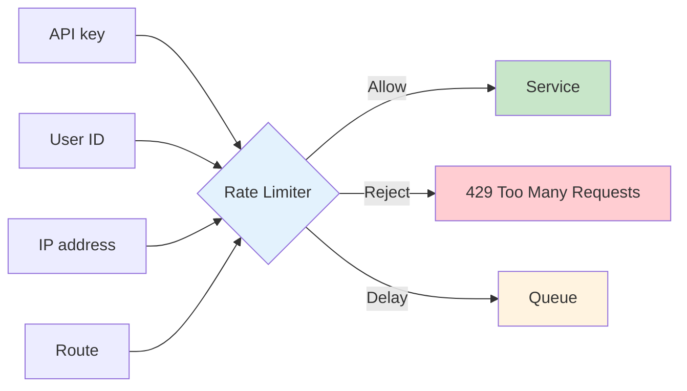

### The Three Trade-offs

```yaml
Every_Algorithm_Trades_Off:
  Accuracy: "How exact is the count? Can it let more through than the limit?"
  Burst_Behaviour: "What happens when lots of requests arrive at once?"
  Memory_Per_Key: "How much state do you store per user / API key?"

Running_Example:
  Limit: "100 requests per minute (100/min)"
  Refill_Rate: "100 / 60 s ≈ 1.67 per second, i.e. one every 0.6 s"
```

### Where Rate Limiters Live

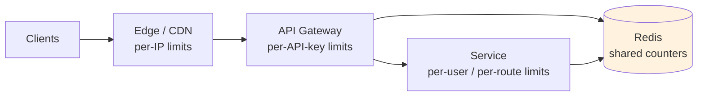

```yaml
Why_Rate_Limit:
  Protect_Capacity: "One noisy client shouldn't take down everyone"
  Fairness: "Each customer gets their share"
  Cost_Control: "Expensive endpoints (LLM calls, SMS, email) cost real money"
  Security: "Slow down brute-force logins, OTP guessing, scraping"
```

---

## Algorithm 1: Fixed Window Counter

### How It Works

The simplest one: **one counter per key per minute**. In Redis, the key is the user plus the current minute number. You `INCR` it, and if it goes over 100, you reject.

```lua
-- Redis Lua (from limiters.py)
local k = KEYS[1] .. ':' .. math.floor(now / win)   -- one key per user per minute
local n = redis.call('INCR', k)                     -- atomic
if n == 1 then redis.call('PEXPIRE', k, win) end    -- same script: a crash can't skip it
return n <= limit
```

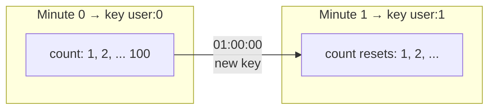

### The Crash Gotcha

```yaml
Atomicity:
  INCR: "Atomic - concurrent requests can't corrupt the count"
  The_Trap: |
    If INCR and EXPIRE are separate calls and your server crashes between them,
    that key never expires. The counter stays above 100 forever, and that user
    is blocked forever.
  Fix: "Set the expiry in the SAME Lua script as the INCR"
```

### The Real Problem: The Boundary

| Sent at | Requests | Window | Result |
|---------|----------|--------|--------|
| 00:59.95 | 100 | window 0 | all allowed |
| 01:00.05 | 100 | window 1 (counter reset) | all allowed |
| **Total** | **200 in 0.102 s** | | against a limit of 100/min |

At one minute, a new window starts and the counter resets, so the next 100 are allowed too. A fixed window lets **up to 2x the limit** through at a boundary.

```yaml
Fixed_Window_Summary:
  State: "One integer per key"
  Memory: "Tiny"
  Accuracy: "Exact within a window, wrong across windows"
  Worst_Case_Burst: "2 × limit around the boundary"
  Good_For: "Simple daily or monthly quotas where a boundary burst doesn't matter"
```

---

## Algorithm 2: Sliding Window Log

### How It Works

To fix the boundary, the sliding log stores **the timestamp of every accepted request**, in a Redis sorted set. On each request: drop timestamps older than 60 seconds, count what's left, and allow if that's under 100.

```python
def sliding_log(log, now, limit=100, W=60):     # log: a Redis sorted set
    while log and log[0] <= now - W:             # drop anything older than 60 s
        log.popleft()
    if len(log) >= limit:
        return False                             # don't log rejected requests
    log.append(now)
    return True
```

The Redis version in the practical uses a sorted set:

```lua
redis.call('ZREMRANGEBYSCORE', KEYS[1], '-inf', now - win)  -- forget anything older than the window
local n = redis.call('ZCARD', KEYS[1])
if n >= limit then return {0, now_us, n} end                -- rejected requests are not logged
redis.call('ZADD', KEYS[1], now, ARGV[3])
redis.call('PEXPIRE', KEYS[1], win)
return {1, now_us, n + 1}
```

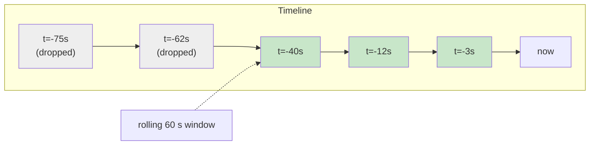

### It's Exact

**Measured:** never more than **100** in any 60 seconds of the attack.

### The Cost Is Memory

```yaml
Memory_Math:
  Scenario: "1 million users, a limit of 1,000 requests per hour"
  Sliding_Log: "1M × 1,000 × 8 bytes = 8 GB of raw timestamps"
  Counters: "about 16 MB"
  Note: "Raw numbers - Redis's per-entry overhead for sorted sets makes the log even bigger"
```

### The Gotcha: Don't Log Rejected Requests

```yaml
Rejected_Request_Gotcha:
  Mistake: "Adding a timestamp for every request, including rejected ones"
  Result: "A client that keeps retrying keeps refilling its own log and never gets back under the limit"
  Fix: "Only log accepted requests"
```

---

## Algorithm 3: Sliding Window Counter

### Two Counters and a Weighted Estimate

The sliding window counter gets most of the sliding log's accuracy with **just two counters**: last minute's count and this minute's. Weight last minute's count by how much of it still overlaps your rolling window, then add this minute's.

```
estimate = prev_count × (time left in current window / window) + curr_count
allow if estimate + 1 ≤ limit
```

### Cloudflare's Worked Example (limit 50/min)

```yaml
Cloudflare_Example:
  Limit: 50 per minute
  Last_Minute: 42 requests
  This_Minute_So_Far: 18 requests
  Time_Into_Current_Minute: "15 s → 45 s of the previous minute still overlaps"
  Estimate: "42 × 45/60 + 18 = 31.5 + 18 = 49.5"
  Decision: "49.5 < 50 → allowed"
```

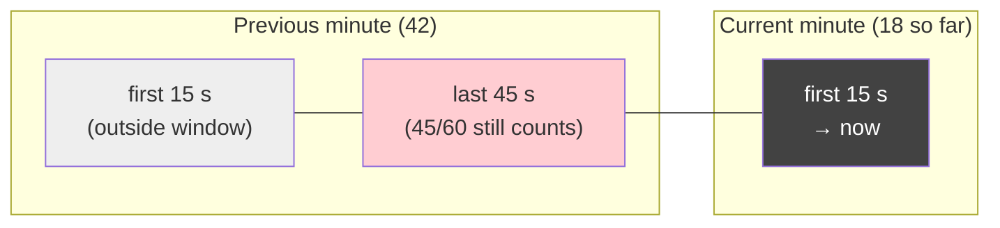

The Redis version from the practical:

```lua
local w = math.floor(now / win)
local curr_k, prev_k = KEYS[1] .. ':' .. w, KEYS[1] .. ':' .. (w - 1)
local curr = tonumber(redis.call('GET', curr_k) or '0')
local prev = tonumber(redis.call('GET', prev_k) or '0')
local est = prev * (1 - (now % win) / win) + curr
if est + 1 > limit then return {0, now_us, math.floor(est * 1000)} end
redis.call('INCR', curr_k)
redis.call('PEXPIRE', curr_k, 2 * win)
```

### Accuracy at Scale

```yaml
Cloudflare_Accuracy:
  Checked: "400 million requests from 270,000 sources"
  Wrongly_Allowed_Or_Limited: "0.003%"
  State: "Two counters per key"
```

### The Assumption, and How the Attack Breaks It

The estimate assumes **last minute's traffic was spread evenly**. The attack put 100 requests at the very end of the minute, then kept sending. Since only ~0.1 s of the previous minute was "real" traffic, the weighting underestimates it.

**Measured: 199** let through in one rolling minute.

```yaml
Sliding_Counter_Summary:
  State: "2 counters per key"
  Accuracy: "Approximate - very good on real traffic"
  Weak_Spot: "Traffic concentrated at the end of a window"
  Good_For: "Edge / CDN with huge key counts, where approximate is fine"
```

---

## Algorithm 4: Token Bucket

### How It Works

The token bucket is what **most public APIs actually run**.

```yaml
Token_Bucket:
  Capacity: "C tokens (the bucket size)"
  Refill: "r tokens per second"
  Each_Request: "Spends one token"
  Empty_Bucket: "Reject (429)"
```

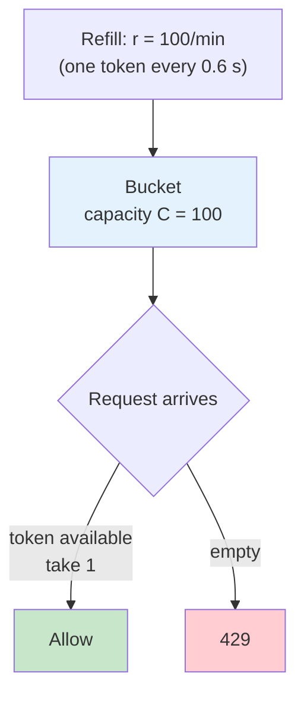

### No Timer Needed: Lazy Refill

There's no background timer. Store the **token count and a timestamp**. On each request, add `elapsed time × rate`, capped at C.

```python
def token_bucket(tokens, last, now, C=100, rate=100/60, cost=1):
    tokens = min(C, tokens + (now - last) * rate)   # lazy refill, no timer
    if tokens < cost:
        return tokens, now, False
    return tokens - cost, now, True
```

### The Burst Bound Nobody Mentions

A full bucket of 100 lets 100 through instantly, and refilling at 100 per minute adds another 100 **within the same minute**.

```
max requests in any window W  =  C + r × W

C = 100, r = 100/min   →  up to 200 in a rolling minute
measured: 100 at once, then one every 0.60 s  →  199
```

```yaml
Measured_Token_Bucket:
  Burst: "100 let through at once"
  After_Burst: "one every 0.59 to 0.61 s (the refill rate: 100/min = one per 0.6 s)"
  Most_In_Any_60s: 199
```

### If You Need "At Most 100 in Every Minute", Shrink the Bucket

```yaml
In_Production:
  Anthropic_API:
    Algorithm: "Token bucket"
    Docs_Say: "60 requests per minute might be enforced as 1 request per second"
    Why: "A smaller bucket means a smaller burst"
  AWS_API_Gateway:
    Algorithm: "Token bucket"
    Defaults: "Refills 10,000 requests per second, with a burst of 5,000"
```

| Bucket Size (C) | Refill (r) | Most in any 60 s (C + r×W) |
|-----------------|------------|----------------------------|
| 100 | 100/min | up to 200 |
| 10 | 100/min | up to 110 |
| 1 | 100/min | up to 101 |

The trade-off: a tiny bucket stops legitimate clients from doing a short burst (like loading a page that fires 10 API calls at once).

---

## Algorithm 5: Leaky Bucket (Two Algorithms, One Name)

The leaky bucket is where most tutorials get confused, because **the name covers two different algorithms**.

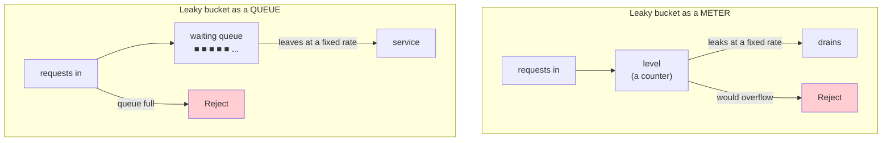

### Version 1: The Meter

Each request adds one to a **level**. The level leaks at a fixed rate. A request that would overflow is rejected.

```lua
-- leaky bucket as a meter (from limiters.py)
level = math.max(0, level - math.max(0, now - ts) * leak / 1000)
local ok = 0
if level + 1 <= cap then level = level + 1; ok = 1 end
```

```yaml
Token_Bucket_In_A_Mirror:
  Why: "The level is exactly capacity minus tokens"
  Measured: "Made the same decision as the token bucket on all 820 requests of the attack"
  In_Production: "Shopify REST API: a bucket of 40 that leaks 2 per second"
```

### Version 2: The Queue

Requests **actually wait**, and leave at a fixed rate.

```yaml
Leaky_Queue:
  Output: "Perfectly smooth - one every 0.6 s in the test"
  Cost: "The last request in the queue waited 60 s"
  Problem: "By then, the client has probably timed out"
  In_Production: "NGINX limit_req"
```

### NGINX `limit_req`

```nginx
# 100 requests per minute per client IP
limit_req_zone $binary_remote_addr zone=api:10m rate=100r/m;

server {
    location /api/ {
        limit_req zone=api burst=100;          # burst = the queue size
        # limit_req zone=api burst=100 nodelay; # nodelay = turns it back into a meter
        limit_req_status 429;                   # default is 503, not 429
    }
}
```

```yaml
NGINX_Notes:
  burst: "The queue size"
  nodelay: "Turns the queue back into a meter (no waiting)"
  Default_Status: "503 - set limit_req_status 429 if you want the standard code"
```

### Meter vs Queue

| | Leaky bucket as a **meter** | Leaky bucket as a **queue** |
|---|---|---|
| **What leaks** | A counter (the "level") | Actual waiting requests |
| **When full** | Reject | Reject new arrivals |
| **Output** | Bursty, same as a token bucket | Smooth: one every 0.60 s (measured) |
| **Extra latency** | None | Measured: the last one waited **60 s** |
| **Measured** | Same decision as the token bucket on all 820 requests | Never more than 100 out per minute |
| **In production** | Shopify REST: a 40-request bucket, leaking 2/s | NGINX `limit_req`: `burst` is the queue size, `nodelay` makes it a meter, 503 by default |

---

## The Same Attack, Every Algorithm

### The Attack

```yaml
Attack:
  Limit: "100/min"
  Step_1: "100 requests at 00:59.95"
  Step_2: "100 requests at 01:00.05"
  Step_3: "Then 10 requests per second for about a minute"
  Fairness: "Every request goes through all six limiters (separate keys), so they all see the exact same traffic"
  Total_Requests: 820
```

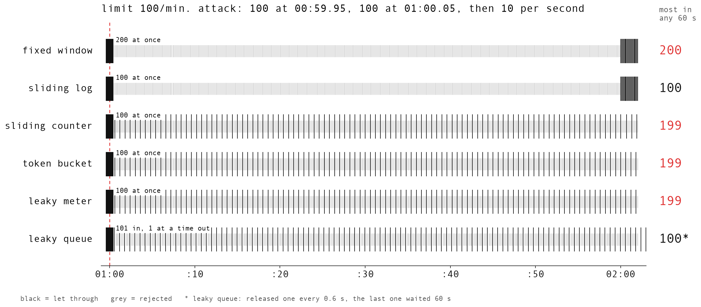

*Black = let through, grey = rejected.*

### The Results (measured on Redis 7.4)

| Algorithm | Let through in the 0.1 s burst | Most in any 60 s | Longest wait | Total allowed (of 820) |
|-----------|--------------------------------|------------------|--------------|------------------------|
| Fixed window | 200 (in 0.102 s) | **200** | 0 | 221 |
| Sliding log | 100 | 100 | 0 | 121 |
| Sliding window counter | 100 | **199** | 0 | 203 |
| Token bucket | 100 | **199** | 0 | 203 |
| Leaky bucket (meter) | 100 | **199** | 0 | 203 |
| Leaky bucket (queue) | 101 in (1 served, 100 waiting) | 100 out | **60 s** | 204 |

*Source: [`results/attack_summary.json`](./practical/ratelimit-from-scratch/results/attack_summary.json). A second run gave the same counts.*

```yaml
What_It_Shows:
  Fixed_Window: "200 in a tenth of a second"
  Sliding_Log: "Exactly 100"
  Sliding_Counter_Token_Bucket_Leaky_Meter: "100 at once, then about one every 0.6 s → 199 in the minute"
  Leaky_Queue: "The only one holding output to 100/min - and it paid for that in waiting time"

The_Big_Lesson: |
  "100 per minute" is a long-run average.
  Always ask what burst your algorithm allows.
```

### Algorithm Comparison

| Algorithm | State per key | Accuracy | Burst at boundary | Adds latency | Typical use |
|-----------|---------------|----------|-------------------|--------------|-------------|
| Fixed window | 1 counter | Low at boundaries | Up to 2x | No | Simple daily/monthly quotas |
| Sliding log | 1 timestamp per request | Exact | None | No | Logins, OTPs, rare sensitive actions |
| Sliding window counter | 2 counters | Approximate (0.003% at Cloudflare) | Up to ~2x on adversarial traffic | No | Edge/CDN, huge key counts |
| Token bucket | Tokens + timestamp | Exact to its own rule | C + r × W | No | Public APIs (default) |
| Leaky meter | Level + timestamp | Same as token bucket | C + r × W | No | Same as token bucket |
| Leaky queue | Next-free time / queue | Exact output rate | None (smooth) | Yes | Protecting a fragile downstream |

---

## Going Distributed: The Race Condition

### The Setup

Put the limiter behind more than one server. The bucket lives in Redis, and each gateway **reads it, does the math, and writes it back**.

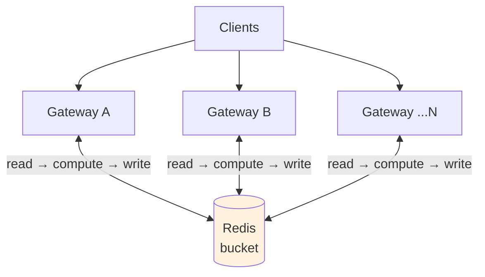

### The Lost Update

Two gateways read 50 tokens at the same moment. Both spend one, and both write back 49. **Two requests got through, but the bucket only went down by one.**

| Step | Gateway A | Gateway B | Redis |
|------|-----------|-----------|-------|
| 1 | HMGET → 50 | | 50 |
| 2 | | HMGET → 50 | 50 |
| 3 | 50 ≥ 1 → allow | 50 ≥ 1 → allow | |
| 4 | HSET 49 | HSET 49 | 49, but **2 admitted** |

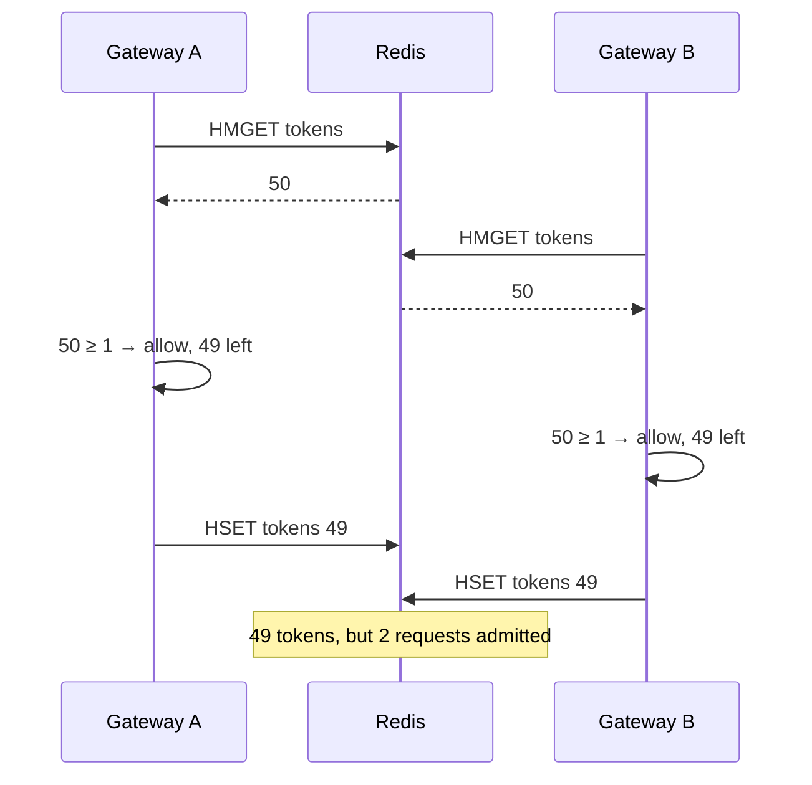

### Measured: Lost Updates Compound

1,000 requests against a bucket of 100, median of 5 runs:

| Gateways | Read → compute → write | One Lua script |
|----------|------------------------|----------------|
| 1 | 100 | 100 |
| 2 | **196** | 100 |
| 5 | **344** | 100 |
| 10 | **605** | 100 |
| 20 | **1,000** (994 to 1,000) | 100 |
| 50 | **1,000** | 100 |

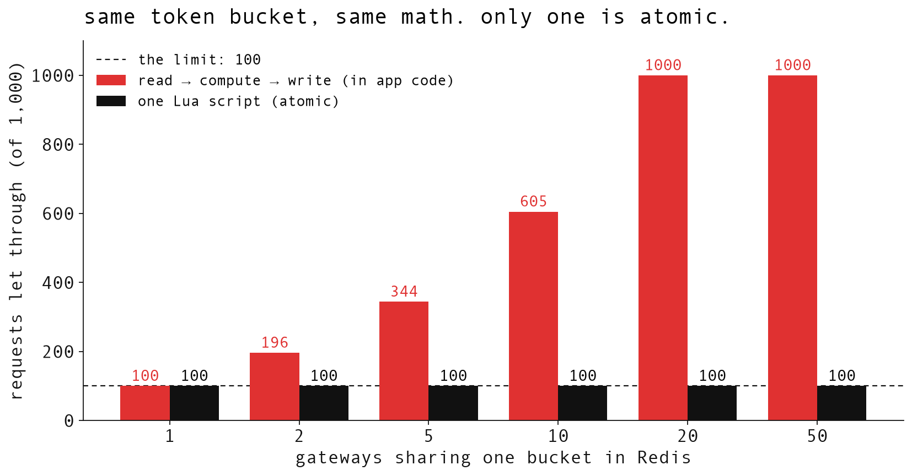

*Source: [`results/race.json`](./practical/ratelimit-from-scratch/results/race.json). The Lua version let exactly 100 through in all 30 runs.*

```yaml
Why_It_Compounds:
  Not: "Overshoot by at most N - 1"
  Actually: "Every lost update leaves an extra token in the bucket"
  Result: "The overshoot grows with every request - 20 gateways let all 1,000 through"
```

### The Fix: The Whole Decision in One Lua Script

Redis runs a Lua script **atomically**, so nothing can interleave with it. Same math, same gateways: **exactly 100, every time**.

```lua
local t   = redis.call('TIME')                              -- one clock for all
local now = tonumber(t[1]) * 1000 + tonumber(t[2]) / 1000   -- ms
local s   = redis.call('HMGET', KEYS[1], 'tokens', 'ts')
local tokens = tonumber(s[1]) or cap
local last   = tonumber(s[2]) or now
tokens = math.min(cap, tokens + (now - last) * rate / 1000)
local ok = tokens >= cost
if ok then tokens = tokens - cost end
redis.call('HSET', KEYS[1], 'tokens', tokens, 'ts', now)
return ok
```

```yaml
Distributed_Rules:
  One_Script:
    Why: "Read, compute and write happen as one atomic step"
  MULTI_EXEC_Alone_Is_Not_Enough:
    Why: "You can't branch on a value inside the transaction - the commands are queued before you see the result"
  One_Clock:
    Why: "Call Redis TIME inside the script, so a gateway whose clock runs ahead can't hand out extra tokens"
  Redis_Cluster:
    Note: "Put the user in a hash tag ({user}:minute) so all of a key's counters land on the same shard"
```

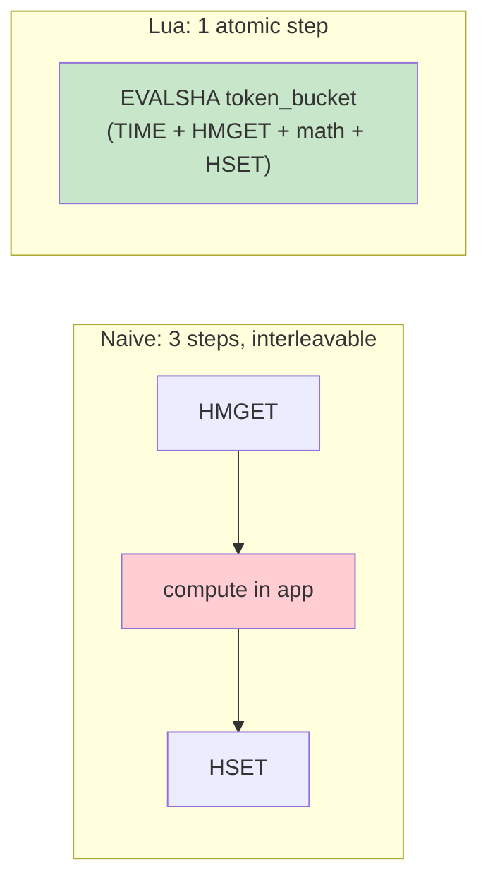

---

## LLM APIs: Tokens per Minute

### Same Token Bucket, Different Cost

LLM APIs limit **tokens per minute**, not just requests. It's the same token bucket. The request just spends **its token count** instead of one.

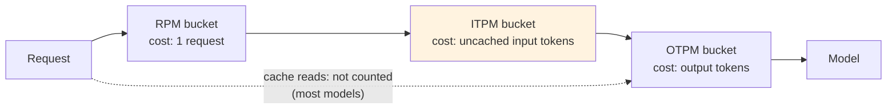

```yaml
Anthropic:
  Algorithm: "Token bucket"
  Three_Limits_At_Once:
    RPM: "Requests per minute"
    ITPM: "Input tokens per minute"
    OTPM: "Output tokens per minute"
  Prompt_Caching: "On most models, tokens read from the prompt cache don't count toward ITPM (see the KV cache video)"

OpenAI:
  Counting: "The maximum of max_tokens and the estimated number of tokens"
  Consequence: "A huge max_tokens uses up your limit even when the reply is short"
```

### Measured With Anthropic's Example Numbers

```yaml
Setup:
  ITPM_Limit: "2,000,000 input tokens per minute"
  Requests: "50, each a 200,000-token document plus a 50-token question"
  Note: "A simulation of their documented limit using the Lua token bucket - not a call to their API"
```

| | Requests let through (of 50) | Input tokens processed | Counted toward the limit |
|---|---|---|---|
| No cache | **9** | 1,800,450 | 1,800,450 |
| With cache | **50** | 10,002,500 | 202,500 |

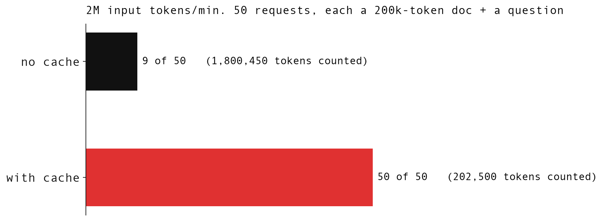

*Source: [`results/llm_tokens.json`](./practical/ratelimit-from-scratch/results/llm_tokens.json).*

```yaml
Why:
  No_Cache: "Each request costs 200,050 tokens → 2,000,000 / 200,050 ≈ 9.99 → 9 fit"
  With_Cache: "The first request writes the cache (200,050); each of the other 49 costs only 50 → 202,500 total"
```

---

## Two More Worth Knowing

### GCRA (Generic Cell Rate Algorithm)

GCRA stores **a single timestamp per key**: the **theoretical arrival time** (TAT). Each allowed request pushes the TAT forward by one emission interval (0.6 s for 100/min). It makes **the same decisions as a token bucket**, and the retry-after time falls straight out of the math. `redis-cell` uses it.

```python
# GCRA sketch: limit 100/min with a burst of 100
T   = 60 / 100            # emission interval: 0.6 s between requests
tau = T * (100 - 1)       # how far "ahead of schedule" a client may get

def gcra(stored_tat, now):
    tat = max(stored_tat, now)
    if tat - now > tau:                       # too far ahead of schedule
        retry_after = tat - tau - now         # falls straight out of the math
        return stored_tat, False, retry_after
    return tat + T, True, 0                   # allow, push TAT forward by T
```

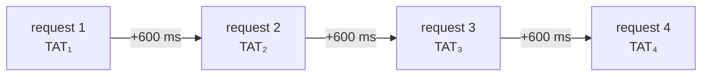

```yaml
GCRA:
  State: "One timestamp per key (vs tokens + timestamp for a token bucket)"
  Decisions: "Same as a token bucket"
  Bonus: "Retry-After comes for free"
  Used_By: "redis-cell"
```

### Concurrency Limits (Little's Law)

Rate limits count **arrivals**, but servers die from **requests in flight**.

```
L = λ × W

L = requests in flight
λ = arrival rate (requests per second)
W = latency (service time)
```

```yaml
Concurrency_Limit_Example:
  Slots: "100 requests in flight"
  Latency_50ms: "100 / 0.05 s → up to 2,000 requests per second"
  Latency_1s: "100 / 1 s → only 100 requests per second"
  Point: "When latency spikes, the same 100 slots throttle you automatically"
  In_Production: "Stripe runs a concurrency limiter next to its token bucket"
```

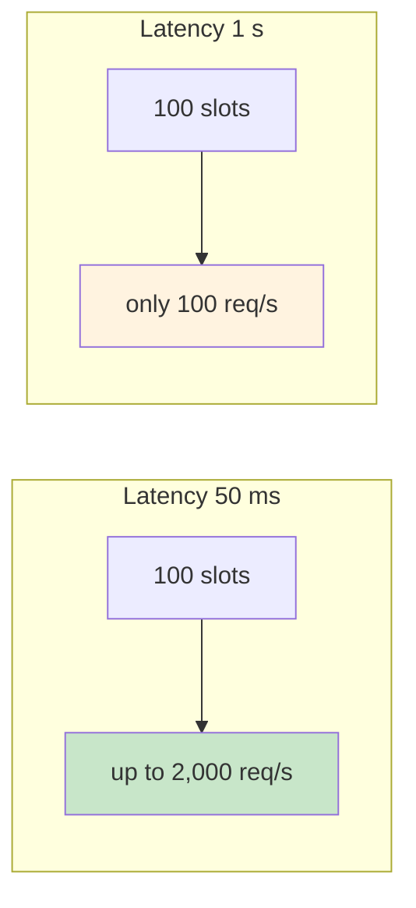

---

## Beyond the Video: Using This in Practice

These points come from the practical repo and the episode's pinned comment rather than the main video.

### Which Algorithm?

| Need | Use |
|------|-----|
| A public API where short bursts are fine | Token bucket, or GCRA |
| Edge / CDN with huge key counts, where approximate is fine | Sliding window counter |
| An exact limit on rare, sensitive actions (login, OTP) | Sliding log |
| Smoothing traffic to a fragile dependency | Leaky bucket as a queue |
| Simple daily or monthly quotas | Fixed window |

### The Client Contract

```http
HTTP/1.1 429 Too Many Requests
Retry-After: 12
Content-Type: application/json

{ "error": "rate_limited", "message": "Too many requests, retry in 12 s" }
```

```yaml
Client_Contract:
  Status: "429 Too Many Requests (RFC 6585)"
  Retry_After: "Tell the client when to come back (RFC 9110)"
  Clients_Should: "Back off exponentially, with jitter, so retries don't all arrive at once"
  Watch_Out: "NGINX limit_req returns 503 by default"
```

### "Design a Rate Limiter" in Five Steps

```yaml
Interview_Answer:
  1_Where_And_Key: "Gateway, sidecar or in-service. Key on API key, user, IP or route"
  2_Algorithm_And_Burst: "Token bucket by default - and say what burst you allow (C + r × W)"
  3_State: "Redis with one Lua script per decision, sharded by key"
  4_Failure: "Fail open or fail closed, per endpoint (Stripe fails open)"
  5_Contract: "429 + Retry-After, and clients that back off with jitter"
```

---

## Key Takeaways

### Remember This

- **"100/min" is a long-run average**: always ask what burst your algorithm allows
- **Fixed window** is cheap but lets **2x through at the boundary** (200 in 0.102 s, measured)
- **Sliding log** is exact (never more than 100 in any 60 s) but costs memory: **8 GB vs 16 MB** for 1M users at 1,000/hour
- **Sliding window counter** is approximate and fine at scale: Cloudflare measured **0.003%** error on 400M requests, but adversarial traffic got **199** through
- **Token bucket** is the default for public APIs, and its bound is **C + r × W**: 199 in a rolling minute, measured
- **Token bucket and the leaky meter make the same decisions** (identical on all 820 requests). **Only a queue smooths traffic**, and it costs waiting time (60 s for the last request)
- **Across servers, the whole decision must be atomic**: read-compute-write let 1,000 of 1,000 through with 20 gateways; one Lua script let exactly 100 through every time. **One script, one clock**
- **LLM APIs** use the same token bucket with a token-count cost; cached prompt tokens can let **50 of 50** requests through instead of 9
- **GCRA** stores one timestamp per key; **concurrency limits** protect you from latency spikes (Little's law)

### Common Mistakes to Avoid

```yaml
Common_Mistakes:
  1_Separate_INCR_And_EXPIRE:
    Reality: "A crash in between blocks that user forever"
    Correct: "Both in one Lua script"

  2_Logging_Rejected_Requests:
    Reality: "Retrying clients never get back under the limit"
    Correct: "Only log accepted requests"

  3_Assuming_The_Limit_Is_A_Hard_Cap:
    Reality: "Token bucket allows C + r × W in any window W"
    Correct: "Shrink the bucket if you need a strict per-minute cap"

  4_Read_Compute_Write_Across_Gateways:
    Reality: "Lost updates compound - 20 gateways let everything through"
    Correct: "One atomic Lua script per decision"

  5_Trusting_MULTI_EXEC:
    Reality: "You can't branch on a value inside the transaction"
    Correct: "Lua script"

  6_Using_Each_Gateway_Clock:
    Reality: "A gateway with a fast clock hands out extra tokens"
    Correct: "Redis TIME inside the script"

  7_Calling_A_Queue_A_Rate_Limiter_Without_Timeouts:
    Reality: "The last request waited 60 s - the client is long gone"
    Correct: "Keep queues short, or use a meter"

  8_Counting_Only_Arrivals:
    Reality: "Servers die from requests in flight when latency spikes"
    Correct: "Add a concurrency limit next to the rate limit"
```

---

## Practical

Run every measurement from this episode yourself:

- [Practical Guide](./practical/): how to run the code
- [ratelimit-from-scratch](./practical/ratelimit-from-scratch/): the six limiters as Redis Lua scripts, the attack, the race and the LLM tokens demo

## Resources

- [Presentation Slides](./presentation/)
- [Cloudflare: Counting things, a lot of different things](https://blog.cloudflare.com/counting-things-a-lot-of-different-things/)
- [Stripe: Scaling your API with rate limiters](https://stripe.com/blog/rate-limiters)
- [Anthropic rate limits](https://platform.claude.com/docs/en/api/rate-limits)
- [OpenAI rate limits](https://developers.openai.com/api/docs/guides/rate-limits)
- [Brandur: Rate limiting and GCRA](https://brandur.org/rate-limiting)
- [Wikipedia: Leaky bucket](https://en.wikipedia.org/wiki/Leaky_bucket)
- [NGINX limit_req](https://nginx.org/en/docs/http/ngx_http_limit_req_module.html)
- [Shopify REST rate limits](https://shopify.dev/docs/api/admin-rest/usage/rate-limits)
- [RFC 6585 §4: 429 Too Many Requests](https://www.rfc-editor.org/rfc/rfc6585#section-4)

---

<div align="center">

[Previous Episode: Webhooks & Push Notifications](../28-webhooks-push-notifications/) | [Course Home](../../) | [Next Episode: Coming Soon](../30-coming-soon/)

</div>
