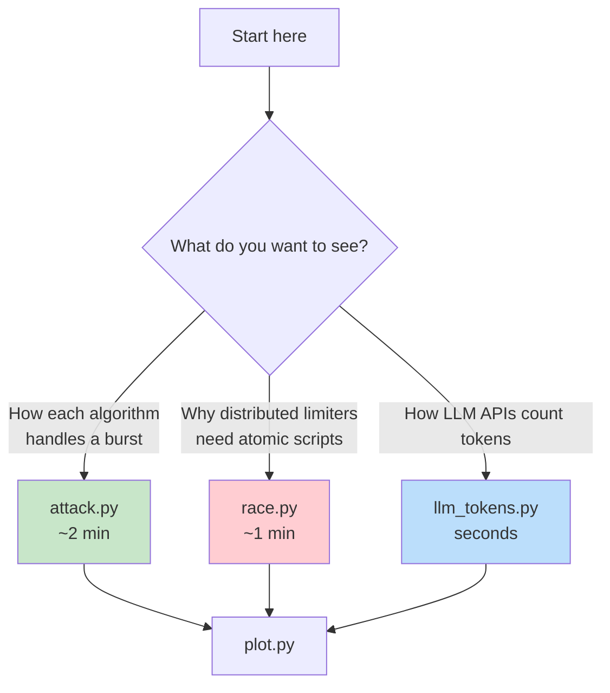

# Practical: Rate Limiting From Scratch

Hands-on code that measures every rate limiting algorithm from the episode against a real Redis.

## Tutorials

| Tutorial | Description | Time |
|----------|-------------|------|
| [ratelimit-from-scratch](./ratelimit-from-scratch/) | Six limiters as atomic Redis Lua scripts, plus the boundary attack, the race condition and the LLM tokens-per-minute demo | 15 min |

## What's Inside

| Script | What it does | Runtime | Output |
|--------|--------------|---------|--------|
| [`limiters.py`](./ratelimit-from-scratch/limiters.py) | Fixed window, sliding log, sliding window counter, token bucket, leaky meter, leaky queue (one Lua script each) | - | - |
| [`attack.py`](./ratelimit-from-scratch/attack.py) | 100 requests just before a minute boundary, 100 just after, then 10/s, against all six at once | ~2 min | `results/attack.json` |
| [`race.py`](./ratelimit-from-scratch/race.py) | 1 to 50 gateways sharing one token bucket: read → compute → write vs one Lua script | ~1 min | `results/race.json` |
| [`llm_tokens.py`](./ratelimit-from-scratch/llm_tokens.py) | Input-tokens-per-minute limit, with and without prompt caching | seconds | `results/llm_tokens.json` |
| [`plot.py`](./ratelimit-from-scratch/plot.py) | Regenerates the charts from the results | seconds | `plots/*.png` |

## Which to Start With?



## Prerequisites

- Docker (or any Redis 7+ you can reach)
- Python 3.10+
- Terminal/command line

## Installation

```bash
cd ratelimit-from-scratch

# A throwaway Redis on port 6390 (no persistence, 64 MB cap)
docker run -d --rm --name ratelimit-demo-redis -p 127.0.0.1:6390:6379 \
  redis:7-alpine redis-server --save '' --appendonly no --maxmemory 64mb

# Python dependencies (redis, matplotlib, numpy)
python3 -m venv .venv && .venv/bin/pip install -r requirements.txt
```

Using a different Redis? Set `REDIS_URL` (default `redis://127.0.0.1:6390/0`):

```bash
export REDIS_URL=redis://localhost:6379/0
```

## Running

```bash
.venv/bin/python attack.py        # the boundary attack (waits for the next minute, then ~62 s of traffic)
.venv/bin/python race.py          # the race condition
.venv/bin/python llm_tokens.py    # tokens per minute, with and without caching
.venv/bin/python plot.py          # redraw plots/*.png from results/

.venv/bin/python attack.py --summary   # re-print the attack table from results/attack.json
```

When you're done:

```bash
docker stop ratelimit-demo-redis
```

## What You Should See

### attack.py

```
algorithm         allowed in the 0.1 s burst  most in any 60 s  longest wait
fixed window              200 in 0.102 s               200          0.0s
sliding log               100 in 0.011 s               100          0.0s
sliding counter           100 in 0.011 s               199          0.0s
token bucket              100 in 0.011 s               199          0.0s
leaky meter               100 in 0.011 s               199          0.0s
leaky queue               101 in 0.095 s               101         60.0s
```

### race.py

```
gateways    naive    lua  right answer
       1      100    100   ≤ 100
       2      196    100   ≤ 100
       5      344    100   ≤ 100
      10      605    100   ≤ 100
      20     1000    100   ≤ 100
      50     1000    100   ≤ 100
```

### llm_tokens.py

```
no cache  :  9 of 50 requests allowed, 1,800,450 input tokens processed, 1,800,450 counted toward the limit
with cache: 50 of 50 requests allowed, 10,002,500 input tokens processed, 202,500 counted toward the limit
```

Exact timings will differ on your machine; the counts should match closely. The reference runs are saved in [`ratelimit-from-scratch/results/`](./ratelimit-from-scratch/results/).

## What You'll Learn

### attack.py
- Why a fixed window lets 2x the limit through at a boundary
- Why the token bucket, leaky meter and sliding counter all allow 199 in a rolling minute
- Why only the leaky queue smooths output, and what it costs in waiting time

### race.py
- How read → compute → write loses updates when gateways share state
- Why lost updates compound instead of overshooting by just N − 1
- How one atomic Lua script (with Redis `TIME`) fixes it

### llm_tokens.py
- How a token bucket works when each request costs many tokens
- Why prompt caching lets far more requests fit under an input-tokens-per-minute limit

> The code is short on purpose: it's for learning, not production. See the [full README](./ratelimit-from-scratch/README.md) for details and sources.
