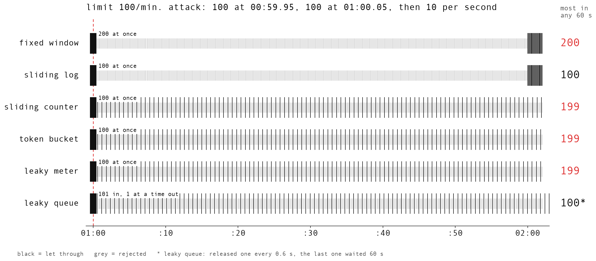
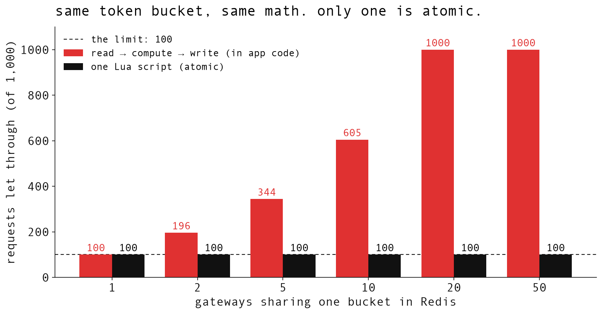

# ratelimit-from-scratch

five rate-limiting algorithms (six, counting both leaky buckets) as atomic Redis Lua scripts, plus every measurement behind my video [Token Bucket vs Leaky Bucket vs Sliding Window | Rate Limiting Explained](https://www.youtube.com/@ThatNotesGuy).

in short: "100 requests per minute" is a long-run average. every algorithm lets a different burst through, and the one most public APIs use (token bucket) let 199 through in a single minute. and if your limiter reads, computes and writes in separate steps, 20 servers sharing it let all 1,000 requests through a limit of 100.

everything here was measured on 2026-10-20, on Redis 7.4.11 (in OrbStack, on an M4 Pro Mac).

## setup

```bash
# a throwaway Redis on port 6390 (no persistence, 64 MB cap)
docker run -d --rm --name ratelimit-demo-redis -p 127.0.0.1:6390:6379 \
  redis:7-alpine redis-server --save '' --appendonly no --maxmemory 64mb

python3 -m venv .venv && .venv/bin/pip install -r requirements.txt
```

set `REDIS_URL` if your Redis lives somewhere else (default `redis://127.0.0.1:6390/0`).

## what's in here

| what | code | results |
|---|---|---|
| the six limiters, one Lua script each | `limiters.py` | |
| the boundary attack, against all six at once (~2 min) | `attack.py` | `results/attack*.json`, `results/logs/attack_run*.txt` |
| the race condition: read → compute → write vs one Lua script | `race.py` | `results/race.json`, `results/logs/race.txt` |
| LLM tokens per minute, with and without prompt caching | `llm_tokens.py` | `results/llm_tokens.json` |
| the charts from the video | `plot.py` | `plots/*.png` |

every script reads the clock with Redis `TIME`, so every caller shares one clock.

## the numbers

### the boundary attack (`attack.py`)

limit 100/min. the attacker waits for a minute boundary (by Redis's clock), then:

100 requests at 00:59.95 → 100 more at 01:00.05 → 10 per second for 62 seconds

every request goes through all six limiters (separate keys), so they all see the exact same traffic.

| algorithm | let through in the 0.1 s burst | most in any 60 s | longest wait |
|---|---|---|---|
| fixed window | 200 (in 0.102 s) | **200** | 0 |
| sliding log | 100 | 100 | 0 |
| sliding window counter | 100 | **199** | 0 |
| token bucket (100 tokens, 100/min) | 100 | **199** | 0 |
| leaky bucket, as a meter | 100 | **199** | 0 |
| leaky bucket, as a queue | 101 in (1 served, 100 waiting) | 100 out | **60 s** |

two runs, same counts both times (the burst took 0.102 s and 0.105 s).



a few things worth seeing in the raw data:

- token bucket and leaky meter made the same decision on all 820 requests. a leaky meter is a token bucket in a mirror (level = capacity − tokens).
- after its burst, the token bucket let one through every 0.59 to 0.61 s. that's the refill rate (100/min = one per 0.6 s), and it's why the minute ends at 199: the bound is `C + r × W`.
- the queue is the only one whose output never goes over 100 a minute (one every 0.600 s). the price: the last request waited 59.96 s.

### the race condition (`race.py`)

one token bucket in Redis (100 tokens), shared by N gateways. 1,000 requests in total, all gateways start at the same moment. gateways are threads, each with its own connection. median of 5 runs:

| gateways | read → compute → write | one Lua script |
|---|---|---|
| 1 | 100 | 100 |
| 2 | 196 | 100 |
| 5 | 344 | 100 |
| 10 | 605 | 100 |
| 20 | 1,000 (994 to 1,000) | 100 |
| 50 | 1,000 | 100 |

the Lua version let exactly 100 through in all 30 runs.

turns out it's not "overshoot by N − 1". two gateways read 50, both spend one, both write 49. that's two requests for one token. every lost update leaves an extra token behind, so it compounds. `MULTI/EXEC` doesn't fix it either (you can't branch on a value inside the transaction). one Lua script does.



### tokens per minute (`llm_tokens.py`)

LLM APIs limit tokens, not requests. same token bucket, the cost just isn't 1. this uses the example from [Anthropic's rate-limit docs](https://platform.claude.com/docs/en/api/rate-limits): a 2,000,000 input-tokens-per-minute limit, and requests that each send a 200,000-token document plus a 50-token question. for most Claude models, tokens read from the prompt cache don't count toward that limit.

| | requests let through (of 50) | input tokens processed | counted toward the limit |
|---|---|---|---|
| no cache | 9 | 1,800,450 | 1,800,450 |
| with cache | 50 | 10,002,500 | 202,500 |

this is my bucket with their numbers, not a call to their API.

## gotchas this code handles

- **INCR and EXPIRE in one script.** if a server crashes between them, the key never expires and that user is blocked forever.
- **rejected requests aren't logged** in the sliding log, or a client that keeps retrying never gets back under the limit.
- **one clock.** Redis `TIME` inside every script, so a gateway with a fast clock can't hand out extra tokens.
- the queue works like NGINX `limit_req` with `burst=100`: one request goes straight through, 100 wait their turn.
- dynamic key names (like `key:minute`) are fine on a single Redis. on Redis Cluster, put the user in a hash tag (`{user}:minute`) so both keys land on the same shard.

## sources

- Cloudflare, sliding window counter (0.003% of 400M requests): [counting things, a lot of different things](https://blog.cloudflare.com/counting-things-a-lot-of-different-things/)
- Stripe: [scaling your API with rate limiters](https://stripe.com/blog/rate-limiters)
- NGINX: [limit_req](https://nginx.org/en/docs/http/ngx_http_limit_req_module.html)
- GCRA: [brandur.org/rate-limiting](https://brandur.org/rate-limiting), [redis-cell](https://github.com/brandur/redis-cell)
- Anthropic: [rate limits](https://platform.claude.com/docs/en/api/rate-limits). OpenAI: [rate limits](https://developers.openai.com/api/docs/guides/rate-limits)

the code is short on purpose. it's for learning, not production. if you break one of these limiters in a way I didn't, I'd love to see it :)

MIT license.
